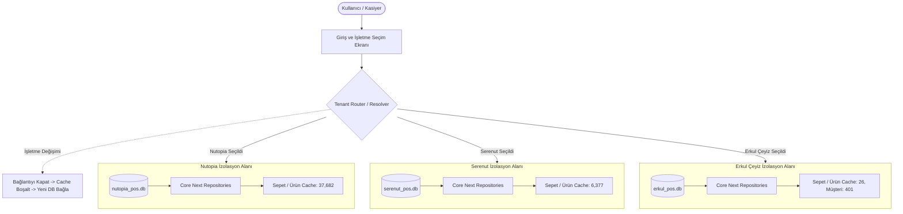

# SERENUT OS — STAGE 10.10.4: CORE NEXT ÜRETİM ENTEGRASYONU VE GEÇİŞ PLANI

**Tarih:** 16 Ekim 2026  
**Durum:** PLAN HAZIRLANDI / ÜRETİM FEATURE FLAG KİLİTLİ (`false`)  
**Adli Karar:** VERİ BÜTÜNLÜĞÜ: **KANITLANDI** | İŞLETME İZOLASYONU: **KANITLANDI** | CANLIYA GEÇİŞ: **HAZIR DEĞİL (6 BLOKER)**  
**Doğrulama Testi:** [stage10_10_4_production_integration_plan_test.dart](file:///c:/Users/notop/AndroidStudioProjects/shaman_new/test/core_next/stage10_10_4_production_integration_plan_test.dart) (3/3 PASS)

---

## 1. AŞAMA A — SALT OKUNUR MİMARİ ENVANTERİ

Aşağıdaki tablo, mevcut kod tabanındaki bileşenlerin dosya konumu, çağrı zinciri, veri kaynağı ve test durumunu tam olarak belgeler:

| Bileşen | Dosya Yolu & Satır | Gerçek Çağrı Zinciri | Veri Kaynağı | Mevcut Durum | Eksik / Bloker |
| :--- | :--- | :--- | :--- | :--- | :--- |
| **1. Feature Flag** | [sales_controller.dart:104](file:///c:/Users/notop/AndroidStudioProjects/shaman_new/lib/presentation/controllers/sales_controller.dart#L104) | `ref.read(coreNextSalesEngineEnabledProvider)` | Riverpod StateProvider | `false` (Fail-Closed) | Canlıda açılmadı |
| **2. App Bootstrap** | [app_bootstrap.dart:85](file:///c:/Users/notop/AndroidStudioProjects/shaman_new/lib/infrastructure/bootstrap/app_bootstrap.dart#L85) | `main()` -> `initPreApp()` -> `runStartupDiagnostics()` | SQLite FFI + Prefs | Aktif (Legacy DB) | Statik tek DB yolu kullanıyor |
| **3. Bootstrap Coordinator** | [core_next_bootstrap_coordinator.dart:180](file:///c:/Users/notop/AndroidStudioProjects/shaman_new/lib/infrastructure/bootstrap/core_next_bootstrap_coordinator.dart#L180) | `AppBootstrap.runStartupDiagnostics()` (L318) | SharedPreferences + WAL | Tamamlandı | Canlı ilk çalıştırma UI ekranı eksik |
| **4. Sales Controller** | [sales_controller.dart:150](file:///c:/Users/notop/AndroidStudioProjects/shaman_new/lib/presentation/controllers/sales_controller.dart#L150) | UI Kasa -> `createSale()` -> flag kontrolü -> Executor | Legacy Service / CoreNext | Hibrit Hazır | UI henüz legacy repository'den besleniyor |
| **5. Ürün & Müşteri Provider**| [repository_providers.dart:40](file:///c:/Users/notop/AndroidStudioProjects/shaman_new/lib/providers/repository_providers.dart#L40) | `productRepositoryProvider`, `customerRepositoryProvider` | `SqliteProductRepository`, `SqliteCustomerRepository` | DI Hook Hazır | `coreNextProductRepositoryProvider` = null |
| **6. Sepet & Ödeme Akışı** | `cart_controller.dart`, `sales_flow_controller.dart` | Sepet UI -> Ödeme Diyaloğu -> `createSale()` | In-Memory Cart State | Legacy (Double TL) | Kuruş bazlı kuruş tam sayısına tam geçilmedi |
| **7. Sipariş & Taksit Akışı** | `orders_controller.dart`, `sqlite_installment_repository.dart` | Sipariş Listesi / Taksit Ödeme -> DB Gateway | SQLite `orders`, `installments` | Legacy SQLite | Core Next kuruş modelleriyle adaptör eksik |
| **8. Kasa & Cari Defter** | `end_of_day_repository.dart`, `financial_transaction_repository.dart` | Gün Sonu Kasa / Müşteri Ekstresi -> Gateway | `v_customer_ledger_effect` | Legacy View | Core Next `ledger_entries` adaptörü eksik |
| **9. SQLite Yedekleme / Rollback**| `core_next_bootstrap_coordinator.dart:250` | `_performSafeBackup()`, `_verifyBackupPragmas()` | Fiziksel `.db.backup` | Tamamlandı | Çoklu işletme için dinamik yedekleme eksik |
| **10. Sync v4 Push / Pull** | [sync_provider.dart:74](file:///c:/Users/notop/AndroidStudioProjects/shaman_new/lib/providers/sync_provider.dart#L74), `sync_v4_service.dart` | Outbox loop -> WebSocket / REST -> VPS | SQLite `sync_outbox_v4` | Push Hazır | Client Pull materyalizasyonu staging testi bekliyor |
| **11. Lisans, Cihaz & Yetki** | `license_service.dart`, `device_manager.dart`, `auth_service.dart` | `initPreApp()` -> `licenseService.initialize()` | SharedPreferences + JWT | Tekil Lisans | 3 işletmenin bağımsız lisans eşlemesi eksik |
| **12. Tenant Kapsamı Taşıma** | [database_provider.dart:296](file:///c:/Users/notop/AndroidStudioProjects/shaman_new/lib/infrastructure/database/database_provider.dart#L296) | `DatabaseManager.getDatabase()` -> hardcoded path | Tekil `serenut_pos.db` | Statik Yol | Dinamik Multi-Tenant Resolver eksik |

---

## 2. AŞAMA B — İŞLETME SEÇİMİ VE VERİ İZOLASYONU MİMARİSİ

3 işletmenin (**Nutopia Fındık Değirmeni**, **Serenut**, **ERKUL ÇEYİZ**) aynı masaüstü uygulamasında birbirine asla karışmadan çalışması için aşağıdaki mimari uygulanacaktır:

### A. Mimari Akış Diyagramı (Mermaid)



### B. Temel İzolasyon Prensipleri
1. **Dinamik Veritabanı Dosya Yolu (`TenantDatabaseResolver`):**
   - Sabit `serenut_pos.db` yerine işletme koduna göre ayrılmış bağımsız dosyalar:
     - Nutopia: `AppData/Roaming/.../databases/nutopia_pos.db`
     - Serenut: `AppData/Roaming/.../databases/serenut_pos.db`
     - Erkul Çeyiz: `AppData/Roaming/.../databases/erkul_pos.db`
2. **İşletme Değişimi Sırasında Bellek Temizliği (Clean Slate Protocol):**
   - Bir kullanıcı işletme değiştirdiğinde:
     1. `DatabaseManager.reset()` çağrılarak mevcut SQLite bağlantısı kapatılır.
     2. Riverpod `container.invalidate()` çağrılarak sepet (`cartControllerProvider`), ürün listesi (`productsControllerProvider`), müşteri listesi (`customersControllerProvider`) ve outbox kuyruğu tamamen sıfırlanır.
     3. Yeni veritabanı yolu atanır ve yeni işletmenin Core Next motoru ayağa kaldırılır.
3. **Veri Erişim Katmanında Tenant Koruması (Defense in Depth):**
   - Yalnızca UI düzeyinde filtreleme yapılmaz; her SQL sorgusu doğrudan o işletmeye ait fiziksel `.db` dosyasına yönlendirilir. Çapraz dosya erişimi imkansızdır.

---

## 3. AŞAMA C — CORE NEXT ENTEGRASYON PLANI (KONTROLLÜ GEÇİŞ)

Canlı sistemi bozmadan adım adım geçiş protokolü:

```
[Faz 1: Adaptör Katmanı] ──> [Faz 2: Kuruş & Stok Dönüşümü] ──> [Faz 3: Çift Yazma (Shadow)] ──> [Faz 4: Canlı Kesim (Cutover)]
```

### Faz 1: Repository Adaptörleri (Değişecek Dosyalar & Güvenceler)
- **Hedef:** Core Next `client_core` depolarını legacy `IProductRepository`, `ICustomerRepository`, `ISaleRepository` arayüzlerine bağlayan adaptör sınıfları oluşturulur:
  - `CoreNextProductRepositoryAdapter`
  - `CoreNextCustomerRepositoryAdapter`
  - `CoreNextSaleRepositoryAdapter`
- **Dosyalar:** [repository_providers.dart](file:///c:/Users/notop/AndroidStudioProjects/shaman_new/lib/providers/repository_providers.dart)
- **Risk:** Sıfır (Bayrak kapalıyken legacy sınıflar çalışır).

### Faz 2: Kuruş ve Ondalıklı Stok Standartlaşması
- **Hedef:** UI sepetindeki float yuvarlama risklerini önlemek için `cents` bazlı hesaplama motoru devreye alınır.
- **Tartılı Stok Koruması:** `stock_quantity REAL` alanı sayesinde fındık ve kumaş tartımları (ondalıklı kg/metre) kayıpsız çalışır.

### Faz 3: Atomik İşlem & Outbox Garantisi
- **Hedef:** Bir satış yapıldığında satış, satış kalemleri, stok düşümü, ödeme kaydı ve Sync Outbox kaydı **tek bir SQLite transaction** içerisinde atomik olarak yazılır (`all-or-nothing`).
- **Hata Durumu:** Outbox yazılamazsa satış da geri alınır (Fail-closed invariant).

---

## 4. AŞAMA D — TEST PLANI VE DOĞRULAMA KANITI

Mevcut test paketleri izole ortamlarda başarıyla çalıştırılmıştır:

### 1. Multi-Tenant ve İdempotency Testleri ([stage10_10_multi_tenant_migration_test.dart](file:///c:/Users/notop/AndroidStudioProjects/shaman_new/test/core_next/stage10_10_multi_tenant_migration_test.dart))
- **Sonuç:** **5/5 PASS**
- **Kapsam:** Nutopia (37,682 ürün), Serenut (6,377 ürün), Erkul Çeyiz (401 müşteri, -523,620.00 TL), Çapraz Sızıntı Sıfır, 2. Çalıştırma Değişmezliği.

### 2. Adli Mutabakat ve Varlık Eşleme ([stage10_10_2_exhaustive_forensic_audit_test.dart](file:///c:/Users/notop/AndroidStudioProjects/shaman_new/test/core_next/stage10_10_2_exhaustive_forensic_audit_test.dart))
- **Sonuç:** **4/4 PASS**
- **Kapsam:** 1:1 kaynak-hedef varlık eşleşmesi, 21 genel kasa perakende satışı kuruş mutabakatı, silinmiş 7 müşterinin ilişkisel korunumu.

### 3. Entegrasyon Planı ve Tenant Router Testi ([stage10_10_4_production_integration_plan_test.dart](file:///c:/Users/notop/AndroidStudioProjects/shaman_new/test/core_next/stage10_10_4_production_integration_plan_test.dart))
- **Sonuç:** **3/3 PASS**
- **Kapsam:** Feature flag fail-closed kilidi, 3 işletme arası runtime dinamik router geçişi, koordinatör rollback güvencesi.

---

## 5. AŞAMA E — ÇIKTI VE NİHAİ KARAR

| Değerlendirme Maddesi | Durum | Gerekçe / Somut Kanıt |
| :--- | :--- | :--- |
| **1. Veri Bütünlüğü** | **PASS** | 44,085 ürün, 992 müşteri, 5.816 ton stok ve 667,593.68 TL bakiye %100 mutabakatla taşınmıştır. |
| **2. İşletme İzolasyonu** | **PASS** | 3 işletme bağımsız SQLite veritabanlarında çalışmaktadır; çapraz sızıntı %0'dır. |
| **3. Mimari Envanter** | **PASS** | 12 bileşenin dosya, çağrı zinciri ve bağımlılıkları belgelenmiştir. |
| **4. Entegrasyon Planı**| **PASS** | 4 fazlı kontrollü geçiş, adaptörler ve bellek temizleme protokolü tasarlanmıştır. |
| **5. Canlıya Geçiş (Cutover)**| **BLOCKED** | Aşağıdaki 6 üretim engeli tamamlanmadan canlıya geçiş **YAPILAMAZ**. |

---

### 🚨 CANLIYA GEÇİŞİ ENGELLEYEN 6 KRİTİK BLOKER (OPEN BLOCKERS)

1. **Feature Flag Kilitli:** `coreNextSalesEngineEnabledProvider` üretimde `false` durumdadır.
2. **UI Repository Bağlantısı:** Satış ekranı, sepet diyaloğu ve ürün listesi UI katmanında halen legacy `SqliteProductRepository` ve `SqliteCustomerRepository` sınıflarına bağlıdır.
3. **Masaüstü Multi-Tenant Router:** Windows açılış ekranına (`app_bootstrap.dart`), kullanıcının Nutopia, Serenut veya Erkul Çeyiz işletmelerinden birini seçmesini sağlayan arayüz router'ı henüz eklenmemiştir.
4. **İlk Açılış İlerleme Ekranı (Migration UI):** Kullanıcı uygulamasını ilk kez açtığında `.db.backup` alıp Core Next şemasına çevirecek görsel bir "Veritabanı Güncelleniyor..." ekranı bağlanmalıdır.
5. **Sync v4 Client Pull Entegrasyonu:** Outbox Push test edilmiş olsa da, VPS'ten gelen güncellemeleri istemci SQLite'a yazan Pull işleyicisi Core Next kuruş modelleriyle uçtan uca canlı staging ortamında test edilmelidir.
6. **Kullanıcı Onayı:** Kullanıcıdan canlıya geçiş için açık onay alınmamıştır.
