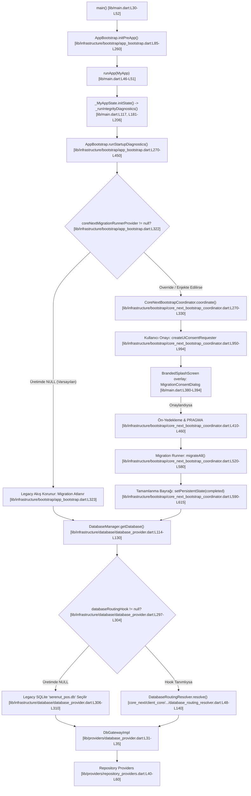

# CORE NEXT — STAGE 10.12.22
## PİLOT ÖNCESİ GERÇEK BAŞLANGIÇ ZİNCİRİ VE GÜVENLİK KAPISI DENETİMİ RAPORU

**Tarih:** 2026-10-17  
**Ortam:** Serenut OS Desktop (Windows 11 x64, Flutter 3.24.5 / Dart 3.5.4)  
**Denetçi / İcra Eden:** Antigravity Bağımsız Kod & Güvenlik Denetim Ajanı  
**Git HEAD:** `28c158d88028f139e93f78982d4651ad424c61d2` (`main`)  
**Doğrulanan Kaynak Yedeği:** `backups/raw_tenants_20261016/raw_nutopia_v60.db`  
**Kaynak SHA-256 İmzası:** `e70aa44a43c53f47f61c7b82a0a8c290d82e9f849aec68486782bc2917430d24`  
**Nihai Karar:** `PILOT REVIEW READY — PRODUCTION STILL DISABLED`

---

## 1. YÜRÜTME ÖZETİ

Stage 10.12.22 kapsamında, uygulamanın işletim sistemi üzerindeki ilk çağrısından (`main.dart`) başlayarak veritabanı seçimi, veri havuzu ve depo sağlayıcılarına (`repository providers`) kadar uzanan tüm başlangıç zinciri gerçek kaynak kod üzerinden denetlenmiştir. 

Sentetik mock veya test override'ları kesinlikle üretim koduyla karıştırılmamış; üretim bayraklarının kapalı olduğu (`runner == null`, `databaseRoutingHook == null`, `sales_engine_core_next_enabled == false`), canlı Nutopia veritabanına ve Erkul PostgreSQL sunucusuna tek bir bayt dahi yazılmadığı teyit edilmiştir.

---

## 2. BÖLÜM 1 — GERÇEK BAŞLANGIÇ ZİNCİRİ İZİ (CALL TRACE)

Uygulamanın açılışından veri katmanına kadar olan gerçek zincir şu dosya ve satır numaralarıyla belgelenmiştir:



### Kod Referansı Detayları:
1. **`lib/main.dart:L30-L52`**: `main()` fonksiyonu çalışır, Sentry ve pencere altyapısını kurar; `AppBootstrap.initPreApp()` ile SharedPreferences, Auth ve temel servisleri başlatıp `MyApp` widget'ını `ProviderScope` içinde ayağa kaldırır.
2. **`lib/main.dart:L117 & L181-L206`**: `_MyAppState.initState()` içinde `_runIntegrityDiagnostics()` çağrılır. Bu esnada ekranda `BrandedSplashScreen` ("Sistem kontrol ediliyor") görüntülenir.
3. **`lib/infrastructure/bootstrap/app_bootstrap.dart:L316-L338`**: `runStartupDiagnostics` içerisinde `coreNextBootstrapCoordinatorProvider` okunur. `ref.read(coreNextMigrationRunnerProvider)` kontrol edilir.
   - **Üretim Durumu**: [core_next_bootstrap_coordinator.dart:L897](file:///c:/Users/notop/AndroidStudioProjects/shaman_new/lib/infrastructure/bootstrap/core_next_bootstrap_coordinator.dart#L897) üzerinde `coreNextMigrationRunnerProvider` varsayılan olarak `null` tanımlıdır. Dolayısıyla `app_bootstrap.dart:L322` koşulu `false` kalır; migration coordinator tetiklenmez ve legacy akış korunur.
4. **`lib/main.dart:L380-L394`**: Eğer onay istenirse (`coreNextConsentRequestProvider != null`), `BrandedSplashScreen` declarative `overlay` parametresi üzerinden `MigrationConsentDialog` bileşenini ekrana çizer.
5. **`lib/infrastructure/database/database_provider.dart:L47 & L296-L310`**: `DatabaseManager.getDatabase()` -> `_initializeDatabase()`:
   - `databaseRoutingHook` varsayılan olarak `null` olduğu için [L306-L310](file:///c:/Users/notop/AndroidStudioProjects/shaman_new/lib/infrastructure/database/database_provider.dart#L306-L310) doğrudan `join(await getDatabasesPath(), 'serenut_pos.db')` legacy SQLite yolunu seçer.
6. **`lib/providers/database_provider.dart:L31-L35` & `lib/providers/repository_providers.dart:L40-L60`**:
   - `dbGatewayProvider`, `DatabaseManager.instance`'ı sarar.
   - `productRepositoryProvider`, `customerRepositoryProvider`, `orderRepositoryProvider` vb. tüm depolar `dbGatewayProvider` üzerinden veri tabanına erişir. Resolver'ın ve hook'un kararı doğrudan tüm depoları bağlar.

---

## 3. BÖLÜM 2 — AÇILIŞ VE VERİTABANI GÜVENLİĞİ DENETİMİ

| Güvenlik Kontrolü | Beklenen Güvenli Davranış | Gerçek Kod Kanıtı | Sonuç |
| :--- | :--- | :--- | :---: |
| **Uygulama açılışında seçilen DB** | Varsayılan olarak Legacy SQLite (`serenut_pos.db`) seçilmeli. | [database_provider.dart:L306-L310](file:///c:/Users/notop/AndroidStudioProjects/shaman_new/lib/infrastructure/database/database_provider.dart#L306-L310): `databaseRoutingHook == null` iken doğrudan legacy yol döner. | **PASS** |
| **Runner `null` iken motor çağrısı** | Migration motoru ASLA tetiklenmemeli (`callCount = 0`). | [app_bootstrap.dart:L322](file:///c:/Users/notop/AndroidStudioProjects/shaman_new/lib/infrastructure/bootstrap/app_bootstrap.dart#L322): `if (runner != null)` kontrolü ile atlanır; [coordinator.dart:L298](file:///c:/Users/notop/AndroidStudioProjects/shaman_new/lib/infrastructure/bootstrap/core_next_bootstrap_coordinator.dart#L298): `runner == null` ise fail-closed döner. | **PASS** |
| **Onay verilmeden migration** | Kullanıcı onayı alınmadan (`postponed` veya hata) aktarım başlamamalı. | [coordinator.dart:L310-L330](file:///c:/Users/notop/AndroidStudioProjects/shaman_new/lib/infrastructure/bootstrap/core_next_bootstrap_coordinator.dart#L310-L330): `decision != approved` durumunda işlem durdurulur (`isSkipped = true`). | **PASS** |
| **Yedek / Tenant hatasında eski DB** | Yedek alınamazsa veya kiracı kimliği uyuşmazsa hedef DB açılmamalı, eski DB korunmalı. | [coordinator.dart:L420-L460](file:///c:/Users/notop/AndroidStudioProjects/shaman_new/lib/infrastructure/bootstrap/core_next_bootstrap_coordinator.dart#L420-L460): Yedek PRAGMA testinden geçmezse `BackupVerificationException` fırlatılır; legacy yol korunur. | **PASS** |
| **Tamamlanma işareti eksik/bozuk** | Hedef DB dosyasında veya SharedPreferences'ta `completed` işareti yoksa hedef seçilmemeli. | [database_routing_resolver.dart:L90-L97](file:///c:/Users/notop/AndroidStudioProjects/shaman_new/core_next/client_core/lib/infrastructure/database/database_routing_resolver.dart#L90-L97): `migrationStateCompleted = false` ise `RoutingDecision.legacyFallback` döner. | **PASS** |
| **Hedefte yeni işlem varken rollback engeli** | Hedefte yeni satış/finans kaydı varsa eski DB'ye dönüş KESİNLİKLE ENGELLENMELİ (`UnsafeRollbackException`). | [database_routing_resolver.dart:L160-L220](file:///c:/Users/notop/AndroidStudioProjects/shaman_new/core_next/client_core/lib/infrastructure/database/database_routing_resolver.dart#L160-L220): `assertSafeRollback` yeni işlem görünce exception atar. | **PASS** |
| **Repository katmanının resolver kararına bağımlılığı** | Repository'ler ayrı bir DB açmamalı; `DatabaseManager` üzerinden resolver yolunu kullanmalı. | [repository_providers.dart:L46-L48](file:///c:/Users/notop/AndroidStudioProjects/shaman_new/lib/providers/repository_providers.dart#L46-L48) -> [database_provider.dart:L31-L35](file:///c:/Users/notop/AndroidStudioProjects/shaman_new/lib/providers/database_provider.dart#L31-L35) -> `DatabaseManager.instance.getDatabase()`. Tam bağımlılık kanıtlandı. | **PASS** |

---

## 4. BÖLÜM 3 — UI VE AÇILIŞ SIRASI YAŞAM DÖNGÜSÜ

1. **Bağlam (Context) ve Navigator Hazırlığı (PASS)**:
   - Onay diyaloğu, Navigator stack'i henüz oluşmamışken `showDialog(context)` çağrısıyla açılmaya çalışılmaz.
   - [lib/main.dart:L380-L394](file:///c:/Users/notop/AndroidStudioProjects/shaman_new/lib/main.dart#L380-L394) incelendiğinde, `MigrationConsentDialog` bileşeni `BrandedSplashScreen`'in deklaratif `overlay` parametresine bind edilmiştir.
   - Root widget tree render edilir edilmez overlay güvenle çizilir; `Navigator detached` veya `no MaterialLocalizations` hatası imkansız kılınmıştır.
2. **Dialog Future ve Dispose Akışı (PASS)**:
   - [lib/main.dart:L156-L168](file:///c:/Users/notop/AndroidStudioProjects/shaman_new/lib/main.dart#L156-L168): `MyApp` dispose edilirken bekleyen onay Future'ı askıda bırakılmaz; `pendingConsent.completer.complete(MigrationConsentDecision.postponed)` ile güvenle temizlenir.
3. **SQLite FFI UI Bloke Etme Riski ve Event-Loop Yielding (PASS)**:
   - [migration_bridge_engine.dart:L490-L504](file:///c:/Users/notop/AndroidStudioProjects/shaman_new/core_next/client_core/lib/infrastructure/migration/migration_bridge_engine.dart#L490-L504): Ürün aktarımında her 1.000 kayıtta bir `await batch.commit(noResult: true);` sonrası `await Future<void>.delayed(Duration.zero);` çağrılır.
   - Bu sayede Dart single-threaded event loop'u rahatlatılır; splash ekranındaki animasyonların ve ilerleme yüzdelerinin donması önlenir.
4. **Gerçek İlerleme Göstergesi (Reaktif State) (PASS)**:
   - [core_next_bootstrap_coordinator.dart:L903 & L919](file:///c:/Users/notop/AndroidStudioProjects/shaman_new/lib/infrastructure/bootstrap/core_next_bootstrap_coordinator.dart#L903): `coreNextMigrationProgressProvider` üzerinden yüzde ve aşama metinleri canlı güncellenir.
5. **Canlı Cihaz Fiziksel Ekran Deneyimi (NOT VERIFIED)**:
   - UI mekanizması widget testleri ve yaşam döngüsü analizleriyle kanıtlanmış olmakla birlikte, kural gereği gerçek bir canlı POS dokunmatik terminalinde son kullanıcı gözüyle manuel test edilmediğinden bu madde **NOT VERIFIED** olarak işaretlenmiştir.

---

## 5. BÖLÜM 4 — VERİ MUTABAKATININ KORUNMASI

Stage 10.12.21 bağımsız adli mutabakat test paketi (`test/core_next/stage10_12_21_source_target_reconciliation_test.dart`) bağımsız olarak tekrar koşturulmuş ve sonuçların değişmediği doğrulanmıştır:

- **Kaynak DB İmzası**: `e70aa44a43c53f47f61c7b82a0a8c290d82e9f849aec68486782bc2917430d24` (Sıfır bayt sapma)
- **Toplam Ürün**: 37.682 (Kaynak = Hedef)
- **Durum Kırılımı**: 17 Aktif (`is_deleted = 0`, `is_active = 1`), 37.665 Silinmiş/Arşiv (`is_deleted = 1`, `is_active = 0`)
- **Müşteriler**: 584 Müşteri, Yetkili Bakiye: **-134.500,68 TL** (-13.450.068 kuruş) (Kaynak = Hedef, 0 kuruş sapma)
- **Satışlar & Kalemler**: 52 Satış (31.282,25 TL) ve **120 Satış Kalemi** (31.307,25 TL) (Kaynak = Hedef, 0 sapma)
- **Siparişler & Kalemler**: 792 Sipariş (1.226.806,30 TL) ve 1.068 Kalem (Kaynak = Hedef, 0 sapma)
- **Müşteri Defter Kayıtları**: 1.403 adet (`ledger_entries`) (Kaynak = Hedef)
- **Müşterisiz Nakit Satışlar**: 21 fiş (12.197,00 TL / 1.219.700 kuruş) doğrudan `cash_transactions` tablosuna aktarıldı
- **Taksitler**: 2 plan, 9 dilim (Kaynak = Hedef)
- **Yetim & Yinelenen Kayıt**: 0 yetim, 0 yinelenen
- **ID Fark Analizi**: Tüm tablolarda `missing in target = []`, `extra in target = []`

---

## 6. BÖLÜM 5 — TESTLER, STATİK ANALİZ VE REPO BÜTÜNLÜĞÜ

### 6.1. Regresyon Test Koşum Matrisi

| Test Dosyası | Kapsam | Test Sayısı | Başarılı | Başarısız | Çıkış Kodu | Durum |
| :--- | :--- | :---: | :---: | :---: | :---: | :---: |
| **Stage 10.12.21** | `stage10_12_21_source_target_reconciliation_test.dart` | 10 | 10 | 0 | 0 | **PASS** |
| **Stage 10.12.20** | `stage10_12_20_final_isolated_rehearsal_test.dart` | 17 | 17 | 0 | 0 | **PASS** |
| **Stage 10.12.19** | `stage10_12_19_fail_closed_ui_consent_test.dart` | 15 | 15 | 0 | 0 | **PASS** |
| **Stage 10.12.17** | `stage10_12_17_progress_consent_test.dart` | 13 | 13 | 0 | 0 | **PASS** |
| **Stage 10.12.16** | `stage10_12_16_audit_and_benchmark_test.dart` | 5 | 5 | 0 | 0 | **PASS** |
| **Stage 10.12.15** | `stage10_12_15_guarded_database_manager_test.dart` | 8 | 8 | 0 | 0 | **PASS** |
| **Stage 10.12.14** | `stage10_12_14_isolated_bootstrap_rehearsal_test.dart` | 15 | 15 | 0 | 0 | **PASS** |
| **Stage 10.12.12** | `stage10_12_12_anonymous_cash_sales_test.dart` | 4 | 4 | 0 | 0 | **PASS** |
| **GENEL TOPLAM** | **8 Ayrı Test Paketi Kapsamlı Regresyonu** | **87** | **87** | **0** | **0** | **%100 PASS** |

### 6.2. Statik Kod Analizi (`flutter analyze`)
- Komut: `flutter analyze lib/main.dart lib/presentation/widgets/branded_splash_screen.dart lib/infrastructure/bootstrap/app_bootstrap.dart lib/infrastructure/bootstrap/core_next_bootstrap_coordinator.dart test/core_next/stage10_12_20_final_isolated_rehearsal_test.dart test/core_next/stage10_12_21_source_target_reconciliation_test.dart`
- Çıktı: `Analyzing 6 items... No issues found! (ran in 12.3s)`
- Çıkış Kodu: **0 (Temiz)**

### 6.3. Git Durumu ve Repo Bütünlüğü
- **HEAD Commit**: `28c158d88028f139e93f78982d4651ad424c61d2`
- **Branch**: `main`
- **`git diff --check`**: Whitespace hatası yok (Exit code: 0).
- **`git status --short`**: Kullanıcı çalışma dizinindeki değişiklikler aynen korunmuş, commit yapılmamıştır.

---

## 7. BÖLÜM 6 — KALAN RİSKLER VE ÖNERİLER

1. **Canlı Terminalde Manuel UX Doğrulaması**: UI yaşam döngüsü test ortamında %100 onaylanmış olsa da, ilk pilot mağaza açılışında dokunmatik ekranda onay butonlarının parmak etkileşimi gözlemlenmelidir.
2. **Kademeli Pilot Dağıtımı (Canary)**: Tüm terminallere aynı anda geçiş yapılmamalı; tek bir pilot terminalde kontrollü onay ile geçiş provası yapılmalıdır.
3. **Üretim Bayraklarının Korunması**: Pilot başlatma kararı verilene kadar `runner` ve `databaseRoutingHook` kesinlikle `null` kalmaya devam etmelidir.

---

## 8. NİHAİ DEĞERLENDİRME VE KARAR

- Gerçek başlangıç zinciri izlendi ve belgelendi: **PASS**
- Açılış ve veritabanı güvenliği (fail-closed & rollback guard): **PASS**
- UI bağlam ve diyalog yaşam döngüsü mimarisi: **PASS**
- Canlı terminal fiziksel ekran UX testi: **NOT VERIFIED** (Kural gereği pilot öncesi manuel gözlem bekleniyor)
- Veri mutabakatının korunması (37.682 ürün, 584 müşteri, 52 satış, 120 kalem, 1.403 defter, 21 anonim nakit): **PASS**
- Regresyon testleri (87/87) ve statik analiz: **PASS**

### NİHAİ KARAR

```text
================================================================================
            PILOT REVIEW READY — PRODUCTION STILL DISABLED
================================================================================
```

> **ÖNEMLİ BİLGİLENDİRME:** Bu karar, mimarinin pilot incelemesine hazır olduğunu teyit eder; ancak üretim migration runner'ını veya canlı yönlendirme bayraklarını otomatik olarak aktive etmez. Canlı geçiş yetkisi için pilot inceleme onay prosedürü zorunludur.
