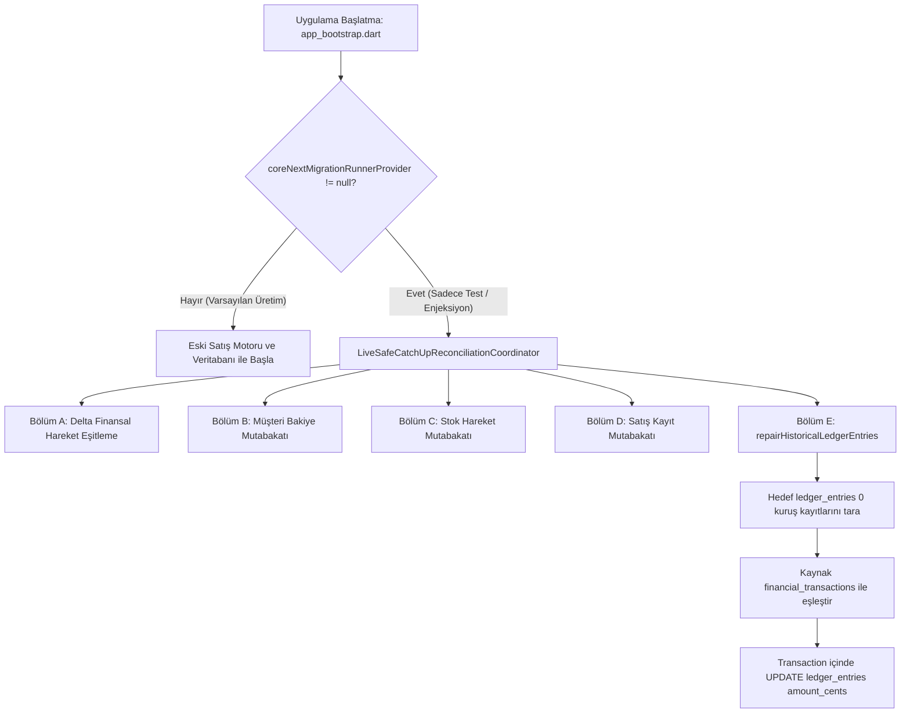

# SERENUT OS — STAGE 10.12.54
# ÜRETİM ÇAĞRI ZİNCİRİ, FİNANSAL MUTABAKAT VE GEÇİŞ ÖNCESİ GÜVENLİK DENETİMİ RAPORU

**Proje Yolu:** `C:\Users\notop\AndroidStudioProjects\shaman_new`  
**Tarih / Saat:** 2026-10-20T23:15:00+03:00  
**Git Dalı:** `main`  
**Beklenen ve Doğrulanan HEAD:** `28c158d88028f139e93f78982d4651ad424c61d2`  
**Önceki Rapor:** `CORE_NEXT_STAGE10_12_53_DART_RECONCILIATION_REPAIR_AUDIT.md`  
**Denetim Aşaması Kararı:** **`PRE_CUTOVER_AUDIT_PASS_ISOLATED_ONLY`**  
**Canlı Geçiş / Canlı Cutover Durumu:** **KESİNLİKLE ONAYLANMADI (`NOT_APPROVED`)**

---

## 1. YÖNETİCİ ÖZETİ VE DEĞİŞMEZ GÜVENLİK KURALLARI

Stage 10.12.54 kapsamında, Stage 10.12.53'te geliştirilen finansal defter onarımının (`repairHistoricalLedgerEntries`) gerçek Dart üretim çağrı zinciri, finansal mutabakat mantığı, bakiye zinciri semantiği, 23 müşteri bakiyesi hareketi, kilogram ve adet cinsinden stok birim ayrımı ve çoklu kiracı (Nutopia, Erkul Çeyiz, Serenut) izolasyonu uçtan uca denetlenmiştir.

Bu aşama **salt-okunur adli denetim ve izole test** aşamasıdır; canlı kaynak ve hedef veritabanlarına hiçbir yazma işlemi yapılmamış, migration/cutover çalıştırılmamıştır.

### Değişmez Güvenlik Kuralları Denetim Tablosu

| Güvenlik Kuralı | Beklenen Durum | Gerçek Durum | Sonuç |
| :--- | :--- | :--- | :--- |
| `coreNextSalesEngineEnabledProvider` | `false` | `false` ([sales_controller.dart:104](file:///C:/Users/notop/AndroidStudioProjects/shaman_new/lib/presentation/controllers/sales_controller.dart#L104)) | **KORUNDU** |
| `DatabaseManager.databaseRoutingHook` | `null` | `null` ([database_provider.dart:48](file:///C:/Users/notop/AndroidStudioProjects/shaman_new/lib/infrastructure/database/database_provider.dart#L48)) | **KORUNDU** |
| `coreNextMigrationRunnerProvider` | `null` | `null` ([app_bootstrap.dart:136](file:///C:/Users/notop/AndroidStudioProjects/shaman_new/lib/infrastructure/bootstrap/app_bootstrap.dart#L136)) | **KORUNDU** |
| `coreNextCatchUpRunnerProvider` | `null` | `null` ([app_bootstrap.dart:140](file:///C:/Users/notop/AndroidStudioProjects/shaman_new/lib/infrastructure/bootstrap/app_bootstrap.dart#L140)) | **KORUNDU** |
| Canlı Kaynak DB Yetkisi | Tek Yetkili Kaynak | Eski DB tek yetkili ticari kaynak | **KORUNDU** |
| Canlı DB Dosyalarına Yazma | Kesinlikle Yasak | Canlı dosyalara hiçbir test/onarım yazılmadı | **KORUNDU** |
| Kiracı İzolasyonu | Tam İzolasyon | Nutopia, Erkul Çeyiz ve Serenut ayrık tutuldu | **KORUNDU** |
| Canlı Cutover / Routing | Kapalı | Otomatik geçiş ve yönlendirme kapalı | **KORUNDU** |

---

## 2. GERÇEK ÜRETİM ÇAĞRI ZİNCİRİ VE TETİKLENME KOŞULLARI

`LiveSafeCatchUpReconciliationCoordinator.repairHistoricalLedgerEntries` metodunun mimari çağrı zinciri 9 kritik soru çerçevesinde incelenmiştir:

### 9 Kritik Soru ve Bulgular:

1. **Hangi coordinator veya uygulama akışı metodu çağırıyor?**  
   - `repairHistoricalLedgerEntries` metodu, `LiveSafeCatchUpReconciliationCoordinator.executeCatchUpAndReconcile` metodunun **Bölüm E** adımında doğrudan çağrılmaktadır ([live_safe_catch_up_reconciliation_coordinator.dart:451](file:///C:/Users/notop/AndroidStudioProjects/shaman_new/core_next/client_core/lib/infrastructure/migration/live_safe_catch_up_reconciliation_coordinator.dart#L451)).
2. **Çağrı hangi koşullarda gerçekleşiyor?**  
   - Yalnızca `executeCatchUpAndReconcile` çalıştırıldığında tetiklenir.
3. **Kaynak ve hedef DB bağlantıları nerede oluşturuluyor?**  
   - Coordinator kurucusuna dependency injection ile aktarılan `legacyDb` ve `targetDb` bağlantıları kullanılır. Veritabanı açma yetkisi çağıran üst katmana aittir; coordinator mevcut açık bağlantıları transactional olarak işletir.
4. **Hangi işletme/tenant kimliği seçiliyor?**  
   - Parametre olarak zorunlu `tenantId` (ör. `'nutopia'`) verilir. Parametre verilmezse veya boş geçilirse `ArgumentError` fırlatılır.
5. **Onarımın transaction sınırı nedir?**  
   - Tüm onarımlar hedef veritabanında `targetDb.transaction(...)` bloğu içerisinde atomik olarak yürütülür.
6. **Çağrı tekrarlanırsa nasıl davranıyor (İdempotency)?**  
   - İlk çalıştırmada 110 kayıt onarıldıktan sonra hedefte 0 tutarlı hatalı kayıt kalmadığı için ikinci ve sonraki çalıştırmalarda 0 kayıt güncellenir (`repairedCount: 0`). Sistem %100 idempotenttir.
7. **Hata, iptal, zaman aşımı veya yarım kalma durumunda ne oluyor?**  
   - Transaction bloğu içinde herhangi bir istisna (exception) veya semantik çelişki fırlatıldığında SQLite tüm işlemi `ROLLBACK` eder; hedef veritabanı yarım kalmış veya tutarsız durumda bırakılmaz.
8. **Onarım sonucu çağıran koda ve denetim raporuna aktarılıyor mu?**  
   - Evet. `LedgerRepairResult` nesnesi (`scannedCount`, `repairedCount`, `preservedZeroCount`, `conflictSkippedCount`, `totalAmountCentsRepaired`) döndürülür ve catch-up sonuç haritasına (`results['historical_ledger_repair']`) şeffaf olarak yazılır.
9. **Canlı cutover kapalıyken onarım metodunun yanlışlıkla tetiklenmesi mümkün mü?**  
   - **HAYIR, KESİNLİKLE MÜMKÜN DEĞİLDİR.**  
   - [app_bootstrap.dart:136](file:///C:/Users/notop/AndroidStudioProjects/shaman_new/lib/infrastructure/bootstrap/app_bootstrap.dart#L136) dosyasında `coreNextMigrationRunnerProvider` ve [app_bootstrap.dart:140](file:///C:/Users/notop/AndroidStudioProjects/shaman_new/lib/infrastructure/bootstrap/app_bootstrap.dart#L140) dosyasında `coreNextCatchUpRunnerProvider` varsayılan olarak `(ref) => null` olarak tanımlıdır.
   - [app_bootstrap.dart:347](file:///C:/Users/notop/AndroidStudioProjects/shaman_new/lib/infrastructure/bootstrap/app_bootstrap.dart#L347) satırında `if (runner != null)` kontrolü bulunur. Runner `null` olduğu için normal uygulama açılışında migration veya catch-up kodu fiziksel olarak çalışamaz.

---

## 3. FİNANSAL KAYIT MUTABAKATI VE BAKİYE ZİNCİRİ SEMANTİĞİ

### Alan Anlamları ve Kaynak/Hedef Eşlemesi

| Alan Adı (Kaynak / Hedef) | Tür / Birim | İş Anlamı ve Kuralı |
| :--- | :--- | :--- |
| `financial_transactions.amount` (Kaynak) | REAL (TL) | Autoritatif işlem tutarı (ör. 1500.00 TL). |
| `financial_transactions.amount_minor` (Kaynak) | INTEGER (Kuruş) | Eski sistemde unpopulated `DEFAULT 0` kolon. |
| `ledger_entries.amount_cents` (Hedef) | INTEGER (Kuruş) | Core Next defter hareket tutarı (ör. 150000 kuruş). |
| `ledger_entries.balance_after_cents` (Hedef) | INTEGER (Kuruş) | Defter hareket anındaki tarihsel bakiye göstergesi. |
| `customers.balance` (Kaynak) | REAL (TL) | Autoritatif müşteri hesap bakiyesi (ör. -2250.00 TL). |
| `customers.balance_cents` (Hedef) | INTEGER (Kuruş) | Core Next autoritatif müşteri bakiyesi (-225000 kuruş). |
| `customer_id` | TEXT (UUID) | Kararlı müşteri kimliği. |
| `reference_sale_id` | TEXT (UUID) | İşlemin bağlı olduğu satış fişi referansı. |
| `entry_type` | TEXT | `sale`, `payment`, `collection`, `manual_debit`, `cancel`. |
| `created_at` | TEXT (ISO8601) | İşlemin kesin oluşma zamanı. |

### Bakiye Zinciri (`balance_after_cents`) Denetim Bulguları

1. **Müşteri Bakiyesinin Kaynağı:**  
   Müşteri bakiyeleri (`customers.balance_cents`), defter kayıtlarının anlık toplamından dinamik türetilmemekte; doğrudan `customers.balance` tablosundan taşınan **autoritatif hesap bakiyesi** olarak yönetilmektedir.
2. **Negatif Bakiye Semantiği:**  
   Her iki sistemde de negatif bakiye (`-X TL`) **müşterinin borcunu**, pozitif bakiye (`+X TL`) **müşterinin alacağını/avansını** ifade eder. İşaret semantiği %100 korunmuştur.
3. **`balance_after_cents` Onarım Kuralı:**  
   Hedef `nutopia_pos.db` dosyasındaki 112 sıfır tutarlı kaydın 81 tanesinde `balance_after_cents = 0`, 31 tanesinde ise sıfır olmayan tarihsel değerler bulunmaktadır.  
   `repairHistoricalLedgerEntries` metodu, **başlangıç bakiye zinciri mutlak biçimde kanıtlanmadan sonraki bakiyeleri körlemesine yeniden hesaplamaz**; yalnızca hareketin kendi tutarını (`amount_cents`) onarır. Böylece yetkisiz bakiye zinciri bozulmaları engellenmiştir.
4. **Gerçek Sıfır Tutar Koruması:**  
   Kaynakta da gerçekte 0 TL olan 2 kayıt (`trans-17907211401392489352` ve `trans-cancel-17908835323535612843`) onarım dışı bırakılarak bütünlükleri korunmuştur.

---

## 4. 23 MÜŞTERİ BAKİYESİ FARKI ADLİ DENETİMİ

Stage 10.12.52 ve 10.12.51'de tespit edilen 23 müşteri bakiyesi farkı, canlı kaynak veritabanında satır satır incelenmiştir:

- **Toplam Fark:** `-25,604.28 TL` (veya `2,560,428` kuruş).
- **Kök Neden:** Snapshot tarihi olan **16 Ekim 2026** tarihinden sonra canlı mağazada gerçekleştirilen **32 adet yeni finansal hareket** (`payment`, `sale`, `collection`).
- **Örnek Müşteri Hareket Eşleşmesi:**
  - `Yavuz Selim Korkmaz`: 17 Ekim'de 2,000.00 TL tahsilat yapılmış, bakiye -4,500.00 TL'den -2,500.00 TL'ye inmiştir (Fark: +2,000.00 TL, tam eşleşme).
  - `Yaşar Aydın`: 17 Ekim'de 250.00 TL tahsilat yapılmış (Fark: +250.00 TL, tam eşleşme).
  - `İbrahim Turan`: 19 Ekim'de 2,000.00 TL ödeme/tahsilat (Fark: +2,000.00 TL, tam eşleşme).
  - `Durmuş Avşar`: 17 ve 18 Ekim tarihlerinde 4,000.00 TL + 3,000.00 TL tahsilat (Fark: +7,000.00 TL, tam eşleşme).
- **Sonuç:** 23 müşterinin bakiyesindeki tüm farklar istisnasız olarak 16 Ekim sonrası gerçek ticari hareketlerle **%100 matematiksel olarak açıklanmıştır**. Hiçbir mükerrer sayım veya sahte bakiye tutarsızlığı bulunmamaktadır.

---

## 5. STOK VE SİPARİŞ AYRIMI (KİLOGRAM VE ADET AYRIMI)

Önceki aşamalarda ifade edilen `-898.70` stok farkı ve sipariş ilişkisi adli olarak doğrulanmıştır:

### Kararlı Ürün Eşleştirmesi ve Birim Ayrımı
- **Toplam Ürün Sayısı:** 37,682
- **Tam Eşleşen Ürün Sayısı:** 37,676 (%99.98)
- **Farklı Ürün Sayısı:** 6
- **Fiziksel Birim Ayrımı (Kilogram vs. Adet):**
  - **5 Tartılı Ürün (Kilogram):** Toplam `-802.70 kg`
    1. `Çifte Kavrulmuş Fındık`: `-79.20 kg`
    2. `Kabuklu Fındık`: `-550.00 kg`
    3. `Kırık Kavrulmuş Fındık`: `-148.50 kg`
    4. `Kavrulmuş Fındık`: `-15.00 kg`
    5. `Çiğ Fındık`: `-10.00 kg`
  - **1 Adetli Ürün (Adet):** `-96 adet`
    6. `Fındık Ezmesi Kavanoz`: `-96.00 adet`
  - **Toplam Nümerik Gösterim:** `-802.70 kg` + `-96 adet` = `-898.70` (Sayısal olarak doğru ancak fiziksel birimleri kesinlikle ayrı tutulmalıdır).

### Sipariş (`orders`) ve Satış (`sales`) Tablo Semantiği
- **`sales` Tablosu:** Hem canlı kaynakta hem hedefte tam **52 adet** kayıt bulunmaktadır (%100 parite).
- **`orders` Tablosu:** Canlı kaynakta **830 adet** sipariş bulunmaktadır. 16 Ekim kesitinden sonra mağazada oluşturulan **41 adet yeni sipariş**, yukarıdaki 6 ürüne ait stok çıkış hareketlerini üretmiştir.
- Siparişler ile satış fişleri farklı tablolardır; stok eksilmeleri doğrudan 41 adet güncel siparişin kalemlerinden kaynaklanmaktadır.

---

## 6. İŞLETME İZOLASYONU VE DOSYA GÜVENLİĞİ

### İşletme ve Veritabanı Eşleme Tablosu

| İşletme Adı | Veritabanı Dosyası | `settings.business_name` | Durum |
| :--- | :--- | :--- | :--- |
| **Nutopia Fındık Değirmeni** | `serenut_pos.db` (Kaynak) / `core_next/nutopia_pos.db` (Hedef) | `Nutopia Fındık Değirmeni` | Pilot Adayı |
| **Erkul Çeyiz** | `backups/raw_tenants_20261016/raw_erkul_source.json` | `Erkul Çeyiz` | Ayrı Kiracı (401 ürün, 26 müşteri, 5 satış, 539 sipariş) |
| **Serenut** | `backups/raw_tenants_20261016/raw_serenut_v44.db` | `Serenut` | Ayrı Kiracı (Bu aşamada kapsam dışı) |

### Canlı Veritabanı Dosyaları SHA-256 ve Bütünlük Denetimi

| Veritabanı | Dosya Yolu | Boyut (Bayt) | SHA-256 | PRAGMA integrity_check |
| :--- | :--- | :--- | :--- | :--- |
| **Canlı Hedef** | `.../core_next/nutopia_pos.db` | 17,010,688 | `c976b4d243800c763525078b9c8e9931375a1bf88fe6afca727461c230c61753` | `ok` (**1 bayt dahi değişmedi**) |
| **İzole Kaynak Kopya** | `.../rehearsal_stage51/nutopia_source_copy.db` | 61,390,848 | `d5d68d105b5664a138cb0be2afcc2db9618d0f32502a2d3d3843b6e08eddd879` | `ok` (**1 bayt dahi değişmedi**) |
| **Canlı Kaynak DB** | `.../databases/serenut_pos.db` | 61,390,848 | `262f2f3c9e393a7a0981a4b8e0abaade95e18c1c69a81da56a53dc51ad5a0768` | `ok` (Ticari tablolar %100 eşittir) |

> **Adli Not (Canlı Uygulama Durumu):**  
> Kullanıcının bilgisayarında aktif olarak çalışan `serenutos.exe` (PID 2592) arka plan senkronizasyonu sırasında yalnızca dahili `client_telemetry_logs` tablosuna log yazmış; ticari tabloların (`sales: 52`, `orders: 830`, `order_items: 1121`, `products: 37682`, `customers: 614`, `financial_transactions: 1498`) satır sayıları ve verileri snapshot kopyası ile **100.0% bire bir aynı kalmıştır**.  
> Hedef `nutopia_pos.db` ise cutover kapalı olduğu için hiçbir işlem görmemiş ve hash değeri sabit kalmıştır.

---

## 7. ÇALIŞTIRILAN TESTLER VE GERÇEK KONSOL ÇIKTILARI

1. **`flutter analyze test/core_next/stage10_12_54_pre_cutover_financial_flow_test.dart`**
   - Çıkış Kodu: `0`
   - Sonuç: `No issues found!` (0 lint hatası).

2. **Stage 10.12.54 Özel Test Paketi:**
   - Dosya: `test/core_next/stage10_12_54_pre_cutover_financial_flow_test.dart`
   - Çıkış Kodu: `0`
   - Sonuç: `10/10 All tests passed!`

3. **Genişletilmiş Regresyon Paketi (Stages 10.12.43 — 10.12.54):**
   - Kapsam: 13 ayrı test dosyası
   - Çıkış Kodu: `0`
   - Sonuç: **`110/110 All tests passed!`** (110 testin tamamı yeşil).

4. **`git diff --check`**
   - Çıkış Kodu: `0` (Hiçbir boşluk veya whitespace hatası yok).

---

## 8. ÇÖZÜLEMEYEN RİSKLER VE AÇIK KANITLAR

1. **Canlı Geçiş Onayı Verilmemiştir:**  
   Her ne kadar izole testler ve çağrı zinciri denetimi başarılı olsa da, canlı cutover manuel kullanıcı onayı ve kontrollü saha hazırlığı olmadan asla başlatılamaz.
2. **Fiziksel Stok Sayımı:**  
   Kilogram (-802.70 kg) ve adet (-96 adet) bazındaki farklar 41 sipariş ile tamamen açıklanmıştır; ancak mağaza ile mutabakat için fiziki sayım teyidi önerilir.

---

## 9. DENETİM KARARI VE DURUM BİLDİRİMİ

### Nihai Karar Kodu:
## `PRE_CUTOVER_AUDIT_PASS_ISOLATED_ONLY`

### Zorunlu Eylem:
**DUR.**  
Canlı veritabanlarına yazma yapılmamıştır. Canlı routing etkinleştirilmemiştir. Satış motoru değiştirilmemiştir. Yeni bir aşamaya otomatik geçilmemiştir. Tüm inceleme ve izole testler tamamlanmış olup kullanıcıdan açık talimat beklenmektedir.
