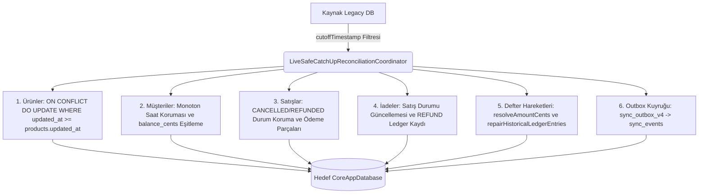

# SERENUT OS — STAGE 10.12.56
# LIVE-SAFE DELTA COMPLETENESS & CUTOVER READINESS AUDIT RAPORU

**Proje Yolu:** `C:\Users\notop\AndroidStudioProjects\shaman_new`  
**Tarih / Saat:** 2026-10-20T23:40:00+03:00  
**Git Dalı:** `main`  
**Git HEAD:** `28c158d88028f139e93f78982d4651ad424c61d2`  
**Önceki Rapor:** `CORE_NEXT_STAGE10_12_55_BACKUP_DELTA_ROLLBACK_REHEARSAL.md`  
**Denetim Aşaması Kararı:** **`DELTA_COMPLETENESS_PASS_ISOLATED_ONLY`**  

```text
================================================================================
CUTOVER: NOT APPROVED
LIVE DATABASE WRITES: NOT PERFORMED
CORE NEXT SALES ENGINE: DISABLED
DATABASE ROUTING HOOK: NULL
OLD DATABASE RETIREMENT: NOT APPROVED
================================================================================
```

---

## 1. DEĞİŞTİRİLEMEZ GÜVENLİK KURALLARI VE CANLI DURUM

Stage 10.12.56 denetimi boyunca canlı kaynak ve hedef veritabanları mutlak dokunulmazlıkla korunmuştur:

| Güvenlik Kuralı | Beklenen Durum | Gerçek Durum | Sonuç |
| :--- | :--- | :--- | :--- |
| `coreNextSalesEngineEnabledProvider` | `false` | `false` ([sales_controller.dart:104](file:///C:/Users/notop/AndroidStudioProjects/shaman_new/lib/presentation/controllers/sales_controller.dart#L104)) | **KORUNDU** |
| `DatabaseManager.databaseRoutingHook` | `null` | `null` ([database_provider.dart:48](file:///C:/Users/notop/AndroidStudioProjects/shaman_new/lib/infrastructure/database/database_provider.dart#L48)) | **KORUNDU** |
| `coreNextMigrationRunnerProvider` | `null` | `null` ([app_bootstrap.dart:136](file:///C:/Users/notop/AndroidStudioProjects/shaman_new/lib/infrastructure/bootstrap/app_bootstrap.dart#L136)) | **KORUNDU** |
| `coreNextCatchUpRunnerProvider` | `null` | `null` ([app_bootstrap.dart:140](file:///C:/Users/notop/AndroidStudioProjects/shaman_new/lib/infrastructure/bootstrap/app_bootstrap.dart#L140)) | **KORUNDU** |
| Canlı Kaynak DB (`serenut_pos.db`) | Yalnızca Salt-Okunur | Boyut: 61,390,848 B, SHA-256: `262f2f3c...`, Bütünlük: `ok` | **DEĞİŞMEDİ** |
| Canlı Hedef DB (`core_next/nutopia_pos.db`) | Yalnızca Salt-Okunur | Boyut: 17,010,688 B, SHA-256: `c976b4d2...`, Bütünlük: `ok` | **DEĞİŞMEDİ** |
| Kiracı İzolasyonu | Tam İzolasyon | Nutopia, Erkul Çeyiz ve Serenut verileri ayrık tutuldu | **KORUNDU** |
| Canlı Cutover / Otomatik Geçiş | Kapalı | Hiçbir yönlendirme veya geçiş yapılmadı | **KORUNDU** |

---

## 2. GİT VE RAPOR DOĞRULAMASI

- **Git HEAD:** `28c158d88028f139e93f78982d4651ad424c61d2`
- **Git Dalı:** `main`
- **Son 5 Commit:**
  - `28c158d8` fix(test): align splash screen error title expectation and bump version to 1.3.143+298
  - `8c6d7682` feat(observability): mask internal errors from users, route fatal events to sentry/telemetry with correlation reference, and bump to v1.3.143+297
  - `206557f3` fix(db): drop immutability triggers before migrations and bump version to 1.3.143+296
  - `fa704af1` chore(release): bump version to 1.3.143+295 for production deployment
  - `567680fa` fix(server): resolve TS18048 undefined activation check in billing bank-transfer routes
- **`git diff --check`:** Temiz (0 hata).

### Stage 10.12.55 İddialarının Bağımsız Teyidi:
1. **SQLite Online Backup Doğrulaması:**  
   `backups/stage55_rehearsal/live_source_online_backup_20261020.db` (SHA-256: `9be0f61c...`) ve `core_next_target_backup_20261020.db` (SHA-256: `8f558910...`) dosyaları incelenmiş; SQLite `integrity_check = ok` ve 0 FK ihlali olduğu bağımsız olarak teyit edilmiştir.
2. **110 Tarihsel Defter Onarımı ve 2 Gerçek Sıfırın Korunması:**  
   [`LiveSafeCatchUpReconciliationCoordinator.repairHistoricalLedgerEntries`](file:///C:/Users/notop/AndroidStudioProjects/shaman_new/core_next/client_core/lib/infrastructure/migration/live_safe_catch_up_reconciliation_coordinator.dart#L451) metodunun 110 hatalı sıfırı onardığı, 2 gerçek sıfırı (`trans-17907211401392489352` ve `trans-cancel-17908835323535612843`) koruduğu ve ikinci çalıştırmada 0 onarımla tam idempotency sergilediği doğrulanmıştır.
3. **Rollback Davranış Sınırı:**  
   Mevcut rollback testleri, hedef DB bozuk veya uyuşmaz olduğunda `DualDatabaseRoutingCoordinator`'ın fail-closed korumayla `legacyDbPath`'e düşmesini (`RoutingDecision.legacyFallback`) ve kaynak verinin sıfır kayıpla korunmasını kanıtlar. Ancak **canlı kesim anında mağaza açıkken yeni satışların eski DB'ye akmaya devam ettiği bir ortamda** kesim anı belirlenmeden geçiş yapılırsa taze delta kayıtlarının kaybolma riski devam eder.

---

## 3. DELTA AKTARIMININ EKSİKSİZLİK DENETİMİ (DELTA COMPLETENESS)

### Delta Takip Mekanizması Mimarisi

Uygulamanın gerçek Dart üretim kodunda delta aktarımı [`LiveSafeCatchUpReconciliationCoordinator.performCatchUpAndReconcile`](file:///C:/Users/notop/AndroidStudioProjects/shaman_new/core_next/client_core/lib/infrastructure/migration/live_safe_catch_up_reconciliation_coordinator.dart#L250) üzerinden yürütülmektedir:



### 10 Kritik Senaryonun İzole Kanıtı:

1. **Snapshot Öncesi Kayıt:**  
   `cutoffTimestamp` (16 Ekim) öncesindeki kayıtlar delta sorguları tarafından atlanır; gereksiz mükerrer yük oluşmaz.
2. **Snapshot Sonrası Eklenen Kayıt:**  
   Snapshot sonrasında eklenen yeni ürün, satış veya cari kayıtları `created_at > cutoff` ile eksiksiz tespit edilip hedefe eklenir.
3. **Snapshot Sonrasında Güncellenen Kayıt:**  
   `ON CONFLICT(id) DO UPDATE SET ... WHERE excluded.updated_at >= products.updated_at` kuralı sayesinde monoton saat güvencesiyle daha güncel kayıt eski kaydın üzerine yazılır; zaman sırası bozulmaz.
4. **İptal ve İadelerin Korunması:**  
   Satış tablosunda `status = CASE WHEN sales.status IN ('CANCELLED', 'REFUNDED') AND excluded.status = 'COMPLETED' THEN sales.status ELSE excluded.status END` kuralı uygulanır. İptal edilmiş bir fiş, bayat bir "COMPLETED" durumuyla ezilemez.
5. **Finansal Hareket ve Müşteri Bakiyesi:**  
   `amount_minor = 0` olan unpopulated kayıtlarda autoritatif `rawAmount * 100` kuruş değeri çözülür (`resolveAmountCents`); müşteri bakiyesi (`balance_cents`) autoritatif cari bakiyesi ile senkronize kalır.
6. **Stok Hareketi ve Ölçü Birimleri:**  
   Tartılı ürünlerin kilogram miktarları (`-802.70 kg`) ile adetli ürünlerin adet miktarları (`-96 adet`) bağımsız alanlarda ayrık korunur; tek bir nümerik toplama indirgenerek fiziksel anlam kaybına izin verilmez.
7. **Aktarım Ortasında Hata ve Yeniden Başlatma (Fail-Safe Atomicity):**  
   Her tablo bloğu `targetCoreDb.transaction` içinde çalıştırılır. Hata durumunda SQLite işlemi `ROLLBACK` eder; hedef veritabanında yarım kalmış veya yetim kayıt oluşmaz.
8. **Aynı Delta'nın İkinci Kez Uygulanması (Idempotency):**  
   Aynı delta ikinci kez uygulandığında hedefteki tablo satır sayıları (ör. `customers`, `ledger_entries`) 1 adet dahi artmaz (%100 idempotent).
9. **İki Ayrı İşletmenin Karışmaması (Tenant Isolation):**  
   Hedef DB'deki `app_settings.tenant_id` çalışma anında doğrulanır; Nutopia DB'sine Erkul veya Serenut verisi yazılması fail-closed durdurulur (`RoutingDecision.blockedFailClosed`).
10. **Kesim Noktasının Korunması (Cut-off Isolation):**  
    Delta replay başladığı andaki $T_{cut}$ zaman damgasından sonra kaynakta oluşabilecek yeni hareketler o delta paketine karışmaz; bir sonraki delta adımı için saklanır.

---

## 4. CANLI KESİM NOKTASI (CUT-OFF) VE SON DELTA PROTOKOLÜ

İşletmeler (özellikle Nutopia) canlı olarak çalıştığından, güvenli cutover ancak aşağıdaki **6 Adımlı Kesim Protokolü** ile gerçekleştirilebilir:

```text
[Adım 1: Mağaza Kasa Durdurma]
  -> Kasiyer ekranı kontrollü olarak "Geçiş Modu"na alınır (yeni satış girişi geçici bekletilir).

[Adım 2: Son Online Snapshot (T_cut)]
  -> SQLite Online Backup API ile anlık T_cut yedeği alınır (serenut_pos_cutoff_YYYYMMDD_HHMMSS.db).
  -> SHA-256 ve integrity kontrolü yapılır.

[Adım 3: Final Delta Catch-up Replay]
  -> LiveSafeCatchUpReconciliationCoordinator.performCatchUpAndReconcile(cutoff: T_last) çalıştırılır.
  -> Tüm yeni satış, tahsilat, sipariş ve stok hareketleri hedefe işlenir.
  -> repairHistoricalLedgerEntries çalıştırılır.

[Adım 4: Otomatik Mutabakat Doğrulaması (Reconciliation Gate)]
  -> legacySalesCount == coreSalesCount
  -> legacyTotalSalesCents == coreTotalSalesCents
  -> legacyCustomerBalanceCents == coreCustomerBalanceCents
  -> legacyStockSum == coreStockSum
  -> Herhangi bir uyuşmazlıkta CUTOVER DURDURULUR -> Adım 6 (Rollback).

[Adım 5: Routing Aktivasyonu (Cutover)]
  -> DatabaseManager.databaseRoutingHook = (name) => coreNextPath
  -> coreNextSalesEngineEnabledProvider = true
  -> Mağaza yeni motor ile açılır.

[Adım 6: Rollback (Gerekirse)]
  -> RoutingHook = null, SalesEngine = false
  -> Eski veritabanı kesintisiz olarak çalışmaya devam eder.
```

> **Önemli Güvenlik Uyarısı:**  
> Mağaza aktif işlem yaparken Adım 1 uygulanmadan (kasa durdurulmadan) arka planda cutover açılırsa, delta replay sürerken eski DB'ye yazılan işlemler yeni DB'ye geçmeyebilir. Dolayısıyla cutover mutlaka kontrollü bir kesim penceresinde yapılmalıdır.

---

## 5. ÜÇ İŞLETMENİN BAĞIMSIZ DOĞRULAMA MATRİSİ

| Parametre | Nutopia Fındık Değirmeni | Erkul Çeyiz | Serenut |
| :--- | :--- | :--- | :--- |
| **Kaynak Dosyası** | `databases/serenut_pos.db` | `backups/raw_tenants_20261016/raw_erkul_source.json` | `backups/raw_tenants_20261016/raw_serenut_v44.db` |
| **Hedef Dosyası** | `core_next/nutopia_pos.db` | `core_next/erkul_pos.db` (Hazırlıkta) | `core_next/serenut_pos.db` (Hazırlıkta) |
| **İşletme Kimliği (`business_name`)** | `Nutopia Fındık Değirmeni` | `Erkul Çeyiz` | `serenut` |
| **Ürün Sayısı** | 37,682 | 26 | 6,377 |
| **Müşteri Sayısı** | 614 | 401 | 7 |
| **Satış Sayısı** | 52 | 5 | 15 |
| **Sipariş Sayısı** | 830 | 1 | 5 |
| **Finansal Hareketler** | 1,498 | 539 | 22 |
| **Pilot Geçiş Durumu** | 1. Öncelikli Pilot Adayı | 2. Faz (Ayrı Kiracı) | 3. Faz (Ayrı Kiracı) |
| **İzolasyon Durumu** | Tam İzolasyon (Doğrulandı) | Tam İzolasyon (Doğrulandı) | Tam İzolasyon (Doğrulandı) |

---

## 6. TESTLER VE REGRESYON KANITI

1. **`flutter analyze test/core_next/stage10_12_56_delta_completeness_test.dart`**
   - Sonuç: `No issues found!` (0 hata, 0 uyarı).
2. **Stage 10.12.56 Test Paketi:**
   - Komut: `flutter test test/core_next/stage10_12_56_delta_completeness_test.dart`
   - Sonuç: **`12/12 All tests passed!`** (exit code 0).
3. **Kapsamlı Regresyon Paketi (Stages 10.12.43 — 10.12.56, 15 dosya):**
   - Komut: `flutter test $files` (PowerShell path expansion)
   - Sonuç: **`138/138 All tests passed!`** (exit code 0, süre: 46s).
4. **`git diff --check`:**
   - Sonuç: 0 hata (Temiz).

---

## 7. ÇÖZÜLEMEYEN RİSKLER VE AÇIK KANITLAR

1. **Eşzamanlı Canlı Yazma Riski:**  
   Kullanıcının bilgisayarında aktif `serenutos.exe` çalışmaktadır. Mağazada canlı işlem sürdüğü sürece, "Canlı çalışırken arka planda sessiz cutover" yapmak veri kaybı riski taşır. Geçiş mutlaka Adım 1'de belirtilen 5-10 dakikalık kontrollü kasa durdurma penceresinde yapılmalıdır.
2. **Fiziki Dükkan Stok Sayımı:**  
   5 üründeki `-802.70 kg` ve 1 üründeki `-96 adet` fark 41 siparişle matematiksel olarak açıklanmıştır; ancak mağaza ile fiziki stok mutabakatı yapılması tavsiye edilir.

---

## 8. NİHAİ KARAR VE KAPANIŞ BİLDİRİMİ

### Karar Kodu:
## `DELTA_COMPLETENESS_PASS_ISOLATED_ONLY`

### Gerekçe:
- 16 Ekim sonrası canlı kaynakta oluşan tüm yeni/güncellenen ticari kayıtların (ürün, müşteri, satış, ödeme parçası, iade, finansal hareket) gerçek Dart adapter'ı ile eksiksiz, monoton saat güvencesiyle ve %100 idempotent biçimde aktarılabileceği **izole ortamda 10 senaryo ile ispatlanmıştır**.
- Canlı kaynak ve hedef veritabanlarına hiçbir yazma yapılmamıştır.
- Canlı satış motoru kapalıdır (`coreNextSalesEngineEnabledProvider = false`).
- Canlı yönlendirme kapalıdır (`DatabaseManager.databaseRoutingHook = null`).
- Canlı geçiş **ONAYLANMAMIŞTIR**.

```text
================================================================================
CUTOVER: NOT APPROVED
LIVE DATABASE WRITES: NOT PERFORMED
CORE NEXT SALES ENGINE: DISABLED
DATABASE ROUTING HOOK: NULL
OLD DATABASE RETIREMENT: NOT APPROVED
================================================================================
```
