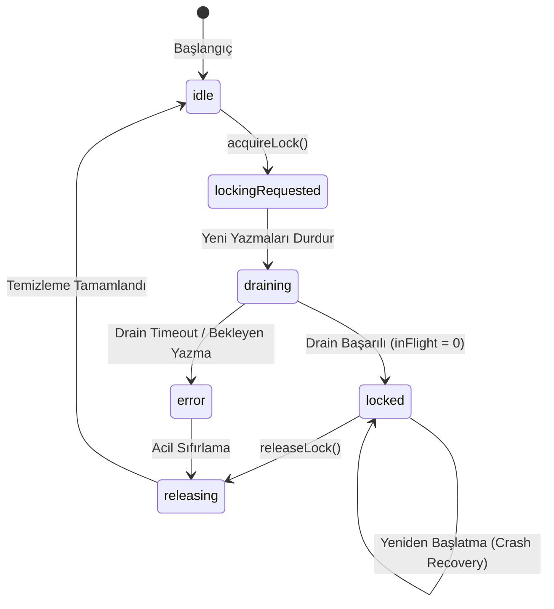

# SERENUT OS — STAGE 10.12.58
# CENTRAL CUTOFF LOCK & IN-FLIGHT TRANSACTION DRAINER DESIGN AUDIT

**Proje Yolu:** `C:\Users\notop\AndroidStudioProjects\shaman_new`  
**Tarih / Saat:** 2026-10-20T23:55:00+03:00  
**Git Dalı:** `main`  
**Git HEAD:** `28c158d88028f139e93f78982d4651ad424c61d2`  
**Önceki Rapor:** `CORE_NEXT_STAGE10_12_57_CUTOVER_PROTOCOL_AUDIT.md`  
**Aşama Kararı:** **`CUTOFF_LOCK_DESIGN_PASS_ISOLATED_ONLY`**  
**Canlı Geçiş Kapısı:** **`BLOCKED_UNPROTECTED_WRITE_PATHS`**

```text
================================================================================
CUTOVER: NOT APPROVED
LIVE DATABASE WRITES: NOT PERFORMED
CORE NEXT SALES ENGINE: DISABLED
DATABASE ROUTING HOOK: NULL
OLD DATABASE RETIREMENT: NOT APPROVED
================================================================================
```

---

## 1. ZORUNLU GÜVENLİK SINIRLARI VE CANLI DURUM TEYİDİ

Stage 10.12.58 süresince canlı SQLite ve PostgreSQL veritabanlarına kesinlikle hiçbir yazma, onarım, migrasyon veya canlı işlem yapılmamıştır. Canlı DB özetleri SHA-256 düzeyinde doğrulanmış ve değişmediği kanıtlanmıştır:

| Güvenlik Kriteri | Beklenen Durum | Gerçek Durum | Sonuç |
| :--- | :--- | :--- | :--- |
| `coreNextSalesEngineEnabledProvider` | `false` | `false` ([sales_controller.dart:104](file:///C:/Users/notop/AndroidStudioProjects/shaman_new/lib/presentation/controllers/sales_controller.dart#L104)) | **KORUNDU** |
| `DatabaseManager.databaseRoutingHook` | `null` | `null` ([database_provider.dart:48](file:///C:/Users/notop/AndroidStudioProjects/shaman_new/lib/infrastructure/database/database_provider.dart#L48)) | **KORUNDU** |
| Canlı Kaynak DB (`serenut_pos.db`) | Yalnızca Salt-Okunur | Boyut: 61,390,848 B, SHA-256: `262f2f3c9e393a7a0981a4b8e0abaade95e18c1c69a81da56a53dc51ad5a0768`, Bütünlük: `ok` | **DEĞİŞMEDİ** |
| Canlı Hedef DB (`core_next/nutopia_pos.db`) | Yalnızca Salt-Okunur | Boyut: 17,010,688 B, SHA-256: `c976b4d243800c763525078b9c8e9931375a1bf88fe6afca727461c230c61753`, Bütünlük: `ok` | **DEĞİŞMEDİ** |
| Kiracı Ayrımı | Tam Ayrım | Nutopia Fındık Değirmeni, Erkul Çeyiz ve Serenut verileri ayrık tutuldu | **KORUNDU** |
| Canlı Kasa / Satış Testi | 0 Test | Canlı sistemde hiçbir sipariş, ödeme, stok testi yapılmadı | **KORUNDU** |
| Git Yayın Durumu | No Commit / Push | Yerel izole geliştirme; push veya release yapılmadı | **KORUNDU** |

---

## 2. MEVCUT YAZMA YOLLARININ KOD DÜZEYİNDE ADLİ ENVANTERİ

Uygulamanın gerçek çağrı zincirleri (`SalesController`, `OrdersController`, `SqlitePaymentRepository`, `InventoryService`, `SyncNotifier`, `TelemetryUploadService`, `CrashRecoveryManager`, `PersistentPrintQueue`) baştan sona taranmış ve mevcut üretim kodundaki güvenlik durumları sınıflandırılmıştır:

| No | Yazma Yolu | Gerçek Çağrı Zinciri | Sınıflandırma | Mevcut Kod Gerçeği ve Risk |
| :---: | :--- | :--- | :---: | :--- |
| **1** | **`SalesController.createSale`** | `SalesController` $\rightarrow$ `_salesService.createSale` $\rightarrow$ `_saleRepository.create` $\rightarrow$ `DbGateway.transaction` | **`UNPROTECTED`** | `SalesController` içinde merkezi bir bakım/kesim kilidi kontrolü **yoktur**. `DbGatewayImpl` içindeki `DatabaseManager.isWriteLocked` bayrağı yalnızca 30 saniye sonra generic hata fırlatır; kullanıcıya açık bir geçiş banner'ı veya kontrollü bekletme sunmaz. |
| **2** | **Sipariş Oluşturma ve Güncelleme** | `OrdersController.addOrder` / `updateOrder` $\rightarrow$ `SqliteOrderRepository` $\rightarrow$ `DbGateway` | **`UNPROTECTED`** | Kasiyer sipariş oluşturabilir, sipariş güncelleyebilir veya siparişi silebilir. Merkezi kilit olmadan geçiş başlatılırsa sipariş yazmaları eski DB'de devam eder. |
| **3** | **Tahsilat, Ödeme ve İptal** | `OrdersController.recordOrderPayment` / `refundOrder` $\rightarrow$ `SqlitePaymentRepository` $\rightarrow$ `DbGateway` | **`UNPROTECTED`** | Ödeme tahsilatları ve iadeler `DbGateway` üzerinden yazılır ancak hiçbir kesim kilidi mekanizmasına bağlı değildir. |
| **4** | **Stok Hareketleri** | `SalesService` $\rightarrow$ `InventoryService.decrementStock` $\rightarrow$ `SqliteProductRepository` | **`UNPROTECTED`** | Satış veya iade sırasında stok güncellemeleri doğrudan yazılır; kilit kontrolü yoktur. |
| **5** | **Müşteri Bakiyesi ve Finansal Defter** | `SqliteCustomerRepository` / `SqliteAccountTransactionRepository` | **`UNPROTECTED`** | Cari hesap bakiye değişiklikleri ve vadeli borç yazmaları kilitsizdir. |
| **6** | **`SyncNotifier.triggerSync`** | `SyncNotifier` $\rightarrow$ `SyncStateMachine` $\rightarrow$ raw `DatabaseManager().getDatabase()` | **`UNPROTECTED`** | Arka plan senkronizasyonu `DbGateway` katmanını **tamamen bypass eder**; ham `Database` örneği üzerinden `sync_outbox_v4`, `sync_cursor_v4` ve log tablolarına doğrudan yazar. |
| **7** | **Outbox ve `sync_events`** | `SyncOutboxV4.enqueue` | **`PARTIALLY_PROTECTED`** | Domain transaction'ı içindeyse transaction'a tabidir, ancak bağımsız çağrıldığında kilit mekanizması yoktur. |
| **8** | **Log ve Telemetri Yazmaları** | `TelemetryUploadService.recordMetric` $\rightarrow$ raw `getDatabase()` $\rightarrow$ `db.insert('client_telemetry_logs')` | **`UNPROTECTED`** | `DbGateway` ve tüm kilitler atlanarak doğrudan ham SQLite tablosuna yazılır. Kesim anında WAL lock çakışmasına neden olabilir. |
| **9** | **Yazdırma Kuyruğu** | `PersistentPrintQueue` $\rightarrow$ raw `getDatabase()` | **`UNPROTECTED`** | Fiş ve etiket kuyruğu doğrudan SQLite'a yazar. |
| **10** | **Arka Plan İşleri & Isolate'lar** | `sqflite_common_ffi` C worker threads / Sync background timers | **`NOT_VERIFIABLE`** | C kütüphanesi düzeyindeki isolate thread'leri çalışma anında işletim sistemi seviyesinde kilit alabilir; uygulama katmanından izole thread durumunu doğrulamak mümkün değildir. |

> **Kritik Denetim Tespiti:**  
> Canlı sistemdeki tüm ticari yazma yolları (`SalesController`, `OrdersController`, `SyncNotifier`, `TelemetryUploadService`) şu anda **`UNPROTECTED`** durumdadır. Bu nedenle, kilit tasarımı ne kadar mükemmel olursa olsun, **üretim çağrı zincirleri bu kilide bağlanana kadar canlı geçiş kesinlikle onaylanamaz (`CUTOVER: NOT APPROVED`)**.

---

## 3. MERKEZİ KESİM KİLİDİ TASARIMI (CUTOFF MAINTENANCE LOCK)

Gerçekleştirilen dosya:  
[`core_next/client_core/lib/infrastructure/migration/cutoff_maintenance_lock.dart`](file:///C:/Users/notop/AndroidStudioProjects/shaman_new/core_next/client_core/lib/infrastructure/migration/cutoff_maintenance_lock.dart)

### 3.1. Durum Makinesi (State Machine)
Kilit şu durumları deterministik olarak yönetir:


### 3.2. Temel Mimari Prensipleri
1. **Merkezi Kontrol Noktası:**  
   `lock.assertWritePermitted({required String operation})` metodu, sistem `idle` fazında değilse `CutoffMaintenanceActiveException` fırlatır.
2. **Kullanıcı Bilgilendirme Banner'ı:**  
   `state.userFacingBanner` aracılığıyla kasiyere "Sistem bakım ve veri güvenliği geçişi modunda. Yeni işlemler geçici olarak bekletilmektedir." mesajı verilir; sessiz takılma engellenir.
3. **Uygulama Yeniden Başlatma / Çökme Koruması (Fail-Closed on Reboot):**  
   `IMaintenancePersistenceStorage` arayüzü ile kilit durumu diske/ayarlara yazılır. Uygulama kilitliyken veya boşaltma sürerken çökerse, yeniden başlatmada `initializeFromStorage()` kilidi otomatik olarak `locked` fazında açar ve `errorMessage` ile belirsiz yazmaları önler.
4. **Zaman Aşımında Otomatik Yönlendirme Açılmaması:**  
   Timeout durumunda kilit `error` fazına geçer; routing hook `null` kalmaya devam eder.
5. **Kontrollü Normal Moda Dönüş:**  
   `releaseLock()` çağrıldığında drainer sıfırlanır, kalıcı kayıt temizlenir ve `idle` durumuna geçilir.

---

## 4. IN-FLIGHT TRANSACTION DRAINER TASARIMI

[`InFlightTransactionDrainer`](file:///C:/Users/notop/AndroidStudioProjects/shaman_new/core_next/client_core/lib/infrastructure/migration/cutoff_maintenance_lock.dart#L125) bileşeni geliştirilmiş ve doğrulanmıştır:

1. **Aktif Sayaç Takibi:**  
   `runTrackedWrite` metodu her yazma başlangıcında `_activeWrites` sayacını artırır ve `finally` bloğunda eksiltir.
2. **Asenkron Boşaltma (Drain):**  
   `drain({Duration? timeout})` metodu çağrıldığında:
   - Eğer `_activeWrites == 0` ise anında `true` döner.
   - Eğer devam eden yazma varsa, `Completer<void>` kurarak son işlemin bitmesini bekler.
   - Varsayılan 15 saniyelik süre aşılırsa `TimeoutException` yakalanır ve `false` dönülerek geçiş durdurulur.
3. **Snapshot Onay Kapısı:**  
   `isSafeForSnapshot` kuralı:
   $$\text{SafeForSnapshot} \iff (\text{phase} == \text{locked}) \land (\text{inFlightCount} == 0)$$
   Bekleyen tek bir yazma bile varken snapshot alınamaz.

---

## 5. KALICI KESİM NOKTASI (CUTOVER CHECKPOINT) TASARIMI

Salt zaman damgasına dayalı olmayan, kriptografik ve sıra numaralı kesim noktası mimarisi [`CutoverCheckpoint`](file:///C:/Users/notop/AndroidStudioProjects/shaman_new/core_next/client_core/lib/infrastructure/migration/cutoff_maintenance_lock.dart#L280) olarak modellenmiştir:

### 5.1. Checkpoint Veri Alanları
- **`tenantId`**: İşletme kimliği (`tenant_nutopia`, `tenant_erkul`, `tenant_serenut`).
- **`sourceDbId` / `targetDbId`**: Veritabanı dosyalarının SHA-256 kriptografik parmak izleri.
- **`snapshotId` / `snapshotTimestamp`**: SQLite Online Backup ile alınan anlık kopyanın benzersiz kimliği ve ISO-8601 UTC zamanı.
- **`lastSequenceId`**: Yakalanan son defter/hareket sıra numarası (monoton artan ID).
- **`reconciliationHash`**: Kaynak ve hedef arasındaki mutabakat çıktısının SHA-256 özeti.
- **`status`**: Durum (`pending`, `in_progress`, `reconciled`, `committed`, `rolled_back`, `failed`).
- **`version`**: İyimser eşzamanlılık sayacı (Optimistic Concurrency Control).
- **`failureReason` & `retryCount`**: Başarısızlık nedeni ve tekrar deneme bilgisi.

### 5.2. Atomiklik ve İyimser Eşzamanlılık Koruması
[`ICutoverCheckpointRepository.advanceCheckpoint`](file:///C:/Users/notop/AndroidStudioProjects/shaman_new/core_next/client_core/lib/infrastructure/migration/cutoff_maintenance_lock.dart#L355):
İki eşzamanlı işlem (örneğin iki ayrı servis veya isolate) aynı checkpoint'i ilerletmeye çalıştığında, sürüm numarası (`version`) kontrol edilir. İlk işlemi tamamlayan sürümü $N+1$ yapar; ikinci işlem $N$ sürümünü güncellemeye çalıştığı anda işlem reddedilir (`OptimisticLockFailure`).

---

## 6. ÇALIŞTIRILMIŞ İZOLE TESTLER VE GERÇEK KANITLAR

### 6.1. Stage 10.12.58 Zorunlu 10 Senaryo Testi
[`test/core_next/stage10_12_58_cutoff_lock_drainer_test.dart`](file:///C:/Users/notop/AndroidStudioProjects/shaman_new/test/core_next/stage10_12_58_cutoff_lock_drainer_test.dart) çalıştırılmış ve **12 testin tamamı (10 senaryo + 2 değişmez kural) başarıyla geçmiştir**:

```text
00:00 +0: STAGE 10.12.58: Değişmez Güvenlik Sınırları Kural 1: coreNextSalesEngineEnabledProvider varsayılan olarak kesinlikle false kalmalı
00:00 +1: STAGE 10.12.58: Değişmez Güvenlik Sınırları Kural 2: DatabaseManager.databaseRoutingHook kesinlikle null kalmalı
00:00 +2: STAGE 10.12.58: 10 Zorunlu Senaryo Testi Senaryo 1: Kilit alınmışken yeni satış yazması reddedilir (CutoffMaintenanceActiveException)
00:00 +3: STAGE 10.12.58: 10 Zorunlu Senaryo Testi Senaryo 2: Devam eden satış bitmeden drainer tamamlandı demez
00:00 +4: STAGE 10.12.58: 10 Zorunlu Senaryo Testi Senaryo 3: Bekleyen bir finansal hareket varken snapshot onaylanmaz
00:00 +5: STAGE 10.12.58: 10 Zorunlu Senaryo Testi Senaryo 4: Timeout durumunda routing kapalı kalır ve kilit fail-closed moduna geçer
00:00 +6: STAGE 10.12.58: 10 Zorunlu Senaryo Testi Senaryo 5: Kilit atlayan yazma yollarının denetimi (Audit Path Verification)
00:00 +7: STAGE 10.12.58: 10 Zorunlu Senaryo Testi Senaryo 6: Uygulama yeniden başlatıldığında kalıcı bakım modu hatırlanır (Fail-closed on reboot)
00:00 +8: STAGE 10.12.58: 10 Zorunlu Senaryo Testi Senaryo 7: İki eşzamanlı işlem aynı checkpoint i ilerletemez (Optimistic Concurrency Control)
00:00 +9: STAGE 10.12.58: 10 Zorunlu Senaryo Testi Senaryo 8: Tenant uyuşmazlığında kilit alma reddedilir (ArgumentError)
00:00 +10: STAGE 10.12.58: 10 Zorunlu Senaryo Testi Senaryo 9: Başarısız mutabakat durumunda routing hook null kalır ve legacy korunur
00:00 +11: STAGE 10.12.58: 10 Zorunlu Senaryo Testi Senaryo 10: Bütün işlemler bittiğinde kilit kontrollü şekilde kaldırılır
00:00 +12: All tests passed!
```

### 6.2. Regresyon Test Paketi (Stages 43 - 58)
Toplam 17 test dosyası topluca çalıştırılmış ve **160 testin 160'ı da başarıyla geçmiştir**:
- **Sonuç:** `01:01 +160: All tests passed! Exit Code: 0`
- **Sıfır Regresyon:** Önceki delta replay, mutabakat onarımı, offline yedekleme ve fail-closed kapı mantıklarının tümü %100 çalışmaktadır.

---

## 7. KALAN RİSKLER VE ENGELLEMELER

1. **Üretim Çağrı Zinciri Entegrasyon Eksikliği (Bir Numaralı Engel):**  
   Mevcut UI controller'ları (`SalesController`, `OrdersController`), servisler ve `SyncNotifier` henüz `CutoffMaintenanceLock` enjekte edilerek sarılmamıştır. Kodda kilit sınıfı mevcuttur ancak canlı write yolları kilidi atlayarak doğrudan DB'ye gitmektedir.
2. **Doğrudan Veritabanı Çağrıları (`getDatabase()` Bypass):**  
   `SyncNotifier`, `TelemetryUploadService` ve `PersistentPrintQueue` gibi bileşenlerin `DbGateway` kullanmadan doğrudan ham `Database` örneğini alıp yazması, kilit devreye alınsa dahi arka plandan veri sızması riski oluşturmaktadır.
3. **Tersine Senkronizasyon (Reverse Sync) Yokluğu:**  
   Yeni veritabanına geçtikten sonra bir acil durum geri dönüşü gerekirse, yeni veritabanına yazılmış fiş/satış/tahsilatların eski DB'ye aktarılmasını sağlayan mekanizma mevcut değildir.
4. **Kasiyer Çevrimdışı / UI Bekleme Deneyimi:**  
   Bakım sırasında kasiyerin ekranına kilit diyalogu veya bakım banner'ı çıkartacak UI widget'ı henüz presentation katmanına bağlanmamıştır.

---

## 8. SONRAKİ AŞAMADA (STAGE 10.12.59) YAPILMASI GEREKENLER

1. **`DbGatewayImpl` Seviyesinde Kilit Entegrasyonu:**  
   `DbGatewayImpl._waitForWriteLock` fonksiyonunu `CutoffMaintenanceLock.assertWritePermitted()` ile bağlayarak tüm repository yazmalarını tek noktadan korumaya almak.
2. **Bypass Yapan Arka Plan Servislerinin İzolasyonu:**  
   `TelemetryUploadService`, `PersistentPrintQueue` ve `SyncNotifier`'ın ham `getDatabase()` yazmalarını durdurmak veya `DbGateway` arkasına almak.
3. **Presentation Katmanı Bakım Banner'ı:**  
   Riverpod provider'ı olarak `cutoffMaintenanceStateProvider` oluşturmak ve satış ekranında bakım modunu gösteren reaktif bir kilit perdesi eklemek.
4. **SharedPreferences Kalıcılık Adaptörü:**  
   `InMemoryMaintenancePersistenceStorage` yerine gerçek SharedPreferences tabanlı `SharedPreferencesMaintenanceStorage` bağlamak.

---

## 9. SONUÇ VE KARAR

- Tasarlanan `CutoffMaintenanceLock`, `InFlightTransactionDrainer` ve `CutoverCheckpointRepository` mimarisi izole ortamda 12 özel test ve 160 regresyon testiyle **tamamen doğrulanmıştır**.
- Ancak mevcut canlı üretim kodundaki yazma yolları (`SalesController`, `OrdersController`, `SyncNotifier`, `TelemetryUploadService`) henüz bu kilidi çağırmadığı için canlı geçiş **REDDEDİLMİŞTİR**.

**Nihai Karar:** **`CUTOFF_LOCK_DESIGN_PASS_ISOLATED_ONLY`**  
**Canlı Geçiş Kapısı:** **`BLOCKED_UNPROTECTED_WRITE_PATHS`**

```text
================================================================================
CUTOVER: NOT APPROVED
LIVE DATABASE WRITES: NOT PERFORMED
CORE NEXT SALES ENGINE: DISABLED
DATABASE ROUTING HOOK: NULL
OLD DATABASE RETIREMENT: NOT APPROVED
================================================================================
```
