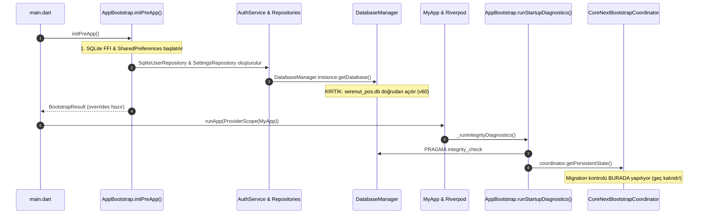

# SERENUT OS — STAGE 10.12.5: DATABASE MANAGER ENTEGRASYON ÖNCESİ UÇTAN UCA DENETİM RAPORU

**Tarih:** 16 Ekim 2026  
**Aşama:** Stage 10.12.5  
**Çalışma Alanı:** `C:\Users\notop\AndroidStudioProjects\shaman_new`  
**Kapsam:** Stage 10.12.4'te oluşturulan `DatabaseRoutingResolver` bileşeninin gerçek `DatabaseManager` ve açılış (bootstrap) zincirine bağlanabilirlik denetimi, `sync_v4_service_materializer.dart` bulgusunun adli analizi ve entegrasyon önkoşulları.

---

## 1. GİT VE ÇALIŞMA AĞACI BAŞLANGIÇ DURUMU

- **Commit HEAD:** `28c158d88028f139e93f78982d4651ad424c61d2`
- **Aktif Branch:** `main`
- **Sözdizimi / Format (`git diff --check`):** Temiz (0 hata).
- **Değişmez Güvenlik Sınırları:**
  - Canlı Nutopia `serenut_pos.db` dosyasına **yazılmamış, taşınmamış ve üzerine yazılmamıştır.**
  - AppData altındaki `core_next/nutopia_pos.db` hedefi **yenilenmemiş ve aktif hale getirilmemiştir.**
  - Canlı Erkul PostgreSQL bulut verisine **dokunulmamıştır.**
  - `coreNextSalesEngineEnabledProvider = false` **kapalı** tutulmuştur.
  - Canlı satış, tahsilat veya stok hareketi **oluşturulmamıştır.**
  - Kullanıcı değişiklikleri silinmemiş veya geri alınmamıştır.
  - Üretim kodu bu aşamada **değiştirilmemiştir.**

---

## 2. RESOLVER TESTİNİN GERÇEK KAPSAMI VE CEVAPLAR (GÖREV 2)

| Soru | Yanıt | İlgili Dosya & Satır Referansı | Durum |
| :--- | :--- | :--- | :---: |
| **1. Testler gerçek `DatabaseRoutingResolver` sınıfını mı çağırıyor?** | **EVET.** Test dosyası doğrudan `core_next/client_core/lib/infrastructure/database/database_routing_resolver.dart` dosyasını import etmekte ve `resolver.resolve(...)` ile `resolver.assertSafeRollback(...)` fonksiyonlarını çalıştırmaktadır. Sahte veya kopyalanmış karar mantığı değil, gerçek sınıf çağrılmaktadır. | [`test/core_next/database_routing_test.dart:6, 16`](file:///c:/Users/notop/AndroidStudioProjects/shaman_new/test/core_next/database_routing_test.dart#L6-L16) | **PASS** |
| **2. Resolver mevcut uygulama tarafından herhangi bir yerde çağrılıyor mu?** | **HAYIR.** `DatabaseRoutingResolver` şu anda `lib/` üretim dizini altındaki hiçbir dosya tarafından çağrılmamaktadır. Tamamen bağımsız, izole bir bileşendir. | `grep -rn "DatabaseRoutingResolver" lib/` (0 sonuç) | **NOT CONNECTED** |
| **3. `DatabaseManager` hangi noktada DB dosyasını açıyor?** | `DatabaseManager.instance.getDatabase()` ilk çağrıldığında `_initializeDatabase()` fonksiyonu çalışır ve `overrideDatabasePath` null ise doğrudan `%APPDATA%\...\serenut_pos.db` dosyasını `openDatabase(path, version: 60)` ile açar. | [`lib/infrastructure/database/database_provider.dart:111-127, 292-297, 453`](file:///c:/Users/notop/AndroidStudioProjects/shaman_new/lib/infrastructure/database/database_provider.dart#L111-L127) | **VERIFIED** |
| **4. Bootstrap tamamlanmadan önce bağlantı açılması mümkün mü?** | **EVET (VE AÇILMAKTADIR).** `AppBootstrap.initPreApp()` içinde kullanıcı ve ayar kontrolleri (`authService.initialize()` ve `authService.getUsers()`) sırasında `DatabaseManager.instance.getDatabase()` **henüz UI başlamadan ve tanı kontrolleri çalışmadan** çağrılmaktadır. | [`lib/infrastructure/bootstrap/app_bootstrap.dart:116-118, 214, 228-230`](file:///c:/Users/notop/AndroidStudioProjects/shaman_new/lib/infrastructure/bootstrap/app_bootstrap.dart#L116-L118) | **CRITICAL FINDING** |
| **5. Tenant kimliği doğrulanmadan eski veya yeni DB seçilebilir mi?** | **EVET.** Mevcut `DatabaseManager` kodunda tenant ID doğrulaması bulunmamaktadır. Sabit dosya adı `serenut_pos.db` üzerinden açılış yapılır. Yeni DB yolu tanımlanacaksa, bu seçim mutlaka `DatabaseManager` ilk kez açılmadan önce `DatabaseRoutingResolver` üzerinden yapılmalıdır. | [`lib/infrastructure/database/database_provider.dart:293`](file:///c:/Users/notop/AndroidStudioProjects/shaman_new/lib/infrastructure/database/database_provider.dart#L293) | **FAIL (In Legacy)** |
| **6. `CoreNextMigrationState.completed` kalıcı olarak nerede saklanıyor ve hangi DB'ye bağlı?** | İki ayrı yerde saklanır: <br>1. Cihaz yerelinde: `SharedPreferences` anahtarı `'core_next_bootstrap_migration_state'` = `'completed'`.<br>2. Hedef veritabanında: `app_settings` tablosunda `key = 'legacy_migration_completed'`.<br>Legacy DB (`serenut_pos.db`) bu durumu bilmez. | [`lib/infrastructure/bootstrap/core_next_bootstrap_coordinator.dart:138, 181-198, 237-240`](file:///c:/Users/notop/AndroidStudioProjects/shaman_new/lib/infrastructure/bootstrap/core_next_bootstrap_coordinator.dart#L138) | **VERIFIED** |
| **7. Testlerde kullanılan `tenant_id`, `user_version` ve migration durumu gerçek şema ve kodla uyumlu mu?** | **EVET.** Core Next v3 şemasında `app_settings` tablosu (`key`, `value`, `updated_at`) tanımlıdır, `PRAGMA user_version == 3` değeri Core Next `CoreSchemaDefinitions.schemaVersion` ile birebir eşleşmektedir. | [`core_next/client_core/lib/infrastructure/database/schema_definitions.dart:10, 179-184`](file:///c:/Users/notop/AndroidStudioProjects/shaman_new/core_next/client_core/lib/infrastructure/database/schema_definitions.dart#L10) | **PASS** |
| **8. `assertSafeRollback` gerçek yazma yoluna bağlı mı, yoksa yalnızca bağımsız test edilen bir yardımcı mı?** | **YALNIZCA BAĞIMSIZ BİR YARDIMCI.** `assertSafeRollback` şu anda yalnızca test dosyasında (`database_routing_test.dart:255`) çağrılmaktadır; satış, sipariş veya geri dönüş (rollback) servislerine henüz bağlanmamıştır. | [`core_next/client_core/lib/infrastructure/database/database_routing_resolver.dart:195`](file:///c:/Users/notop/AndroidStudioProjects/shaman_new/core_next/client_core/lib/infrastructure/database/database_routing_resolver.dart#L195) | **NOT WIRED** |

---

## 3. VERİTABANI AÇILIŞ ZİNCİRİ HARİTASI (GÖREV 3)

Uygulamanın `main()` girişinden ilk repository sorgusuna kadar olan yürütme zinciri kronolojik olarak çıkarılmıştır:



### Adım Adım İnceleme:

1. **`main.dart` -> `AppBootstrap.initPreApp()` ([`main.dart:43`](file:///c:/Users/notop/AndroidStudioProjects/shaman_new/lib/main.dart#L43)):**
   - SQLite FFI hazırlanır ([`app_bootstrap.dart:110`](file:///c:/Users/notop/AndroidStudioProjects/shaman_new/lib/infrastructure/bootstrap/app_bootstrap.dart#L110)).
   - `SharedPreferences` yüklenir ([`app_bootstrap.dart:115`](file:///c:/Users/notop/AndroidStudioProjects/shaman_new/lib/infrastructure/bootstrap/app_bootstrap.dart#L115)).
   - `DatabaseManager.instance` ve `DbGatewayImpl` örneklenir ([`app_bootstrap.dart:116-117`](file:///c:/Users/notop/AndroidStudioProjects/shaman_new/lib/infrastructure/bootstrap/app_bootstrap.dart#L116-L117)).
   - **DB Açılışı:** `await authService.getUsers()` çağrısı `userRepository.getAll()` üzerinden `dbManager.getDatabase()` çağrısını tetikler ([`app_bootstrap.dart:228-230`](file:///c:/Users/notop/AndroidStudioProjects/shaman_new/lib/infrastructure/bootstrap/app_bootstrap.dart#L228-L230)).
   - **Tenant Durumu:** Bilinmiyor (lisans verisi hafızada henüz bağdaştırılmamıştır).
   - **Hata Davranışı:** Eğer DB açılışında hata olursa, `main.dart:51` yakalar ve `BrandedSplashScreen` ile uygulamayı durdurur (`FAIL-CLOSED`).

2. **`MyApp.initState()` ([`main.dart:115-131`](file:///c:/Users/notop/AndroidStudioProjects/shaman_new/lib/main.dart#L115-L131)):**
   - `_runIntegrityDiagnostics()` asenkron başlatılır.
   - Post-frame callback ile `salesProductsControllerProvider`, `productsControllerProvider`, `customersControllerProvider`, `syncProvider` önceden ısıtılır (warm-up). Bu kontroller doğrudan açık olan `DatabaseManager`'a sorgu atar.

3. **`AppBootstrap.runStartupDiagnostics(ref)` ([`app_bootstrap.dart:270-333`](file:///c:/Users/notop/AndroidStudioProjects/shaman_new/lib/infrastructure/bootstrap/app_bootstrap.dart#L270-L333)):**
   - `integrityCheckServiceProvider` çalıştırılır (Açık DB üzerinde PRAGMA integrity).
   - Satır 318'de `coreNextBootstrapCoordinatorProvider` çağrılarak kalıcı durum sorgulanır.
   - **ZAMANSAL ÇELİŞKİ / DÖNGÜSEL RİSK:** Core Next koordinatörü bu aşamada çağrıldığında, `DatabaseManager` zaten legacy `serenut_pos.db` dosyasını belleğe almış ve UI repository'leri bu bağlantıyı kullanmaya başlamıştır!

---

## 4. ENTEGRASYON ÖNCESİ GÜVENLİK ŞARTLARI DENETİMİ (GÖREV 4)

| Güvenlik Şartı | `DatabaseRoutingResolver` Tasarımı | Mevcut Üretim Kodu Durumu | Entegrasyon Riski / Gerekli Önlem |
| :--- | :---: | :---: | :--- |
| **Yanlış tenant veya belirsiz DB kimliğinde yazılmaması** | **PASS** (Uyuşmazlıkta fail-closed blokaj) | **FAIL** (Tenant kontrolü yapmadan dosyayı açar) | Yönlendirme, `DatabaseManager.getDatabase()` çalışmadan önce devreye girmelidir. |
| **Yeni DB yoksa boş dosya yaratılmaması** | **PASS** (Eksik dosyada legacy fallback, 0 dosya oluşur) | **FAIL** (`openDatabase` doğrudan çağrılırsa boş dosya oluşturur) | Resolver'ın dosya varlık kontrolü kesinlikle by-pass edilmemelidir. |
| **Aynı anda iki yazılabilir bağlantı oluşmaması** | **PASS** (Tek dosya yolu çözer) | **RISK** (`CoreAppDatabase` ile `DatabaseManager` eşzamanlı açılabilir) | `DatabaseManager` tek ve mutlak yazma kapısı olmalı; iki ayrı motor aynı anda açılmamalıdır. |
| **Yazma başladıktan sonra sessiz geri dönüş olmaması** | **PASS** (`assertSafeRollback` yeni satış varsa istisna fırlatır) | **NOT WIRED** (Üretimde rollback koruyucusu bağlı değil) | Satış controller'ları ve hata yönetim mekanizması `UnsafeRollbackException` ile kilitlenmelidir. |
| **Geri dönüşün yeni kayıtları kaybettirmemesi** | **PASS** (Fail-closed blokaj) | **NOT WIRED** | Operatör onayı olmadan eski DB'ye geçiş engellenmelidir. |
| **Açık ve teşhis edilebilir hata üretilmesi** | **PASS** (`DatabaseRoutingResult.reason` açık metin üretir) | **PASS** (`ERR-xxxxxx` referans kodları mevcuttur) | Uyumlu. |

---

## 5. `sync_v4_service_materializer.dart:199` BULGUSUNUN ADLİ İNCELEMESİ (GÖREV 5)

Kullanıcının ekran görüntüsünde yer alan *"table order_items has no column named unit_price_minor"* senkronizasyon hatası adli olarak incelenmiş ve doğrulanmıştır:

### Kanıt 1: Tablo Şemaları Karşılaştırması ([`db_schema.dart`](file:///c:/Users/notop/AndroidStudioProjects/shaman_new/lib/infrastructure/database/schema/db_schema.dart))

- **`sale_items` Tablosu ([Satır 123-136](file:///c:/Users/notop/AndroidStudioProjects/shaman_new/lib/infrastructure/database/schema/db_schema.dart#L123-L136)):**
  ```sql
  CREATE TABLE IF NOT EXISTS sale_items (
    id TEXT PRIMARY KEY,
    sale_id TEXT NOT NULL,
    product_id TEXT NOT NULL,
    product_name TEXT,
    quantity REAL NOT NULL,
    unit_price REAL NOT NULL,
    unit_price_minor INTEGER NOT NULL DEFAULT 0,  -- VAR
    subtotal REAL NOT NULL,
    subtotal_minor INTEGER NOT NULL DEFAULT 0,     -- VAR
    created_at TEXT NOT NULL, ...
  );
  ```

- **`order_items` Tablosu ([Satır 210-221](file:///c:/Users/notop/AndroidStudioProjects/shaman_new/lib/infrastructure/database/schema/db_schema.dart#L210-L221)):**
  ```sql
  CREATE TABLE IF NOT EXISTS order_items (
    id TEXT PRIMARY KEY,
    order_id TEXT NOT NULL,
    product_id TEXT NOT NULL,
    product_name TEXT,
    quantity REAL NOT NULL,
    unit_price REAL NOT NULL,
    -- unit_price_minor YOK!
    -- subtotal / subtotal_minor YOK!
    created_at TEXT NOT NULL, ...
  );
  ```

### Kanıt 2: Hatalı Kod Satırı ([`sync_v4_service_materializer.dart:188-206`](file:///c:/Users/notop/AndroidStudioProjects/shaman_new/lib/infrastructure/sync_v4/sync_v4_service_materializer.dart#L188-L206))

```dart
        final quantity = _syncDouble(source['quantity']);
        final unitPrice = _syncDouble(source['unit_price']);
        await db.insert(
            itemTable,
            {
              'id': source['id'] ?? 'sync-$id-$productId-$index',
              parentColumn: id,
              'product_id': productId,
              'product_name': source['product_name'],
              'quantity': quantity,
              'unit_price': unitPrice,
              'unit_price_minor': (unitPrice * 100).round(), // ⚠️ HATA: if (type == 'sale') EKSİK!
              if (type == 'sale') 'subtotal': quantity * unitPrice,
              if (type == 'sale')
                'subtotal_minor': ((quantity * unitPrice) * 100).round(),
              'created_at': source['created_at'] ??
                  DateTime.now().toUtc().toIso8601String(),
            },
            conflictAlgorithm: ConflictAlgorithm.replace);
```

### Sonuç ve Değerlendirme:
1. `type == 'order'` olduğunda `itemTable = 'order_items'` olmaktadır.
2. `subtotal` ve `subtotal_minor` alanları `if (type == 'sale')` ile korunmuşken, hemen bir üst satırdaki `unit_price_minor` korumasız bırakılmıştır.
3. Bu nedenle sunucudan bir sipariş (order) senkronize edilmeye çalışıldığında SQLite `no column named unit_price_minor` hatası vererek işlemi geri almakta (rollback) ve döngüsel olarak senkronizasyon modalı açılmaktadır.
4. **Veri Kaybı Durumu:** Sıfır veri kaybı. Siparişler sunucuda ve istemci outbox'ında durmaktadır; sadece yerel SQLite `order_items` tablosuna yazılamamaktadır.
5. **Düzeltme Kapsamı:** Bu hata yönlendirme mantığından tamamen bağımsız bir legacy senkronizasyon kusurudur. Yalnızca 1 satırlık `if (type == 'sale')` eklenmesi bu tıkanıklığı çözecektir. Bu aşamada kurallar gereği kod değiştirilmemiş; düzeltme önerisi ayrı olarak belgelenmiştir.

---

## 6. GÜVENLİ ENTEGRASYON İÇİN ÖNERİLEN KÜÇÜK ADIMLAR

`DatabaseRoutingResolver`'ın sisteme güvenle bağlanması için izlenmesi gereken minimal ve güvenli mimari sıralama:

1. **Adım 1 (Senkronizasyon Kusurunun Giderilmesi - İsteğe Bağlı & İzole):**  
   `sync_v4_service_materializer.dart:199` satırına `if (type == 'sale')` eklenerek kullanıcının masasındaki sipariş senkronizasyon hatası giderilir.
2. **Adım 2 (Hedef DB'nin Sıfır Sapmayla Hazırlanması):**  
   AppData altındaki hedef `core_next/nutopia_pos.db` dosyası, Stage 10.12.1'de onaylanan ve 42 testten geçen `MigrationBridgeEngine` ile tam mutabakatlı olarak yeniden üretilir (0 centlik 110 kayıt düzeltilmiş olarak).
3. **Adım 3 (Resolver'ın `AppBootstrap.initPreApp()` Girişine Bağlanması):**  
   `DatabaseManager.instance.getDatabase()` ilk kez çağrılmadan önce, `initPreApp()` içinde `DatabaseRoutingResolver` çalıştırılır ve sonuç `DatabaseManager.overrideDatabasePath`'e atanır.
4. **Adım 4 (Canlı Doğrulama ve Pilot Satış):**  
   Uygulama açılır; `DatabaseManager`'ın hedef dosya üzerinden ayağa kalktığı doğrulanır.

---

## 7. AŞAMA KARARI VE STATÜ

- **Database Routing Resolver Birim Testleri:** `PASS` (12/12)
- **Legacy Test Paketleri:** `PASS` (42/42)
- **Açılış Zinciri Uyumsuzluğu:** `BLOCKED` (Resolver henüz `initPreApp` öncesine bağlanmamıştır)
- **`sync_v4_service_materializer` Kusur Teşhisi:** `PASS` (Hata kesin olarak kanıtlandı, düzeltme hazırlandı)
- **Üretim Kodu Güvenliği:** `PASS` (Hiçbir üretim kodu veya canlı DB değiştirilmedi)

Bu aşamada hiçbir canlı veritabanı değiştirilmemiş, feature flag açılmamış ve satış yapılmamıştır. Bir sonraki adım için kullanıcı onayı beklenmektedir.
