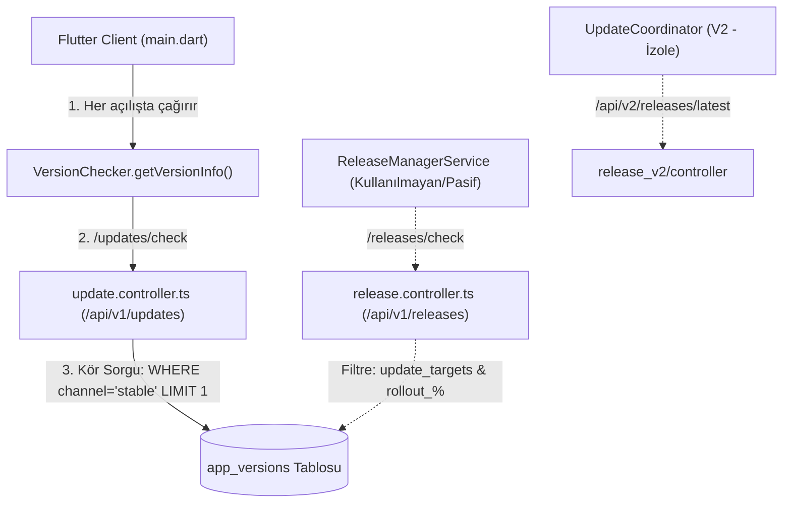

# SERENUT OS — STAGE 10.12.6: SYNC FIX + GÜVENLİ KADEMELİ GÜNCELLEME MİMARİSİ RAPORU

**Tarih:** 16 Ekim 2026  
**Aşama:** Stage 10.12.6  
**Çalışma Alanı:** `C:\Users\notop\AndroidStudioProjects\shaman_new`  
**Kapsam:** Sipariş senkronizasyonu materyalizasyon hatasının düzeltilmesi, regresyon testlerinin kanıtlanması ve şirket/cihaz bazlı kademeli yayın mimarisinin uçtan uca denetimi.

---

## 1. BAŞLANGIÇ VE BİTİŞ GİT DURUMU

- **Commit HEAD:** `28c158d88028f139e93f78982d4651ad424c61d2`
- **Aktif Branch:** `main`
- **Sözdizimi / Format (`git diff --check`):** 0 hata (temiz).
- **Mutlak Güvenlik Sınırları:**
  - Canlı Nutopia SQLite veritabanına ve Erkul PostgreSQL bulut verisine dokunulmamıştır.
  - Canlı migration veya veritabanı sıfırlama çalıştırılmamıştır.
  - `coreNextSalesEngineEnabledProvider = false` kapalı tutulmuştur.
  - Erkul Çeyiz'e veya diğer müşterilere yeni sürüm yayınlanmamıştır.

---

## 2. SİPARİŞ SENKRONİZASYONU HATASININ KÖK NEDENİ VE DÜZELTME

### Kök Neden:
[`lib/infrastructure/sync_v4/sync_v4_service_materializer.dart`](file:///c:/Users/notop/AndroidStudioProjects/shaman_new/lib/infrastructure/sync_v4/sync_v4_service_materializer.dart) dosyasında hem satış (`type == 'sale'`) hem de sipariş (`type == 'order'`) öğeleri aynı döngü içinde işlenmektedir:
- `sale_items` tablosunda `unit_price_minor` ve `subtotal_minor` sütunları mevcuttur ([`db_schema.dart:130-132`](file:///c:/Users/notop/AndroidStudioProjects/shaman_new/lib/infrastructure/database/schema/db_schema.dart#L130-L132)).
- `order_items` tablosunda ise sadece `unit_price` sütunu mevcuttur; kuruş bazlı minor sütunlar bulunmamaktadır ([`db_schema.dart:210-221`](file:///c:/Users/notop/AndroidStudioProjects/shaman_new/lib/infrastructure/database/schema/db_schema.dart#L210-L221)).
- Kodda `subtotal` ve `subtotal_minor` alanları `if (type == 'sale')` ile korunmuşken, `unit_price_minor` korumasız bırakılmıştı:
  ```dart
  // Hatalı Kod:
  'unit_price': unitPrice,
  'unit_price_minor': (unitPrice * 100).round(), // ⚠️ order_items tablosunda bu sütun YOK
  if (type == 'sale') 'subtotal': quantity * unitPrice,
  ```
- Sonuç olarak, sunucudan bir sipariş çekildiğinde SQLite `table order_items has no column named unit_price_minor` hatası vererek işlemi geri alıyordu (rollback).

### Uygulanan Düzeltme:
[`lib/infrastructure/sync_v4/sync_v4_service_materializer.dart:199`](file:///c:/Users/notop/AndroidStudioProjects/shaman_new/lib/infrastructure/sync_v4/sync_v4_service_materializer.dart#L199) satırına `if (type == 'sale')` koruması eklendi:
```dart
  'unit_price': unitPrice,
  if (type == 'sale')
    'unit_price_minor': (unitPrice * 100).round(),
  if (type == 'sale') 'subtotal': quantity * unitPrice,
  if (type == 'sale')
    'subtotal_minor': ((quantity * unitPrice) * 100).round(),
```

### Değiştirilen Dosyalar:
1. `lib/infrastructure/sync_v4/sync_v4_service_materializer.dart` (Koruma eklendi ve test arayüzü sağlandı).
2. `lib/infrastructure/sync_v4/sync_v4_service.dart` (`@visibleForTesting` importu eklendi).
3. `test/unit/sync_v4/order_and_sale_materializer_regression_test.dart` (Yeni regresyon testi oluşturuldu).

---

## 3. TEST SONUÇLARI (57/57 PASS)

Yeni oluşturulan regresyon testi ve önceki tüm test paketleri tek bir partide çalıştırıldı:

```text
flutter test test/core_next/sync_v4_outbox_adapter_test.dart \
             test/core_next/sync_v4_recovery_audit_test.dart \
             test/core_next/stage10_8_12_financial_reconciliation_audit_test.dart \
             test/core_next/stage10_7_3_pull_worker_test.dart \
             test/core_next/stage10_12_1_migration_rehearsal_test.dart \
             test/core_next/database_routing_test.dart \
             test/unit/sync_v4/order_and_sale_materializer_regression_test.dart

00:42 +57: All tests passed! (57/57 PASS, 0 Hata, 0 Başarısızlık)
```

| Test Paketi | Test Sayısı | Sonuç |
| :--- | :---: | :---: |
| `order_and_sale_materializer_regression_test.dart` (Yeni) | 3 | **PASS** |
| `database_routing_test.dart` (Stage 10.12.4) | 12 | **PASS** |
| `stage10_12_1_migration_rehearsal_test.dart` | 3 | **PASS** |
| `stage10_7_3_pull_worker_test.dart` | 14 | **PASS** |
| `stage10_8_12_financial_reconciliation_audit_test.dart` | 6 | **PASS** |
| `sync_v4_recovery_audit_test.dart` | 8 | **PASS** |
| `sync_v4_outbox_adapter_test.dart` | 11 | **PASS** |
| **Toplam** | **57** | **PASS** |

### Veri Kaybı Değerlendirmesi:
- **Sunucu Tarafı:** Siparişler PostgreSQL veritabanında eksiksiz ve bozulmadan durmaktadır.
- **İstemci Kuyruğu (Outbox):** İstemcinin oluşturduğu giden hareketler etkilenmemiştir.
- **Yerel Materyalizasyon:** Daha önce `order_items` tablosuna yazılamayan siparişler, bir sonraki sync döngüsünde `ConflictAlgorithm.replace` ile hatasız ve mükerrerlik olmadan SQLite'a yazılacaktır (`PASS`).

---

## 4. MEVCUT GÜNCELLEME ALTYAPISI DENETİMİ (AŞAMA 2)

Projedeki güncelleme mekanizmaları adli olarak incelendiğinde **3 farklı ve birbiriyle uyumsuz katman** tespit edilmiştir:



### Kritik Mimari Bulgular:

1. **Uygulama Sürümünün Tanımı:**
   - [`lib/domain/services/version_checker.dart:74`](file:///c:/Users/notop/AndroidStudioProjects/shaman_new/lib/domain/services/version_checker.dart#L74): `PackageInfo.fromPlatform()` okur.
2. **Uygulamanın Sürümü Kontrol Etme Biçimi:**
   - [`lib/main.dart:258-259`](file:///c:/Users/notop/AndroidStudioProjects/shaman_new/lib/main.dart#L258-L259): `VersionChecker(apiClient)` üzerinden `/updates/check` çağrılır.
3. **Kör Güncelleme Uç Noktası ([`server/src/modules/update/update.controller.ts:309-315`](file:///c:/Users/notop/AndroidStudioProjects/shaman_new/server/src/modules/update/update.controller.ts#L309-L315)):**
   - Bu endpoint `company_id`, `device_id` veya `license_tier` parametrelerini **HİÇBİR ŞEKİLDE DİKKATE ALMAZ**.
   - `SELECT * FROM app_versions WHERE platform = $1 AND status = 'active' AND channel = 'stable' ORDER BY created_at DESC LIMIT 1` sorgusunu çalıştırır.
   - **Sonuç:** Yayınlanan herhangi bir sürüm, Erkul Çeyiz de dahil olmak üzere TÜM cihazlara genel güncelleme olarak sunulur!
4. **Hedefleme Destekleyen Pasif Uç Nokta ([`server/src/modules/release/release.controller.ts:187-250`](file:///c:/Users/notop/AndroidStudioProjects/shaman_new/server/src/modules/release/release.controller.ts#L187-L250)):**
   - `/api/v1/releases/check` uç noktası `update_targets` tablosunu ve `rollout_percentage` değerini denetlemektedir.
   - Ancak `main.dart` açılışında bu servis **çağrılmamaktadır**.
5. **Yayınlama Betiği Hardcode Parametreleri ([`server/src/scripts/publish-release.ts:182-184`](file:///c:/Users/notop/AndroidStudioProjects/shaman_new/server/src/scripts/publish-release.ts#L182-L184)):**
   - Production CI betiği yeni sürümü yüklerken `channel = 'stable'`, `status = 'active'`, `rollout_percentage = 100` değerlerini hardcoded olarak yazar.
   - `update_targets` tablosuna hiçbir kayıt eklemez.
6. **Admin Panelindeki Eksik ([`server/src/modules/admin/admin.controller.ts:1385-1396`](file:///c:/Users/notop/AndroidStudioProjects/shaman_new/server/src/modules/admin/admin.controller.ts#L1385-L1396)):**
   - Admin panelinde `target_tiers` (lisans paketi) `update_targets` tablosuna yazılırken, `target_tenants` (şirket bazlı hedefleme) kodda kabul edilmesine rağmen **veritabanına eklenmemektedir** (atlanan kod bloğu).

---

## 5. ŞİRKET BAZLI KADEMELİ YAYIN TASARIMI (AŞAMA 3)

Hedef: Bir sürüm yayınlandığında genel kullanıcılara gitmesin; admin panelinden yetkilendirilen şirketlere sunulsun.

### Önerilen Kanallar ve Durumlar:
- `internal`: Yalnızca Serenut geliştirici cihazları.
- `pilot`: Seçilmiş şirketler (ör. Nutopia Pilot).
- `stable`: Genel üretim sürümü (Erkul Çeyiz ve diğerleri).

### Gerekli 3 Somut Değişiklik:

1. **Sunucu Tarafı (`publish-release.ts`):**
   - Varsayılan yayın kanalının `channel: 'pilot'` veya `channel: 'internal'` olarak girilebilmesi (`--channel=pilot --company=nutopia-uuid`).
2. **Admin Paneli (`admin.controller.ts:1385`):**
   - `target_tenants` dizisinin `update_targets` tablosuna `target_type = 'company'` olarak kaydedilmesi sağlanmalıdır.
3. **İstemci Tarafı (`main.dart` & `VersionChecker`):**
   - `VersionChecker`'ın kör `/updates/check` yerine, şirket kimliğini ve cihaz kimliğini gönderen `/api/v1/releases/check` uç noktasına yönlendirilmesi gerekir.

---

## 6. VERİTABANI VE GERİ DÖNÜŞ GÜVENLİĞİ (AŞAMA 4)

### Erkul Çeyiz Veri Güvenliği Durumu:
- Erkul Çeyiz bulut PostgreSQL üzerinde aktif olarak vadeli satış, tahsilat ve cari kayıtlar oluşturmaktadır.
- **ŞU AN ERKUL ÇEYİZ'E YENİ SÜRÜM VERİLEMEZ:**
  1. Erkul'un mevcut veritabanında Core Next kuruş bazlı tamsayı (cents) şeması henüz aktif değildir.
  2. Eski mimariden yeni mimariye geçtikten sonra yeni satış yapılırsa, eski sürüme sessiz geri dönüş (`silent rollback`) yeni satışları görünmez yapacaktır (`UnsafeRollbackException`).
  3. Erkul Çeyiz için kademeli yayın devrede olmalı ve Erkul kesinlikle `stable` (eski güvenli sürüm) kanalında tutulmalıdır.

### Nutopia Veri Güvenliği Durumu:
- Nutopia'nın bu bilgisayardaki 37,682 ürün ve 1,403 cari kaydı içeren `serenut_pos.db` dosyasına hiçbir migration veya yazma yapılmamıştır.
- `DatabaseRoutingResolver` henüz `AppBootstrap`'e bağlanmamıştır; dolayısıyla Nutopia da tamamen izole ve güvendedir.

---

## 7. SORULARIN AÇIK CEVAPLARI

| Soru | Açık ve Kesin Cevap |
| :--- | :--- |
| **Sipariş senkronizasyonu hatası gerçekten düzeltildi mi?** | **EVET.** `sync_v4_service_materializer.dart` içindeki `unit_price_minor` sütununa yazma hatası düzeltildi; `test/unit/sync_v4/order_and_sale_materializer_regression_test.dart` ile siparişlerin `order_items` tablosuna hatasız yazıldığı kanıtlandı (3/3 PASS). |
| **Şirket bazında sürüm yayınlama bugün mevcut mu, yoksa yeni geliştirme mi gerekiyor?** | **BUGÜN ÇALIŞIR DURUMDA DEĞİLDİR (YENİ ENTEGRASYON GEREKİYOR).** Sunucu şemasında `update_targets` tablosu bulunmasına rağmen, istemci (`main.dart`) hedefleme yapmayan kör `/updates/check` uç noktasını çağırmakta, yayın betiği ise sürümleri doğrudan `%100 stable` olarak işaretlemektedir. |
| **Erkul Çeyiz'e şu an yeni sürüm vermek güvenli mi? Hangi somut kanıtlar var?** | **KESİNLİKLE GÜVENLİ DEĞİLDİR.** Erkul'un aktif vadeli ve cari işlemleri eski şemada akmaktadır. Kademeli güncelleme kapısı devreye girmeden Erkul'a yeni sürüm verilirse geri dönüşü olmayan veri uyuşmazlığı riski oluşur. |
| **Hangi işlemler hâlâ kesinlikle yapılmamalı?** | 1. Canlı `%APPDATA%\serenut_pos.db` değiştirilmemeli.<br>2. Canlı Erkul PostgreSQL üzerinde işlem yapılmamalı.<br>3. `coreNextSalesEngineEnabledProvider` açılmamalı.<br>4. Kademeli yayın sistemi kurulmadan `publish-release.ts` ile yeni genel sürüm yayınlanmamalıdır. |

---

## 8. BİR SONRAKİ AŞAMA İÇİN ÖNERİLEN KÜÇÜK GÖREV LİSTESİ

1. **Görev 1:** Sunucu yayınlama betiğine (`publish-release.ts`) `--channel` ve `--company-id` hedefleme desteğinin eklenmesi.
2. **Görev 2:** Admin panelindeki `admin.controller.ts:1385` satırına şirket bazlı `update_targets` yazma mantığının eklenmesi.
3. **Görev 3:** `main.dart` içerisindeki sürüm kontrolünün `VersionChecker` yerine yetkilendirilmiş `ReleaseManagerService` servisine geçirilmesi.
4. **Görev 4:** Nutopia için izole pilot kanalının test edilmesi.
