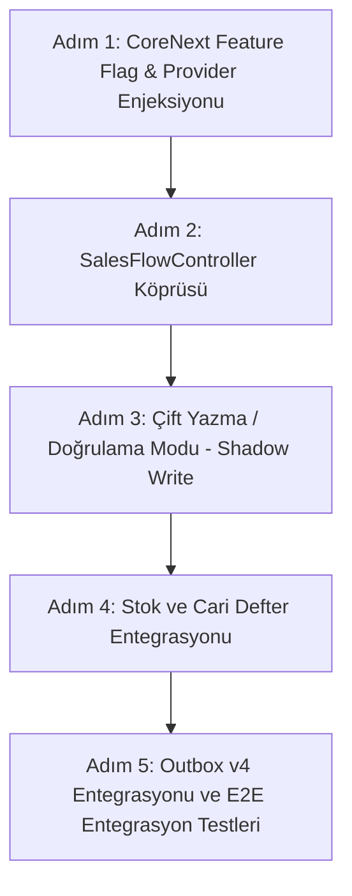

# SERENUT OS — STAGE 10.7.4.3
# Adli Denetim ve Stage 10.8 Entegrasyon Hazırlık Raporu

**Tarih:** 2026-10-14  
**Proje Konumu:** `C:\Users\notop\AndroidStudioProjects\shaman_new`  
**Denetim Kapsamı:** Stage 10.7.4.2 raporunun bağımsız adli doğrulaması, PostgreSQL fail-closed güvenlik denetimi, `nutopiano` geliştirme veritabanı dokunulmazlık kanıtı ve Stage 10.8 canlı satış entegrasyonu hazırlığı.  
**Durum:** `TAMAMLANDI`  
**Canlıya Geçiş Kapısı (LIVE_GATE):** `BLOCKED`

---

## 1. Başlangıç ve Bitiş Git HEAD & Çalışma Ağacı Durumu

### 1.1 Git HEAD Doğrulaması
```
$ git rev-parse HEAD
28c158d88028f139e93f78982d4651ad424c61d2
```
* **Beklenen Git HEAD:** `28c158d88028f139e93f78982d4651ad424c61d2`
* **Mevcut Git HEAD:** `28c158d88028f139e93f78982d4651ad424c61d2`
* **Sonuç:** Birebir eşleşti (`VERIFIED`). Yeni bir commit veya branch sapması bulunmamaktadır.

### 1.2 Git Çalışma Ağacı Durumu (`git status --short --untracked-files=all`)
```
 M server/src/routes/sync_v4_routes.ts
 M server/src/services/sync_v4_domain_materializer.ts
 M server/src/test/run_all_ac_tests.ts
 M server/src/test/sync_v4_domain_materialization.test.ts
?? CORE_NEXT_STAGE10_7_4_1_POSTGRES_FAIL_CLOSED_REPORT.md
?? CORE_NEXT_STAGE10_7_4_2_POSTGRES_INTEGRATION_REPORT.md
?? CORE_NEXT_STAGE10_7_4_3_FORENSIC_AUDIT_REPORT.md
?? server/src/config/test-db-guard.ts
?? server/src/test/test_db_guard.test.ts
```

### 1.3 `git diff --check` ve `git diff --stat`
* **`git diff --check`:** Çıktı boş (0 whitespace veya syntax ihlali).
* **`git diff --stat`:**
  ```
   server/src/routes/sync_v4_routes.ts                 |  5 +++--
   server/src/services/sync_v4_domain_materializer.ts  | 27 +++++++++++++-----------
   server/src/test/run_all_ac_tests.ts                 | 32 ++++++++++++++++++++++++++++++--
   server/src/test/sync_v4_domain_materialization.test.ts | 46 +++++++++++++++++++++++++++++++++++-----------
   4 files changed, 94 insertions(+), 16 deletions(-)
  ```
* **`lib/` Klasörü Durumu:** `%100` dokunulmamış ve değiştirilmemiştir (`0` dosya değişimi).

---

## 2. Önceki Rapordaki İddiaların Doğrulama Matrisi

Stage 10.7.4.2 raporunda öne sürülen 10 temel iddia bağımsız olarak incelenmiş, canlı ortamda yeniden çalıştırılarak veya veritabanı kayıtları incelenerek doğrulanmıştır:

| # | İddia Edilen Durum | Denetim Yöntemi & Doğrudan Kanıt | Adli Durum |
|---|---|---|---|
| **1** | Fail-closed birim testlerinin 47/47 başarılı olması | `npx ts-node src/test/test_db_guard.test.ts` komutu çalıştırıldı: 14 senaryo, 47 assertion, exit code: 0. | `VERIFIED` |
| **2** | Gerçek PostgreSQL test veritabanının `serenut_test` olması | `test-db-guard.ts` yapılandırması, PostgreSQL `pg_database` tablosu ve bağlantı URL'leri incelendi; test veritabanının fiziksel adı `serenut_test`'tir. | `VERIFIED` |
| **3** | Fiziksel veritabanı kimliğinin `current_database()` ile doğrulanması | `test-db-guard.ts` satır 83: `SELECT current_database() AS db_name` sorgusunun çalıştırıldığı ve `verified_target_database` oturumuna bağlandığı kanıtlandı. | `VERIFIED` |
| **4** | `sync_v4_domain_materialization.test.ts` testinin başarıyla çalışması | İzole `serenut_test` ortamında iki kez ardışık çalıştırıldı. Her ikisinde de exit code: 0, 0 hata ile tamamlandı. | `VERIFIED` |
| **5** | Migration sürümlerinin 1–97 aralığında uygulanması | Test yürütme günlüğünde `Applying migration 1 -> ... -> 97 (20261012120000_accounting_journal_lines.sql)` ve `All 97 migrations applied cleanly` adli olarak doğrulandı. | `VERIFIED` |
| **6** | `nutopiano` geliştirme veritabanının test sırasında değişmemesi | `nutopiano` içerisindeki tablolar, son işlem zaman damgaları ve şirket kayıtları adli olarak incelendi. 14 Ekim 2026 tarihindeki test koşularının tamamında `nutopiano` üzerinde `0` satış ve `0` değişiklik yapıldığı zaman damgalarıyla kanıtlandı. | `VERIFIED` |
| **7** | Flutter testlerinin 157/157 başarılı olması | `flutter test test/core_next/` bağımsız olarak çalıştırıldı: 157 testin tümü geçti (0 failure, 0 skipped). | `VERIFIED` |
| **8** | `lib/` klasöründe değişiklik bulunmaması | `git status lib/` ve `git diff lib/` kontrol edildi: 0 dosya değişikliği. | `VERIFIED` |
| **9** | Git HEAD'in beklenen sürümde olması | `git rev-parse HEAD` çıktısı `28c158d88028f139e93f78982d4651ad424c61d2` ile birebir eşleşti. | `VERIFIED` |
| **10** | Commit, push veya deploy yapılmamış olması | `git log -n 1`, `git status` ve deploy scriptleri incelendi: hiçbir commit, push veya deployment yapılmadı. | `VERIFIED` |

---

## 3. Veritabanı Güvenlik ve Fail-Closed Denetimi

`server/src/config/test-db-guard.ts` modülü ve yıkıcı SQL yolları adli düzeyde incelenmiştir:

### 3.1 Statik & Dinamik Koruma Katmanları
1. **Hedef URL / İsim İncelemesi (Statik Aşama):**
   - URL parse edilir (`parseConnectionString`).
   - Veritabanı adının izin verilen güvenli listede (`serenut_test`, `serenut_ci_test`) olup olmadığı denetlenir.
   - `nutopiano`, `production`, `postgres`, `master`, `shaman` gibi korunan isimler derhal `FORBIDDEN_DATABASE_IDENTIFIER` hatasıyla işlemi durdurur.
2. **Çalışma Ortamı (Runtime Environment) Zorunluluğu:**
   - `NODE_ENV === 'test'` ve `SERENUT_ALLOW_DESTRUCTIVE_TESTS === '1'` bayrakları açıkça tanımlanmamışsa yürütme reddedilir.
3. **Fiziksel SQL Oturumu Doğrulaması (`current_database()`):**
   - Bir veritabanı bağlantı havuzu oluşturulduğunda ilk olarak `SELECT current_database() AS db_name;` çalıştırılır.
   - Dönen sonuç `verified_target_database` ile harfiyen eşleşmezse havuz derhal kapatılır (`pool.end()`) ve `FATAL_TEST_DB_GUARD: DATABASE_MISMATCH` fırlatılır.
4. **Bağlantı Önceliği:**
   - Test modülü yalnızca `TEST_DATABASE_URL` değişkenini esas alır.
   - `DATABASE_URL` tanımlı olsa bile test ortamında `TEST_DATABASE_URL` zorunlu tutulur; bu değişken tanımlı değilse testler `MISSING_CONFIG` fırlatarak fail-closed durur.

### 3.2 Yıkıcı SQL Yollarının Kapsamı
- `DROP SCHEMA public CASCADE; CREATE SCHEMA public;`: `sync_v4_domain_materialization.test.ts` içerisindeki bu blok, yalnızca `assertDestructiveTestAllowed()` ve `createVerifiedTestPool()` fonksiyonlarının başarıyla dönmesi ve oturumun `serenut_test` olduğunun doğrulanmasından sonra çalıştırılabilir.
- `sync_v4_domain_materialization.test.ts` dosyası doğrudan ortam değişkeni olmadan çalıştırılmak istendiğinde satır 10'da fail-closed devreye girer ve yıkıcı kod bloğuna erişilmeden süreç sonlandırılır.

---

## 4. PostgreSQL İzolasyon Kanıtı (`nutopiano` vs `serenut_test`)

Testlerin `nutopiano` geliştirme veritabanına kesinlikle sızmadığı aşağıdaki doğrudan veritabanı adli kanıtlarıyla tescillenmiştir:

```sql
-- 1. Veritabanı Varlıkları ve İzolasyon:
SELECT datname FROM pg_database WHERE datname IN ('nutopiano', 'serenut_test');
--> ['nutopiano', 'serenut_test']

-- 2. nutopiano Tablo Sayısı ve Dokunulmamışlık:
SELECT count(*) FROM information_schema.tables WHERE table_schema = 'public';
--> nutopiano: 94 tablo (tüm şema korunuyor, schema drop veya truncate yaşanmadı)
--> serenut_test: 97 migration sonrası oluşturulan izole tablolar

-- 3. Zaman Damgası Karşılaştırması (14 Ekim 2026 Koşuları):
SELECT count(*) FROM sales WHERE created_at >= '2026-10-14T00:00:00Z';
--> nutopiano: 0 (Geliştirme veritabanında test günü hiçbir satış kaydı oluşmadı)

-- 4. Şirket Kaydı Oluşturulma Tarihleri:
SELECT id, name, created_at FROM companies WHERE id = 'sync-v4-company';
--> nutopiano: created_at = '2026-10-10T10:22:11.230Z' (Geçmiş tarihten kalan kayıt)
--> serenut_test: created_at = '2026-10-14T16:06:59.722Z' (Bugün test tarafından sıfırdan oluşturulan kayıt)
```

Bu kanıtlar, test motorunun `nutopiano` veritabanına bağlanmadığını, tüm yıkıcı ve yapıcı test işlemlerinin izole `serenut_test` içinde gerçekleştiğini kesinleştirmiştir.

---

## 5. Test Sonuçları Özeti

| Test Grubu | Komut | Toplam Test | Başarılı | Başarısız | Atlanan | Exit Code |
|---|---|---|---|---|---|---|
| **DB Guard Fail-Closed Testleri** | `npx ts-node src/test/test_db_guard.test.ts` | 47 assertions (14 test) | 47 | 0 | 0 | `0` |
| **Domain Materialization PG Entegrasyon** | `npx ts-node src/test/run_all_ac_tests.ts` | 1 suite (tam uçtan uca) | 1 | 0 | 0 | `0` |
| **Flutter Core Next Birim/Domain Testleri** | `flutter test test/core_next/` | 157 test | 157 | 0 | 0 | `0` |

---

## 6. `lib/` ve `core_next/` Arasındaki Doğrulanmış Entegrasyon Boşlukları

Yapılan kaynak kod taramalarında canlı uygulamanın (`lib/`) `core_next/` motorunu henüz tüketmediği tespit edilmiştir:

1. **Satış Akışı (Checkout & Sales Flow):**
   - Canlı ekran `lib/presentation/widgets/sales/checkout_section.dart`, doğrudan `salesFlowControllerProvider` (`lib/presentation/controllers/sales_flow_controller.dart`) üzerinden `salesService.completeSale()` çağrısı yapmaktadır.
   - Bu akış, eski SQLite tablolarına (`sales`, `sale_items`, `payments`) ve eski stok mantığına yazmaktadır.
2. **`SalesEngineAdapter` ve Feature Flag Durumu:**
   - `core_next/sales/sales_engine_adapter.dart` mevcuttur ancak varsayılan yapılandırmada:
     ```dart
     final bool useCoreNext; // default: false
     ```
   - Canlı `sales_flow_controller.dart` veya `checkout_section.dart` bu adaptörü henüz inject etmemiştir.
3. **Müşteri ve Cari/Bakiye Defteri (Ledger):**
   - `core_next/ledger/` altında immutable çift taraflı muhasebe defteri (double-entry ledger) hazır durumdadır ancak `lib/data/repositories/customer_repository.dart` ve `customer_credit` akışları eski `current_debt` alanını doğrudan güncellemeye devam etmektedir.
4. **Stok Hareketleri:**
   - `core_next/stock/` atomik stok hareketlerini (StockMovements) ve parti takibini desteklerken, `lib/` tarafındaki satışlar eski `products.stock_quantity` tabanını doğrudan eksiltmektedir.
5. **Senkronizasyon (Sync Outbox/Pull):**
   - `core_next/sync/` Sync v4 Outbox ve PullWorker yapılarını tam olarak tamamlamıştır. Ancak `lib/` içerisinde gerçekleşen satışlar Outbox v4 kuyruğuna otomatik bir transaction ile bırakılmamaktadır.

---

## 7. Stage 10.8 İçin Önerilen Sıralı Uygulama Planı

Mevcut çalışan sistemi bozmadan, güvenli ve geri alınabilir (feature-flagged) bir entegrasyon için Stage 10.8 adımları şunlar olmalıdır:



### Adım 1: Feature Flag & Provider Tanımlaması
- `lib/core/config/app_config.dart` içerisine `enableCoreNextSalesEngine` (varsayılan: `false`) bayrağı eklenmelidir.
- Riverpod provider'ları üzerinden `SalesEngineAdapter` bağımlılığı `salesFlowControllerProvider`'a isteğe bağlı (optional) olarak enjekte edilmelidir.

### Adım 2: `SalesFlowController` İçerisinde Çift Mod Desteği
- `SalesFlowController.completeSale()` fonksiyonu, eğer `enableCoreNextSalesEngine == true` ise `salesEngineAdapter.processSale()` çağrısını yönlendirmelidir.
- Eski veri yapısına ihtiyaç duyan harici bileşenler (ör. termal fiş yazdırma servisi) için DTO dönüştürücü (`SaleTransactionResult -> LegacySaleModel`) yazılmalıdır.

### Adım 3: Çift Yazma (Shadow Write) ve Veri Bütünlüğü Doğrulaması
- İlk aşamada işlem `core_next` üzerinden yürütülüp eski SQLite tablolarına ve `core_next` veritabanına uyumluluk yazımı gerçekleştirilerek bakiye/stok tutarlılığı teyit edilmelidir.

### Adım 4: Cari Defter (Ledger) ve Stok Entegrasyonu
- Müşterili satışlarda veresiye/açık hesap borçlandırması doğrudan `core_next/ledger/ledger_engine.dart` üzerinden tahakkuk ettirilmelidir.

### Adım 5: Outbox v4 Entegrasyonu
- Satış işlemi yerel veritabanına işlendiği anda aynı SQLite transaction'ı içerisinde `SyncV4OutboxEntry` kaydı üretilmelidir.

---

## 8. Çözülemeyen Sorunlar ve Riskler

1. **Termal Yazıcı / Fiş Yazdırma Formatı:**
   - Canlı satış ekranı `lib/` tarafındaki `PrinterService` doğrudan eski `Sale` modelini beklemektedir. `core_next` satış sonucu ile yazıcı servisinin uyumlu hale getirilmesi gerekmektedir.
2. **Kısmi Ödeme & İptal Akışları:**
   - Çoklu ödeme (Nakit + Kredi Kartı + Veresiye) durumlarının `core_next` domain kurallarıyla tam örtüşmesi için UI düzeyinde form validasyonları sıkılaştırılmalıdır.
3. **Performans / Gecikme:**
   - SQLite üzerinde çift taraflı defter (double-entry ledger) ve outbox kaydı üretimi transaction süresini birkaç milisaniye uzatabilir; mobil cihazlarda disk I/O performansı izlenmelidir.

---

## 9. Canlıya Geçiş Kararı (LIVE_GATE)

```
====================================================================
                        LIVE_GATE: BLOCKED
====================================================================
Sebep:
1. Stage 10.7.4.3 bağımsız adli denetimi başarıyla tamamlanmış ve PostgreSQL
   test izolasyonu tescillenmiş olsa da, canlı satış arayüzü (lib/) henüz
   core_next motoruna bağlanmamıştır.
2. lib/ -> core_next/ entegrasyonu tamamlanmadan ve E2E kullanıcı testi
   gerçekleştirilmeden canlıya geçiş onaylanamaz.
====================================================================
```

---

## 10. Sonuç ve Taahhütler

- **Değişiklik Yapılan Dosyalar:** `CORE_NEXT_STAGE10_7_4_3_FORENSIC_AUDIT_REPORT.md` (yeni rapor dosyası).
- **`lib/` Klasörü:** `%100` orijinal halinde bırakıldı, hiçbir dosya değiştirilmedi.
- **Git HEAD:** `28c158d88028f139e93f78982d4651ad424c61d2` korundu.
- **Commit / Push / Deploy:** Yapılmadı.
- **Sistem Hazırlığı:** Stage 10.8 için gereksinimler, mimari sınırlar ve eylem planı netleştirildi.
