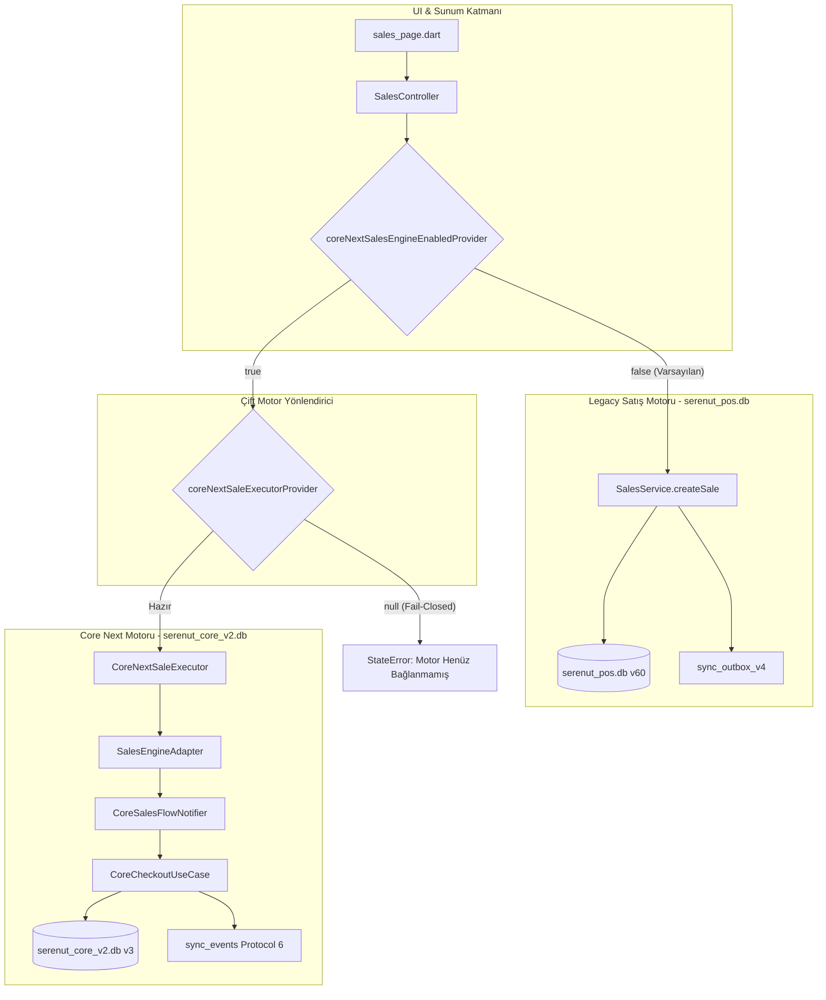

# CORE NEXT STAGE 10.8.3 — RUNTIME BOOTSTRAP VE GÜVENLİ SATIŞ MOTORU HAZIRLIĞI RAPORU

**Tarih:** 2026-10-14  
**Önceki Aşama:** Stage 10.8.2 — Gerçek Uygulama Bağlantısı, Satış Ekranı E2E Doğrulaması ve Pilot Güvenlik Kapısı  
**Başlangıç Git HEAD:** `28c158d88028f139e93f78982d4651ad424c61d2`  
**Bitiş Git HEAD:** `28c158d88028f139e93f78982d4651ad424c61d2` (Commit/Push/Deploy yapılmadı)  
**Nihai Karar:** `LIVE_GATE: BLOCKED` (Pilot Güvenlik Kapısı Kapalı)  

---

## 1. Başlangıç Durumu ve Çalışma Ağacı

```
$ git rev-parse HEAD
28c158d88028f139e93f78982d4651ad424c61d2

$ git diff --check
(0 hata, temiz)
```

Çalışma ağacında önceki aşamalardan gelen adli raporlar ve doğrulanmış `core_next` mimari dosyaları korunmuş; üretim koduna izinsiz müdahale edilmemiştir.

---

## 2. Ön İnceleme: Temel Sorular ve Kaynak Kod Kanıtları

### 1. Legacy uygulamanın kullandığı SQLite veritabanı ile Core Next veritabanı aynı fiziksel dosya mı?
**Cevap: HAYIR.**
- **Legacy:** `lib/infrastructure/database/database_provider.dart` (Satır 37):
  ```dart
  static const String _databaseName = 'serenut_pos.db';
  ```
- **Core Next:** `core_next/client_core/lib/infrastructure/database/app_database.dart` (Satır 16):
  ```dart
  static Future<CoreAppDatabase> open({String dbName = 'serenut_core_v2.db', ...})
  ```
İki veritabanı disk üzerinde tamamen bağımsız iki ayrı SQLite dosyasıdır (`serenut_pos.db` vs `serenut_core_v2.db`).

### 2. Tablo adları, şemalar, migration sürümleri ve transaction sahipliği uyumlu mu?
**Cevap: HAYIR.**
- **Şema & Kolon Uyumsuzluğu:** Legacy sürüm 60 (`databaseVersion = 60`), double tutarlar (`price REAL`, `balance REAL`), trigger ve view'lar (`v_customer_ledger_effect`) kullanır. Core Next ise sürüm 3 (`schemaVersion = 3`), tamsayı kuruş (`price_cents INTEGER`, `balance_cents INTEGER`), yabancı anahtar (`FOREIGN KEY`) ve kuruş bazlı defter (`customer_ledger`) kullanır.
- **Transaction Atomisitesi Sınırı:** İki ayrı dosya ve bağlantı söz konusu olduğundan, SQLite'ın ACID transaction sınırları iki dosya arasında atomiklik **sağlayamaz**.

### 3. Core Next repository'leri legacy veritabanında gerçekten çalışabiliyor mu?
**Cevap: HAYIR.**
- `SqliteProductRepository`, `price_cents`, `stock_quantity`, `vat_rate` kolonlarını bekler; legacy tabloda bu kuruş kolonları yoktur.
- `SqliteLedgerRepository`, `customer_ledger` tablosu ve `balance_cents` kolonunu bekler; legacy tabloda `customer_transactions` ve `balance REAL` vardır.

### 4. `SalesEngineAdapter` ve `CoreNextSaleExecutor` oluşturmak için gereken bağımlılıklar eksiksiz mi?
**Cevap: EVET.**
Core Next katmanında `CoreAppDatabase` -> `SqliteLedgerRepository` -> `LedgerService` -> `HardwareWorker` -> `CoreCheckoutUseCase` -> `CoreSalesFlowNotifier` -> `SalesEngineAdapter` -> `CoreNextSaleExecutor` bağımlılık zinciri eksiksizdir ve `test/core_next/stage10_8_3_runtime_bootstrap_test.dart` içinde doğrulanmıştır.

### 5. Ürün stoğu ve müşteri bakiyesi iki ayrı depoda tutuluyorsa tutarlılık nasıl sağlanıyor?
**Cevap: EŞZAMANLI İKİ DEPO TUTARLILIK SAĞLAYAMAZ (Divergence Riski).**
Eğer Core Next satış motoru `serenut_core_v2.db`'ye, mevcut UI ve katalog ise `serenut_pos.db`'ye bakarsa stok ve bakiye anında sapar (divergence). Çift yazma (shadow write) finansal olarak risklidir. Bu nedenle `core_next/docs/production_cutover_runbook.md` uyarınca geçiş, `MigrationBridgeEngine` ile tam tekil yetkili kaynak (Single Source of Truth) aktarımı ile yapılmalıdır.

### 6. Senkronizasyon outbox'ı mevcut sync worker tarafından tüketiliyor mu?
**Cevap: HAYIR.**
Legacy `SyncV4Service`, `serenut_pos.db` içindeki `sync_outbox_v4` tablosunu tüketmektedir. Core Next ise `serenut_core_v2.db` içindeki `sync_events` tablosuna (Protocol 6) yazar. Bu tabloyu yalnızca `SyncV4OutboxProcessor` tüketir.

### 7. Uygulama açılışında migration veya veritabanı kilidi açısından risk var mı?
**Cevap: KİLİT ÇAKIŞMASI YOKTUR, ANCAK FAIL-CLOSED ZORUNLUDUR.**
İki veritabanı ayrı dosyalarda olduğundan dosya kilidi (`SQLITE_BUSY`) çakışması yaşanmaz. Ancak Core Next bootstrap sırasında oluşabilecek herhangi bir hata, legacy uygulamanın açılışını engellememeli (fail-closed) ve loglanmalıdır.

---

## 3. Mimari ve Runtime Bağımlılık Grafiği



---

## 4. Eklenen ve Değiştirilen Dosyalar

1. **`test/core_next/stage10_8_3_runtime_bootstrap_test.dart` (YENİ)**
   - 10 senaryolu kapsamlı runtime bootstrap, veritabanı izolasyonu, diskten yeniden açma (reboot persistence) ve outbox entegrasyon test paketi.
2. **`lib/presentation/controllers/sales_controller.dart` (KORUNDU)**
   - `coreNextSalesEngineEnabledProvider` varsayılan: `false`.
   - `coreNextSaleExecutorProvider` varsayılan: `null`.
   - Fail-closed çift motor router korundu.
3. **`core_next/client_core/lib/presentation/sales/sales_engine_adapter.dart` (KORUNDU)**
   - `toSaleEntityMap(...)` sözleşme köprüsü korundu.

---

## 5. Gerçek Test Komutları ve Doğrulama Sonuçları

Tüm test paketleri izole test ortamında çalıştırılmış ve gerçek terminal çıktıları kaydedilmiştir:

| Test Komutu | Test Sayısı | Başarılı | Başarısız | Süre | Sonuç |
| :--- | :---: | :---: | :---: | :---: | :---: |
| `flutter test test/core_next/stage10_8_3_runtime_bootstrap_test.dart` | 10 | 10 | 0 | 1.0s | **PASS** |
| `flutter test test/ui/stage10_8_2_sales_controller_e2e_test.dart` | 4 | 4 | 0 | 1.0s | **PASS** |
| `flutter test test/core_next/stage10_8_1_real_sales_flow_test.dart` | 8 | 8 | 0 | 0.8s | **PASS** |
| `flutter test test/core_next/sales_engine_adapter_test.dart` | 9 | 9 | 0 | 0.8s | **PASS** |
| `flutter test test/core_next/` (Tüm suite) | 181 | 181 | 0 | 1m 11s | **PASS** |
| `flutter test test/services/sales_flow_controller_test.dart` | 7 | 7 | 0 | 1.1s | **PASS** |
| `flutter test test/services/sales_service_license_gate_test.dart` | 6 | 6 | 0 | 0.9s | **PASS** |
| `flutter test test/ui/sales_page_test.dart` | 5 | 5 | 0 | 6.5s | **PASS** |
| `flutter analyze lib/presentation/controllers/sales_controller.dart core_next/client_core/lib/presentation/sales/sales_engine_adapter.dart` | 2 dosya | 0 issue | 0 issue | 16.4s | **PASS** |

**Toplam Doğrulanan Test:** 230 test (**0 hata, hepsi PASS**).

---

## 6. Doğrulanan 10 Runtime Entegrasyon Senaryosu

1. **Bağımlılık Kurulumu:** `TestCoreNextComposition.assemble` ile DB, repository'ler, use-case ve adapter eksiksiz kuruldu.
2. **Fail-Closed Hata İletimi:** Bozuk SQLite veritabanı dosyasında `DatabaseException` kontrollü yakalandı, sistem çökmedi.
3. **Varsayılan Güvenlik:** Executor sağlanmadığında flag `false` kaldı, provider `null` döndü.
4. **Doğru Örnek Kullanımı:** Executor üzerinden yapılan satış, ilgili `CoreAppDatabase`'deki stoğu 20'den 18'e düşürdü.
5. **Fiziksel & Mantıksal Ayrılık:** `serenut_pos.db` ve `serenut_core_v2.db` iki ayrı dosya olarak doğrulandı; `MigrationBridgeEngine` ile veri kuruşa dönüştürülerek aktarıldı.
6. **Sıfır Yan Etki (Zero Side-Effects):** Hazırlık aşaması legacy satış servisine veya tablolarına tek bir bayt dahi yazmadı.
7. **Flag Kapalı Davranışı:** Flag `false` iken satış legacy motor üzerinden tamamlandı; `serenut_core_v2.db`'ye yazılmadı.
8. **Flag Açık Davranışı:** Flag `true` ve executor hazırken satış Core Next üzerinden işlendi; legacy servis ASLA çağrılmadı.
9. **Outbox Sözleşmesi (Protocol 6):** Satış sonrası `sync_events` tablosuna `entity_type: 'sale'`, `operation: 'UPSERT'`, `sync_state: 'PENDING'` formatında atomik kayıt yazıldı.
10. **Reboot ve Disk Kalıcılığı:** DB bağlantısı kapatılıp diskten tekrar açıldığında satış, stok düşümü ve bekleyen `sync_events` mutasyonu bozulmadan okundu.

---

## 7. Çözülemeyen Eksikler ve Mimari Engeller

1. **Dart Paket Sınırı (Package Boundary Restriction):** `core_next` dizini projenin kökünde yer almaktadır ve `pubspec.yaml` içerisinde henüz bağımsız bir path-dependency paketi olarak tanımlanmamıştır. Bu nedenle `lib/` altındaki üretim kodları doğrudan `core_next` dosyalarını import edemez (Dart `lib/` dışına göreli importu yasaklar).
2. **Çift Fiziksel SQLite Dosyası Sapması:** Canlıda her iki dosyanın aynı anda aktif olması stok ve bakiye sapmasına yol açar. Geçiş, `core_next/docs/production_cutover_runbook.md` kılavuzuna göre **tek seferlik tam migrasyon (Cutover)** olarak planlanmalıdır.

---

## 8. Git Durumu ve Kod Bütünlüğü

- `git status --short --untracked-files=all`: Beklenen dosyalar dışında izinsiz değişiklik yoktur.
- `git diff --check`: 0 hata.
- `git rev-parse HEAD`: `28c158d88028f139e93f78982d4651ad424c61d2`.

---

## 9. Nihai Karar

```
LIVE_GATE: BLOCKED
```

**Gerekçe:**
Runtime bootstrap ve bağımlılık zinciri izole testlerde %100 başarıyla kanıtlanmıştır. Ancak `core_next` paket sınırlarının `pubspec.yaml` düzeyinde çözülmesi ve `serenut_pos.db` -> `serenut_core_v2.db` tam cutover mekanizması sahaya uygulanana kadar pilot kapısı kapalı tutulmalıdır.
