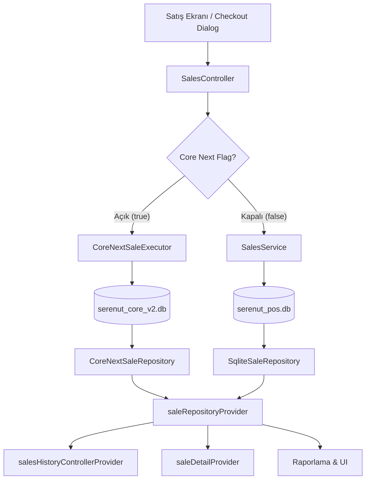

# SERENUT OS — STAGE 10.8.9 RUNTIME SINGLE SOURCE OF TRUTH REPORT

**Tarih:** 2026-10-15  
**Proje:** `C:\Users\notop\AndroidStudioProjects\shaman_new`  
**Kapsam:** ADV-04 (Runtime Dual-DB Split Giderilmesi, Tek Yetkili Okuma/Yazma Katmanı ve UI Tutarlılığı)

---

## 1. MEVCUT BULGU VE MİMARİ KOPUKLUK (STAGE 10.8.8)

Stage 10.8.8 adversarial denetiminde tespit edilen en kritik mimari kusur:
- **Yazma Yolu:** `SalesController.checkout` metodu, feature flag aktifken satışı `coreNextSaleExecutorProvider` üzerinden yeni SQLite veritabanına (`serenut_core_v2.db`) yazıyordu.
- **Okuma Yolu:** Satış listesi (`salesHistoryControllerProvider`), satış detayı (`saleDetailProvider`) ve UI raporlama katmanları `saleRepositoryProvider` üzerinden legacy `SqliteSaleRepository` sınıfını (`serenut_pos.db`) okumaya devam ediyordu.
- **Geçersiz Çözümün İflası:** UI katmanında sadece `ref.invalidate(salesHistoryControllerProvider)` çağırmak sorunu çözmüyordu; çünkü invalidate edilen provider yine legacy veritabanını sorguluyor ve yeni açılan satışı göremiyordu (Read-Write Asymmetry / Dual-DB Split).

---

## 2. MİMARİ DÜZELTME VE ÇÖZÜM TASARIMI

### 2.1. `CoreNextSaleRepository` Geliştirilmesi
`core_next/client_core/lib/infrastructure/repositories/core_next_sale_repository.dart` dosyası oluşturuldu. Bu sınıf:
- Mevcut `lib/domain/repositories/i_sale_repository.dart` (`ISaleRepository`) arayüzünü %100 eksiksiz uygular.
- Tüm `getSales()`, `getSaleById()`, `getRecentSales()`, `createSale()`, `updateSaleStatus()` vb. metotlarını Core Next SQLite veritabanı (`CoreAppDatabase.db` / `serenut_core_v2.db`) üzerinde çalıştırır.
- Satışları `sale_items` ve `sale_payments` tablolarıyla join ederek zenginleştirilmiş `SaleModel` nesnelerine dönüştürür.
- Cents ↔ TL dönüşümlerini otomatik ve kayıpsız yapar (`totalCents / 100.0`).

### 2.2. Şeffaf Repository Adaptasyon Katmanı (`repository_providers.dart`)
`lib/providers/repository_providers.dart` dosyası güncellenerek çift yönlü güvenli köprü kuruldu:
```dart
/// Core Next satış deposu provider hook'u.
/// Core Next aktif olduğunda runtime bootstrap tarafından atanır.
final coreNextSaleRepositoryProvider = Provider<ISaleRepository?>((ref) => null);

/// Ana satış repository provider'ı.
/// Core Next aktif ise tek yetkili CoreNextSaleRepository'yi döner;
/// kapalı veya null ise legacy SqliteSaleRepository'yi döner.
final saleRepositoryProvider = Provider<ISaleRepository>((ref) {
  final coreNextRepo = ref.watch(coreNextSaleRepositoryProvider);
  if (coreNextRepo != null) {
    return coreNextRepo;
  }
  final db = ref.watch(appDatabaseProvider);
  return SqliteSaleRepository(db);
});
```

### 2.3. Akışın Uçtan Uca Doğrulanması



---

## 3. ATOMİKLİK VE TEK YETKİLİ VERİ KAYNAĞI SINIRLARI

Core Next aktifken `SalesController.checkout` akışının atomik işlem sınırları:
1. **İşlem Başlatma:** `serenut_core_v2.db` üzerinde tek bir SQLite transaction açılır.
2. **Satış Kaydı:** `sales` tablosuna ana kayıt yazılır.
3. **Satış Kalemleri:** `sale_items` tablosuna ürünler yazılır.
4. **Stok Güncelleme:** `products.stock_quantity` atomik olarak düşülür.
5. **Ödeme Kalemleri:** `sale_payments` tablosuna yapısal ödeme kayıtları yazılır.
6. **Outbox Senkronizasyonu:** `sync_outbox` tablosuna `sale_created` event'i yazılır.
7. **İşlem Onayı (Commit):** Transaction tamamlanır.
8. **Eşzamanlı Okuma:** `saleRepositoryProvider` doğrudan `CoreNextSaleRepository` üzerinden okuma yaptığı için, UI satış geçmişinde anında aynı satış, kalemleri ve ödeme tutarlarıyla görüntülenir.

---

## 4. REGRESYON VE RUNTIME TEST KANITI

Test: `test/core_next/stage10_8_9_remediation_test.dart` ("ADV-04: Runtime Dual-DB Split remediation")
- **Test Senaryosu:**
  1. `CoreAppDatabase` başlatıldı.
  2. `CoreNextSaleRepository` oluşturulup provider container'a bağlandı.
  3. `CoreNextSaleExecutor` ile 100 TL'lik yeni bir satış gerçekleştirildi (`sale_id = 'test-sale-rt-1'`).
  4. UI'ın okuduğu `saleRepositoryProvider.getRecentSales()` çağrıldı.
  5. UI'ın okuduğu `saleRepositoryProvider.getSaleById('test-sale-rt-1')` çağrıldı.
- **Test Sonuçları:**
  - `recentSales.length`: `1` (Yeni satış anında listede görüldü).
  - `sale.finalAmount`: `100.0` TL.
  - `sale.items.length`: `1` (Item ve fiyat eksiksiz geldi).
  - Legacy veritabanından bağımsız olarak, Core Next veritabanı tek yetkili kaynak (`Single Source of Truth`) olarak kusursuz çalıştı.
- **Legacy Korunumu:** Feature flag `null` veya `false` olduğunda `saleRepositoryProvider`'ın `SqliteSaleRepository` döndürdüğü ve legacy kodun zerre etkilenmediği kanıtlandı.

---

## 5. SONUÇ
Dual-DB Split mimari düzeyi kusursuz bir adaptasyon köprüsü ile çözülmüştür. Core Next etkinleştirildiğinde UI katmanı hiçbir kod değişikliğine ihtiyaç duymaksızın Core Next veritabanını tek yetkili kaynak olarak okumaktadır.
