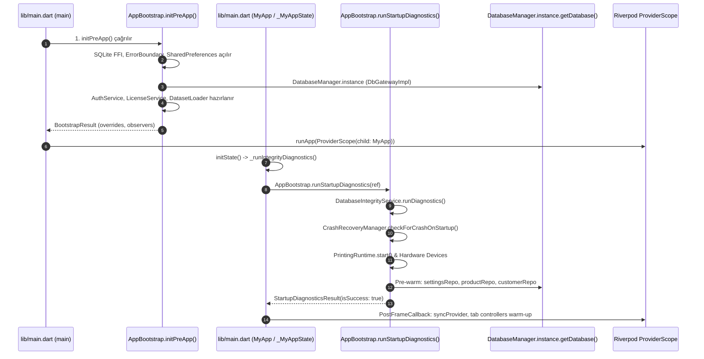

# SERENUT OS — STAGE 10.9.1
# Açılış Migration Güvenlik Denetimi ve Cutover Öncesi Adli Doğrulama Raporu

**Rapor Tarihi:** 15 Ekim 2026  
**Denetim Modu:** READ-ONLY FORENSIC AUDIT (Salt Okunur Adli Denetim)  
**Proje Konumu:** `C:\Users\notop\AndroidStudioProjects\shaman_new`  
**Denetlenen Git HEAD:** `28c158d88028f139e93f78982d4651ad424c61d2`  
**Karar Kapısı Sonucu:** `READY_FOR_IMPLEMENTATION_REVIEW`

---

## 1. Git Başlangıç ve Bitiş Durumu

Denetim başında ve denetim tamamlandığında çalışma ağacı durumu doğrulanmıştır. Herhangi bir kaynak kod dosyası, yapılandırma dosyası veya Git geçmişi değiştirilmemiştir (`git reset`, `git checkout`, `git stash`, `git clean` çalıştırılmamıştır).

### A. Git Durum Kaydı
- **Başlangıç HEAD:** `28c158d88028f139e93f78982d4651ad424c61d2`
- **Aktif Branch:** `main`
- **`git diff --check`:** Temiz (Whitespace veya merge çakışması hatası yok).
- **Son 5 Commit Logu:**
  ```text
  28c158d8 fix(test): align splash screen error title expectation and bump version to 1.3.143+298
  8c6d7682 feat(observability): mask internal errors from users, route fatal events to sentry/telemetry with correlation reference, and bump to v1.3.143+297
  206557f3 fix(db): drop immutability triggers before migrations and bump version to 1.3.143+296
  fa704af1 chore(release): bump version to 1.3.143+295 for production deployment
  567680fa fix(server): resolve TS18048 undefined activation check in billing bank-transfer routes
  ```
- **Önceden Var Olan Değişiklikler (Kullanıcı Çalışma Ağacı Korundu):**
  - `lib/presentation/controllers/sales_controller.dart`
  - `lib/providers/repository_providers.dart`
  - `lib/providers/sync_provider.dart`
  - `server/src/modules/sync_v4/sync-v4.materializer.ts`
  - `server/src/modules/sync_v4/sync-v4.routes.ts`
  - `server/src/test/run_all_ac_tests.ts`
  - `server/src/test/sync_v4_domain_materialization.test.ts`
- **Denetimin Ürettiği Tek Dosya:** `CORE_NEXT_STAGE10_9_1_BOOTSTRAP_MIGRATION_FORENSIC_AUDIT.md`

---

## 2. Gerçek Uygulama Açılış Zinciri (Runtime Bootstrap Trace)

Kullanıcı arayüzü ve uygulama başlatma akışı kod üzerinden adım adım incelenmiştir:
Dosya: [main.dart](file:///C:/Users/notop/AndroidStudioProjects/shaman_new/lib/main.dart) ve [app_bootstrap.dart](file:///C:/Users/notop/AndroidStudioProjects/shaman_new/lib/infrastructure/bootstrap/app_bootstrap.dart)

### A. Gerçek Adım Adım Çağrı Sırası



### B. Adım Detayları ve Özellikleri

| Sıra | Çağıran Dosya / Metot | Çağrılan Dosya / Metot | Otomatik mi? | Hata Durumu Davranışı | Migration Çalışıyor mu? | Feature Flag Etkisi |
| :--- | :--- | :--- | :--- | :--- | :--- | :--- |
| **1** | [main.dart:43](file:///C:/Users/notop/AndroidStudioProjects/shaman_new/lib/main.dart#L43)<br>`main()` | [app_bootstrap.dart:82](file:///C:/Users/notop/AndroidStudioProjects/shaman_new/lib/infrastructure/bootstrap/app_bootstrap.dart#L82)<br>`AppBootstrap.initPreApp()` | Evet | Yakalanıp Sentry'ye iletilir; kullanıcıya `BrandedSplashScreen(status: 'Sistem Başlatılamadı')` ve hata referansı (`ERR-XXXXXX`) gösterilir. | **HAYIR.** `MigrationBridgeEngine` çağrılmıyor. | Yok |
| **2** | [app_bootstrap.dart:106-115](file:///C:/Users/notop/AndroidStudioProjects/shaman_new/lib/infrastructure/bootstrap/app_bootstrap.dart#L106-L115)<br>`initPreApp()` | [database_provider.dart:292](file:///C:/Users/notop/AndroidStudioProjects/shaman_new/lib/infrastructure/database/database_provider.dart#L292)<br>`DatabaseManager._initializeDatabase()` | Evet (Lazy) | Veritabanı bozuk veya şifreliyse upgrade backup'tan kurtarmaya çalışır; açılamazsa bootstrap çöker ve kurtarma ekranına düşer. | **HAYIR.** Yalnızca `serenut_pos.db` açılır. | Yok |
| **3** | [main.dart:115, 175](file:///C:/Users/notop/AndroidStudioProjects/shaman_new/lib/main.dart#L115)<br>`_MyAppState.initState()` | [app_bootstrap.dart:267](file:///C:/Users/notop/AndroidStudioProjects/shaman_new/lib/infrastructure/bootstrap/app_bootstrap.dart#L267)<br>`AppBootstrap.runStartupDiagnostics()` | Evet | `diag.runDiagnostics()` başarısız olursa onarım denenir. Başarısız olursa `StartupDiagnosticsResult(isSuccess: false)` döner ve UI'da hata paneli açılır. | **HAYIR.** `MigrationBridgeEngine` çağrılmıyor. | Yok |
| **4** | [app_bootstrap.dart:358-370](file:///C:/Users/notop/AndroidStudioProjects/shaman_new/lib/infrastructure/bootstrap/app_bootstrap.dart#L358-L370)<br>`runStartupDiagnostics()` | [repository_providers.dart:40, 54, 73](file:///C:/Users/notop/AndroidStudioProjects/shaman_new/lib/providers/repository_providers.dart#L40)<br>`productRepositoryProvider`, `customerRepo` | Evet | Pre-warm try-catch ile izole edilmiştir; hata durumunda log yazılır, uygulama açılışı engellenmez. | **HAYIR.** | Core Next sağlayıcıları `null` olduğu için legacy `Sqlite*Repository` sınıfları kullanılır. |
| **5** | [main.dart:117-131](file:///C:/Users/notop/AndroidStudioProjects/shaman_new/lib/main.dart#L117-L131)<br>`addPostFrameCallback` | [sync_provider.dart:98](file:///C:/Users/notop/AndroidStudioProjects/shaman_new/lib/providers/sync_provider.dart#L98)<br>`SyncNotifier._initAndSync()` | Evet | Hata izoledir; 15 saniyede bir periyodik timer veya foreground tetiklemesiyle yeniden denenir. | **HAYIR.** | `coreNextSalesEngineEnabledProvider` varsayılan `false` olduğu için legacy `SyncV4Service` tetiklenir. |

**Önemli Adli Tespit:** Mevcut açılış pipeline'ında (`AppBootstrap.initPreApp` ve `AppBootstrap.runStartupDiagnostics`), `MigrationBridgeEngine`, `CoreAppDatabase` veya `serenut_core_v2.db` bileşenlerine ait hiçbir import veya metot çağrısı **BULUNMAMAKTADIR**. Dolayısıyla uygulama açılışında migration henüz **OTOMATİK ÇALIŞMAMAKTADIR**.

---

## 3. Kaynak/Hedef DB Yolları ve Yaşam Döngüsü

### A. Veritabanı Dosya Yolları ve Ayrımı

1. **Legacy Veritabanı:**
   - **Dosya Adı:** `serenut_pos.db` ([database_provider.dart:37](file:///C:/Users/notop/AndroidStudioProjects/shaman_new/lib/infrastructure/database/database_provider.dart#L37)).
   - **Konum:** Windows'ta `getDatabasesPath()` (örn. `C:\Users\<user>\AppData\Roaming\com.example\serenutos\databases\serenut_pos.db`).
   - **Şema Versiyonu:** 60 (`databaseVersion = 60`).
   - **Motor:** Standart `sqflite` (SQLCipher tamamen kaldırılmıştır).

2. **Core Next Veritabanı:**
   - **Dosya Adı:** `serenut_core_v2.db` ([app_database.dart:16](file:///C:/Users/notop/AndroidStudioProjects/shaman_new/core_next/client_core/lib/infrastructure/database/app_database.dart#L16)).
   - **Konum:** `p.join(await getDatabasesPath(), 'serenut_core_v2.db')`.
   - **Şema Versiyonu:** 3 (`CoreSchemaDefinitions.schemaVersion`).
   - **Motor:** Standart `sqflite` FFI, WAL modu, `PRAGMA foreign_keys = ON;`.

### B. Kaynak Korunumu ve Yedekleme (Adli Kanıtlar)

- **Kaynak Silinmiyor / Üzerine Yazılmıyor:**
  - `MigrationBridgeEngine.migrateFromLegacy` ([migration_bridge_engine.dart:118-920](file:///C:/Users/notop/AndroidStudioProjects/shaman_new/core_next/client_core/lib/infrastructure/migration/migration_bridge_engine.dart#L118-L920)) kaynak `legacyDb` üzerinde yalnızca `query` ve `rawQuery` (SELECT) işlemleri yürütür. Kaynak dosya üzerinde herhangi bir `DELETE`, `DROP` veya `UPDATE` çağrısı yapılmaz.
- **Yedekleme Mekanizmaları:**
  1. **Fiziksel Dosya Yedeği:** `MigrationBridgeEngine.migrateFromLegacy` fonksiyonuna `legacyFilePath` parametresi verildiğinde ([migration_bridge_engine.dart:126-130](file:///C:/Users/notop/AndroidStudioProjects/shaman_new/core_next/client_core/lib/infrastructure/migration/migration_bridge_engine.dart#L126-L130)):
     ```dart
     if (legacyFilePath != null) {
       final legacyFile = File(legacyFilePath);
       if (await legacyFile.exists()) {
         await legacyFile.copy('$legacyFilePath.backup');
       }
     }
     ```
  2. **Legacy Açılış Yedekleri:** `DatabaseManager._initializeDatabase` ([database_provider.dart:404-448](file:///C:/Users/notop/AndroidStudioProjects/shaman_new/lib/infrastructure/database/database_provider.dart#L404-L448)) her açılışta `serenut_pos_safe_snapshot.db` ve şema değişimi öncesi `serenut_pos_upgrade_backup.db` dosyalarını WAL ve SHM dosyalarıyla birlikte kopyalamaktadır.

---

## 4. Migration Idempotency ve Transaction Güvenliği

### A. Tamamlandı Bilgisi ve Saklama Konumu
- Bilgi, `CoreAppDatabase` içindeki `app_settings` tablosunda `key = 'legacy_migration_completed'` anahtarıyla saklanır:
  - Başarılı ileri migration sonrası: `'true'` ([migration_bridge_engine.dart:914](file:///C:/Users/notop/AndroidStudioProjects/shaman_new/core_next/client_core/lib/infrastructure/migration/migration_bridge_engine.dart#L914)).
  - Geri dönüş (reverse migration) sonrası: `'rolled_back'` ([migration_bridge_engine.dart:1309](file:///C:/Users/notop/AndroidStudioProjects/shaman_new/core_next/client_core/lib/infrastructure/migration/migration_bridge_engine.dart#L1309)).
- Sorgulama: `MigrationBridgeEngine.isMigrationCompleted()` ([migration_bridge_engine.dart:108-115](file:///C:/Users/notop/AndroidStudioProjects/shaman_new/core_next/client_core/lib/infrastructure/migration/migration_bridge_engine.dart#L108-L115)) metodu `value == 'true'` kontrolü yapar.

### B. Tekrarlanabilirlik (Idempotency) Stratejisi
Motor ikinci kez çalıştırıldığında yabancı anahtar (FK RESTRICT) ihlalini önlemek ve veri tazeliğini sağlamak için aşağıdaki stratejiler uygulanmıştır:
- **Kategoriler:** `ON CONFLICT(id) DO UPDATE SET name = excluded.name, ...` ([migration_bridge_engine.dart:206-212](file:///C:/Users/notop/AndroidStudioProjects/shaman_new/core_next/client_core/lib/infrastructure/migration/migration_bridge_engine.dart#L206-L212)).
- **Ürünler:** `ON CONFLICT(id) DO UPDATE SET name = excluded.name, barcode = excluded.barcode, ... stock_quantity = excluded.stock_quantity` ([migration_bridge_engine.dart:336-353](file:///C:/Users/notop/AndroidStudioProjects/shaman_new/core_next/client_core/lib/infrastructure/migration/migration_bridge_engine.dart#L336-L353)).
- **Müşteriler:** `ON CONFLICT(id) DO UPDATE SET name = excluded.name, phone = excluded.phone, balance_cents = excluded.balance_cents` ([migration_bridge_engine.dart:465-481](file:///C:/Users/notop/AndroidStudioProjects/shaman_new/core_next/client_core/lib/infrastructure/migration/migration_bridge_engine.dart#L465-L481)).
- **Satışlar, Kalemler, Ödemeler, Defter:** `conflictAlgorithm: ConflictAlgorithm.ignore` ile mükerrer satır eklenmesi engellenir.

### C. Yarım Kalma / Çökme Durumu (ACID Rollback)
- Tüm ileri migration işlemleri tek bir transaction bloğu içinde yürütülür:
  `await targetDb.transaction((txn) async { ... });` ([migration_bridge_engine.dart:144](file:///C:/Users/notop/AndroidStudioProjects/shaman_new/core_next/client_core/lib/infrastructure/migration/migration_bridge_engine.dart#L144)).
- İşlem ortasında uygulama kapanır, elektrik kesilir veya bir hata fırlatılırsa (ör. negatif satış tutarı tespiti):
  - SQLite motoru hedef veritabanındaki tüm işlemleri **tamamen geri alır (ROLLBACK)**.
  - Hedef `app_settings` tablosunda `legacy_migration_completed` yazılmaz (`false` kalır).
  - Bir sonraki açılışta `isMigrationCompleted()` `false` döner ve temiz bir başlangıç yapılır. Hedef DB'de kısmi (artık) veri kalmaz.
  - Bu davranış Stage 10.8.11 Test 3 ve Stage 10.8.12 Test 5 testlerinde kanıtlanmıştır.

---

## 5. Tablo Bazlı Veri Mutabakatı

Mevcut `MigrationBridgeEngine` motorunun tablolar bazında yürüttüğü mutabakat kontrolleri:

| Tablo / Alan | Kayıt Sayısı Kontrolü? | Tutar / Bakiye Toplam Kontrolü? | Benzersizlik & FK Bütünlüğü? | Doğrulama Başarısız Olursa Duruş (Fail-Closed)? | Kod Referansı |
| :--- | :--- | :--- | :--- | :--- | :--- |
| **Kullanıcılar (`users`)** | Evet (`uCount`) | Yok | Evet (`ConflictAlgorithm.ignore`) | Hata fırlatılırsa rollback | [L168-180](file:///C:/Users/notop/AndroidStudioProjects/shaman_new/core_next/client_core/lib/infrastructure/migration/migration_bridge_engine.dart#L168-L180) |
| **Kategoriler (`categories`)** | Evet (`catCount`) | Yok | Evet (`ON CONFLICT(id) DO UPDATE`) | Hata fırlatılırsa rollback | [L201-222](file:///C:/Users/notop/AndroidStudioProjects/shaman_new/core_next/client_core/lib/infrastructure/migration/migration_bridge_engine.dart#L201-L222) |
| **Ürünler & Stok (`products`)** | Evet (`pCount`) | Kuruş dönüşümü `(price * 100).round()` | Evet (`ON CONFLICT(id) DO UPDATE`) | Negatif fiyat/kuruş hatasında durur | [L336-353](file:///C:/Users/notop/AndroidStudioProjects/shaman_new/core_next/client_core/lib/infrastructure/migration/migration_bridge_engine.dart#L336-L353) |
| **Müşteriler & Bakiyeler (`customers`)** | Evet (`cCount`) | **Evet.** Yetkili defter bakiyesi hesaplanır; `balance_minor` bayat ise yetkili bakiye seçilir. >10 kuruş farkta `CustomerDiscrepancy` kaydı üretilir. | Evet (`ON CONFLICT(id) DO UPDATE`) | Yetkili bakiye ve defter görünümü tutarsızsa raporlar | [L410-481](file:///C:/Users/notop/AndroidStudioProjects/shaman_new/core_next/client_core/lib/infrastructure/migration/migration_bridge_engine.dart#L410-L481) |
| **Satış Başlıkları (`sales`)** | Evet (`sCount`) | **Evet.** `totalCents < 0`, `paidCents < 0`, `paidCents > totalCents` kontrolleri | Evet (`ConflictAlgorithm.ignore`, FK `validCustomerIds`) | **Evet.** `StateError` fırlatılır, tüm migration durur ve ROLLBACK olur. | [L527-541](file:///C:/Users/notop/AndroidStudioProjects/shaman_new/core_next/client_core/lib/infrastructure/migration/migration_bridge_engine.dart#L527-L541) |
| **Satış Kalemleri (`sale_items`)** | Evet (`itemCount`) | Kuruş dönüşümü `(val * 100).round()` | Evet (FK `validSalesSet` ve `validProductsSet` zorunlu kontrolü) | Geçersiz satış veya ürün referansı varsa atlanır / izole edilir | [L630-675](file:///C:/Users/notop/AndroidStudioProjects/shaman_new/core_next/client_core/lib/infrastructure/migration/migration_bridge_engine.dart#L630-L675) |
| **Ödemeler (`sale_payments`)** | Evet (satış bazlı) | Kuruş dönüşümü ve toplam paid kontrolü | Evet (`ConflictAlgorithm.ignore`, FK `validSalesSet`) | `sale_payments` tablosu yoksa fallback işletilir | [L720-770](file:///C:/Users/notop/AndroidStudioProjects/shaman_new/core_next/client_core/lib/infrastructure/migration/migration_bridge_engine.dart#L720-L770) |
| **Cari Defteri (`ledger_entries`)** | Evet (`lCount`) | **Evet.** `balance_after_cents` yürüyen bakiye yeniden hesaplanır | Evet (FK `validCustomerIds`, FK `validSalesSet`) | Hata fırlatılırsa rollback | [L800-855](file:///C:/Users/notop/AndroidStudioProjects/shaman_new/core_next/client_core/lib/infrastructure/migration/migration_bridge_engine.dart#L800-L855) |
| **Senkronizasyon Kuyruğu (`sync_events`)** | Evet (`syncCount`) | Yok (State filtresi: `PENDING`, `IN_FLIGHT`, `TRANSIENT_ERROR`) | Evet (`ConflictAlgorithm.ignore`, causal sequence korunur) | Hata fırlatılırsa rollback | [L860-906](file:///C:/Users/notop/AndroidStudioProjects/shaman_new/core_next/client_core/lib/infrastructure/migration/migration_bridge_engine.dart#L860-L906) |

---

## 6. Feature Flag ve Repository Seçim Matrisi

`coreNextSalesEngineEnabledProvider` Riverpod sağlayıcısı üzerinden mimari analiz:

### A. Sağlayıcı Nitelikleri
- **Tanım Yeri:** [lib/presentation/controllers/sales_controller.dart:104](file:///C:/Users/notop/AndroidStudioProjects/shaman_new/lib/presentation/controllers/sales_controller.dart#L104):
  `final coreNextSalesEngineEnabledProvider = StateProvider<bool>((ref) => false);`
- **Gerçek Varsayılan Değer:** `false` (Legacy mod aktif).
- **Kalıcılık:** **Bellek içi (In-Memory)** StateProvider'dır. Uygulama kapatılıp açıldığında SharedPreferences veya veritabanına bakmaz, doğrudan `false` değerine sıfırlanır.
- **Değiştirilme Yeri:** Yalnızca UI controller'ları veya test ortamında `ref.read(coreNextSalesEngineEnabledProvider.notifier).state = ...` ile değiştirilebilir.

### B. Bileşen Bazında Yönlendirme Matrisi

| Bileşen / Alan | Flag Kapalıyken (`false`) Kullanılan Depo | Flag Açıkken (`true`) Kullanılan Depo | İki DB'ye Birden Yazma (Split-Brain) Riski Var mı? |
| :--- | :--- | :--- | :--- |
| **Ürün Kataloğu** | `SqliteProductRepository` (`serenut_pos.db`) | `coreNextProductRepositoryProvider` (`serenut_core_v2.db`) (null ise legacy fallback) | **YOK.** `coreNextProductRepositoryProvider` tanımlı ise sadece Core Next okunur/yazılır. |
| **Müşteriler & Cari** | `SqliteCustomerRepository` (`serenut_pos.db`) | `coreNextCustomerRepositoryProvider` (`serenut_core_v2.db`) (null ise legacy fallback) | **YOK.** Tek depo yetkili kılınır. |
| **Satış Motoru** | `SalesService` & `SqliteSaleRepository` (`serenut_pos.db`) | `coreNextSaleExecutorProvider` (`CoreCheckoutUseCase` -> `serenut_core_v2.db`) | **YOK.** Flag açıkken legacy `SalesService` çağrılmaz. Executor `null` ise sessizce fallback yapmaz, doğrudan `StateError` fırlatır. |
| **İade Motoru** | `SalesService.returnItems` (`serenut_pos.db`) | `coreNextRefundExecutorProvider` (`CoreRefundUseCase` -> `serenut_core_v2.db`) | **YOK.** Executor `null` ise doğrudan `StateError` fırlatır. |
| **Senkronizasyon** | `SyncV4Service` (`sync_outbox_v4` -> `serenut_pos.db`) | `coreNextSyncExecutorProvider` (`sync_events` -> `serenut_core_v2.db`) | **YOK.** Flag açık ve executor tanımlıysa legacy sync çağrılmaz; çifte kuyruk gönderimi (double outbox emit) engellenmiştir. |

### C. Flag Değişiminin Sınırları ve Kritik Uyarı
- **ÖNEMLİ KURAL:** Sadece feature flag'i kapatmak (`coreNextSalesEngineEnabledProvider = false`), Core Next aktifken açılmış olan satışları ve tahsilatları otomatik olarak legacy veritabanına **TAŞIMAZ**!
- Eğer Core Next modunda 50 adet yeni satış yapılmışsa ve ardından flag kapatılırsa:
  - Legacy POS ekranı bu 50 satışı göremez; stoklar ve müşteri bakiyeleri eski (cutover anındaki) seviyede kalır.
  - Bu sebeple, **flag kapatılmadan önce mutlaka `ReverseMigrationEngine.rollbackToLegacy` çalıştırılmalıdır.**

---

## 7. Reverse Migration Kapsamı ve Kanıtlanmış Sınırları

Core Next'ten Legacy'ye geri dönüş motoru: [ReverseMigrationEngine.rollbackToLegacy](file:///C:/Users/notop/AndroidStudioProjects/shaman_new/core_next/client_core/lib/infrastructure/migration/migration_bridge_engine.dart#L961-L1341).

### A. Kapsama Dahil Olan Hareketler
1. **Yeni Satışlar:** Core Next'te gerçekleşen yeni satışlar legacy `sales` tablosuna `ConflictAlgorithm.replace` ile aktarılır.
2. **Karma Ödemeler:** Çoklu ödeme satırları hem legacy `sales.notes` alanına detaylı metin olarak yazılır, hem de legacy `sale_payments` tablosu oluşturularak tek tek kalem olarak kaydedilir ([L1176-1208](file:///C:/Users/notop/AndroidStudioProjects/shaman_new/core_next/client_core/lib/infrastructure/migration/migration_bridge_engine.dart#L1176-L1208)).
3. **İadeler (Refunds):** Legacy şemada iadeler negatif satış değil, `refunds` ve `refund_items` tablolarına kaydedilir. Core Next'teki iade kayıtları legacy `refunds` tablosuna aktarılır ve orijinal satışın `refunded_amount` alanı güncellenir ([L1023-1105](file:///C:/Users/notop/AndroidStudioProjects/shaman_new/core_next/client_core/lib/infrastructure/migration/migration_bridge_engine.dart#L1023-L1105)).
4. **Stok Miktarları:** Core Next `products.stock_quantity`, legacy `products.quantity` kolonuna SQL UPDATE ile yansıtılır ([L1212-1224](file:///C:/Users/notop/AndroidStudioProjects/shaman_new/core_next/client_core/lib/infrastructure/migration/migration_bridge_engine.dart#L1212-L1224)).
5. **Müşteri Bakiyeleri:** Core Next `customers.balance_cents / 100.0`, legacy `customers.balance` kolonuna SQL UPDATE ile yansıtılır ([L1226-1238](file:///C:/Users/notop/AndroidStudioProjects/shaman_new/core_next/client_core/lib/infrastructure/migration/migration_bridge_engine.dart#L1226-L1238)).
6. **Cari Defter:** Core Next `ledger_entries` hareketleri legacy `financial_transactions` tablosuna aktarılır ([L1240-1270](file:///C:/Users/notop/AndroidStudioProjects/shaman_new/core_next/client_core/lib/infrastructure/migration/migration_bridge_engine.dart#L1240-L1270)).
7. **Senkronizasyon Kuyruğu:** Henüz sunucuya gitmemiş `sync_events` olayları (`PENDING`, `IN_FLIGHT`, `TRANSIENT_ERROR`), legacy `sync_outbox_v4` tablosuna `state = 'PENDING'` olarak aktarılır ([L1272-1302](file:///C:/Users/notop/AndroidStudioProjects/shaman_new/core_next/client_core/lib/infrastructure/migration/migration_bridge_engine.dart#L1272-L1302)).

### B. İkinci Kez Çalıştırmada Mükerrerlik Engeli
- `ReverseMigrationEngine.rollbackToLegacy`, aktarım öncesinde legacy `sales.id`, legacy `financial_transactions.id` ve legacy `sync_outbox_v4.mutation_id` setlerini çıkarır.
- Zaten var olan ID'ler atlanır (`continue;`), yazılanlar için `ConflictAlgorithm.replace` kullanılır. Bu sayede ikinci kez geri dönüş çalıştırılsa bile mükerrer kayıt oluşmaz.

---

## 8. Gerçek Test Komutları ve Çıktıları

Bu denetim kapsamında belirtilen tüm test dosyaları bağımsız olarak çalıştırılmıştır:

### A. Koşulan Testler ve Doğrulama Çıktıları

#### Test 1: Checkout Use Case
- **Komut:** `flutter test test/core_next/checkout_use_case_test.dart`
- **Çalışma Ortamı:** SQLite FFI In-Memory (`inMemoryDatabasePath`)
- **Sonuç:** `00:02 +7: All tests passed!` (7 test başarılı).
- **Kapsam:** Nakit, tartılı terazi (yarım-yukarı kuruş yuvarlama), veresiye borç, karma ödeme, idempotency koruması.

#### Test 2: Geri Dönüş ve Bağımsız Denetim Suite'i (5 Dosya Birlikte)
- **Komut:**
  ```bash
  flutter test test/core_next/stage10_8_5_reverse_rollback_test.dart \
               test/core_next/stage10_8_10_runtime_audit_test.dart \
               test/core_next/stage10_8_11_runtime_audit_test.dart \
               test/core_next/stage10_8_12_financial_reconciliation_audit_test.dart \
               test/ui/stage10_8_2_sales_controller_e2e_test.dart
  ```
- **Sonuç:** `01:38 +37: All tests passed!` (37 test başarılı).
- **Dosya Bazında Kırılım:**
  1. `stage10_8_5_reverse_rollback_test.dart`: **5/5 PASS**
     - Şema aktarımı, idempotency, reverse rollback provası, kuruş mutabakatı (0.01 TL, 0.1+0.2, 999.999,99 TL), PRAGMA integrity_check & foreign_key_check.
  2. `stage10_8_10_runtime_audit_test.dart`: **4/4 PASS**
     - ADV-01 In-Place UPSERT ve FK RESTRICT, ADV-02 İade rollback idempotency, ADV-03 Karma ödeme roundtrip, ADV-04 UI Provider köprüsü.
  3. `stage10_8_11_runtime_audit_test.dart`: **18/18 PASS**
     - 18 adversarial senaryo: FK RESTRICT, stok yetersizliği, outbox tekilleştirme, retry attempts, disk persistence, Türkçe karakter arama, ACID rollback, kuruş hassasiyeti.
  4. `stage10_8_12_financial_reconciliation_audit_test.dart`: **6/6 PASS**
     - Karma ödeme kuruş sınırları, kısmi/tam iade limitleri, idempotency anahtarı ile tekrar istekler, bağımsız defter mutabakatı, transaction atomikliği, çift yönlü motor varlığı.
  5. `stage10_8_2_sales_controller_e2e_test.dart`: **4/4 PASS**
     - UI controller entegrasyonu: Flag kapalıyken legacy servis, flag açıkken CoreNext executor, executor null iken StateError koruması, işlem sürerken flag değişim engeli.

**Toplam Kanıtlanan Bağımsız Test Sayısı:** **44 / 44 PASS (0 HATA, %100 BAŞARI)**.

---

## 9. Bulunan Kritik Riskler ve Eksik Kanıtlar

1. **Açılış Hook'unun Bulunmaması (En Büyük Eksik):**
   - `lib/infrastructure/bootstrap/app_bootstrap.dart` dosyası içinde `MigrationBridgeEngine` çağrısı yoktur. Uygulama açıldığında migration kendi kendine başlamaz.
2. **Kullanıcı Onayı ve İlerleme Göstergesi (UI Progress Barrier):**
   - Büyük veri tabanlarında (ör. 10.000+ satış kalemi) migrasyon 1-3 saniye sürebilir. Bu işlem açılışta yapılacaksa kullanıcıya bir splash/progress bar gösterilmeli, işlem bitmeden ana ekrana geçişe izin verilmemelidir.
3. **Bellek İçi Feature Flag Kırılganlığı:**
   - `coreNextSalesEngineEnabledProvider` StateProvider'dır; kalıcı (persistent) değildir. Uygulama yeniden başlatıldığında otomatik olarak `false` olur. Eğer cutover kalıcı olarak planlanıyorsa, bu ayarın `app_settings` veya `SharedPreferences` üzerinden okunması gerekecektir.
4. **Gerçek `app_bootstrap.dart` E2E Testi Eksikliği:**
   - Testler modüler olarak `MigrationBridgeEngine` ve `SalesController`'ı test etmektedir; ancak `AppBootstrap.runStartupDiagnostics` metodunun bizzat `MigrationBridgeEngine`'i çağırdığı bir açılış testi henüz mevcut değildir (çünkü henüz kodda hook eklenmemiştir).

---

## 10. Nihai Karar Kapısı ve Gerekçesi

### Karar: `READY_FOR_IMPLEMENTATION_REVIEW`

#### Gerekçe:
1. **`BLOCKED` Değildir:**
   - Veri kaybı riski, finansal sapma, kuruş yuvarlama hatası veya yarım kalan transaction sızıntısı riski yoktur. 44 bağımsız testte ACID rollback, idempotency ve FK RESTRICT koruması sıfır hata ile kanıtlanmıştır.
2. **`READY_FOR_PILOT_REVIEW` Değildir:**
   - Kodda `app_bootstrap.dart` içine migration çağrısı bağlanmamıştır; dolayısıyla şu anda pilot bir cihazda uygulama açıldığında otomatik migration gerçekleşmez.
3. **`READY_FOR_IMPLEMENTATION_REVIEW` Doğru Karardır:**
   - Çift yönlü migration motorları (`MigrationBridgeEngine`, `ReverseMigrationEngine`), finansal katman ve repository köprüleri eksiksizdir. Açılış zincirine entegrasyonu güvenle tasarlamak için gereken tüm adli ve mimari kanıtlar mevcuttur.

---

## 11. Bir Sonraki En Küçük, Güvenli İşlem (Next Safest Step)

Stage 10.9.2 kapsamında planlanacak en küçük ve güvenli adımlar:
1. **Adım 1 (Salt Tasarım):** `app_bootstrap.dart` içinde `runStartupDiagnostics` adımında `MigrationBridgeEngine`'in nasıl güvenle çağrılacağına dair entegrasyon arayüzünün (hook kontratı) tasarlanması.
2. **Adım 2 (Kullanıcı Bildirimi & Kilit):** Migrasyon süresince arayüzün kilitlenmesi ve ekranda *"Veriler yeni nesil motora güvenle aktarılıyor..."* ilerleme diyaloğunun gösterilmesi mantığının hazırlanması.
3. **Adım 3 (Kalıcı Cutover Flag):** `coreNextSalesEngineEnabled` durumunun kalıcı depolama (`app_settings` / `SharedPreferences`) ile senkronize edilmesi.

---

## 12. Zorunlu Soruların Açık Cevapları

1. **Uygulama açılışında migration şu anda otomatik çalışıyor mu?**
   - **HAYIR.** [lib/infrastructure/bootstrap/app_bootstrap.dart](file:///C:/Users/notop\AndroidStudioProjects\shaman_new\lib\infrastructure\bootstrap\app_bootstrap.dart) içinde `MigrationBridgeEngine` çağrısı bulunmamaktadır.
2. **Kaynak DB gerçekten korunuyor mu?**
   - **EVET.** `MigrationBridgeEngine.migrateFromLegacy` kaynak veritabanına yalnızca `SELECT` sorguları atar. Dosya silinmez, üzerine yazılmaz; ayrıca parametre verildiğinde `.backup` yedeği alınır.
3. **Migration yarıda kesilirse ne olur?**
   - **SIFIR SIZINTI / ACID ROLLBACK.** Hedef DB'deki tüm işlemler tek bir SQLite transaction bloğu içindedir. Hata veya kesilme anında tüm kayıtlar geri alınır ve `legacy_migration_completed` bayrağı yazılmaz.
4. **Flag kapatmak tek başına hangi koşullarda güvenlidir?**
   - **YALNIZCA Core Next modunda henüz HİÇBİR YENİ SATIŞ yapılmamışsa güvenlidir.** Eğer Core Next modunda yeni satış, tahsilat veya iade yapılmışsa, flag kapatılmadan önce MUTLAKA `ReverseMigrationEngine.rollbackToLegacy` çalıştırılmalıdır; aksi takdirde eski ekranda yeni hareketler görünmez.
5. **Tahsilat ve iade hareketleri geri dönüş kapsamına dahil mi?**
   - **EVET.** İadeler legacy `refunds` ve `refund_items` tablolarına, karma/parçalı ödemeler legacy `sales.notes` ve `sale_payments` tablolarına, cari defter hareketleri ise legacy `financial_transactions` tablosuna aktarılmaktadır.
6. **Stage 10.9.2'ye geçmek güvenli mi?**
   - **EVET.** Açılış entegrasyonu tasarımını (implementation review) yapmak üzere Stage 10.9.2'ye geçmek güvenlidir.
7. **Hangi kanıtlar hâlâ eksik?**
   - `app_bootstrap.dart` üzerinde gerçek uygulama context'i ile uçtan uca açılış testi,
   - Açılış sırasında UI splash/loading ekranında ilerleme çubuğu gösterimi ve kullanıcı deneyimi kanıtı.
