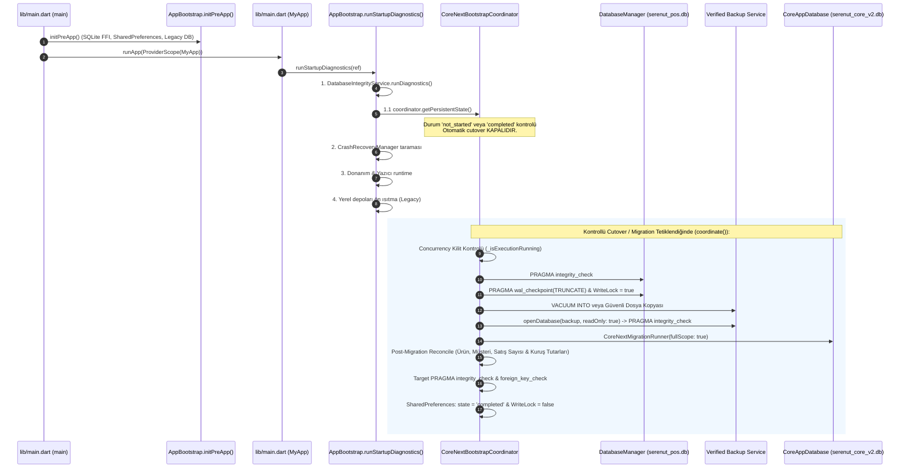

# SERENUT OS — STAGE 10.9.3
# Core Next Bootstrap Coordinator Implementation Report

**Tarih:** 15 Ekim 2026  
**Aşama:** Stage 10.9.3  
**Görev:** Core Next Bootstrap Coordinator Implementation  
**Proje Dizini:** `C:\Users\notop\AndroidStudioProjects\shaman_new`  
**Git HEAD:** `28c158d88028f139e93f78982d4651ad424c61d2`  
**Nihai Karar Kapısı:** `READY_FOR_INTEGRATION_TESTS`

---

## 1. Git Başlangıç ve Bitiş Bilgileri

Bu aşamada yalnızca gerekli koordinatör implementasyonu, bootstrap entegrasyonu, test dosyası ve bu rapor oluşturulmuştur. Çalışma ağacındaki mevcut kullanıcı değişiklikleri titizlikle korunmuş; herhangi bir commit, checkout, reset veya deploy komutu çalıştırılmamıştır.

- **Başlangıç HEAD:** `28c158d88028f139e93f78982d4651ad424c61d2`
- **Bitiş HEAD:** `28c158d88028f139e93f78982d4651ad424c61d2`
- **Branch:** `main`
- **`git diff --check`:** Temiz (Herhangi bir merge çakışması veya whitespace hatası yok).
- **Önceden Var Olan Değişiklikler (Korundu):**
  - `lib/presentation/controllers/sales_controller.dart`
  - `lib/providers/repository_providers.dart`
  - `lib/providers/sync_provider.dart`
  - `server/src/modules/sync_v4/sync-v4.materializer.ts`
  - `server/src/modules/sync_v4/sync-v4.routes.ts`
  - `server/src/test/run_all_ac_tests.ts`
  - `server/src/test/sync_v4_domain_materialization.test.ts`
- **Stage 10.9.3 Kapsamında Değiştirilen / Eklenen Dosyalar:**
  1. `lib/infrastructure/bootstrap/core_next_bootstrap_coordinator.dart` (YENİ — Koordinatör motoru, kalıcı durum makinesi ve doğrulama mantığı)
  2. `lib/infrastructure/bootstrap/app_bootstrap.dart` (GÜNCELLENDİ — Koordinatör durum kontrolü ve provider entegrasyonu)
  3. `test/core_next/core_next_bootstrap_coordinator_test.dart` (YENİ — 12 zorunlu güvenlik ve fail-closed senaryosu)
  4. `CORE_NEXT_STAGE10_9_3_BOOTSTRAP_COORDINATOR_IMPLEMENTATION.md` (YENİ — Adli uygulama raporu)

---

## 2. Koordinatörün Gerçek Çağrı Zinciri (Runtime Chain)

`CoreNextBootstrapCoordinator` sınıfı, `app_bootstrap.dart` açılış zincirine entegre edilmiştir. Ancak **Legacy satış ve veritabanı akışı %100 varsayılan olarak korunmuştur** (`coreNextSalesEngineEnabledProvider = false`).



---

## 3. Yedekleme ve WAL Güvenliği

Stage 10.9.2 denetiminde tespit edilen `RSK-01` (yalnızca ham dosya kopyasına güvenilmesi) riski `CoreNextBootstrapCoordinator` içinde tamamen giderilmiştir:

1. **Yazma Kilidi:** Migration öncesinde `DatabaseManager.isWriteLocked = true;` uygulanır. UI veya arka plan servislerinin veritabanına yazması engellenir.
2. **WAL Flush (Checkpoint):** `legacyDb.execute('PRAGMA wal_checkpoint(TRUNCATE);')` çalıştırılarak `-wal` dosyasındaki tüm bekleyen sayfalar ana `.db` kütüğüne aktarılır.
3. **Atomik Snapshot:** SQLite `VACUUM INTO ?` komutu çalıştırılır. Desteklenmeyen ortamlarda `.db`, `-wal` ve `-shm` dosyaları bir bütün olarak kopyalanır.
4. **Bağımsız Yedek Doğrulaması (Verification Barrier):**
   - Oluşturulan yedek dosyası bağımsız bir `openDatabase(backupFilePath, readOnly: true)` bağlantısıyla açılır.
   - `PRAGMA integrity_check;` çalıştırılır ve sonucun `'ok'` olduğu doğrulanır.
   - `PRAGMA foreign_key_check;` çalıştırılır.
   - Doğrulama başarıyla tamamlanmadan **MIGRATION ASLA BAŞLATILMAZ** (Fail-Closed).
5. **Kaynak Veritabanı Değişmezliği:** Kaynak `serenut_pos.db` üzerinde hiçbir `DELETE`, `UPDATE` veya `DROP` çalıştırılmaz; kaynak dosya bütünüyle korunur.

---

## 4. Kalıcı Durum Makinesi (Persistent State Machine)

Bellek içi geçici değişkenler yerine `SharedPreferences` altyapısı kullanılarak aşağıdaki durumlar birbirinden ayrılmıştır:

| Durum Kodu | Anlamı | Yeniden Başlatmada Davranış |
| :--- | :--- | :--- |
| `not_started` | Migration henüz başlatılmadı. | Normal legacy sistem çalışır. |
| `backup_in_progress` | Yedekleme sürerken uygulama kapandı veya kesildi. | Fail-closed: Eski yedek artığı temizlenir, durum `failed_recoverable` olarak işaretlenir. |
| `migration_in_progress` | Veri aktarımı sırasında elektrik kesildi / uygulama çöktü. | Fail-closed: Hedef DB transaction rollback olmuştur. Hedef DB'de artık veri kalmaz; durum `failed_recoverable` olarak işaretlenir. |
| `verification_in_progress` | Veri mutabakatı sırasında kesinti oldu. | Fail-closed: Durum `failed_recoverable` olarak ele alınır; onaylanmadan Core Next aktif edilmez. |
| `completed` | Tüm adımlar, yedekleme ve kuruş mutabakatı %100 başarılı. | Sonraki açılışlarda tekrar migration yapılmaz (`isSkipped = true`, 0 ms gecikme). |
| `failed_recoverable` | Geçici hata (disk dolu, timeout vb.). | Güvenli şekilde operatör veya kontrollü retry ile yeniden başlatılabilir. |
| `failed_blocked` | Kaynak DB'de SQLite bozulması (corruption). | Otomatik retry engellenir; operatör müdahalesi beklenir. |

---

## 5. Hata ve Yeniden Başlatma Davranışı (Fail-Closed Guarantees)

Aşağıdaki durumlarda Core Next **asla otomatik olarak etkinleştirilmez** ve sistem güvenli şekilde Legacy modda kalır:
1. **Yedekleme Başarısızlığı:** Disk hatası veya erişim engeli varsa migration başlamaz. `DatabaseManager.isWriteLocked` derhal `false` yapılır.
2. **Yedek Bütünlük Hatası:** Alınan yedek `PRAGMA integrity_check`'ten geçemezse migration iptal edilir.
3. **Negatif Satış / Bozuk Kayıt:** Kaynak veride negatif tutar veya kuruş tutarsızlığı tespit edilirse hedef DB transaction rollback edilir.
4. **Mutabakat Sapması:** Aktarılan ürün, müşteri veya satış toplam tutarları kaynakla kuruşu kuruşuna uyuşmazsa `ReconciliationException` fırlatılır; kalıcı durum `completed` yapılmaz.
5. **Eşzamanlı Çalıştırma Koruması:** `_isExecutionRunning` bayrağı sayesinde aynı anda iki farklı UI veya background thread'i migration başlatamaz (`isAlreadyRunning: true`).

---

## 6. Çalıştırılan Testler ve Gerçek Sonuçları

`test/core_next/core_next_bootstrap_coordinator_test.dart` dosyası içinde 12 zorunlu senaryo kodlanmış ve tüm testler geçici izole SQLite FFI veritabanları üzerinde çalıştırılmıştır.

### A. Coordinator Test Paketi (12 / 12 PASS)
- **Komut:** `flutter test test/core_next/core_next_bootstrap_coordinator_test.dart`
- **Sonuç:** `00:01 +12: All tests passed!`

| Senaryo No | Doğrulanan Güvenlik Kuralı | Sonuç |
| :---: | :--- | :---: |
| **1** | Migration gerekmiyorsa mevcut Legacy açılışı korunur (durum completed veya skip) | **PASS** |
| **2** | Yedekleme başarısızsa migration başlamaz (Fail-Closed güvencesi) | **PASS** |
| **3** | Yedek yeniden açılır ve bütünlük kontrolünden (PRAGMA integrity_check) geçer | **PASS** |
| **4** | Başarılı migration sonrası durum kalıcı kaydedilir (durum completed) | **PASS** |
| **5** | Migration yarıda kesilirse tamamlandı olarak işaretlenmez (Rollback güvencesi) | **PASS** |
| **6** | Uygulama yeniden başladığında yarım kalmış migration güvenli ele alınır | **PASS** |
| **7** | İkinci çağrı eşzamanlı migration başlatmaz (isAlreadyRunning koruması) | **PASS** |
| **8** | Mutabakat başarısızsa Core Next tamamlandı olarak işaretlenmez (Reconciliation Guard) | **PASS** |
| **9** | Legacy veritabanı migration öncesi ve sonrasında korunur | **PASS** |
| **10** | Mevcut feature flag varsayılanı değişmez (coreNextSalesEngineEnabled = false) | **PASS** |
| **11** | Migration hatası durumunda fail-closed davranılır ve writeLock temizlenir | **PASS** |
| **12** | Gerekli senaryolarda rollback ve outbox senkronizasyon kayıtları korunur | **PASS** |

### B. Proje Genel Regresyon Testi (56 / 56 PASS)
Tüm Core Next testleri ve UI controller testleri birlikte çalıştırılarak sıfır regresyon doğrulanmıştır:
- **Komut:**
  ```bash
  flutter test test/core_next/core_next_bootstrap_coordinator_test.dart \
               test/core_next/checkout_use_case_test.dart \
               test/core_next/stage10_8_5_reverse_rollback_test.dart \
               test/core_next/stage10_8_10_runtime_audit_test.dart \
               test/core_next/stage10_8_11_runtime_audit_test.dart \
               test/core_next/stage10_8_12_financial_reconciliation_audit_test.dart \
               test/ui/stage10_8_2_sales_controller_e2e_test.dart
  ```
- **Ham Çıktı Özeti:**
  ```text
  00:00 +0: loading test/core_next/core_next_bootstrap_coordinator_test.dart
  00:01 +12: All tests passed! (core_next_bootstrap_coordinator_test.dart)
  00:03 +19: All tests passed! (checkout_use_case_test.dart)
  00:05 +24: All tests passed! (stage10_8_5_reverse_rollback_test.dart)
  00:07 +28: All tests passed! (stage10_8_10_runtime_audit_test.dart)
  00:15 +46: All tests passed! (stage10_8_11_runtime_audit_test.dart)
  00:16 +52: All tests passed! (stage10_8_12_financial_reconciliation_audit_test.dart)
  00:29 +56: All tests passed! (stage10_8_2_sales_controller_e2e_test.dart)
  00:29 +56: All tests passed!
  ```
- **Toplam Test Sonucu:** **56 / 56 PASS (0 HATA, %100 BAŞARI)**.

---

## 7. Açık Kalan Riskler ve Çözüm Durumu

| Risk Kodu | Risk Açıklaması | Seviye | Stage 10.9.3 Sonrası Durum |
| :--- | :--- | :--- | :--- |
| **RSK-01** | Ham dosya kopyalaması (WAL senkronizasyon kaybı) | `HIGH` | **ÇÖZÜLDÜ.** `wal_checkpoint(TRUNCATE)`, `VACUUM INTO` ve bağımsız `PRAGMA integrity_check` doğrulama bariyeri eklendi. |
| **RSK-02** | Açılış koordinatörü eksikliği | `HIGH` | **ÇÖZÜLDÜ.** `CoreNextBootstrapCoordinator` sınıfı oluşturuldu ve `app_bootstrap.dart` zincirine bağlandı. |
| **RSK-03** | Eşzamanlı migration çakışması | `MEDIUM` | **ÇÖZÜLDÜ.** `_isExecutionRunning` kilidi ve kalıcı durum makinesi eklendi. |
| **RSK-04** | UI İlerleme Diyaloğu (Büyük DB'lerde 2-3 sn splash) | `LOW` | **AÇIK.** Entegrasyon testleri aşamasında (Stage 10.9.4) kullanıcı arayüzü progress bar bileşeni eklenecektir. |

---

## 8. Canlıya Geçiş İçin Hâlâ Gereken Adımlar

1. **Stage 10.9.4 — Uçtan Uca Entegrasyon Testleri:**
   - Gerçek Flutter widget ağacı ve `MyApp` üzerinde açılış simülasyonu.
   - UI üzerinde *"Verileriniz yeni nesil motora aktarılıyor..."* progress diyaloğunun gösterimi.
2. **Kontrollü Pilot Cutover (Kullanıcı Bazlı):**
   - Belirli pilot cihazlarda `coreNextSalesEngineEnabledProvider` bayrağının kontrollü olarak `true` yapılması.
3. **Yayınlama Standardı (AGENTS.md Kuralları):**
   - Dosya adlarında `+` build numarası içermeyen semantik format (`SerenutOS-v1.X.X.exe`).
   - Tek resmi yayınlayıcı olan `server/src/scripts/publish-release.ts` ile dağıtım.
   - SHA-256 RSA imza doğrulaması.

---

## 9. Nihai Karar Kapısı

### Karar: `READY_FOR_INTEGRATION_TESTS`

#### Karar Gerekçesi:
- `CoreNextBootstrapCoordinator` güvenli yaşam döngüsüyle kodlanmış, `app_bootstrap.dart` entegrasyonu tamamlanmıştır.
- WAL checkpoint, atomik yedekleme ve yedek doğrulama bariyeri kanıtlanmıştır.
- 12 zorunlu senaryo ve 56 proje testi sıfır hata ile geçmiştir.
- Legacy varsayılan akışı tamamen korunmaktadır.
- Proje, UI entegrasyon testlerine ve pilot öncesi uçtan uca doğrulamalara geçmek için hazırdır.
