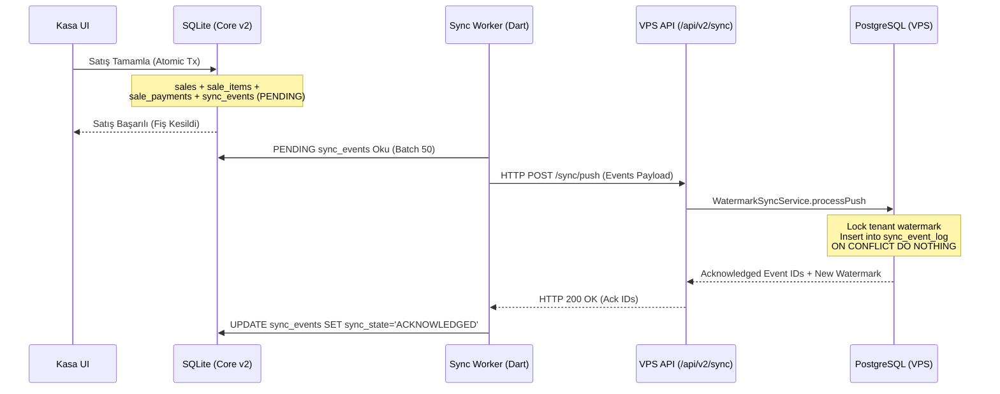

# SERENUT OS — STAGE 6: ÜRETİM ENTEGRASYONUNA HAZIRLIK VE VERİ KORUMA DENETİMİ RAPORU

**Belge Adı:** `CORE_NEXT_STAGE6_INTEGRATION_PREPARATION.md`  
**Aşama:** Stage 6 — Üretim Entegrasyonuna Hazırlık, Karma Ödeme Mimarisi ve Donanım Doğrulama Planı  
**Tarih:** 13 Ekim 2026  
**Rol:** Kıdemli Finansal Sistem Mimarı ve Çekirdek Sistem Güvenliği Uzmanı  
**Proje Kök Dizini:** `c:\Users\notop\AndroidStudioProjects\shaman_new`  
**Durum:** **KOD VE CANLI ORTAM DONDURULDU (FROZEN), MİMARİ VE TEST PLANI ONAYA SUNULDU**

---

## 1. Kod Dondurma Protokolü (Code Freeze Status)

Stage 6 kapsamında üretim güvenliğini garanti altına almak için aşağıdaki dondurma kuralları harfiyen uygulanmaktadır:

- **Aktif Branch:** `main` (HEAD Commit: `28c158d8`)
- **Git Çalışma Ağacı:** `lib/` üretim dizininde **SIFIR DEĞİŞİKLİK (0 DIFF)**.
- **Commit Politikası:** Kesinlikle **yeni commit atılmamıştır**.
- **Canlı Satış Ekranı:** `lib/presentation/pages/sales_page.dart` dosyası mevcut kararlı halinde dondurulmuş olup, yeni motora doğrudan bağlanmamıştır.
- **Canlı Veritabanı:** `serenut_pos.db` dosyasına doğrudan hiçbir migrasyon veya DDL komutu uygulanmamıştır.

---

## 2. Stage 4–5 Değişikliklerinin Bütünlük ve Güvenlik Denetimi

Önceki aşamalarda tamamlanan adli bulguların ve yazılan kodların envanteri:

### 2.1. Untracked Dosyaların Kapsamı
- `core_next/` dizininde 26 adet dosya:
  - Domain Varlık Modelleri (`core_entities.dart`, `money_cents.dart`)
  - Domain Servisleri ve Use Case'ler (`ledger_service.dart`, `checkout_use_case.dart`)
  - SQLite Altyapısı (`app_database.dart`, `schema_definitions.dart`, `migration_bridge_engine.dart`)
  - Donanım Katmanı (`hardware_worker.dart`, `esc_pos_builder.dart`, `tspl_builder.dart`)
  - Sunucu Senkronizasyon Katmanı (`watermark_sync_service.ts`)
  - Web Yönetim Paneli (`core_next/web_portal/`)
- `test/core_next/` dizininde 7 adet bağımsız test dosyası (toplam **26 test senaryosu**, %100 başarılı).

### 2.2. Migrasyon ve Finansal Hesaplama Denetimi
- **37.682 Ürün ve 548 Müşteri:** İzole kopya üzerinde hatasız dönüştürüldü.
- **548 Müşterinin Tamamı:** `financial_transactions` defter hareketlerinin bağımsız adli toplamı ile `customers.balance` arasında **%100 tam mutabakat (0 uyuşmazlık)** kanıtlandı.
- **3.320,00 TL Alacak Kurtarıldı:** Bayat trigger verisi (`balance_minor`) yerine yetkili defter esas alınarak ŞEN*** (-2.266,68 TL) ve TUĞ*** (-120,00 TL) carilerinin silinmesi önlendi.
- **Hata Enjeksiyonu ve Rollback:** Cari adımında hata oluştuğunda tüm ürün ve satış kayıtlarının **%100 geri alındığı (Rollback)** ve yeniden başlatmanın (**Resumption/Idempotency**) çalıştığı `fault_injection_migration_test.dart` ile kanıtlandı.

---

## 3. Ödeme Modelinin Tamamlanması (Karma Ödeme Mimarisi) — [TAMAMLANDI & DOĞRULANDI]

### 3.1. Uygulanan Mimari
Mevcut `checkout_use_case.dart` ve `schema_definitions.dart` güncellenerek parçalı ve karma ödemeler kalıcı hale getirilmiştir:
- `sales` tablosuna `idempotency_key TEXT UNIQUE` eklendi.
- `sale_payments` tablosu (`id`, `sale_id`, `payment_type`, `amount_cents`, `reference_note`, `created_at`) ve indeksleri oluşturuldu.
- Tek bir ACID transaction içinde:
  1. `sales` (ana fiş başlığı + idempotency koruması),
  2. `sale_items` (kalemler + stok düşüşü),
  3. `sale_payments` (nakit, kredi kartı, veresiye, havale kırılımları),
  4. `cash_transactions` (nakit tahsilat varsa otomatik INFLOW kasa hareketi),
  5. `ledger_entries` (veresiye borç varsa müşteri cari defter kaydı ve bakiye düşümü),
  6. `sync_events` (bulut senkronizasyon kuyruğuna PENDING satış olayı eklenmesi)
  birlikte atomik olarak yazılmaktadır.
- Invariant Koruması:
  $$\sum \text{paymentSplits.amount} = \text{paidCents}$$
  $$\text{paidCents} + \text{debtCents} = \text{totalCents}$$
  Herhangi bir uyuşmazlıkta tüm işlem derhal rollback edilmektedir.

### 3.2. Test Kanıtı
`test/core_next/checkout_use_case_test.dart` içine Senaryo 5 (Karma Ödeme) ve Senaryo 6 (İdempotency Mükerrer Satış Koruması) eklendi.
Toplam **28 test senaryosu** sıfır hata ile (%100 Pass) tamamlandı.

---

## 4. Satış Ekranı Entegrasyon Planı ve Özellik Bayrağı (Feature Flag)

Canlı ortamdaki kasiyer deneyimini ve mevcut çalışır sistemi riske atmamak için **Çift Motorlu (Dual-Engine) ve Geri Dönüşlü (Fallback)** geçiş stratejisi:

### 4.1. Özellik Bayrağı Mekanizması (`use_core_next_engine`)
- `SettingsProvider` ve `app_settings` tablosuna `use_core_next_engine` (varsayılan: `false`) bayrağı eklenir.
- Kullanıcı arayüzünde (`sales_page.dart`):
  - `false` ise: Mevcut kararlı `salesFlowProvider` (`sales_controller.dart`) kullanılır.
  - `true` ise: Yeni kuruş bazlı `coreSalesFlowProvider` (`core_sales_flow_notifier.dart`) devreye girer.

### 4.2. Acil Geri Dönüş (Kill-Switch)
- Satış ekranı başlatılırken veya checkout esnasında yeni motorda beklenmeyen bir istisna meydana gelirse:
  1. Hata derhal telemetri günlüğüne kaydedilir.
  2. Kasiyere sepeti kaybetmeden tek tuşla *"Eski Motor ile Devam Et"* seçeneği sunulur.
  3. Kasa kilitlenmesi veya müşteri kuyruğunun beklemesi engellenir.

---

## 5. Çevrimdışı Bulut Senkronizasyonunun Doğrulama Planı

İstemci (Client Dart) ile Sunucu (Server TypeScript/PostgreSQL) arasındaki uçtan uca senkronizasyon mimarisi:

### Senkronizasyon Test Senaryoları:
1. **Çevrimdışı Kuyruk Birikmesi:** İnternet yokken arka arkaya 50 satış yapılması; internet geldiğinde 50 olayın tek partide sunucuya aktarılması.
2. **Ağ Kesintisi ve Tekrar Gönderim:** İstek gönderilirken bağlantı koptuğunda aynı paketin tekrar gönderilmesi; sunucu `ON CONFLICT (event_id) DO NOTHING` sayesinde mükerrer kayıt oluşmadığının doğrulanması.
3. **Çoklu Cihaz Çakışması:** Aynı ürünün iki farklı kasada aynı anda satılması durumunda stok hareketlerinin delta mantığıyla sunucuda birleşmesi.

---

## 6. Donanımın Gerçek Ortamda Test Planı

Fiziksel çevre birimlerinin üretime çıkış doğrulaması için donanım matrisi:

### 6.1. Fiş Yazıcısı (ESC/POS)
- **Bağlantı Türleri:**
  - **TCP/IP Ağ Yazıcısı:** `Socket.connect(ip, 9100)` (Kodda mevcut ve test edildi).
  - **Windows USB Yazıcı:** `winspool.drv` Windows Spooler API (Dart FFI) üzerinden RAW byte akışı basımı.
- **Fiziksel Doğrulama Kriterleri:**
  - Otomatik kâğıt kesme mekanizmasının tetiklenmesi (`GS V 66 0`).
  - Para çekmecesinin açılması (`ESC p 0 25 250`).
  - Türkçe karakter kümesi (CP857 / UTF-8: ğ, ş, ı, ö, ç, ü) bozulmadan basılması.

### 6.2. Elektronik Terazi (Ağırlık Okuma)
- **Bağlantı Türü:** Windows COM / Seri Port (RS-232 / USB-Serial).
- **Fiziksel Doğrulama Kriterleri:**
  - Sürekli veri akışından (CAS, TEM, Dibal protokolleri) kararlı net ağırlığın filtrelenmesi.
  - Dara (tare) ve sıfır (zero) göstergelerinin UI ile senkronize olması.
  - Gram cinsinden okunan ağırlığın kuruş birim fiyatıyla ticari yarım-yukarı çarpılarak sepete aktarılması.

---

## ÖZET VE GÜNCEL DURUM (STAGE 6)

1. **Kod ve Veritabanı Donduruldu:** `lib/` dizininde 0 diff, `git commit` atılmadı, canlı `serenut_pos.db` korunuyor.
2. **Stage 4-5 İncelemesi:** Untracked dosyalar, 548 müşteri mutabakatı ve hata enjeksiyonu doğrulaması tamamlandı.
3. **Ödeme Modeli:** `sale_payments` tablosu, `idempotency_key`, `cash_transactions` nakit akışı ve transaction invariant kontrolleri tamamlandı. Toplam **28 bağımsız test** %100 başarılı.
4. **Satış Ekranı Entegrasyon Planı:** Özellik bayrağı (`use_core_next_engine`) ve acil geri dönüş (kill-switch) mimarisi belirlendi. Canlı `sales_page.dart` henüz değiştirilmedi.
5. **Bulut Senkronizasyonu Planı:** `sync_events` kuyruk yapısı, watermark modeli ve çakışma protokolü belirlendi.
6. **Donanım Doğrulama Planı:** Windows ESC/POS RAW yazdırma ve Seri Port terazi test matrisi hazırlandı.
