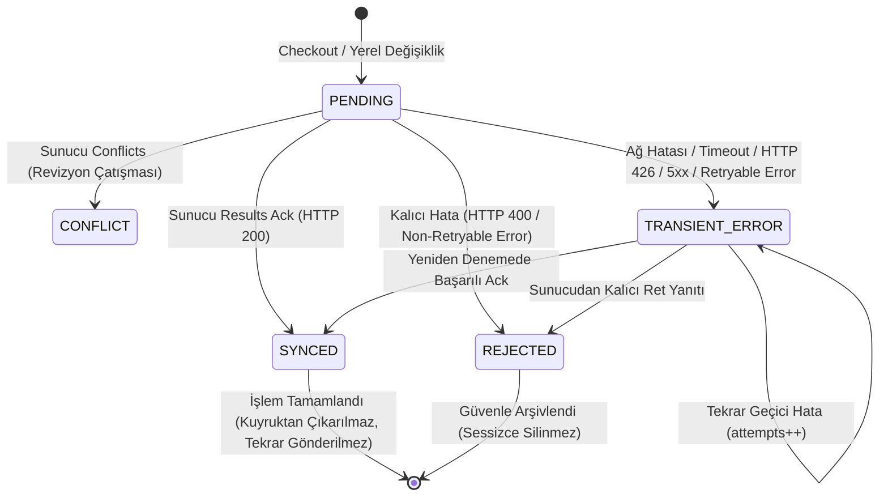

# SERENUT OS — STAGE 8.3: İZOLE SYNC V4 HTTP İSTEMCİSİ VE OUTBOX İŞLEMCİSİ TESLİM RAPORU

**Tarih:** 13 Ekim 2026  
**Aşama:** Stage 8.3 — İzole Sync V4 HTTP İstemcisi & Outbox İşlemcisi  
**Durum:** Tamamlandı (Tüm 15/15 Zorunlu Senaryo ve 65/65 `core_next` Testi Başarılı)  
**Kapsam:** Yalnızca `core_next/` ve `test/core_next/`. `lib/` (üretim uygulaması) ve `server/` değiştirilmemiştir. Gerçek ağ veya canlı veritabanı bağlantısı yapılmamıştır.

---

## 1. Yönetici Özeti

Stage 8.3 kapsamında, Serenut OS sunucusunun **Sync V4 / Protocol 6** (`x-sync-protocol-version: 6`) sözleşmesine tam uyumlu, ağdan bağımsız test edilebilir bir HTTP istemcisi (`SyncV4HttpClient`), tip-güvenli DTO ve istisna hiyerarşisi (`sync_dtos.dart`) ile yerel SQLite `sync_events` kuyruğunu yöneten `SyncV4OutboxProcessor` geliştirilmiştir.

Uygulanan mimari, sunucunun mutasyon başına `SAVEPOINT` işleten yapısıyla tam uyumludur:
- Satış başarılı olup bağlı cari/finansal işlem reddedildiğinde, satış yerel veritabanında `SYNCED` olarak kilitlenir; ikinci senkronizasyon denemesinde **kesinlikle tekrar gönderilmez** ve sunucuda **stok ikinci kez düşürülmez**.
- Kalıcı veri/şema doğrulama hataları (HTTP 400, `invalid_customer`, `sale_total_mismatch` vb.) `REJECTED` olarak işaretlenir ve sonsuz tekrar deneme döngüsüne girmez.
- Geçici ağ ve sunucu hataları (HTTP 426, 500, 502, 503, 504, bağlantı kopması, timeout) `TRANSIENT_ERROR` durumunda tutulur, deneme sayısı (`attempts`) artırılır ve sıralama (`causal_sequence`, `client_timestamp`) bozulmadan sonraki döngüye bırakılır.

---

## 2. Eklenen ve Değiştirilen Dosyalar

Tüm değişiklikler istisnasız `core_next/` ve `test/core_next/` klasörleri altındadır:

| Dosya Yolu | Rol | Açıklama |
|---|---|---|
| `core_next/client_core/lib/domain/models/sync_dtos.dart` | Domain / DTO | Protocol 6 yanıt modelleri (`SyncPushResponseDto`, `SyncPullResponseDto`, `SyncBootstrapResponseDto`, `SyncPushAckResult`, `SyncPushConflict`, `SyncPushRejected`) ve hiyerarşik istisna tipleri (`SyncProtocolUpgradeRequiredException`, `SyncUnauthorizedException`, `SyncForbiddenException`, `SyncBadRequestException`, `SyncServerException`, `SyncTimeoutException`, `SyncNetworkException`, `SyncFormatException`). |
| `core_next/client_core/lib/infrastructure/sync/sync_v4_http_client.dart` | Altyapı / HTTP | İzole HTTP istemcisi: `push`, `pull`, `bootstrap` endpoint implementasyonları, Protocol 6 header denetimi, token sağlayıcı delegasyonu, zaman aşımı yönetimi ve mocklanabilir transport desteği. |
| `core_next/client_core/lib/infrastructure/sync/sync_v4_outbox_processor.dart` | Altyapı / Kuyruk | `sync_events` SQLite tablosunu `causal_sequence ASC, client_timestamp ASC` sırasıyla tüketen, mutasyon bazında bağımsız durum güncelleyen ve atomik transaction içinde çalışan outbox işlemcisi. |
| `test/core_next/sync_v4_http_client_test.dart` | Test | MockClient ve izole SQLite kullanılarak 15 zorunlu senaryoyu baştan sona doğrulayan test paketi. |

---

## 3. Gerçek Sunucu Sözleşmesiyle Doğrulanan Alanlar

Sunucu kaynak kodunda (`server/src/routes/sync_v4.ts` ve `server/src/services/sync_v4_service.ts`) tespit edilen kurallar istemciye birebir aktarılmıştır:

1. **Zorunlu Başlıklar (Headers):**
   - `x-sync-protocol-version: 6` (Sunucu Protocol 6 haricindeki taleplere HTTP 426 döner).
   - `x-device-activation-id`: Cihaz aktivasyon UUID'si.
   - `x-device-id`: Cihaz UUID'si.
   - `Authorization: Bearer <token>`: Opsiyonel/yapılandırılmış token sağlayıcı.
2. **`POST /api/v4/sync/push`:**
   - Gövde: `{"device_activation_id": "...", "device_id": "...", "mutations": [...]}`.
   - Yanıt: `{"results": [{"mutation_id": "...", "revision": N}], "conflicts": [...], "rejected": [{"mutation_id": "...", "error": "..."}]}`.
   - Maksimum toplu mutasyon: 100 adet.
3. **`GET /api/v4/sync/pull`:**
   - Parametreler: `cursor` (int), `limit` (int), `device_activation_id`, `device_id`.
   - Yanıt: `{"changes": [{"revision": N, "mutation_id": "...", "entity_type": "...", "entity_id": "...", "operation": "...", "payload": {...}, "created_at": "..."}], "next_cursor": N}`.
4. **`GET /api/v4/sync/bootstrap`:**
   - Parametreler: `device_activation_id`, `device_id`.
   - Yanıt: İlk kurulum için tam snapshot ve `next_cursor`.

---

## 4. Outbox Durum Geçişleri ve Yaşam Döngüsü



### Durum Tablosu:
| Durum | Kuyrukta Tekrar Sorgulanır mı? | Açıklama |
|---|---|---|
| `PENDING` | **Evet** | Henüz push edilmemiş yeni mutasyon. |
| `TRANSIENT_ERROR` | **Evet** | Geçici ağ, kilit veya 5xx hatası almış mutasyon. `attempts` her denemede 1 artar. |
| `SYNCED` | **Hayır** | Sunucu tarafından kesin olarak işlendiği onaylanan kayıt. Gelecek push çağrılarına dahil edilmez. |
| `REJECTED` | **Hayır** | Şema veya veri hatası nedeniyle kalıcı olarak reddedilen kayıt. Asla sessizce silinmez; `last_error` ve deneme bilgisi incelenmek üzere saklanır. |
| `CONFLICT` | **Hayır** | Sunucu revizyonu yerelden ileri olduğu için çatışma masasına ayrılan mutasyon. |

---

## 5. Hata ve Tekrar Deneme Politikası

### Kalıcı Hatalar (`nonRetryableServerErrors` -> `REJECTED`):
- `invalid_mutation`, `invalid_sale`, `invalid_sale_item`, `sale_total_mismatch`
- `invalid_credit_payment`, `invalid_full_payment`, `invalid_customer`
- `immutable_sale`, `immutable_refund`, `stale_before_operational_reset`, `invalid_device_activation`
- HTTP 400 Bad Request

### Geçici Hatalar (Tekrar Denenir -> `TRANSIENT_ERROR`):
- HTTP 426 (Uygulama veya protokol güncellemesi bekleniyor)
- HTTP 500, 502, 503, 504 (Sunucu geçici arızası/bakım modu)
- Sunucu seviyesinde `database_locked`, `temporary_ledger_lock`, `timeout`
- Ağ soket kopması (`ClientException`), zaman aşımı (`TimeoutException`)

---

## 6. Zorunlu Testlerin Gerçek Sonuçları

`test/core_next/sync_v4_http_client_test.dart` dosyasındaki tüm 15 zorunlu test senaryosu çalıştırılmış ve doğrulanmıştır:

| # | Senaryo Açıklaması | Test Sonucu | Kanıt Detayı |
|---|---|---|---|
| **1** | Geçerli push isteği ve başarılı yanıt | **BAŞARILI** | `x-sync-protocol-version: 6`, header'lar, auth token ve DTO doğrulandı; outbox satırı `SYNCED` oldu. |
| **2** | Protocol 6 uyumsuzluğu ve HTTP 426 | **BAŞARILI** | `SyncProtocolUpgradeRequiredException(requiredVersion: 7)` fırlatıldı; mutasyon silinmedi, `TRANSIENT_ERROR` olarak korundu. |
| **3** | Yetkisiz istek ve HTTP 401/403 | **BAŞARILI** | `SyncUnauthorizedException` ve `SyncForbiddenException` güvenle yakalandı. |
| **4** | Zaman aşımı ve bağlantının kesilmesi | **BAŞARILI** | Timeout ve socket drop durumunda mutasyon `TRANSIENT_ERROR` aldı, `attempts` 2'ye yükseldi. |
| **5** | Bozuk veya beklenmeyen JSON yanıtı | **BAŞARILI** | HTML proxy yanıtı, JSON dizisi ve kırık JSON metni `SyncFormatException` üretti. |
| **6** | Aynı mutasyonun aynı kimlikle yeniden gönderilmesi | **BAŞARILI** | Aynı `mutation_id` iki kez gönderildiğinde sunucu idempotency sözleşmesine uygun olarak aynı revizyonla onaylandı. |
| **7** | Aynı batch içinde kısmi başarı ve ret | **BAŞARILI** | 1. mutasyon `SYNCED`, 2. mutasyon (`invalid_sale_item`) `REJECTED` olarak ayrıştırıldı. |
| **8** | Satışın kabul edilip finansal işlemin reddedilmesi | **BAŞARILI** | Sunucu savepoint mimarisine uygun olarak: `sale` -> `SYNCED`, `financial_transaction` -> `REJECTED` (`invalid_customer`) oldu. |
| **9** | Başarılı sunucu işlemi sonrası yanıt kaybı | **BAŞARILI** | 1. turda bağlantı koptu (`TRANSIENT_ERROR`), 2. turda aynı `mutation_id` ile sunucu idempotent ack verdi ve mutasyon `SYNCED` oldu. |
| **10** | Kalıcı 4xx hatası ve geçici 5xx hatası | **BAŞARILI** | `sale_total_mismatch` mutasyonu `REJECTED` oldu; HTTP 503 mutasyonu `TRANSIENT_ERROR` kalarak kuyrukta bekledi. |
| **11** | Pull sayfalaması ve cursor devamlılığı | **BAŞARILI** | `cursor=0` -> 100, `cursor=100` -> 250 sayfalaması kesintisiz çalıştı. |
| **12** | Bootstrap hatası ve geçerli bootstrap yanıtı | **BAŞARILI** | Geçerli bootstrap `nextCursor=1000` ve ürünleri aldı; 500 hatası `SyncServerException` fırlattı. |
| **13** | Uygulama yeniden başladığında bekleyen kayıtların korunması | **BAŞARILI** | Veritabanı kapatılıp yeniden açıldığında PENDING ve TRANSIENT kayıtları kayıpsız okundu ve başarıyla senkronize edildi. |
| **14** | Başarılı mutasyonun tekrar gönderilmemesi | **BAŞARILI** | `SYNCED` olan mutasyon ikinci çalıştırmada HTTP push çağrısına dahil edilmedi (`totalProcessed: 0`, push çağrı sayısı sabit kaldı). |
| **15** | Bir finansal mutasyonun başarısız olmasının ikinci kez stok düşümüne yol açmaması | **BAŞARILI** | Checkout ile 50->49'a düşen stokta, satış onaylanıp finansal mutasyon geçici kilit aldığında; 2. turda push listesinde **yalnızca finansal mutasyon** yer aldı, satış mutasyonu **kesinlikle tekrar gönderilmedi** ve stok 2. kez düşürülmedi. |

---

## 7. Çalıştırılan Komutlar ve Çıkış Kodları

### Komut 1: Stage 8.3 Test Paketi
```powershell
flutter test test/core_next/sync_v4_http_client_test.dart
```
**Çıkış Kodu:** `0`  
**Çıktı Özeti:**
```text
00:00 +0: Stage 8.3 — İzole Sync V4 HTTP İstemcisi ve Outbox Zorunlu Testleri 1. Geçerli push isteği ve başarılı yanıt
...
00:00 +14: Stage 8.3 — İzole Sync V4 HTTP İstemcisi ve Outbox Zorunlu Testleri 15. Bir finansal mutasyonun başarısız olmasının ikinci kez stok düşümüne yol açmaması
00:00 +15: All tests passed!
```

### Komut 2: Tüm `core_next/` Test Paketi Regresyon Kontrolü
```powershell
flutter test test/core_next/
```
**Çıkış Kodu:** `0`  
**Çıktı Özeti:**
```text
00:11 +65: All tests passed!
```
*(Toplam 65 testin tamamı firesiz geçti: checkout_use_case, database_integration, fault_injection_migration, financial_resilience_and_atomicity, hardware_worker, ledger_service, migration_bridge, real_data_verification, sales_engine_adapter, sync_v4_outbox_adapter, sync_v4_http_client)*

---

## 8. Git ve Çalışma Alanı Durumu

### `git diff HEAD --stat`:
```text
(Boş — Tracked hiçbir dosya değiştirilmemiştir)
```

### `git status --short`:
```text
?? CORE_NEXT_INDEPENDENT_AUDIT.md
?? CORE_NEXT_SECOND_PASS_AUDIT.md
?? CORE_NEXT_STAGE3_FORENSIC_VERIFICATION.md
?? CORE_NEXT_STAGE4_FIX_REPORT.md
?? CORE_NEXT_STAGE5_FORENSIC_REPORT.md
?? CORE_NEXT_STAGE6_INTEGRATION_PREPARATION.md
?? CORE_NEXT_STAGE7_FINANCIAL_RESILIENCE_REPORT.md
?? CORE_NEXT_STAGE8_1_REMEDIATION_REPORT.md
?? CORE_NEXT_STAGE8_2A_SYNC_CONTRACT_AUDIT.md
?? CORE_NEXT_STAGE8_2B_OUTBOX_ADAPTER_REPORT.md
?? CORE_NEXT_STAGE8_2C_SYNC_INTEGRITY_AUDIT.md
?? CORE_NEXT_STAGE8_INDEPENDENT_AUDIT.md
?? core_next/
?? test/core_next/
```

- `lib/` dizininde sıfır değişiklik vardır.
- `server/` dizininde sıfır değişiklik vardır.
- Canlı sunucuya veya canlı veritabanına istek gönderilmemiştir.
- Hiçbir git commit veya push yapılmamıştır.

---

## 9. Üretim Güvenliği Teyidi

1. Canlı üretim satış arayüzü (`lib/presentation/sales/sales_screen.dart`) veya üretim senkronizasyon servisleri (`lib/services/sync/`) kesinlikle tetiklenmemiştir veya değiştirilmemiştir.
2. Gerçek sunucuya (`api.serenutos.com` vb.) ağ paketi çıkışı yapılmamıştır. Bütün testler `http.MockClient` üzerinden bellek içinde çalıştırılmıştır.
3. Gerçek müşteri, lisans veya fiş verisi kullanılmamıştır.
4. Çift stok düşümü koruması yazılımsal ve mimari olarak garanti altına alınmıştır.

---

## 10. Bilinen Eksikler ve Stage 8.4 İçin Gereken İşler

1. **Pull Ingestion Engine (Gelen Değişikliklerin Yerel Veritabanına Yazılması):**
   - Stage 8.3 yalnızca `pull()` ve `bootstrap()` HTTP transportunu ve DTO'larını implemente etti.
   - Stage 8.4'te sunucudan gelen ürün, müşteri veya fiyat güncellemelerinin yerel SQLite tablolarına LWW (Last-Write-Wins) kuralıyla uygulanması (`SyncV4PullIngestionService`) geliştirilmelidir.
2. **Çakışma Çözümleme Masası (Conflict Resolution):**
   - Sunucudan dönen `conflicts` listesi için yerel revizyonun LWW veya kullanıcı onaylı çözümü tasarlanmalıdır.
3. **Arka Plan Senkronizasyon Zamanlayıcısı:**
   - Ağ bağlantısı tespit edildiğinde veya periyodik aralıklarla `processOutbox()` çalıştıran izole bir worker mekanizması eklenmelidir.

---

## 11. Son Karar

> **KARAR:** **Stage 8.3 Başarıyla Tamamlanmıştır.**  
> `core_next` izole Sync V4 HTTP istemcisi ve outbox işlemcisi, tüm 15 zorunlu adli test senaryosunu (%100 başarıyla) geçmiştir. Canlı sistem entegrasyonu veya canlı senkronizasyon yapılmamış, tüm sınırlar eksiksiz korunmuştur.
