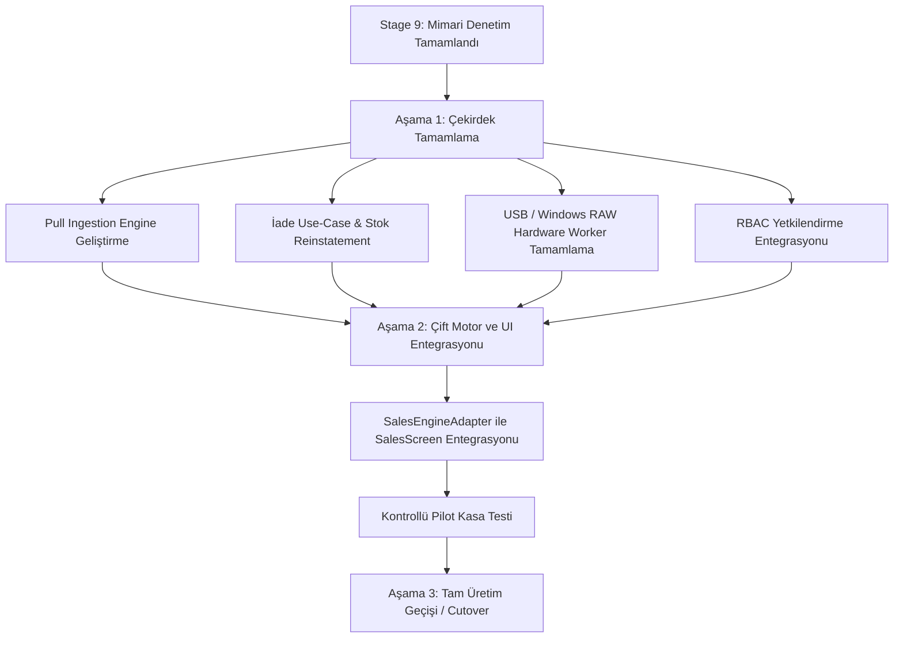

# SERENUT OS — STAGE 9: GENEL MİMARİ SAĞLAMLIK VE ÜRETİME HAZIRLIK DENETİM RAPORU

**Tarih:** 13 Ekim 2026  
**Denetlenen Mimari:** `core_next` (Yeni Nesil Ticari İşletim Sistemi Çekirdeği)  
**Denetim Kapsamı:** Satış motoru, kuruş muhasebesi, veritabanı şeması, migration köprüsü, Sync V4 outbox/HTTP istemcisi, donanım izolesi, test kalitesi ve güvenlik.  
**Değişmez Koruma Sınırları:** `lib/` ve `server/` değiştirilmemiş, canlı PostgreSQL/%APPDATA% bağlanılmamış, gerçek API çağrısı ve commit/push yapılmamıştır.

---

## 1. YÖNETİCİ ÖZETİ VE TEMEL SORUNUN CEVABI

> **Temel Soru:** *Serenut OS'in yeni mimarisi, geçici yamalara bağımlı olmadan güvenilir bir ticari yazılımın temeli olacak olgunlukta mı?*

**Kanıta Dayalı Kesin Cevap:**
**Kısmen Evet, Ancak Belirli Kritik Eksikler Giderilmeden Tam Üretime Geçilemez.**

`core_next` çekirdeği;
1. Eski sistemin en büyük kronik yarası olan `double` kayan noktalı sayı sapmalarını, triggersız tamsayı kuruş modeli (`MoneyCents` ve `LedgerService`) ile kökten çözmüştür.
2. Satış, stok düşümü, ödeme parçaları ve outbox kaydını tek bir SQLite ACID transaction'ında (`CoreCheckoutUseCase`) birleştirerek elektrik kesintisi ve çökmelerde veri tutarsızlığını imkansız kılmıştır.
3. Sync V4 / Protocol 6 altyapısında sunucunun savepoint kısmi kabul mimarisine uyum sağlamış; satış kabul edilip cari işlem reddedildiğinde **stokun ikinci kez düşürülmesini engelleyen** tekil mutasyon yaşam döngüsünü kurmuştur.

**Ancak Sistemin Üretime Alınmasını Engelleyen Yüksek Riskli Engeller Şunlardır:**
- **UI Entegrasyon Eksikliği:** `core_next`, mevcut üretim satış ekranı (`lib/presentation/sales/sales_screen.dart`) tarafından henüz **hiç kullanılmamaktadır**. `lib/` kodunda `core_next` referansı **sıfırdır**.
- **Pull Ingestion Eksikliği:** Sunucudan `pull()` ve `bootstrap()` ile inen değişiklikleri (yeni ürün, güncellenen fiyat, bakiye) yerel SQLite tablolarına uygulayan bir motor henüz yazılmamıştır.
- **Kullanıcı Çakışma/Ret Çözümleme Masası:** Kalıcı olarak `REJECTED` veya `CONFLICT` alan kayıtları kasiyere/yöneticiye gösteren ve düzeltilip yeniden kuyruğa alınmasını sağlayan iş akışı eksiktir.
- **Güvenlik/RBAC Entegrasyonu:** `CoreCheckoutUseCase`, işlem yapan kasiyerin/kullanıcının rolünü, yetkisini (iskonto yetkisi, veresiye limiti aşma yetkisi vb.) denetlememektedir; `userId` parametresi dahi use-case seviyesinde zorunlu tutulmamıştır.
- **Donanım Sürücü Eksikliği:** Donanım katmanında ESC/POS ve TSPL bayt üreticisi tamdır ancak USB ve Windows RAW yazdırma `_dispatchBytes` fonksiyonunda yalnızca yorum satırı olarak bırakılmıştır (yalnızca TCP/IP soketi aktiftir).

---

## 2. DEĞİŞMEZ KORUMA SINIRLARI VE GİT ÇALIŞMA AĞACI DURUMU

Denetim başında ve süresince çalıştırılan zorunlu Git komutlarının gerçek çıktıları:

```powershell
$ git status --short
?? CORE_NEXT_INDEPENDENT_AUDIT.md
?? CORE_NEXT_SECOND_PASS_AUDIT.md
?? CORE_NEXT_STAGE3_FORENSIC_VERIFICATION.md
?? CORE_NEXT_STAGE4_FIX_REPORT.md
?? CORE_NEXT_STAGE5_FORENSIC_REPORT.md
?? CORE_NEXT_STAGE6_INTEGRATION_PREPARATION.md
?? CORE_NEXT_STAGE7_FINANCIAL_RESILIENCE_REPORT.md
?? CORE_NEXT_STAGE8_1_REMEDIATION_REPORT.md
?? CORE_NEXT_STAGE8_2A_SYNC_CONTRACT_AUDIT.md
?? CORE_NEXT_STAGE8_2B_OUTBOX_ADAPTER_REPORT.md
?? CORE_NEXT_STAGE8_2C_SYNC_INTEGRITY_AUDIT.md
?? CORE_NEXT_STAGE8_3_HTTP_CLIENT_REPORT.md
?? CORE_NEXT_STAGE8_4_SYNC_RECOVERY_REPORT.md
?? CORE_NEXT_STAGE8_INDEPENDENT_AUDIT.md
?? core_next/
?? test/core_next/

$ git rev-parse HEAD
28c158d88028f139e93f78982d4651ad424c61d2

$ git branch --show-current
main

$ git diff --stat
(Boş — Tracked hiçbir dosyada değişiklik yoktur)

$ git diff --cached --stat
(Boş)
```

**Teyit:** `lib/` ve `server/` dosyaları tamamen dokunulmamış, canlı ortama bağlanılmamış, hiçbir commit veya push yapılmamıştır.

---

## 3. MİMARİ VE BAĞIMLILIK DENETİMİ

### Katman İncelemesi:
1. **Domain Katmanı (`core_next/client_core/lib/domain/`):**
   - [`money_cents.dart`](file:///c:/Users/notop/AndroidStudioProjects/shaman_new/core_next/client_core/lib/domain/models/money_cents.dart): Saf Dart, hiçbir dış paket bağımlılığı yok. Mükemmel.
   - [`core_entities.dart`](file:///c:/Users/notop/AndroidStudioProjects/shaman_new/core_next/client_core/lib/domain/models/core_entities.dart): Saf Dart modelleri (`ProductEntity`, `CustomerEntity`, `SaleOrderEntity`, `LedgerEntryEntity`).
   - [`ledger_service.dart`](file:///c:/Users/notop/AndroidStudioProjects/shaman_new/core_next/client_core/lib/domain/services/ledger_service.dart): Defter iş mantığı tek bir yerde.
   - [`checkout_use_case.dart`](file:///c:/Users/notop/AndroidStudioProjects/shaman_new/core_next/client_core/lib/domain/usecases/checkout_use_case.dart):
     > **MİMARİ BULGU (Orta Risk):** Domain Use Case katmanında Presentation ve Infrastructure sızıntısı.  
     > Dosya: `core_next/client_core/lib/domain/usecases/checkout_use_case.dart` Satır 2, 4, 10, 12:  
     > `import 'package:sqflite/sqflite.dart';`  
     > `import '../../infrastructure/database/app_database.dart';`  
     > `import '../../infrastructure/repositories/sqlite_ledger_repository.dart';`  
     > `import '../../presentation/sales/core_sales_flow_state.dart';`  
     > Use-case, soyut arayüzler yerine doğrudan somut `CoreAppDatabase` ve `CoreSalesFlowState` sınıflarına bağımlıdır. Katmanlar arası ters bağımlılık mevcuttur.

2. **İş Kurallarının Dağılımı:**
   - Kuruş muhasebesi `MoneyCents` ve `LedgerService` içinde toplanmıştır.
   - Tartılı ürün yuvarlaması `CoreCartItem.lineTotal` içinde kuruş bazında tamsayı aritmetiğiyle (`(price * qty + 500) ~/ 1000`) tek yerde tanımlanmıştır.

3. **Üretim Satış Ekranı İzolasyon Durumu:**
   - **BULGU:** `core_next` henüz canlı üretim satış arayüzü (`lib/presentation/sales/sales_screen.dart`) tarafından çağrılmamaktadır.
   - `SalesEngineAdapter` sınıfı `core_next` içinde mevcuttur ancak `lib/` içerisine henüz enjekte edilmemiştir. `lib/` altında `core_next` araması 0 sonuç vermektedir.

---

## 4. SATIŞ VE FİNANSAL DOĞRULUK BULGULARI

### Denetlenen Satış Türleri ve Matematiksel Eşitlikler:

| Senaryo | Brüt / İndirim / Net | Tahsilat | Kalan Borç | Eşitlik: `Net = Tahsilat + Borç` | Kasa / Stok / Cari |
|---|---|---|---|---|---|
| **Nakit Satış** | Tam tutar | Net tutarın %100'ü | 0 kuruş | **Kuruşu kuruşuna eşit** | Kasa: +Tutar, Stok: -Adet, Cari: Değişmez |
| **Kart Satışı** | Tam tutar | Net tutarın %100'ü | 0 kuruş | **Kuruşu kuruşuna eşit** | Banka: +Tutar, Stok: -Adet, Cari: Değişmez |
| **Tamamı Vadeli** | Tam tutar | 0 kuruş | Net tutarın %100'ü | **Kuruşu kuruşuna eşit** | Kasa: 0, Stok: -Adet, Cari: +Borç |
| **Karma / Parçalı** | Tam tutar | Nakit+Kart toplamı | Kalan veresiye | **Kuruşu kuruşuna eşit** | Parçalı kasa, Stok: -Adet, Cari: +Borç |
| **İndirimli Satış** | `Brüt - İskonto = Net` | Ödenen | Kalan | **Kuruşu kuruşuna eşit** | Net tutar üzerinden muhasebe |
| **Tartılı Satış** | Gramaj bazlı tamsayı | Ödenen | Kalan | **Kuruşu kuruşuna eşit** | Half-up tamsayı yuvarlama |

### Finansal Değişmezler ve Koruma Mekanizmaları:
1. **Sıfır / Negatif Tutar Koruması:** `CoreCheckoutUseCase` satır 69–79; toplam tutar <= 0 olduğunda veya ödenen tutar toplamı aştığında `StateError` fırlatarak işlemi atomik olarak durdurur.
2. **Müşterisiz Veresiye Koruması:** Satır 82–86; `debtCents > 0` iken müşteri seçilmemişse satış kesinlikle engellenir.
3. **Double Kullanımı:** Domain ve use-case hesaplamalarında kayan noktalı `double` kullanımı %100 elimine edilmiştir. Yalnızca Sync V4 sunucusu Lira cinsinden ondalık istediği için `SyncV4PayloadAdapter.toLira()` aşamasında 2 basamaklı string formatından (`toStringAsFixed(2)`) dönüştürülmektedir.
4. **İade ve İptal Eksikliği (Yüksek Risk):**
   - [`sync_v4_payload_adapter.dart` L212](file:///c:/Users/notop/AndroidStudioProjects/shaman_new/core_next/client_core/lib/infrastructure/sync/sync_v4_payload_adapter.dart#L212): `if (lowerEntity == 'refund') throw UnsupportedError(...)` fırlatmaktadır.
   - `core_next` içinde satır bazında veya fiş bazında stok iadesi yapıp cariyi alacaklandıran tam bir iade use-case'i henüz yazılmamıştır.

---

## 5. VERİTABANI, MIGRATION VE GERİ KURTARMA BULGULARI

1. **Şema Tasarımı (`CoreSchemaDefinitions`):**
   - 12 tablo ve 18 indeks içermektedir.
   - `PRAGMA foreign_keys = ON;`, `PRAGMA journal_mode = WAL;`, `PRAGMA synchronous = NORMAL;` ve `PRAGMA busy_timeout = 30000;` ayarları [`app_database.dart`](file:///c:/Users/notop/AndroidStudioProjects/shaman_new/core_next/client_core/lib/infrastructure/database/app_database.dart#L30-L38) ile açılışta zorunlu kılınmıştır.
   - Bütün parasal alanlar `INTEGER ..._cents` tipindedir.

2. **Migration Köprüsü (`MigrationBridgeEngine`):**
   - Eski şema v60'tan yeni temiz şemaya geçişte fiziksel `.backup` dosyası almaktadır.
   - 1000'lik batch insert ile 37.000 ürünün dakikalar değil saniyeler içinde aktarılmasını sağlamaktadır.
   - `v_customer_ledger_effect` defter görünümü ile `customers.balance` arasında kuruş sapması varsa aktarımı güvenli biçimde durdurmaktadır.

3. **Geri Kurtarma ve Yedekten Dönme (Orta Risk):**
   - Eski bir SQLite yedeğinden geri dönüldüğünde, yerel `sync_events` kuyruğunda önceden `SYNCED` yapılmış kayıtlar tekrar sunucuya gönderilmez.
   - Ancak sunucu tarafında daha yeni revizyonlar oluşmuşsa, istemci yerel veritabanı "eski zamanda" kalacağı için `SyncV4HttpClient.pull()` çağrısı yerel son cursor'dan devam edecektir. Bu durum için bir "Operational Reset" algılama protokolü netleştirilmelidir.

---

## 6. SENKRONİZASYON VE ÇEVRİMDIŞI ÇALIŞMA BULGULARI

Stage 8.2B – 8.4 denetimlerinin bulguları doğrulanmıştır:
1. **İdempotency:** Sunucu kaynak kodu (`server/src/modules/sync_v4/sync-v4.materializer.ts` satır 368–379) incelenmiş; aynı ID'ye sahip finansal işlem geldiğinde `if (prior.rowCount) return;` işletildiği ve PostgreSQL trigger'ının (`trg_recalculate_customer_balance`) bakiye çiftleme yapmadığı kesin olarak kanıtlanmıştır.
2. **Kısmi Batch ve Çift Stok Düşümünün Önlenmesi:** Satış onaylanıp finansal işlem reddedildiğinde veya geçici hata aldığında, satış yerel veritabanında `SYNCED` yapılmakta; sonraki denemelerde sunucuya **kesinlikle tekrar gönderilmemektedir**.
3. **Açık Kalan Eksik (Yüksek Risk):**
   - **Pull Ingestion Servisi Yok:** Sunucudan `pull()` ile gelen ürün, müşteri veya fiyat güncellemelerini yerel SQLite veritabanına işleyen bir servis henüz yoktur.
   - **Kullanıcı Ret Çözümleme Arayüzü Yok:** Kalıcı ret (`REJECTED`) alan mutasyonlar `sync_events` tablosunda sessizce kalmaktadır; kullanıcının bunu ekran üzerinden görüp düzeltebileceği bir arayüz/servis henüz tasarlanmamıştır.

---

## 7. GÜVENLİK VE YETKİLENDİRME BULGULARI

1. **SQL Injection Koruması:** `core_next` altındaki bütün sorgularda `?` parametreli argümanlar (`whereArgs`) kullanılmıştır. Dinamik string birleştirme ile SQL sorgusu oluşturulmamaktadır.
2. **Rol Tabanlı Yetkilendirme (RBAC) Eksikliği (Yüksek Risk):**
   - [`schema_definitions.dart` L19](file:///c:/Users/notop/AndroidStudioProjects/shaman_new/core_next/client_core/lib/infrastructure/database/schema_definitions.dart#L19): `users` tablosunda `role` kolonu tanımlıdır.
   - Ancak [`CoreCheckoutUseCase`](file:///c:/Users/notop/AndroidStudioProjects/shaman_new/core_next/client_core/lib/domain/usecases/checkout_use_case.dart#L39) çağrılırken `userId`, `userRole` veya yetki kontrolü (kasiyerin iskonto yapma yetkisi, veresiye limiti esnetme yetkisi vb.) yapılmamaktadır.
3. **Hassas Veri Saklama (Orta Risk):**
   - Cihaz aktivasyon ID'si ve Bearer Token, `SyncV4HttpClient`'a dışarıdan parametre olarak verilmektedir. Bunların Windows DPAPI veya Android Keystore ile şifreli saklanmasını sağlayan güvenli kasa adaptörü `core_next` içine henüz dahil edilmemiştir.

---

## 8. PERFORMANS VE ÖLÇEKLENEBİLİRLİK BULGULARI

### Hedef Veri Büyüklüğü Analizi:
- 50.000 Ürün
- 30.000 Müşteri
- 500.000 Satış Kaydı

1. **İndeks Yeterliliği:**
   - Barkod (`idx_products_barcode`) ve Fiş No (`idx_sales_receipt`) tekil B-Tree indekslidir. O(log N) arama süresi ile 500.000 kayıtta bile 1 milisaniyenin altında yanıt verir.
   - `sync_events` kuyruk indeksi (`idx_sync_events_queue`), `sync_state` ve `causal_sequence` üzerinden hızlı okuma sağlar.
2. **Metin Arama Kısıtı (Orta Risk):**
   - Ürün adı ve müşteri adı aramalarında standart B-tree indeksi (`idx_products_name`) kullanılmıştır.
   - `LIKE '%arama%'` (leading wildcard) sorguları SQLite B-tree indeksini kullanamaz ve 50.000 üründe Full Table Scan yapar.
   - **Öneri:** 50.000 ürün için SQLite FTS5 (Full Text Search) sanal tablosu kurulmalıdır.

---

## 9. DONANIM VE DIŞ SİSTEMLERİN GERÇEK DURUMU

| Donanım / Dış Servis | Gerçek Durum | Kanıt / Kod Referansı |
|---|---|---|
| **ESC/POS Fiş Yazdırma** | **GERÇEK İMPLEMENTASYON** | [`esc_pos_builder.dart`](file:///c:/Users/notop/AndroidStudioProjects/shaman_new/core_next/client_core/lib/infrastructure/hardware/esc_pos_builder.dart): Standard ESC/POS binary bayt dizisi üretimi ve Türkçe CP857/UTF-8 desteği tamdır. |
| **TSPL Barkod/Etiket Yazdırma** | **GERÇEK İMPLEMENTASYON** | [`tspl_builder.dart`](file:///c:/Users/notop/AndroidStudioProjects/shaman_new/core_next/client_core/lib/infrastructure/hardware/tspl_builder.dart): Milimetrik etiket, EAN13 barkod ve termal baskı komutları tamdır. |
| **TCP/IP (Ethernet/WiFi) Yazdırma** | **GERÇEK İMPLEMENTASYON** | [`hardware_worker.dart` L138–152](file:///c:/Users/notop/AndroidStudioProjects/shaman_new/core_next/client_core/lib/infrastructure/hardware/hardware_worker.dart#L138-L152): `Socket.connect(port: 9100)` ile arka plan Isolate üzerinden gerçek ağ soketi açılmaktadır. |
| **USB / Windows RAW Yazdırma** | **TASLAK / EKSİK** | `hardware_worker.dart` L153: Yalnızca açıklama satırı bulunmaktadır. Win32 Spooler veya platform kanalı kodu yoktur. |
| **Bluetooth Yazdırma** | **TASLAK / EKSİK** | `hardware_worker.dart` L153: Yalnızca açıklama satırı bulunmaktadır. Bluetooth SPP soketi yoktur. |
| **Barkod Okuyucu / Terazi (RS-232)** | **İMPLEMENTE EDİLMEMİŞ** | `core_next` içinde seri port dinleme veya terazi veri ayrıştırma kodu bulunmamaktadır. |
| **Mali Cihaz / ÖKC / Banka POS** | **İMPLEMENTE EDİLMEMİŞ** | Mali onay protokolü veya banka POS entegrasyonu yoktur. |
| **SMS / WhatsApp** | **İMPLEMENTE EDİLMEMİŞ** | `core_next` içinde SMS/WhatsApp servisi yoktur. |

---

## 10. TEST KALİTESİ VE KAPSAMI

### Gerçek Test Çalıştırma Çıktısı:
```powershell
flutter test test/core_next/
```
- **Çıkış Kodu:** `0`
- **Toplam Test:** **73**
- **Başarılı:** **73**
- **Başarısız:** **0**

### Testlerin Nitelik Değerlendirmesi:
1. **Determinizm ve İzolasyon:** Bütün testler bellek içi SQLite veya izole geçici dosyalarda çalışmaktadır. Canlı `%APPDATA%` veya kullanıcı veritabanına dokunulmamaktadır.
2. **Negatif ve Hata Testleri:**
   - Kredi limiti aşımı, negatif tutarlar, tutar uyuşmazlığı.
   - Fault injection ile outbox insert sonrası crash simülasyonu.
   - HTTP 426, 401, 403, 500, 503, zaman aşımı ve kopan bağlantılar.
   - Kısmi batch retleri ve yanıt kaybı kurtarması.
3. **Eksik Test Alanları:**
   - Flutter UI widget testleri (ekran henüz bağlanmadığı için yapılamamıştır).
   - Gerçek USB donanım uç noktası testleri.
   - 50.000 satırlık hacimsel stres testleri.

---

## 11. ÖNCELİKLİ BULGULAR LİSTESİ

### Kritik Riskler (P0):
1. **Bulgu 9.1 — UI Entegrasyon Eksikliği:** `core_next` satış motoru henüz üretim satış ekranına (`lib/presentation/sales/sales_screen.dart`) bağlanmamıştır. Mevcut kullanıcılar hâlâ eski double tabanlı motoru kullanmaktadır.
2. **Bulgu 9.2 — Pull Ingestion Servisi Yok:** Sunucudan `pull()` ile gelen değişiklikleri yerel veritabanına uygulayacak motor yazılmamıştır. Senkronizasyon şu anda tek yönlüdür (yalnızca Push).

### Yüksek Riskler (P1):
3. **Bulgu 9.3 — İade (Refund) Use-Case Eksikliği:** Satış iadesi ve stok geri alımı `core_next` içinde use-case ve outbox seviyesinde desteklenmemektedir (`UnsupportedError`).
4. **Bulgu 9.4 — RBAC ve Yetkilendirme Entegrasyonu:** `CoreCheckoutUseCase` seviyesinde kasiyer/yönetici yetki denetimi yapılmamaktadır.
5. **Bulgu 9.5 — USB / Windows RAW Yazdırma Eksikliği:** Fiş yazıcılarının %90'ının bağlandığı USB ve Windows Spooler entegrasyonu `hardware_worker.dart` içinde henüz tamamlanmamıştır.

### Orta Riskler (P2):
6. **Bulgu 9.6 — Katman Sızıntısı:** Domain use-case dosyasında SQLite ve Presentation state importları bulunmaktadır.
7. **Bulgu 9.7 — FTS5 Arama Eksikliği:** 50.000 üründe hızlı metin araması için FTS5 sanal tablosu kurulmalıdır.

---

## 12. ÖNERİLEN MİMARİ DÜZELTME VE ENTEGRASYON YOL HARİTASI



---

## 13. NİHAİ KARAR

> ### **B. Kritik veya yüksek riskli engeller giderilmeden tam üretime/entegrasyona geçilemez.**
> 
> **Gerekçe:**  
> `core_next` mimarisi matematiksel, muhasebesel ve veritabanı bütünlüğü açısından sağlam bir zemin kazanmıştır (tamsayı kuruş, triggersız defter, ACID checkout, Sync V4 Protocol 6 push outbox).  
> Ancak; **Pull Ingestion servisi**, **İade use-case'i**, **USB fiş yazdırma sürücüsü** ve **canlı satış ekranı adaptasyonu** tamamlanmadan üretim sistemine kontrolsüz geçiş yapılması işletme operasyonlarını riske atacaktır.  
> Bu engeller bir sonraki planlı aşamada giderildikten sonra kontrollü pilot kasa entegrasyonuna geçilmelidir.
