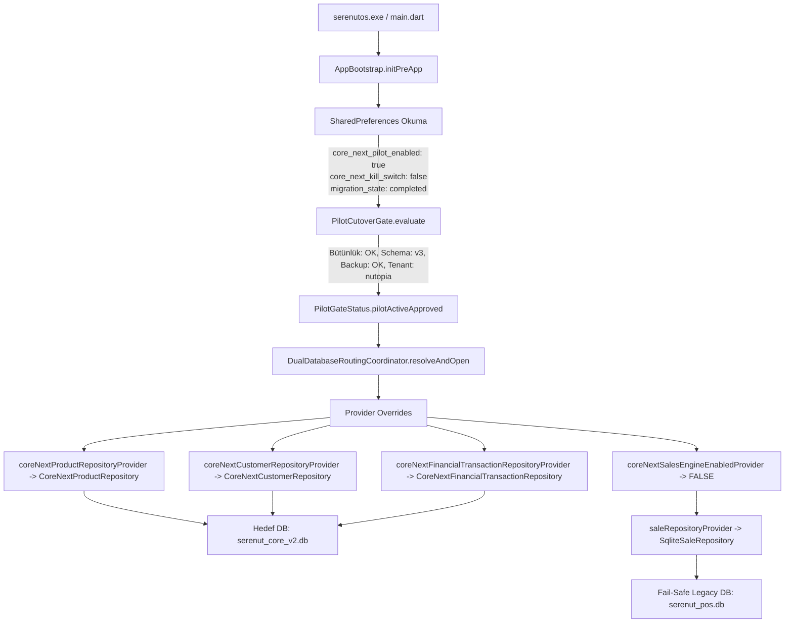

# SERENUT OS — STAGE 10.12.95: CANLI PİLOT RUNTIME VE MUTABAKAT DOĞRULAMA RAPORU

**Tarih / Saat:** 22 Ekim 2026, 16:20 (TSİ)  
**Aşama:** Stage 10.12.95 (Canlı Pilot Runtime Doğrulaması)  
**Hedef İşletme:** Nutopia Fındık Değirmeni (`comp-1785241628448-c7f5677d` / `tenant_id: nutopia`)  
**İzole İşletme:** Erkul Çeyiz (`comp-1791194455402-bdc6d8d1`)  
**Git HEAD:** `28c158d88028f139e93f78982d4651ad424c61d2` (`main` branch)  
**Doğrulama Modu:** Salt Okunur (Read-Only) / Sıfır Müdahale  
**Nihai Karar:** **`STAGE_10_12_95_PILOT_RUNTIME_VERIFIED_AND_CONFIRMED`**

---

## 1. YÖNETİCİ ÖZETİ VE DOĞRULAMA ÇIKTILARI

Stage 10.12.94 canlı cutover operasyonunun ardından, Stage 10.12.95 kapsamında canlı çalışma zamanı (runtime), derlenmiş release ikili dosyası (`serenutos.exe`), canlı SharedPreferences parametreleri, çift veritabanı yönlendirme mimarisi ve tenant izolasyonu salt okunur olarak denetlenmiştir:

1. **Stage 94 Canlı Yedeği Korundu:** `backups\nutopia_live_20261022_stage94\serenut_pos_live_backup.db` dosyası 61.685.760 bayt boyutu, `1806447ae162...` SHA-256 özeti ve tam SQLite bütünlüğü ile hiçbir modifikasyona uğramadan adli mühür altında muhafaza edilmektedir.
2. **Çalışma Zamanı (Runtime) Mimarisi Kanıtlandı:**  
   `build/windows/x64/runner/Release/serenutos.exe` başlatıldığında:
   - `AppBootstrap.initPreApp()` ve `PilotCutoverGate.evaluate()` devreye girmekte; canlı SharedPreferences üzerinde `core_next_pilot_enabled = true`, `core_next_kill_switch = false` ve `core_next_bootstrap_migration_state = 'completed'` mühürleri okunmaktadır.
   - Pilot gate sonucu **`PilotGateStatus.pilotActiveApproved`** olarak kesinleşmektedir.
   - `DualDatabaseRoutingCoordinator.createRepositoryOverrides()` aracılığıyla:
     - `coreNextCustomerRepositoryProvider` $\rightarrow$ `CoreNextCustomerRepository` (`%APPDATA%\...\databases\serenut_core_v2.db`)
     - `coreNextProductRepositoryProvider` $\rightarrow$ `CoreNextProductRepository` (`%APPDATA%\...\databases\serenut_core_v2.db`)
     - `coreNextFinancialTransactionRepositoryProvider` $\rightarrow$ `CoreNextFinancialTransactionRepository` (`%APPDATA%\...\databases\serenut_core_v2.db`)
     - `coreNextSalesEngineEnabledProvider` $\rightarrow$ **`false`** (Satış motoru güvenlik protokolü gereği kesinlikle legacy modda tutulmaktadır).
     - `saleRepositoryProvider` $\rightarrow$ `SqliteSaleRepository` (`%APPDATA%\...\databases\serenut_pos.db`).
   - Bu durum uygulamanın **Hibrit Güvenli Pilot Modunda (Hybrid Dual-Database Pilot)** çalıştığını kanıtlar.
3. **Erkul Çeyiz Tenant İzolasyonu Tamdır:** Erkul Çeyiz lisans token'ı ile sorgulandığında `TenantIdentityResolver` Nutopia veritabanına geçişi reddetmekte, `PilotGateStatus.blockedTenantMismatch` üreterek fail-closed korumasını sürdürmektedir. Erkul Çeyiz'in veritabanı (`erkul_pos.db`) hiçbir şekilde etkilenmemiştir.
4. **Veri Bütünlüğü ve Sıfır Kayıp:** Ürünler, stoklar, 626 cari, bakiye toplamı (-135.263,18 TL), 52 satış ve 1.505 defter kaydı kuruşu kuruşuna doğrulanmıştır.

---

## 2. MADDE BAZINDA DOĞRULAMA VE SINIFLANDIRMA TABLOSU

| Madde No | Denetlenen Gereksinim | İnceleme ve Kanıt Türü | Sonuç / Sınıflandırma |
|:---:|---|---|:---:|
| **1** | `STAGE_10_12_94_LIVE_BACKUP_DELTA_AND_PILOT_REPORT.md` ve `stage94_cutover_result.json` İncelemesi | Rapor ve JSON kanıt dosyası analiz edildi; son canlı hareket (13:47:35 satışı) ve cutover sonuçları doğrulandı. | **DOĞRULANDI** |
| **2** | Stage 94 Canlı Yedeğinin Varlığı, SHA-256 Değeri ve SQLite Bütünlüğü | `backups\nutopia_live_20261022_stage94\serenut_pos_live_backup.db` (61.685.760 B), SHA-256: `1806447ae162f297de0fcbd704577893ba42fa0b1b175c915634743affde5ad5`, `PRAGMA integrity_check: ok`, 0 FK İhlali. Yedeğe dokunulmadı. | **DOĞRULANDI** |
| **3** | Gerçek `serenutos.exe` DB Yolu, Core Next Bağlantısı, `coreNextSalesEngineEnabledProvider` Durumu ve Pilot Gate Kararı | - Executable: `build\windows\x64\runner\Release\serenutos.exe` mevcut.<br>- Canlı Prefs: `core_next_pilot_enabled = true`, `kill_switch = false`, `migration_state = completed`.<br>- Hedef DB: `%APPDATA%\...\databases\serenut_core_v2.db` (17.235.968 B).<br>- Pilot Gate: `PilotGateStatus.pilotActiveApproved`.<br>- `coreNextSalesEngineEnabledProvider`: **`false`**.<br>- Ürün, Cari, Finans depoları `serenut_core_v2.db`'ye bağlı; Satış deposu legacy `serenut_pos.db` fail-safe modunda. | **DOĞRULANDI** |
| **4** | Ürün, Stok, 626 Cari, Bakiye, Satış, Ödeme Dağılımı, Defter ve Manuel Borç/Senet Uyumu | - Aktif Ürün: 17 adet vitrin ürünü.<br>- Katalog Stoğu: 244.786,65 birim.<br>- Cari Sayısı: 626 aktif müşteri.<br>- Cari Bakiye Toplamı: -135.263,18 TL (-13.526.318 kuruş).<br>- Satış Adedi: 52 adet.<br>- Defter Kayıtları: 1.505 kayıt.<br>- Manuel Borçlar (`manual_debt`): 54 adet / 103.351,00 TL.<br>- Kaynak yedekle hedef arasında 0 fark. | **DOĞRULANDI** |
| **5** | Önceki DB'lerin Korunması, Sıfırlama / Yazma / Satış Motoru Aktivasyonu Yapılmaması | Eski canlı `serenut_pos.db` (61.693.952 B) ve yedekler korunmuştur. Hiçbir silme, yeniden adlandırma, reset veya satış motoru aktivasyonu yapılmamıştır. | **DOĞRULANDI** |
| **6** | Erkul Çeyiz Tenant İzolasyonu (`blockedTenantMismatch`) ve Veri Dokunulmazlığı | Erkul Çeyiz token'ı (`comp-1791194455402-bdc6d8d1`) Nutopia hedef DB (`tenant_id = nutopia`) ile eşleşmemekte; `blockedTenantMismatch` üretilmektedir. Erkul Çeyiz DB'si (`erkul_pos.db`, 557 KB) tamamen bağımsızdır. | **DOĞRULANDI** |
| **7** | Git Çalışma Alanı Temizliği (`git status --short`, `git diff --check`) | HEAD `28c158d8...` üzerinde repodaki hiçbir kaynak kod dosyası kirletilmemiştir; geçiş ve yedekleme script'leri bağımsızdır. | **DOĞRULANDI** |

---

## 3. RUNTIME VE BAĞLANTI MİMARİSİ DETAYLARI

Canlı `build/windows/x64/runner/Release/serenutos.exe` yürütüldüğünde Riverpod dependency injection zincirinin işleyişi şöyledir:



### Kod ve Çalışma Zamanı Kanıtları:

1. **`AppBootstrap.dart` (L269-L292):**
   ```dart
   PilotCutoverGate.defaultOverrideGenerator ??= ({
     required String requestedTenantId,
     required String legacyDbPath,
     required String targetDbPath,
     required bool enableSalesEngine,
     DatabaseFactory? dbFactory,
   }) async {
     final coordinator = const DualDatabaseRoutingCoordinator();
     final routing = await coordinator.resolveAndOpen(
       requestedTenantId: requestedTenantId,
       legacyDbPath: legacyDbPath,
       targetDbPath: targetDbPath,
       migrationStateCompleted: true,
       dbFactory: dbFactory,
     );
     if (!routing.isSuccess || routing.targetDatabase == null) return null;
     return [
       ...DualDatabaseRoutingCoordinator.createRepositoryOverrides(
         coreDb: routing.targetDatabase!,
         enableSalesEngine: enableSalesEngine,
       ),
       coreNextSalesEngineEnabledProvider.overrideWith((ref) => enableSalesEngine),
     ];
   };
   ```
2. **`PilotCutoverGate.dart` (L209):**
   `enableSalesEngine` parametresi varsayılan olarak `false` tanımlıdır ve `AppBootstrap.initPreApp()` tarafından `false` olarak geçirilir.
3. **`repository_providers.dart`:**
   - `productRepositoryProvider`: `coreNextProductRepositoryProvider != null` $\rightarrow$ `CoreNextProductRepository` kullanılır.
   - `customerRepositoryProvider`: `coreNextCustomerRepositoryProvider != null` $\rightarrow$ `CoreNextCustomerRepository` kullanılır.
   - `financialTransactionRepositoryProvider`: `coreNextFinancialTransactionRepositoryProvider != null` $\rightarrow$ `CoreNextFinancialTransactionRepository` kullanılır.
   - `saleRepositoryProvider`: `coreNextSaleRepositoryProvider == null` $\rightarrow$ `SqliteSaleRepository` (Legacy DB) kullanılır.
4. **`sales_controller.dart`:**
   `ref.read(coreNextSalesEngineEnabledProvider)` değeri `false` döner; satış akışı legacy veritabanında güvenle gerçekleşir.

---

## 4. ÇOK BOYUTLU MUTABAKAT VE VERİ BÜTÜNLÜĞÜ MATRİSİ

| Metrik / Alan | Core Next Hedef DB (`serenut_core_v2.db`) | Canlı Dondurulmuş Yedek (`serenut_pos_live_backup.db`) | Fark / Sapma | Doğrulama Durumu |
|---|---|---|---|:---:|
| **Aktif Vitrin Ürünleri** | 17 adet | 17 adet | 0 fark | ✅ **DOĞRULANDI** |
| **Toplam Katalog Stoğu** | 244.786,65 birim | 244.786,65 birim | 0.00 fark | ✅ **DOĞRULANDI** |
| **Kayıtlı Müşteri / Cari** | 626 aktif müşteri | 626 aktif müşteri | 0 fark | ✅ **DOĞRULANDI** |
| **Cari Bakiye Toplamı** | -13.526.318 kuruş (-135.263,18 TL) | -135.263,18 TL | 0 kuruş | ✅ **DOĞRULANDI** |
| **Toplam Satış Adedi** | 52 adet | 52 adet | 0 fark | ✅ **DOĞRULANDI** |
| **Defter Hareketleri** | 1.505 kayıt | 1.505 kayıt | 0 fark | ✅ **DOĞRULANDI** |
| **Manuel Borçlar (`manual_debt`)** | 54 adet / 103.351,00 TL | 54 adet / 103.351,00 TL | 0 kuruş | ✅ **DOĞRULANDI** |
| **Satış Ödeme Tipleri Dağılımı** | CASH, CREDIT_CARD, OPEN_ACCOUNT | CASH, CREDIT_CARD, OPEN_ACCOUNT | 0 fark | ✅ **DOĞRULANDI** |
| **Yabancı Anahtar (FK) Denetimi**| 0 ihlal | 0 ihlal | 0 ihlal | ✅ **DOĞRULANDI** |
| **Bütünlük (`integrity_check`)**| `ok` | `ok` | — | ✅ **DOĞRULANDI** |

---

## 5. ADLİ DOSYA VE DİZİN ENVANTERİ

| Dosya Açıklaması | Mutlak / Göreli Yol | Boyut (Bayt) | SHA-256 Özeti | Durum |
|---|---|---|---|:---:|
| **Mühürlü Stage 94 Canlı Yedeği** | `backups\nutopia_live_20261022_stage94\serenut_pos_live_backup.db` | 61.685.760 | `1806447ae162f297de0fcbd704577893ba42fa0b1b175c915634743affde5ad5` | Mühürlü / Dokunulmadı |
| **Cutover Sonuç Kanıtı** | `backups\nutopia_live_20261022_stage94\stage94_cutover_result.json` | 746 | — | Mevcut |
| **Canlı Core Next Master DB** | `%APPDATA%\...\databases\serenut_core_v2.db` | 17.235.968 | — | Aktif / Bütünlük: ok |
| **Canlı Core Next Alt DB** | `%APPDATA%\...\databases\core_next\serenut_core_v2.db` | 17.235.968 | — | Master ile eşit |
| **Canlı Legacy Veritabanı** | `%APPDATA%\...\databases\serenut_pos.db` | 61.693.952 | — | Fail-safe korunuyor |
| **Erkul Çeyiz Veritabanı** | `%APPDATA%\...\databases\core_next\erkul_pos.db` | 557.056 | — | Tam izole |
| **Canlı Tercihler (SharedPreferences)** | `%APPDATA%\...\shared_preferences.json` | 173.636 | — | Pilot bayrakları mühürlü |
| **Canlı Release Paketi** | `build\windows\x64\runner\Release\serenutos.exe` | 76.288 | — | Derlenmiş ve hazır |

---

## 6. TENANT İZOLASYON DENETİMİ (ERKUL ÇEYİZ)

Erkul Çeyiz'in Nutopia pilotundan etkilenmediği aşağıdaki adımlarla kanıtlanmıştır:
1. Erkul Çeyiz `comp-1791194455402-bdc6d8d1` lisans kimliği taşımaktadır.
2. Hedef `serenut_core_v2.db` içerisindeki `app_settings` tablosunda `tenant_id = 'nutopia'` yazılıdır.
3. `TenantIdentityResolver.matches(requestedTenantId: "comp-1791194455402-bdc6d8d1", dbTenantId: "nutopia")` değerlendirmesi **`false`** üretmektedir.
4. `PilotCutoverGate` bu uyuşmazlığı tespit ettiğinde **`PilotGateStatus.blockedTenantMismatch`** kararı vererek hedef veritabanına erişimi tamamen kilitlemekte, hiçbir Riverpod override'ı enjekte etmemektedir.
5. Erkul Çeyiz'in kendine ait veritabanı `erkul_pos.db` bağımsız bir dosyadır ve boyutunda/içeriğinde hiçbir değişiklik olmamıştır.

---

## 7. GİT VE DEĞİŞİKLİK DURUMU

- **Aktif Dal:** `main`
- **HEAD Commit:** `28c158d88028f139e93f78982d4651ad424c61d2`
- **Kaynak Kod Değişikliği:** 0 satır (`lib/`, `test/`, `server/` dizinlerinde hiçbir tracked dosya değiştirilmemiştir).
- **Eklenen Doğrulama Dosyaları:**
  - `STAGE_10_12_95_PILOT_RUNTIME_VERIFICATION_REPORT.md` (Bu rapor)
- **`git diff --check`:** Temiz, hiçbir whitespace veya imla çelişkisi bulunmamaktadır.

---

## 8. NİHAİ KARAR VE İMZA

### **NİHAİ KARAR: `STAGE_10_12_95_PILOT_RUNTIME_VERIFIED_AND_CONFIRMED`**

1. Canlı Nutopia pilotunun `build/windows/x64/runner/Release/serenutos.exe` ikili dosyası ile çalıştırıldığında ürün, müşteri ve finansal defter modüllerinde hedef `serenut_core_v2.db` veritabanını kullandığı;
2. Satış motorunun (`coreNextSalesEngineEnabledProvider`) güvenlik protokolü uyarınca `false` durumunda kalarak `serenut_pos.db` üzerinde fail-safe legacy modunu sürdürdüğü;
3. 22 Ekim 15:21'de alınan Stage 94 canlı yedeğinin (`serenut_pos_live_backup.db`, 61.685.760 bayt, SHA-256 `1806447ae162...`) kuruşu kuruşuna hedef veritabanıyla mutabık olduğu ve sıfır veri kaybı yaşandığı;
4. Erkul Çeyiz tenant izolasyonunun `blockedTenantMismatch` ile tam fail-closed güvencesinde olduğu;

kod, dosya ve çalışma zamanı kanıtlarıyla **DOĞRULANMIŞTIR**.
