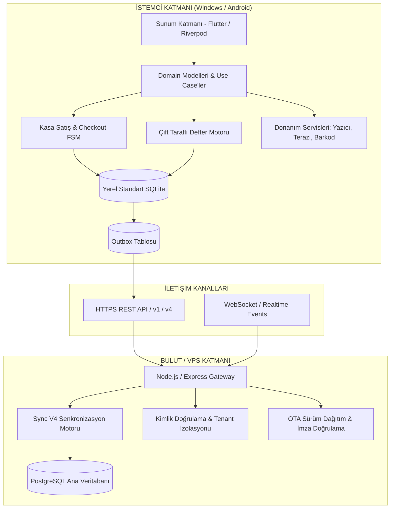
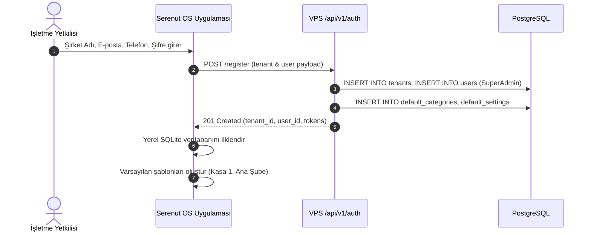
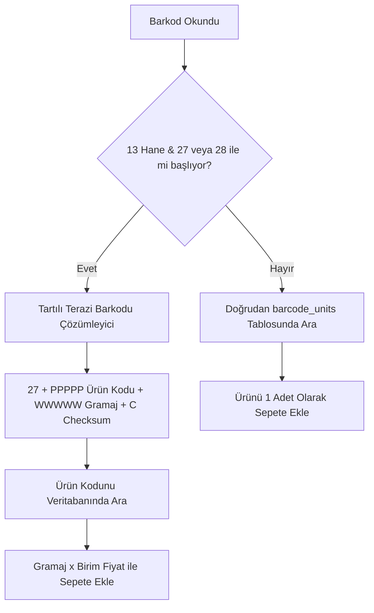
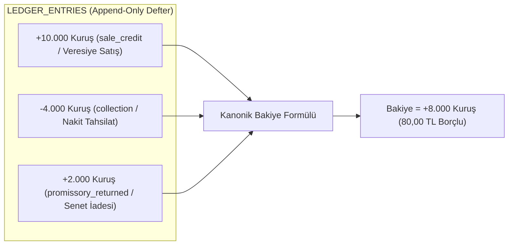
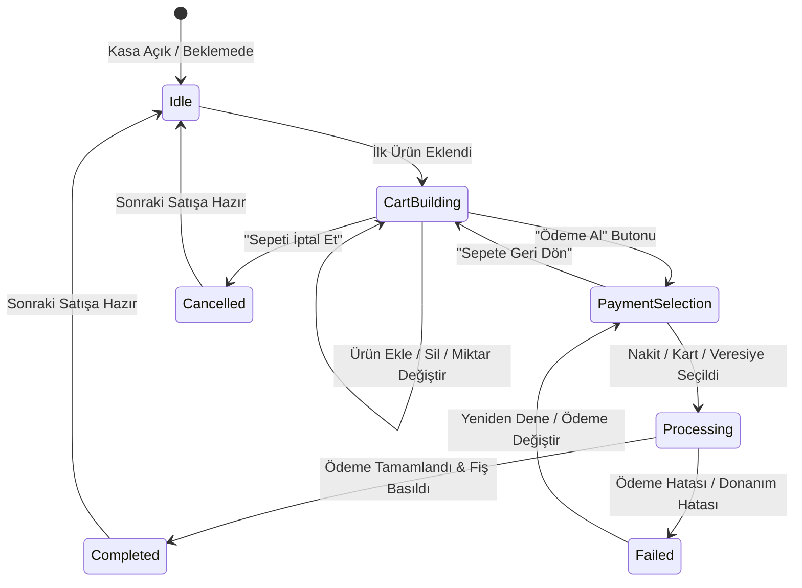
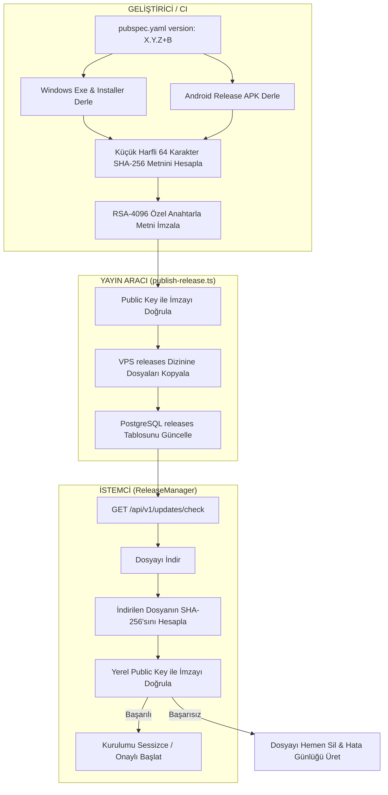

# Serenut OS — Sistem Mimarisi, Operasyonel Kullanım & Sorun Giderme Ana El Kitabı (Master Operating Manual)

> **Belge Sürümü:** 1.0.0 (Master Reference)  
> **Hedef Sistem:** Serenut OS İstemcisi (Desktop Windows / Android) & Serenut Cloud (Node.js/TypeScript VPS & PostgreSQL)  
> **Amaç:** Kayıttan girişe, ürün yönetiminden cariye, donanımdan senkronizasyona ve güncelleme imzalamaya kadar sistemin her bir parçasının ne şekilde çalıştığını açıklayan, sorun anında doğrudan referans alınabilecek nihai operasyonel ve teknik kılavuz.

---

## İÇİNDEKİLER

1. [Sistem Mimarisi & Temel İlkeler](#1-sistem-mimarisi--temel-ilkeler)
2. [Kullanıcı, Organizasyon (Tenant) & Cihaz Yönetimi (Kayıttan Girişe)](#2-kullanıcı-organizasyon-tenant--cihaz-yönetimi-kayıttan-girişe)
3. [Ürün Kataloğu, Fiyatlandırma, Barkodlar & Stok Motoru](#3-ürün-kataloğu-fiyatlandırma-barkodlar--stok-motoru)
4. [Müşteri, Cari Hesap, Veresiye, Senet & Defter Motoru (Ledger Engine)](#4-müşteri-cari-hesap-veresiye-senet--defter-motoru-ledger-engine)
5. [Kasa Satış, Sepet & Ödeme Motoru (POS Sales Engine)](#5-kasa-satış-sepet--ödeme-motoru-pos-sales-engine)
6. [Senkronizasyon Motoru (Sync V4 — Offline-First Replication)](#6-senkronizasyon-motoru-sync-v4--offline-first-replication)
7. [Donanım Entegrasyonları (Peripherals & Hardware Workers)](#7-donanım-entegrasyonları-peripherals--hardware-workers)
8. [Dağıtım, Güncelleme & Kriptografik İmzalama Standartları](#8-dağıtım-güncelleme--kriptografik-imzalama-standartları)
9. [Gözlemlenebilirlik, Telemetri & Loglama](#9-gözlemlenebilirlik-telemetri--loglama)
10. [Sorun Giderme Runbook'u & Acil Müdahale Prosedürleri](#10-sorun-giderme-runbooku--acil-müdahale-prosedürleri)

---

## 1. SİSTEM MİMARİSİ & TEMEL İLKELER

Serenut OS; perakende satış, market, kuruyemiş, şarküteri ve toptan ticaret yapan işletmeler için tasarlanmış, **"Offline-First" (Önce Çevrimdışı)** ve **"Zero-Loss Financial Guarantee" (Sıfır Finansal Kayıp)** prensiplerine dayalı dağıtık bir kurumsal işletim sistemidir.



### 1.1. Temel Mimari Kararlar

1. **SQLCipher'ın Kaldırılması & Standart SQLite (AGENTS.md Kural 1):**
   - Mobil (Android) ve masaüstü (Windows) istemcilerinde şifreli `sqflite_sqlcipher` motoru tamamen kaldırılmıştır.
   - Yerel veritabanı motoru standart, şifresiz `sqflite` / `sqflite_common_ffi`'dir.
   - Veri güvenliği işletim sistemi izinleri (Android `/data/user/0/...` sandbox ve Windows `%APPDATA%` kullanıcı ACL'leri) ve VPS tarafındaki şifreli PostgreSQL bağlantısı ile sağlanır.
2. **Kuruş Bazlı Finansal Bütünlük (MoneyCents):**
   - Sistemde hiçbir para birimi SQLite `REAL` veya Dart/TS `double` olarak saklanamaz ve hesaplanamaz.
   - Tüm tutarlar, bakiyeler ve fiyatlar **kuruş cinsinden tam sayı (Integer)** olarak saklanır (ör. 100,50 TL = `10050` kuruş).
   - Bölme ve oran hesaplamalarında bankacılık standartlarında **Half-Up (0.5 ve üzeri yukarı)** yuvarlama uygulanır.
3. **Append-Only Defter (Ledger) Modeli:**
   - Cari hesaplarda hiçbir bakiye elle doğrudan `UPDATE` edilemez.
   - Defter kayıtları (`ledger_entries`) yalnızca eklenir (append-only); hata düzeltmeleri zıt yönlü düzeltme kaydı (`correction` / `reversal`) ile gerçekleştirilir.
4. **Offline-First Kesintisiz Satış:**
   - İnternet bağlantısı kopsa dahi istemci yerel SQLite veritabanı üzerinde 100 milisaniye altında tam hızla satış yapabilir, tahsilat alabilir, fiş kesebilir ve terazi okuyabilir.
   - Bağlantı geri geldiğinde `Sync V4` motoru biriken hareketleri kayıpsız olarak sunucuya aktarır.

---

## 2. KULLANICI, ORGANİZASYON (TENANT) & CİHAZ YÖNETİMİ (KAYITTAN GİRİŞE)

### 2.1. Organizasyon (Tenant) & Şube Yapısı

Her işletme bir `tenant` (kiracı) olarak izole edilir.
- **Tenant ID:** Benzersiz UUIDv4 (ör. `ten-019a28c3-4d56-7890-abcd-ef0123456789`).
- **Veri Ayrımı:** VPS üzerindeki PostgreSQL tablolarında (`tenants`, `users`, `products`, `customers`, `ledger_entries`, `sales`) her kayıtta zorunlu `tenant_id` kolonu bulunur ve Row-Level / Multi-Tenant indeksleri ile korunur.
- **Şube ve Depolar (`branches`):** Bir firmanın birden fazla kasası veya deposu olabilir. Her kasa bir şubeye bağlıdır.

### 2.2. Kullanıcı Kaydı & İlk Kurulum Akışı



### 2.3. Cihaz Aktivasyonu & Donanım Parmak İzi (`device_fingerprint`)

Bir cihazın bir kasayı yönetebilmesi için organizasyon ile eşleştirilmesi gerekir:
1. İstemci ilk açılışında CPU ID, Anakart Seri No, Disk UUID ve MAC adresinden kriptografik bir `device_fingerprint` üretir (`DeviceFingerprintService`).
2. Yönetici portalından veya ana kasadan bir **Cihaz Aktivasyon Kodu / Eşleştirme Tokeni** alınır.
3. İstemci `POST /api/v1/devices/activate` isteği ile aktivasyon kodunu ve donanım parmak izini gönderir.
4. Sunucu cihazı doğrular ve cihaza özel `device_token` tahsis eder. Bu token yerel SQLite `app_settings` tablosunda ve güvenli depolama alanında saklanır.

### 2.4. Giriş (Login) & Oturum Yönetimi

Sistemde iki seviyeli kimlik doğrulama bulunur:

#### A. Yönetici / İlk Kurulum Girişi (E-posta + Şifre)
- `POST /api/v1/auth/login`
- Yanıt: `accessToken` (kısa ömürlü, 15 dk - 1 saat), `refreshToken` (uzun ömürlü, 30 gün), `user` ve `permissions`.
- Token'lar istemcide `SecureStorage` ve yerel SQLite oturum tablosunda tutulur.

#### B. Kasiyer Hızlı Giriş (4 Haneli PIN Kodu)
- Kasa operasyonlarında kasiyer değişimi çok hızlı olmalıdır.
- Kullanıcının 4 haneli PIN kodu yerel SQLite veritabanında tuzlanmış (salted) PBKDF2/Argon2 özeti olarak saklanır.
- **Offline PIN Doğrulama:** İnternet olmasa dahi kasiyer PIN kodunu girdiğinde yerel veritabanındaki hash ile karşılaştırılır ve anında oturum açılır (`PasswordHashService`).

### 2.5. Rol Bazlı Yetkilendirme (RBAC)

| Rol | Yetkiler | Kısıtlamalar |
|---|---|---|
| **SuperAdmin / Firma Sahibi** | Tüm şubeler, kullanıcı açma, fiyat değiştirme, mali raporlar, silme/iptal işlemleri | Sınırsız |
| **Müdür (Manager)** | Kendi şubesinde stok girişi, fiyat görme, zayi/fire kaydı, iskonto yapabilme | Şirket silme ve lisans yönetimi kapalı |
| **Kasiyer (Cashier)** | Satış yapma, tahsilat alma, fiş yazdırma, ürün arama, müşteri bakiyesi görme | Mali raporları göremez, kısıtlı iskonto limiti, ürün fiyatını elden değiştiremez |
| **Depocu (Stock Clerk)** | Mal kabulü, sayım, stok hareketi girişi | Satış yapamaz, cari defter bakiyelerini göremez |

---

## 3. ÜRÜN KATALOĞU, FİYATLANDIRMA, BARKODLAR & STOK MOTORU

### 3.1. Veri Yapısı (`products`, `barcode_units`, `categories`)

- `products`:
  - `id`: UUID (ör. `prod-xxx`).
  - `tenant_id`: Organizasyon kimliği.
  - `name`: Ürün adı (ör. "Kavrulmuş Fındık 500g").
  - `category_id`: Kategori referansı.
  - `sale_price_cents`: Satış fiyatı (kuruş).
  - `purchase_price_cents`: Alış/maliyet fiyatı (kuruş).
  - `vat_rate`: KDV oranı (ör. 1, 10, 20).
  - `unit_type`: Birim (`piece` - Adet, `kg` - Kilogram, `gram`, `liter`).
  - `stock_tracking`: Boolean (Stok takip edilsin mi?).
  - `current_stock_grams_or_pieces`: Mevcut stok miktarı.
  - `is_weighed`: Tartılı ürün mü? (Terazili mi?).
  - `deleted_at`: Tombstone silme damgası.
- `barcode_units`:
  - Bir ürüne birden fazla barkod atanabilir (ör. koli barkodu, tekil barkod, tedarikçi barkodu).
  - `barcode`: EAN-13, EAN-8 veya dahili barkod.
  - `multiplier`: Adet çarpanı (ör. 1 koli = 24 adet).

### 3.2. Para & Kuruş Modeli (`MoneyCents`) Kuralları

Finansal tutarlarda **Floating Point KESİNLİKLE YASAKTIR**.
```dart
// DOĞRU:
final int priceCents = 14950; // 149.50 TL
final int quantityGrams = 450; // 450 gram
// 1 kg = 1000 gram
// Tutar = (14950 * 450 + 500) ~/ 1000 = 6728 kuruş (67.28 TL) (Half-Up Yuvarlama)
final int totalCents = ((priceCents * quantityGrams) + 500) ~/ 1000;

// YANLIŞ:
double price = 149.50;
double total = price * 0.450; // 67.27500000000002 -> Finansal kayıp ve çakışma riski!
```

### 3.3. Barkod Ekosistemi & Tartılı/Terazili Ürün Çözümlemesi

Sistem barkod okuyucudan gelen girdiyi anında analiz eder:



- **Standart Barkodlar:** EAN-13, EAN-8, Code 128, QR kodları doğrudan `barcode_units` tablosundan eşleştirilir.
- **Terazi Barkod Formatı (`27` ve `28` Serisi):**
  - Prefix: `27` veya `28` (2 hane)
  - PLU / Ürün Kodu: 5 hane (ör. `00142`)
  - Ağırlık / Değer: 5 hane (ör. `00450` -> 450 gram)
  - Kontrol Hanesi (Check Digit): 1 hane
  - Sonuç: Kasiyer teraziden basılmış etiketi okuttuğunda ekrana dokunmadan 450 gram fındık sepetine anında kuruşu kuruşuna eklenir.

### 3.4. Stok Hareketleri (Inventory Ledger)

Her stok değişimi bir `stock_movements` kaydı doğurur:
1. **`sale`:** Kasa satışı onaylandığında ilgili ürünlerin stoğu satılan miktar kadar düşürülür.
2. **`return`:** Müşteri iade getirdiğinde stok otomatik olarak artırılır.
3. **`purchase`:** Mal kabul / alış faturası girildiğinde stok artar ve alış maliyet fiyatı güncellenir.
4. **`waste` (Fire/Zayi):** Bozulan, kırılan ürünler stoktan açıklama ile düşülür.
5. **`count_adjustment` (Sayım Düzeltmesi):** Periyodik fiziki sayım sonucunda tespit edilen fark sisteme işlenir.

---

## 4. MÜŞTERİ, CARİ HESAP, VERESİYE, SENET & DEFTER MOTORU (LEDGER ENGINE)

### 4.1. Çift Girişli Append-Only Defter Modeli

Müşteri bakiyesi asla `customers.balance = 5000` şeklinde elle güncellenmez. Tüm mali geçmiş `ledger_entries` tablosunda sıralı ve değiştirilemez bir defter olarak tutulur.



### 4.2. Kanonik Bakiye Formülü

Tüm sistem genelinde (Dart istemci, SQLite sorguları, Node.js VPS ve PostgreSQL görünümünde) geçerli **TEK VE DEĞİŞMEZ** formül:

$$\text{balance\_cents} = \sum \begin{cases} +\text{amount\_cents}, & \text{eğer type} \in ('sale\_credit', 'manual\_debt', 'promissory\_returned') \\ -\text{amount\_cents}, & \text{diğer tüm tiplerde} ('collection', 'sale\_return\_credit', 'payment') \end{cases}$$

- **Pozitif Bakiye ($> 0$):** Müşteri işletmeye **BORÇLU**dur.
- **Negatif Bakiye ($< 0$):** Müşterinin işletmede **ALACAĞI / AVANSI** vardır.
- **Sıfır Bakiye ($= 0$):** Hesap kapalıdır.

> [!IMPORTANT]
> **Değiştirilemezlik (Append-Only) Kuralı:**  
> Bir defter kaydı oluştuktan sonra asla `DELETE` veya `UPDATE` edilemez. Yanlış girilen bir tahsilat veya borç kaydı için zıt yönlü yeni bir kayıt (`entry_type = 'correction'` veya `'reversal'`) eklenir.

### 4.3. Veresiye (Açık Hesap) Satış Akışı

1. Kasa ekranında sepete ürünler eklenir.
2. Ödeme adımında "Veresiye / Cari" seçildiğinde sistem **Müşteri Seçimini Zorunlu Kılar**. Müşteri seçilmemişse işlem bloke edilir.
3. Müşterinin açık hesap limiti kontrol edilir (limit tanımlıysa ve aşılıyorsa yönetici onayı istenir).
4. Satış tamamlandığında tek bir atomik SQLite transaction içinde:
   - `sales` kaydı oluşturulur (`payment_status = 'pending'`).
   - `sale_payments` tablosuna `veresiye` tipi ödeme işlenir.
   - `ledger_entries` tablosuna `sale_credit` kaydı eklenir.
   - `customers` tablosundaki `balance_cents` önbelleği kanonik formülle artırılır.
   - Müşteriye SMS/WhatsApp bilgi mesajı göndermek üzere kuyruğa (`outbox`) olay yazılır.

### 4.4. Senet (Promissory Notes) Yaşam Döngüsü

Senetli satışlarda senetler ayrı bir portföy tablosunda (`promissory_notes`) takip edilir:
- **`pending` (Beklemede / Kasada):** Vadesi gelmemiş senet.
- **`collected` (Tahsil Edildi):** Müşteri ödemesini yaptı; cari hesaba tahsilat işlenir, kasa giriş kaydı doğar.
- **`returned_protest` (Protesto / İade Edildi):** Vadesinde ödenmeyen senet. Cari hesaba `promissory_returned` tipi ile otomatik borç yazılır.
- **`legal` (İcrada / Hukukta):** Hukuki takibe intikal etmiş senetler.

---

## 5. KASA SATIŞ, SEPET & ÖDEME MOTORU (POS SALES ENGINE)

### 5.1. Checkout Sonlu Durum Makinesi (Finite State Machine)

Satış süreci belirli durumlardan geçer ve her durum geçişi sıkı kurallara bağlıdır:



### 5.2. Sepet Kilitleme (`cart_lock`) & Çakışma Koruması

Eşzamanlı işlemleri engellemek için satış başlatıldığı anda sepet bellek üzerinde kilitlenir (`cart_lock = true`).
- Barkod okuyucu veya kasiyer ikinci bir tuşa bassa dahi işlem devam ederken sepet manipüle edilemez.
- İşlem SQLite transaction seviyesinde `runInTransaction` ile yürütülür. Herhangi bir adımda (ör. stok yetersizliği, donanım çökmesi) hata oluşursa tüm transaction `ROLLBACK` edilir; hayalet satış veya açıkta kalan ödeme engellenir.

### 5.3. Ödeme Yöntemleri & Karma (Split) Ödeme

Sistem esnek ödeme kombinasyonlarını destekler:
1. **Nakit:** Kasiyer alınan tutarı girer, para üstü ekranda büyük puntolarla gösterilir, nakit çekmecesi otomatik açılır (`\x1b\x70...`).
2. **Kredi Kartı / Harici POS:** Banka terminalinden geçiş yapılır; referans / slip no girilebilir.
3. **Veresiye:** Seçilen müşterinin cari hesabına borç kaydedilir.
4. **Karma (Split) Ödeme:** Tek faturada birden çok yöntem:
   - Örnek: Toplam 2.000 TL -> 500 TL Nakit + 1.000 TL Kredi Kartı + 500 TL Veresiye.
   - Her ödeme parçası `sale_payments` tablosuna ayrı ayrı kaydedilir; ödemelerin toplamı sepet toplamına eşit olmadan satış kapatılamaz.

### 5.4. İade ve Değişim Akışı

- **Satış Fişinden İade:** Müşteri fiş barkodunu getirdiğinde geçmiş satış çağrılır. İade edilmek istenen satırlar seçilir.
- **Belgesiz / Serbest İade:** Ürün ve miktar seçilerek iade fişi kesilir.
- **Mali Yansıma:**
  - İade edilen ürünler stoğa otomatik geri alınır (`stock_movements.type = 'return'`).
  - İade bedeli nakit ödendiyse kasadan nakit çıkışı (`cash_transactions.type = 'refund'`) yapılır.
  - Veresiye satışın iadesiyse müşterinin cari hesabına alacak (`sale_return_credit`) yazılır.

### 5.5. Gün Sonu ve Z-Raporu (Kasa Kapanışı)

1. **Gün Açılışı:** Kasaya sabah bırakılan devir nakit girilir.
2. **Gün İçi:** Kasa girişleri (tahsilat, nakit ekleme) ve çıkışları (masraf ödemesi, mal alımı) kaydedilir.
3. **Gün Sonu Kapanışı (Z-Raporu):**
   - Kasiyer kasadaki fiziki parayı sayar ve girer.
   - Sistem gün boyunca yapılan:
     - Toplam Nakit Satışlar
     - Toplam Kredi Kartı Satışları
     - Toplam Veresiye Satışlar
     - Toplam Tahsilatlar ve Masrafları hesaplar.
   - Beklenen Kasa ile Sayılan Kasa karşılaştırılır; varsa **Kasa Fazlası** veya **Kasa Eksiği** raporda belirtilir.
   - Z-Raporu termal yazıcıdan yazdırılır ve `daily_registers` tablosunda kilitlenerek gün kapatılır.

---

## 6. SENKRONİZASYON MOTORU (SYNC V4 — OFFLINE-FIRST REPLICATION)

### 6.1. Mimari Prensip: Dağıtık Outbox Deseni

Tüm istemci değişiklikleri (satış, stok, müşteri, defter) yerel veritabanına kaydedilirken aynı transaction içinde `outbox` tablosuna bir mutasyon olayı olarak yazılır.


### 6.2. Sunucu İdempotency & `payloadDeepEqual` Koruması

Ağ kopması durumunda istemci aynı mutasyonu tekrar gönderebilir.
- Sunucu `idempotency_key` (veya `mutation_id`) üzerinden geçmişi kontrol eder.
- **Kritik Çakışma Önleyici (`payloadDeepEqual`):** PostgreSQL `jsonb` kolonları JSON nesnelerinin anahtarlarını dahili olarak alfabetik ve uzunluğa göre yeniden sıralar. Düz `JSON.stringify` karşılaştırması sahte çakışma (`conflict`) üreteceği için `payloadDeepEqual` recursive fonksiyonu ile anlamsal eşitlik kontrol edilir. Aynı mutasyon geldiğinde hata fırlatılmaz, `already_processed` olarak onaylanır.

### 6.3. Pull Akışı (Sunucudan İstemciye Çekme)

- İstemci son aldığı `server_seq` numarasını bilir.
- `GET /api/v4/sync/pull?since_seq=1480` çağrısı yapar.
- Sunucu, 1480'den sonra organizasyona ait diğer cihazlar veya web portalından yapılan değişiklikleri döner.
- İstemci gelen verileri yerel SQLite tablolarına yansıtır (`SyncV4PullAdapter`).

### 6.4. Çakışma Çözümü (Conflict Resolution)

- **Kural:** Sunucu zaman damgası otoritesi ile Deterministik **Last-Write-Wins (LWW)** uygulanır.
- **Silinmeler (Tombstone):** Hiçbir satır fiziksel silinmez (`DELETE FROM ...` yapılmaz). `deleted_at = timestamp` alanı doldurulur ve diğer cihazlara bu şekilde yayılır.

---

## 7. DONANIM ENTEGRASYONLARI (PERIPHERALS & HARDWARE WORKERS)

### 7.1. Termal Fiş Yazıcısı (ESC/POS)

Termal yazıcılar müşteri fişi, bilgi fişi, mutfak sipariş fişi ve gün sonu Z-raporu dökümünde kullanılır.
- **Protokol:** Raw ESC/POS komutları.
  - İnisiyalizasyon: `\x1b\x40` (`ESC @`)
  - Kağıt Kesme: `\x1d\x56\x00` (`GS V 0` Full Cut) veya `\x1d\x56\x01` (Partial Cut)
  - Çekmece Darbesi (Cash Drawer Kick): `\x1b\x70\x00\x19\xfa`
- **Bağlantı Kanalları:**
  - **USB:** Windows Spooler (`win32` API üzerinden Raw veri gönderme).
  - **Ağ (Ethernet / Wi-Fi):** Raw TCP soketi, varsayılan Port: `9100`.
  - **Seri (COM Port):** RS-232 seri arabirimi.
  - **Bluetooth:** Mobil cihazlarda SPP (Serial Port Profile) bağlantısı.
- **Türkçe Karakter Desteği:**
  - Yazıcının donanım karakter tablosuna göre `CP857` (PC857) kod sayfası dönüşümü yapılır (`ç, ğ, ı, ö, ş, ü, İ`).
  - Türkçe font ROM'u bulunmayan ucuz yazıcılarda sistem otomatik olarak **Raster Grafik Baskı Moduna** geçer; fişi 203 DPI siyah-beyaz bitmap resim olarak çizer ve yazıcıya görsel olarak aktarır (`PersistentPrintQueue`).

### 7.2. Barkod & Etiket Yazıcısı (TSPL / ZPL)

Ürün raf etiketleri ve koli etiketleri için TSPL (Taiwan Semiconductor / Xprinter / Argox) komut seti kullanılır:
```text
SIZE 40 mm, 30 mm
GAP 2 mm, 0 mm
DIRECTION 1
CLS
TEXT 20,20,"3",0,1,1,"SERENUT NUTOPIA FINDIK"
BARCODE 20,60,"EAN13",60,1,0,2,2,"8690123456789"
TEXT 20,130,"4",0,1,1,"149.50 TL"
PRINT 1,1
```

### 7.3. Elektronik Terazi (RS-232 Serial Worker)

Kasaya bağlı terazi ürün tartımında hızı ve doğruluğu sağlar.
- **Seri Port Ayarları:** Baud Rate `9600`, Data Bits `8`, Parity `None`, Stop Bits `1` (`9600-8-N-1`).
- **Desteklenen Protokoller:** CAS (AP-1, ER-Plus), TEM, Dibal, Bizerba, Desis.
- **Kararlılık (Stability) Koruması:**
  - Terazi veri akışında `ST` (Stable / Kararlı) ve `US` (Unstable / Hareketli) bayrakları gönderir.
  - Tartım titrerken kasiyerin hatalı gramajla satış yapmasını önlemek için sistem ekrandaki tartım butonunu `US` durumunda kilitler; terazi `ST` verdiğinde gramaj yeşile döner ve sepete eklenebilir.

---

## 8. DAĞITIM, GÜNCELLEME & KRİPTOGRAFİK İMZALAMA STANDARTLARI

Bu bölüm, `AGENTS.md` ve `docs/release-update-runbook.md` belgelerinde tanımlanan **zorunlu güvenlik ve yayın kurallarını** içerir.



### 8.1. Sürüm ve Dosya Adlandırma Kuralları (Professional Versioning)

- **`+` İletimi Yasaktır (Dosya Adları & Public UI - AGENTS.md Kural 2):**
  - Kullanıcıya sunulan veya web sitesinden indirilen dosyalarda `+` içeren dahili Flutter derleme numarası **ASLA KULLANILAMAZ** (Örnek: `SerenutOS-v1.3.144+299.exe` YASAKTIR).
  - **Doğru Format:**
    - Görünen ve İndirilen Dosya Adı: `SerenutOS-v1.3.144.exe` ve `SerenutOS-v1.3.144.apk`.
  - `pubspec.yaml` içerisindeki `+299` yapısı sadece dahili `versionCode` ve CI takibi içindir; yayın araçları ve indirme servisleri bunu otomatik semantik formata (`v1.3.144`) çevirir.

### 8.2. Değişmez İmza Sözleşmesi & OTA Standardı

1. **Android Paket İmzası (Keystore):**
   - Sertifika Parmak İzi (SHA-256): `server/release-signing-policy.json` dosyasındaki `androidPackageCertificateSha256` değeri ile birebir eşleşmelidir. Eşleşmeyen APK yayınlanamaz.
2. **Windows Authenticode İmzası:**
   - Tüm binary'ler (`.exe` ve `.dll`) Digicert zaman damgası ile SHA-256 PFX sertifikası kullanılarak imzalanır (`signtool.exe`).
3. **OTA RSA-SHA256 İmza Girdisi:**
   - **Kritik Kural:** İmzalanan şey dosyanın baytları değildir! Dosyanın küçük harfli 64 karakterlik SHA-256 özet metnidir (`utf-8`).
4. **Tek Yetkili Yayınlayıcı:**
   - Desteklenen tek yayınlayıcı: `server/src/scripts/publish-release.ts` (`dist/scripts/publish-release.js`).
   - `scripts/publish_v*.py` veya elle SQL yazarak sürüm yayınlamak **YASAKTIR**.
5. **Yayın Doğrulama:**
   - Her yayın sonrasında `node scripts/verify_published_release.js X.Y.Z+B` çalıştırılarak imza ve hash VPS üzerinde tam test edilmeden yayın tamamlanmış sayılmaz.

---

## 9. GÖZLEMLENEBİLİRLİK, TELEMETRİ & LOGLAMA

### 9.1. Yerel Loglama (Structured JSONL)

İstemci tüm çalışma loglarını işletim sistemine özel yerel dizinde saklar:
- **Windows:** `%APPDATA%\Serenut OS Software Technologies A.Ş\Serenut OS\logs\app.log`
- **Android:** `/data/user/0/com.serenutos.pos/files/logs/app.log`
- **Log Formatı:** JSON Lines (her satırda timestamp, level, subsystem, correlation_id, message, payload).

### 9.2. Sentry Entegrasyonu & Hata Fırtınası Filtreleri

Sentry crash reporting sistemi istemcideki gerçek kritik hataları yakalar.
- **Filtreleme Kuralları (`beforeSend`):**
  - Çevrimdışı modda çalışırken oluşan beklenen ağ hataları (`SocketException`, `ClientException`, `HttpException: Connection closed before full header was received`, `HandshakeException`) Sentry'ye gönderilmez ve kota israfı engellenir.
  - Sentry yalnızca yakalanmamış UI çöküşleri (`FlutterError.onError`), veritabanı bozulma alarmları ve donanım kritik istisnalarını raporlar.

---

## 10. SORUN GİDERME RUNBOOK'U & ACİL MÜDAHALE PROSEDÜRLERİ

### 10.1. Senaryo 1: Kasa Çevrimdışı Kaldı / Outbox Kuyruğu Birikti

**Belirti:** Satışlar yapılıyor ancak web panelinde veya diğer kasalarda görünmüyor. Sağ üst köşedeki bulut simgesi kırmızı/sarı.
1. **İnternet ve Sunucu Erişimi Kontrolü:**
   ```bash
   curl -I https://api.serenut.com/api/v1/health
   ```
2. **Kuyruktaki Bekleyen Mutasyonları Sorgula (SQLite):**
   ```sql
   SELECT count(*), status FROM outbox GROUP BY status;
   ```
3. **Hatalı / Dead Letter'a Düşmüş Mutasyonu Bul:**
   ```sql
   SELECT id, aggregate_type, error_message, retry_count FROM outbox WHERE status = 'failed' OR status = 'dead_letter';
   ```
4. **Çözüm / Yeniden Tetikleme:**
   - Ağ düzeldiğinde sistem otomatik push yapar.
   - Acil durumlarda Ayarlar -> Senkronizasyon -> "Şimdi Eşitle" butonuna basılır.

### 10.2. Senaryo 2: Müşteri Bakiyesi ile Defter Hareketleri Uyuşmuyor

**Belirti:** Müşteri kartında bakiye 500 TL yazıyor ancak hareket listesi toplandığında 400 TL çıkıyor.
1. **İnceleme:** `customers.balance_cents` önbellek kolonu harici bir işlem veya kesinti yüzünden güncelliğini yitirmiş olabilir.
2. **Kanonik Yeniden Hesaplama:**
   İstemcideki `LedgerService.recalculateCustomerBalance(customerId)` çalıştırılır veya SQLite üzerinde:
   ```sql
   UPDATE customers 
   SET balance_cents = (
       SELECT COALESCE(SUM(CASE WHEN type IN ('sale_credit', 'manual_debt', 'promissory_returned') THEN amount_cents ELSE -amount_cents END), 0)
       FROM ledger_entries 
       WHERE customer_id = customers.id AND deleted_at IS NULL
   )
   WHERE id = 'HEDEF_MUSTERI_ID';
   ```
3. Bakiye anında matematiksel olarak defterin gerçek toplamına eşitlenir.

### 10.3. Senaryo 3: SQLite Veritabanı Kilitlendi veya WAL Büyüdü

**Belirti:** `database is locked` veya `disk I/O error`.
1. **Bütünlük Kontrolü:**
   ```sql
   PRAGMA integrity_check;
   ```
   Çıktı `ok` olmalıdır.
2. **WAL Checkpoint:**
   Büyüyen `-wal` dosyasını ana veritabanına gömmek için:
   ```sql
   PRAGMA wal_checkpoint(TRUNCATE);
   ```
3. **Kurtarma:** Uygulama tamamen kapatılır, `%APPDATA%\...\databases\core_next` dizinindeki veritabanının yedeği alınır ve uygulama yeniden başlatılır.

### 10.4. Senaryo 4: Termal Yazıcı Fiş Basmıyor veya Türkçe Harfler Bozuk

1. **Bağlantı Kontrolü:**
   - USB yazıcı ise Windows Aygıt Yöneticisi'nde doğru yazıcı kuyruğu seçili mi?
   - Ağ yazıcısı ise IP adresine ping atılabiliyor mu (`ping 192.168.1.200`)?
2. **Türkçe Karakter Sorunu:**
   - Ayarlar -> Yazıcı Ayarları -> "Karakter Kod Sayfası" seçeneğini `CP857` yapın.
   - Sorun çözülmezse "Grafik/Resim Olarak Yazdır" seçeneğini açın (tüm karakterleri piksel olarak dökeceğinden %100 kusursuz Türkçe basacaktır).

### 10.5. Senaryo 5: Terazi Ağırlığı Okumuyor

1. Windows Aygıt Yöneticisi -> Bağlantı Noktaları (COM & LPT) altında terazi USB-Serial çeviricinin COM portunu (ör. `COM3`) kontrol edin.
2. Başka bir uygulamanın COM portunu işgal etmediğinden emin olun (COM portları tekil erişimlidir).
3. Ayarlar -> Donanım -> Terazi ekranından Baud Rate'in `9600` ve modelin doğru seçildiğini doğrulayın.

### 10.6. Senaryo 6: Güncelleme İndirildi Ama İmza Hatası Veriyor

**Belirti:** Güncelleme iniyor ancak "İmza doğrulanamadı" uyarısıyla iptal ediliyor.
1. İndirilen dosyanın SHA-256 hash'i sunucudaki hash ile uyuşmuyor olabilir (eksik indirme / proxy araya girmesi).
2. İstemcideki yerel güncelleme önbelleğini temizleyin:
   - Windows: `%TEMP%\serenut_updates` veya `%APPDATA%\...\updates` dizinini silin.
3. Cihazın sürümünün köprü sürüm gerektirip gerektirmediğini (`1.3.10+91` altı mı?) kontrol edin.

### 10.7. Senaryo 7: VPS Production Sunucusu Acil Müdahale Komutları

```bash
# Sunucu durumunu kontrol et
pm2 status

# Node.js backend loglarını canlı izle
pm2 logs serenut-server --lines 100

# Backend'i sıfır kesintiyle yeniden başlat
pm2 reload serenut-server

# PostgreSQL bağlantı durumunu incele
sudo -u postgres psql -d serenut_production -c "SELECT count(*), state FROM pg_stat_activity GROUP BY state;"

# Yayındaki sürümü doğrula
node scripts/verify_published_release.js 1.3.144+299
```

---

## 11. HIZLI ERİŞİM KONTROL LİSTESİ (CHEAT SHEET)

| Alan | Kanonik Kural | İlgili Dosya / Kod |
|---|---|---|
| **Veritabanı** | Standart SQLite (SQLCipher Yasak) | `lib/infrastructure/database/` |
| **Para Birimi** | Kuruş / Integer (`MoneyCents`) | `core_next/client_core/lib/domain/money_cents.dart` |
| **Bakiye Formülü** | Pozitif = Borçlu, Negatif = Alacaklı | `lib/infrastructure/database/schema/db_triggers.dart` |
| **Dosya İsimleri** | `+` Yasak (`SerenutOS-vX.Y.Z.exe`) | `AGENTS.md` Kural 2 |
| **OTA İmzalama** | Dosya SHA-256 Metninin RSA İmzası | `server/src/scripts/publish-release.ts` |
| **Yayın Doğrulama** | Zorunlu Kontrol Scripti | `scripts/verify_published_release.js` |
| **Senkronizasyon** | Deep Equal JSONB (`payloadDeepEqual`) | `server/src/modules/sync_v4/sync-v4.routes.ts` |
| **Yerel Loglar** | `%APPDATA%\...\logs\app.log` | `lib/infrastructure/services/log_collection_service.dart` |

---
*Bu el kitabı Serenut OS geliştirici ve operasyon ekipleri için birincil ve bağlayıcı referanstır. Her yeni mimari kararda ve sürüm geçişinde güncellenmelidir.*
