# Serenut OS — Sistem Mimarisi, Operasyonel Kullanım & Sorun Giderme Ana El Kitabı (Master Operating Manual)

> **Belge Sürümü:** 3.6.0 (The Definitive Master Architecture, Release v1.3.145+301, Category F & G Hardening, Deadlock-Free Sync V4 Pipeline)  
> **Hedef Sistem:** Serenut OS İstemcisi (Desktop Windows / Android) & Serenut Cloud (Node.js/TypeScript VPS & PostgreSQL)  
> **Amaç:** Kayıttan girişe, ürün yönetiminden cariye, donanımdan senkronizasyona, GİB e-Arşivden WhatsApp Business / Evolution QR entegrasyonuna, Patron Web Portalından Müşteri İkinci Ekranına, P2P görsel ağından kriptografik OTA sürüm imzalamaya kadar sistemin istisnasız tüm parçalarının ne şekilde çalıştığını açıklayan, sorun anında doğrudan referans alınabilecek nihai operasyonel ve teknik el kitabı.

---

## İÇİNDEKİLER

1. [Sistem Mimarisi & Temel İlkeler](#1-sistem-mimarisi--temel-ilkeler)
2. [Kullanıcı, Organizasyon (Tenant) & Cihaz Yönetimi (Kayıttan Girişe)](#2-kullanıcı-organizasyon-tenant--cihaz-yönetimi-kayıttan-girişe)
3. [Ürün Kataloğu, Fiyatlandırma, Barkodlar & Stok Motoru](#3-ürün-kataloğu-fiyatlandırma-barkodlar--stok-motoru)
4. [Müşteri, Cari Hesap, Veresiye, Senet & Defter Motoru (Ledger Engine)](#4-müşteri-cari-hesap-veresiye-senet--defter-motoru-ledger-engine)
5. [Kasa Satış, Sepet, Ödeme Motoru & Sepet Kurtarma](#5-kasa-satış-sepet-ödeme-motoru--sepet-kurtarma)
6. [Senkronizasyon Motoru (Sync V4 — Offline-First Replication)](#6-senkronizasyon-motoru-sync-v4--offline-first-replication)
7. [Donanım Entegrasyonları & Ağ Paylaşımlı Donanım (Hardware Layer)](#7-donanım-entegrasyonları--ağ-paylaşımlı-donanım-hardware-layer)
8. [Hibrit Ürün Görseli Mimarisi (LAN P2P Mesh & VPS Cloud Origin Storage)](#8-hibrit-ürün-görseli-mimarisi-lan-p2p-mesh--vps-cloud-origin-storage)
9. [e-Dönüşüm & GİB e-Arşiv / e-Fatura Portalı (0 TL Maliyetli İstemci)](#9-e-dönüşüm--gib-e-arşiv--e-fatura-portalı-0-tl-maliyetli-istemci)
10. [WhatsApp Bildirim & İletişim Motoru (Evolution API & Meta Cloud)](#10-whatsapp-bildirim--iletişim-motoru-evolution-api--meta-cloud)
11. [Android SIM Kartlı SMS Ağ Geçidi (Yerel GSM Modemi)](#11-android-sim-kartlı-sms-ağ-geçidi-yerel-gsm-modemi)
12. [Patron Web Yönetim Portalı & Canlı Ciro İzleme (Realtime WebSocket Engine)](#12-patron-web-yönetim-portalı--canlı-ciro-izleme-realtime-websocket-engine)
13. [Müşteri İkinci Ekranı (Customer Facing Display)](#13-müşteri-ikinci-ekranı-customer-facing-display)
14. [Yedekleme, Geri Yükleme, Lisanslama & Veri Aktarımı (Migration)](#14-yedekleme-geri-yükleme-lisanslama--veri-aktarımı-migration)
15. [Gelişmiş Raporlar & 5 Sekmeli Analitik Paneli (Reports Engine)](#15-gelişmiş-raporlar--5-sekmeli-analitik-paneli-reports-engine)
16: [Dağıtım, Güncelleme & Kriptografik İmzalama Standartları](#16-dağıtım-güncelleme--kriptografik-imzalama-standartları)
17. [Gözlemlenebilirlik, Telemetri & Loglama](#17-gözlemlenebilirlik-telemetri--loglama)
18. [Sorun Giderme Runbook'u & Acil Müdahale Prosedürleri](#18-sorun-giderme-runbooku--acil-müdahale-prosedürleri)
    - [18.0. Hızlı Hata & Belirti Teşhis Fihristi (Quick Diagnostic Matrix)](#180-hızlı-hata--belirti-teşhis-fihristi-quick-diagnostic-matrix)
19. [Genişletilmiş Master Cheat Sheet Tablosu](#19-genişletilmiş-master-cheat-sheet-tablosu)
20. [Kalıcı Mimari Çözümler & Kusur Giderme Kataloğu (28/28 Çözüldü)](#20-kalıcı-mimari-çözümler--kusur-giderme-kataloğu-2828-çözüldü)
21. [Kategori C: Sistemik Hata Avı ve Saha Kusur Giderme Kataloğu (30/30 Çözüldü)](#21-kategori-c-sistemik-hata-avı-ve-saha-kusur-giderme-kataloğu-3030-çözüldü)
22. [Kategori D: Derin Sistemik ve Finansal Kusur Giderme Kataloğu (12/12 Çözüldü)](#22-kategori-d-derin-sistemik-ve-finansal-kusur-giderme-kataloğu-1212-çözüldü)
23. [Kategori E: Donanım Sürücüleri, Çoklu Kiracı İzolasyonu & Sınır Durum Kusur Giderme Kataloğu (10/10 Çözüldü)](#23-kategori-e-donanım-sürücüleri-çoklu-kiracı-izolasyonu--sınır-durum-kusur-giderme-kataloğu-1010-çözüldü)
24. [Kategori F: Veri İçe Aktarımı, SMS İletişimi, Sepet & Operasyonel Kuyruk Dayanıklılığı Kataloğu (8/8 Çözüldü)](#24-kategori-f-veri-i̇çe-aktarımı-sms-i̇letişimi-sepet--operasyonel-kuyruk-dayanıklılığı-kataloğu-88-çözüldü)
25. [Kategori G: Gün Sonu Mutabakatı, Kasa Sayımı, Taksitli Senkronizasyon ve Sync V4 İstemci Materializer Sağlamlaştırması (4/4 Çözüldü)](#25-kategori-g-gün-sonu-mutabakatı-kasa-sayımı-taksitli-senkronizasyon-ve-sync-v4-i̇stemci-materializer-sağlamlaştırması-44-çözüldü)

---

## 1. SİSTEM MİMARİSİ & TEMEL İLKELER

Serenut OS; perakende satış, market, kuruyemiş, şarküteri ve toptan ticaret yapan işletmeler için tasarlanmış, **"Offline-First" (Önce Çevrimdışı)** ve **"Zero-Loss Financial Guarantee" (Sıfır Finansal Kayıp)** prensiplerine dayalı dağıtık bir kurumsal işletim sistemidir.

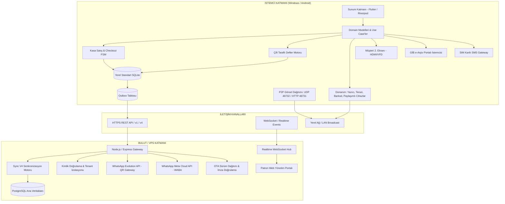

### 1.1. Temel Mimari Kararlar

1. **SQLCipher'ın Kaldırılması & Standart SQLite ([AGENTS.md Kural 1](file:///c:/Users/ecz/proje/shaman/shaman_new/.agents/AGENTS.md)):**
   - Mobil (Android) ve masaüstü (Windows) istemcilerinde şifreli `sqflite_sqlcipher` motoru tamamen kaldırılmıştır.
   - Yerel veritabanı motoru standart, şifresiz `sqflite` / `sqflite_common_ffi`'dir.
   - Veri güvenliği işletim sistemi izinleri (Android `/data/user/0/...` sandbox ve Windows `%APPDATA%` kullanıcı ACL'leri) ve VPS tarafındaki şifreli PostgreSQL bağlantısı ile sağlanır.
2. **Kuruş Bazlı Finansal Bütünlük (MoneyCents) & Canlı Müşteri Uyumluluğu (Dual-Stack):**
   - Authoritative Core Next mimarisinde hiçbir para birimi SQLite `REAL` veya Dart/TS `double` olarak saklanamaz ve hesaplanamaz.
   - Tüm tutarlar, bakiyeler ve fiyatlar **kuruş cinsinden tam sayı (Integer)** olarak saklanır (`MoneyCents`, ör. 100,50 TL = `10050` kuruş).
   - Kasa arayüzünde (`SalesFlowController`) sepet ara toplamı (`subtotalCents`), iskonto ve net tutar tamsayı kuruş üzerinden hesaplanır; bölme ve oran işlemlerinde bankacılık standardında **Half-Up (0.5 ve üzeri yukarı)** yuvarlama uygulanır (`((priceCents * grams) + 500) ~/ 1000`). Ekrana gösterilirken son render anında 2 haneli Lira formatına dönüştürülür.
   - **Ağ & Bulut Köprüsü:** İstemci kuruş tamsayısını muhafaza ederken, Sync V4 ağ adaptörü (`SyncV4PayloadAdapter`) PostgreSQL bulut şeması ile mutabakat için kesin 2 haneli Lira DTO formatı ile haberleşir.
   - **Canlı Müşterilerin Güvenliği:** Sahada mevcut `serenut_pos.db` (Legacy SQLite) veritabanını kullanan aktif müşterilerin kesintisiz çalışması ve veri kaybı yaşamaması için, sistem Fail-Closed Pilot Cutover Kapısı (`PilotCutoverGate`) üzerinden çift yönlü tip korumalı bir köprü (`MoneyCents` tamsayı tabanı) işletir; acil durumlarda 403 ms içinde güvenli geri dönüş (`ReverseMigrationEngine.rollbackToLegacy`) garantisi sunar.
3. **Append-Only Defter (Ledger) Modeli:**
   - Cari hesaplarda hiçbir bakiye elle doğrudan `UPDATE` edilemez.
   - Defter kayıtları (`ledger_entries`) yalnızca eklenir (append-only); hata düzeltmeleri zıt yönlü düzeltme kaydı (`correction` / `reversal`) ile gerçekleştirilir.
4. **Offline-First Kesintisiz Satış:**
   - İnternet bağlantısı kopsa dahi istemci yerel SQLite veritabanı üzerinde 100 milisaniye altında tam hızla satış yapabilir, tahsilat alabilir, fiş kesebilir ve terazi okuyabilir.
   - Bağlantı geri geldiğinde `Sync V4` motoru biriken hareketleri kayıpsız olarak sunucuya aktarır.

---

## 2. KULLANICI, ORGANİZASYON (TENANT) & CİHAZ YÖNETİMİ (KAYITTAN GİRİŞE)

### 2.1. Organizasyon (Tenant) & Şube Yapısı

Her işletme bir `company` (organizasyon) olarak izole edilir.
- **Company / Tenant ID:** Benzersiz sistem kimliği (ör. `comp-1729881234567-a1b2c3d4`).
- **Veri Ayrımı:** VPS üzerindeki PostgreSQL tablolarında (`companies`, `users`, `products`, `customers`, `sales`, `branches`) her kayıtta zorunlu `company_id` (ve Sync V4 defterinde `tenant_id`) kolonu bulunur ve Row-Level Security (RLS `app.current_company_id`) ile korunur.
- **Şube ve Depolar (`branches`):** Bir firmanın birden fazla kasası veya deposu olabilir (`br-<uuid>`). Her kasa bir şubeye bağlıdır.

### 2.2. Kullanıcı Kaydı & İlk Kurulum Akışı

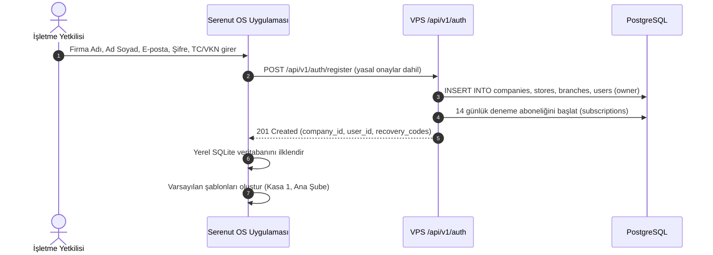

### 2.3. Cihaz Aktivasyonu & Donanım Parmak İzi (`device_fingerprint`)

Bir cihazın bir kasayı yönetebilmesi için organizasyon ile eşleştirilmesi gerekir:
1. İstemci ilk açılışında kararlı sistem parametreleri ve benzersiz kurulum kimliğinden kriptografik bir [DeviceFingerprint](file:///c:/Users/ecz/proje/shaman/shaman_new/lib/domain/models/device_fingerprint.dart) üretir ([DeviceFingerprintService](file:///c:/Users/ecz/proje/shaman/shaman_new/lib/infrastructure/services/device_fingerprint_service.dart)):
   - **`installationId`:** İlk kurulumda üretilen ve `SharedPreferences`'ta kalıcı saklanan benzersiz UUIDv4 (`serenut_installation_id`).
   - **`machineHash`:** `Platform.operatingSystem`, `operatingSystemVersion`, `numberOfProcessors` ve stabil ortam parametrelerinin (`COMPUTERNAME`, `PROCESSOR_IDENTIFIER` / `HOST`) SHA-256 özeti.
   - **`hardwareHash`:** `numberOfProcessors`, `operatingSystemVersion`, `localHostname` ve `PROCESSOR_ARCHITECTURE` bileşenlerinin SHA-256 özeti (uygulama güncellemelerinde sahte donanım değişikliği alarmı üretmemesi için Dart SDK sürümü kasıtlı olarak hariç tutulmuştur).
2. Yönetici portalından veya ana kasadan bir **Lisans Anahtarı / Eşleştirme Tokeni** alınır.
3. İstemci `POST /api/v1/licenses/activate` (veya oturum başlangıcında `POST /api/v1/auth/session-bootstrap`) isteği ile lisans anahtarını ve donanım parmak izini gönderir.
4. Sunucu cihazı doğrular ve cihaza özel `device_activations` kaydı ile JWT lisans tokeni tahsis eder. Bu token yerel SQLite `app_settings` tablosunda ve güvenli depolama alanında saklanır. Kasanın 14 günlük deneme süresi ilk cihaz aktive edildiğinde resmen başlar (`trial_started_at`).

### 2.4. Giriş (Login) & Oturum Yönetimi

Sistemde iki seviyeli kimlik doğrulama bulunur:

#### A. Yönetici / İlk Kurulum Girişi (E-posta + Şifre)
- `POST /api/v1/auth/login`
- Yanıt: `accessToken` (kısa ömürlü, 15 dk - 1 saat), `refreshToken` (uzun ömürlü, 30 gün), `user` ve `permissions`.
- Token'lar istemcide `SecureStorage` ve yerel SQLite oturum tablosunda tutulur.

#### B. Kasiyer Hızlı Giriş (4 Haneli PIN Kodu)
- Kasa operasyonlarında kasiyer değişimi çok hızlı olmalıdır.
- Kullanıcının 4 haneli PIN kodu yerel SQLite veritabanında NIST SP 800-132 standartlarına uygun olarak tuzlanmış (salted) **PBKDF2-HMAC-SHA256** özeti olarak saklanır (`pbkdf2$10000$<salt>$<hash>`).
- **Offline PIN Doğrulama:** İnternet olmasa dahi kasiyer PIN kodunu girdiğinde yerel veritabanındaki hash ile zamanlama saldırılarına (timing attacks) karşı sabit zamanlı (`_constantTimeCompare`) karşılaştırılarak anında oturum açılır ([PasswordHashService](file:///c:/Users/ecz/proje/shaman/shaman_new/lib/infrastructure/services/password_hash_service.dart)). Eski sürümlerden gelen `hashed_password_*` formatı ilk girişte şeffaf olarak yeni PBKDF2 formatına yükseltilir.

### 2.5. Rol Bazlı Yetkilendirme (RBAC) & İzin Modeli ([Permission & UserRole](file:///c:/Users/ecz/proje/shaman/shaman_new/lib/domain/models/permission.dart#L106-L178))

| Rol (`UserRole`) | Yetkiler | Kısıtlamalar |
|---|---|---|
| **Owner / Firma Sahibi** | Şirket genelinde sınırsız yetki: lisans yönetimi, şube açma/kapatma, kullanıcı yetkilendirme, mali raporlar | Kısıtlama yok |
| **Admin (Yönetici)** | Tüm şubeler, kullanıcı yönetimi, katalog, fiyat güncelleme, iptal ve iade onayları | Lisans devri ve şirket silme kapalı |
| **Sysadmin (Sistem Yöneticisi)** | Sistem ayarları, donanım yapılandırması, yazıcı/terazi sürücüleri, teknik loglar ve rapor inceleme | **Kasa satış işlemleri kapalı** (yetki karmaşasını ve kasa açığını önlemek için satış yapamaz) |
| **Manager (Müdür)** | Kendi şubesinde stok girişi, sayım, zayi/fire kaydı, iskonto yapabilme, sipariş yönetimi, satış raporları | Şirket seviyesi ayarlar ve kullanıcı silme kapalı |
| **Cashier (Kasiyer)** | Kasa satışı, tahsilat alma, fiş yazdırma, barkod okutma, müşteri bakiyesi görme | Mali raporları göremez, kısıtlı iskonto limiti, ürün fiyatını elden değiştiremez |
| **Staff (Personel)** | Kısıtlı satış oluşturma ve müşteri listesi önizleme | İptal, iade, tahsilat ve kasa kapatma yetkileri kapalı |

### 2.6. Sektörel Hazır Ürün & Kategori Tohumlama (`IndustryTemplateRegistry`)

Yeni bir işletme Serenut OS'a kaydolduğunda yüzlerce ürünü tek tek elle girmek zorunda kalmaz. Sistemde yerleşik [IndustryTemplateRegistry](file:///c:/Users/ecz/proje/shaman/shaman_new/lib/domain/models/industry_template.dart) motoru bulunur:
- **Kayıt Esnasında Seçim:** İşletme kaydolurken faaliyet alanını seçer:
  1. **Fındıkçı:** Hizmet, Kırma, Kavurma, Şekerleme & Ezme, Kremalar, Butik & Kurabiye kategorileri ve standart hizmet/kırma birim fiyatları tohumlanır.
  2. **Market:** Temel Gıda, İçecek, Temizlik, Şarküteri, Atıştırmalık kategorileri ve popüler EAN-13 barkodlu hazır ürünler yüklenir.
  3. **Kuruyemişçi:** Duble Antep Fıstığı, Giresun Fındığı, Kaju, Badem, Kabak Çekirdeği, Sarı Leblebi vb. tartılı (`isByWeight = true`) ve adetli ürünler tohumlanır.
  4. **Kafe:** Sıcak Kahveler, Soğuk İçecekler, Butik Tatlılar ve porsiyon bazlı menü kalemleri ilklendirilir.
- **Tek Tıkla Tohumlama:** SQLite veritabanı kurulurken ilgili şablonun ürünleri, varsayılan KDV oranları (%1, %10, %20), satış tipleri (tartılı/adetli) ve kategorileri saniyeler içinde tabloya yazılır.

### 2.7. Çoklu Şube & Depo Yönetimi Mimarisi ([Branches API & branch.controller.ts](file:///c:/Users/ecz/proje/shaman/shaman_new/server/src/modules/branch/branch.controller.ts))

Büyüyen işletmelerin birden çok mağazasını (Merkez, Şube 1, Depo) tek çatı altından yönetmesini sağlayan kurumsal şube omurgası:
- **Şube Veri Modeli (`branches` tablosu):**
  - `id`: Benzersiz UUID.
  - `company_id`: Bağlı olduğu ana organizasyon.
  - `name`: Şube/Mağaza adı (ör. "Kadıköy Şubesi", "Merkez Depo").
  - `address`, `phone`: Şube irtibat ve fatura adres bilgileri.
  - `is_active`: Şubenin aktiflik durumu.
- **Cihaz Bağlantısı (`devices.branch_id`):** Mağazada kurulan her POS kasası, mobil el terminali veya tablet donanımı belirli bir şubeye bağlanır (`sales.branch_id`). Kasa o şubenin satışlarını ve gün sonu kasasını (`daily_registers`) işletir.
- **Aktif Cihaz Koruma Kuralı (`COMPANY401 if active devices`):**
  - Bir şube silinmek istendiğinde (`DELETE /api/v1/branches/:id`), sunucu önce o şubeye atanmış aktif cihaz olup olmadığını kontrol eder.
  - Eğer şubeye bağlı aktif bir kasa varsa silme işlemi `COMPANY401: Bu şubeye bağlı aktif cihazlar bulunmaktadır. Önce cihazları başka bir şubeye aktarınız.` hatasıyla reddedilir; yetim cihaz kalması önlenir.
- **Şube İzolasyonu vs Patron Konsolidasyonu:**
  - Şube kasiyerleri kendi kasalarının günlük satışlarını, fişlerini ve Z-raporu dökümlerini görür.
  - İşletme sahibi (SuperAdmin) ise web portalından tek ekranda tüm şubelerin hasılatını konsolide olarak izler.
  - *Mimari Durum:* Mevcut sürümde ürün kataloğu şirket seviyesinde (`company_id`) senkronize çalışır; bağımsız şube stok havuzu tablosu (`branch_inventory`) ve şubeler arası stok transfer motoru sonraki kurumsal genişleme fazı yol haritasındadır.

---

## 3. ÜRÜN KATALOĞU, FİYATLANDIRMA, BARKODLAR & STOK MOTORU

### 3.1. Veri Yapısı (`products` & `categories`)

Serenut OS çift şemalı (Dual-Stack) geçiş mimarisi kullanmaktadır. Hedef Core Next katmanında para ve stok alanları tam tamsayı/kesin modeldedir:

- **Core Next `products` Tablosu ([schema_definitions.dart](file:///c:/Users/ecz/proje/shaman/shaman_new/core_next/client_core/lib/infrastructure/database/schema_definitions.dart)):**
  - `id`: Benzersiz UUID (TEXT PK).
  - `barcode`: Tekil ürün barkodu (TEXT UNIQUE NOT NULL).
  - `name`: Ürün adı (TEXT NOT NULL).
  - `category_id`: Kategori referansı (TEXT FK -> `categories.id`).
  - `price_cents`: Satış birim fiyatı (INTEGER kuruş).
  - `cost_price_cents`: Alış maliyet fiyatı (INTEGER kuruş).
  - `vat_rate`: KDV oranı (%1, %10, %20 — INTEGER).
  - `unit`: Birim (`piece` - Adet, `kg`, `gram`, `portion` — TEXT).
  - `stock_quantity`: Mevcut stok miktarı (REAL).
  - `critical_threshold`: Kritik minimum stok uyarı eşiği (REAL).
  - `image_url`: İçerik adresli P2P görsel URI'si (`device-image://<sha256>.jpg`).
  - `is_active`: Aktiflik durumu (1/0 INTEGER).
  - `is_deleted`: Soft-delete tombstone bayrağı (1/0 INTEGER).
  - `updated_at`: Son güncelleme zaman damgası (INTEGER ms).
- **Legacy SQLite `products` Tablosu ([db_schema.dart](file:///c:/Users/ecz/proje/shaman/shaman_new/lib/infrastructure/database/schema/db_schema.dart)):**
  - Eski istemcilerde `price REAL`, `price_minor INTEGER`, `quantity INTEGER`, `min_stock INTEGER` alanları bulunur; `PilotCutoverGate` üzerinden Core Next şemasına köprülenir.
- **Çoklu Barkod Desteği (`barcode_units` — Yol Haritası):**
  - Mevcut sürümde ürünler `products.barcode` üzerinden doğrudan eşleşir; koli/çarpan bazlı çoklu barkod tablosu sonraki faz yol haritasındadır.

### 3.2. Para & Kuruş Modeli (`MoneyCents`) Kuralları

Finansal tutarlarda **Floating Point KESİNLİKLE YASAKTIR**.
```dart
// DOĞRU:
final int priceCents = 14950; // 149.50 TL
final int quantityGrams = 450; // 450 gram
// 1 kg = 1000 gram
// Tutar = (14950 * 450 + 500) ~/ 1000 = 6728 kuruş (67.28 TL) (Half-Up Yuvarlama)
final int totalCents = ((priceCents * quantityGrams) + 500) ~/ 1000;

// YANLIŞ:
double price = 149.50;
double total = price * 0.450; // 67.27500000000002 -> Finansal kayıp ve çakışma riski!
```

### 3.3. Barkod Ekosistemi & Tartılı/Terazili Ürün Çözümlemesi

Sistem barkod okuyucudan gelen girdiyi anında analiz eder:

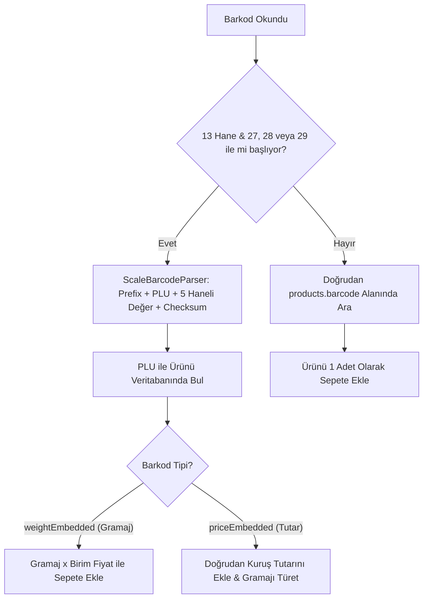

- **Standart Barkodlar:** EAN-13, EAN-8, Code 128, QR kodları doğrudan `products.barcode` alanı üzerinden eşleştirilir.
- **Terazi Barkod Formatı (`27`, `28`, `29` Serisi) — ([ScaleBarcodeParser](file:///c:/Users/ecz/proje/shaman/shaman_new/lib/domain/services/scale_barcode_parser.dart)):**
  - Prefix: `27`, `28` veya `29` (2 hane)
  - PLU / Ürün Kodu: 5 hane (ör. `00142`)
  - Ağırlık veya Tutar: 5 hane (Çift Mod Desteği — `ScaleBarcodeType`):
    - **1. Gramaj İçeren Mod (`weightEmbedded`):** 5 hane net gramajdır (ör. `00450` $\rightarrow$ 450 gram). Kasiyer okuttuğunda birim fiyatla çarpılarak sepete eklenir.
    - **2. Tutar/Fiyat İçeren Mod (`priceEmbedded`):** Kasap ve şarküteri terazilerinde 5 hane kuruş bazında hazır satış tutarıdır (ör. `04550` $\rightarrow$ 45,50 TL = 4550 kuruş). Sistem tutarı doğrudan sepete yazar ve ürünün kilo birim fiyatından net gramajı otomatik türetir (`calculateEffectiveWeightGrams`).
  - Kontrol Hanesi (Check Digit): 1 hane (Modulo-10 EAN-13 algoritması ile doğrulanır).
  - Sonuç: Mağazanın terazisi ister gramaj ister tutar bassın, kasa sıfır hata ve sıfır hesap sapmasıyla doğru tutarı sepete işler. Ayrıca ürün bulunamadığında müşteri sadakat kartı veya telefon barkodu taranırsa cari otomatik seçilir.

### 3.4. Stok Yönetimi & Stok Defteri (Inventory Management)

İstemci mimarisinde stok hareketleri atomik SQLite işlemleri ve denetlenebilir append-only stok defteri (`stock_movements`) üzerinden yönetilir:
1. **`SALE`:** Kasa satışı onaylandığında ilgili ürünlerin stoğu satılan miktar kadar düşürülür ve `stock_movements` tablosuna `reference_type = 'SALE'`, negatif `quantity_delta` (`-quantity`), `previous_stock` ve `new_stock` kaydı düşülür.
2. **`REFUND`:** Müşteri iade getirdiğinde stok otomatik olarak artırılarak restore edilir ve `reference_type = 'REFUND'`, pozitif `quantity_delta` (`+quantity`) kaydı işlenir.
3. **`PURCHASE`:** Mal kabul / alış faturası girildiğinde stok artar, `reference_type = 'PURCHASE'` kaydı düşülür.
4. **`WASTE` (Fire/Zayi):** Bozulan, kırılan ürünler stoktan açıklama (`reason`) ile düşülür.
5. **`COUNT_ADJUSTMENT` (Sayım Düzeltmesi):** Periyodik fiziki sayım sonucunda tespit edilen fark sisteme işlenir.
> *Not: İstemci tarafında Schema v6 ile birlikte append-only `stock_movements` defteri canlıya alınmış; her stok hareketinin `quantity_delta`, `previous_stock`, `new_stock`, `branch_id`, `created_by` ve `reference_id` ile çift taraflı denetim izi güvenceye kavuşturulmuştur.*

### 3.5. Barkodlu Raf Etiketi & Terazi Etiket Basım Motoru (`LabelModel` & TSPL)

Mağazadaki reyon düzeni ve terazili ürünler için entegre etiket basım motoru ([LabelModel](file:///c:/Users/ecz/proje/shaman/shaman_new/lib/domain/models/label_model.dart)):
- **Desteklenen Etiket Ebatları:**
  - `40 x 25 mm`: Kompakt raf etiketi (Barkod + Fiyat + Ürün Adı).
  - `50 x 30 mm`: Standart reyon ve paketleme etiketi (Marka, Raf Kodu, KDV, Birim Fiyat).
  - `60 x 40 mm` & `80 x 40 mm`: Geniş terazi ve kuruyemiş poşeti etiketi (Gramaj, QR Kod, Menşei: "TÜRKİYE", Parti/Lot No, Ambalaj Tarihi).
- **Yazıcı Dili ve Protokolü:**
  - Xprinter, Argox, Zebra, Bixolon rulo etiket yazıcıları için **TSPL (Taiwan Semiconductor Printer Language)** ve **EPL/ZPL** doğrudan binary soket veya Windows Spooler üzerinden sürülür.
  - Sürücü gerektirmeden saf TSPL komutları (örn. `SIZE 60 mm, 40 mm`, `GAP 3 mm`, `DENSITY 8`, `BARCODE 128`, `TEXT`, `PRINT 1`) ile milimetrik netlikte termal basım yapılır.
- **Toplu Etiket Basımı:** Ürün listesinden birden çok ürün seçilerek veya son güncellenen fiyatlar filtrelenerek tüm reyon için tek tıkla toplu raf etiketi yazdırılabilir.

### 3.6. Barkod Normalizasyon Kuralları & 80ms HID Donanım Klavye Filtresi ([BarcodeStandard](file:///c:/Users/ecz/proje/shaman/shaman_new/lib/domain/services/barcode_standard.dart) & [BarcodeScannerMixin](file:///c:/Users/ecz/proje/shaman/shaman_new/lib/presentation/mixins/barcode_scanner_mixin.dart))

Serenut OS'ta barkod okuma rastgele bir metin kutusu girişi değildir; donanım düzeyinde akıllı filtreleme ve kurumsal standart normalizasyonu içerir:
- **UPC-A (12 Hane) $\leftrightarrow$ EAN-13 (13 Hane) Kanonik Eşitlemesi:**
  - UPC-A standardındaki 12 haneli bir sembol, başına `0` eklenerek EAN-13 olarak da ifade edilebilir (`0123456789012`).
  - Sistem bu sembolleri otomatik olarak 12 haneli kanonik biçime dönüştürür (`normalize`). Böylece Excel'den içe aktarılan, el ile yazılan veya barkod tabancasıyla okutulan ürünler tek ve aynı ürüne eşleşir.
- **EAN-8 Bozuk Excel Sıfır Onarımı (`normalizeReadyCatalog`):**
  - Eski kataloglarda veya Excel'de sayı hücresi formatı yüzünden baştaki sıfırı düşmüş 7 haneli kodlar otomatik olarak 8 haneli geçerli EAN-8 formatına (`0xxxxxxx`) tamamlanır.
- **Çoklu Aday Eşleştirme (`lookupCandidates`):**
  - Barkod sorgulandığında sistem aynı anda `[normalized, raw, equivalent_alias]` alternatiflerini üretir; veritabanında tek seferde eşleştirir.
- **80ms HID Donanım Klavye Zaman Aşımı Filtresi:**
  - Piyasada satılan el tipi USB ve Bluetooth barkod okuyucuların %99'u bilgisayara bir "Klavye" (HID Keyboard) gibi bağlanır.
  - Kasiyer klavyede normal yazı yazarken barkod zannedilmesini veya barkod okutulduğunda formun yanlışlıkla `Enter` ile submit edilmesini önlemek için:
  - [BarcodeScannerMixin](file:///c:/Users/ecz/proje/shaman/shaman_new/lib/presentation/mixins/barcode_scanner_mixin.dart), `HardwareKeyboard.instance.addHandler` ile global tuş vuruşlarını dinler.
  - İki karakter arasındaki süre **80 milisaniyenin altındaysa** (insan parmağının erişemeyeceği makine hızı) karakterler barkod tamponuna (`_barcodeBuffer`) alınır.
  - Sonda gelen `Enter` veya `NumpadEnter` yakalanır, UI form submit olayı tüketilerek bloke edilir (`return true`) ve doğrudan `onBarcodeScanned(code)` fonksiyonu tetiklenir.

### 3.7. Gram Bazlı Tamsayı Tartım Matematiği & Sıfır Sapma Güvencesi

Perakende ve kuruyemişte kayan noktalı (`double/float`) para aritmetiği kullanmak ölümcül yuvarlama hatalarına (`0.1 + 0.2 = 0.30000000000000004`) ve gün sonunda kuruş bazında kasa açıklarına yol açar. Serenut OS bu sorunu **İki Kademeli Tamsayı Para & Kesin Stok Mimarisi** ile çözer:

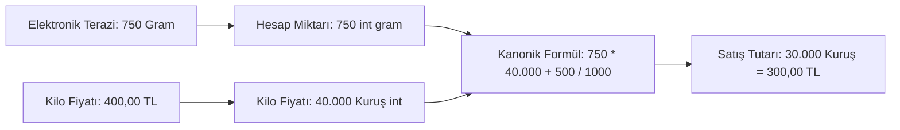

1. **Sepet ve Fiyat Hesaplaması (Integer Cents & Grams):** Tartılı ürünlerde (`isWeighed == true`) miktar sepet hesaplamasında ve terazi çözümlemesinde net gram tamsayısı (`effectiveWeightGrams int`) olarak işlenir (Örnek: 250 gram için `250`, 1.5 kg için `1500`).
2. **Kanonik Finansal Yuvarlama Formülü (Half-Up Math):**
   $$\text{Tutar (Kuruş)} = \left\lfloor\frac{\text{Gram} \times \text{Kilo Fiyatı (Kuruş)} + 500}{1000}\right\rfloor$$
   Para hesabı mutlak surette kuruş tamsayısı (`MoneyCents`) üzerinden yürütülür; kuruş altı kesirler bankacılık standardında 0.5 ve üzeri yukarı yuvarlanır.
3. **Stok Depolama ve Defter Hareketleri:**
   - Katalog seviyesinde ürün stok bakiyesi `products.stock_quantity REAL NOT NULL` (tartılı ürünlerde kg, adetli ürünlerde adet cinsinden) olarak saklanır.
   - Her stok hareketi `stock_movements` tablosunda `quantity_delta REAL NOT NULL` (ör. 450 gramlık satış için `-0.45`, iade için `+0.45`), `previous_stock REAL` ve `new_stock REAL` ile atomik ve append-only olarak mühürlenir.
   - Bu sayede 100.000 satış yapılsa dahi kasada 1 kuruş sapma meydana gelmez ve envanter defterindeki her gram matematiksel olarak doğrulanabilir kalır.

---

## 4. MÜŞTERİ, CARİ HESAP, VERESİYE, SENET & DEFTER MOTORU (LEDGER ENGINE)

### 4.1. Çift Girişli Append-Only Defter Modeli

Müşteri bakiyesi asla `customers.balance = 5000` şeklinde elle güncellenmez. Tüm mali geçmiş `ledger_entries` tablosunda sıralı ve değiştirilemez bir defter olarak tutulur.

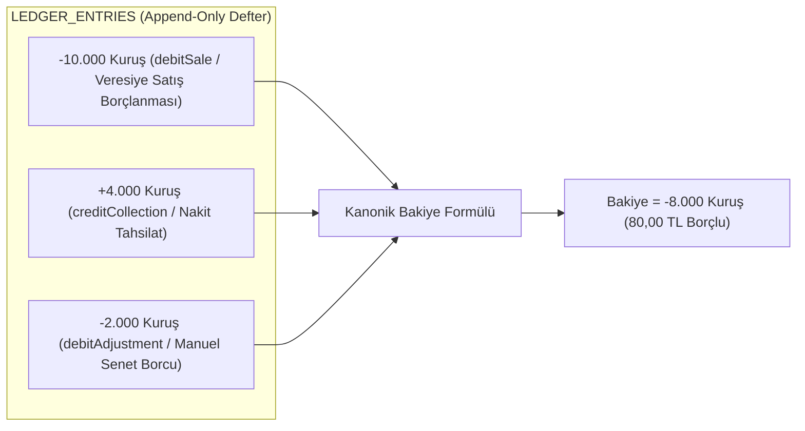

### 4.2. Kanonik Bakiye Formülü & İstemci-Sunucu Semantiği

> [!CAUTION]
> **Kritik Mimari Semantik Ayrımı (İstemci vs. Sunucu İşaret Kuralı):**  
> Serenut OS istemci katmanı (Flutter UI, `Core Next` `LedgerService` ve SQLite trigger'ları) ile VPS PostgreSQL sunucusu arasında bakiye işareti geleneksel olarak farklı yönlerde ele alınır. Çift yönlü mutabakatta ve SQL sorgularında bu ayrım hayati önem taşır:

1. **İstemci Tarafı (Client Core, Flutter UI & Yerel SQLite):**
   - **Kanonik Formül:** `newBalance = previousBalance - debtAmount + collectionAmount`
   - **Negatif Bakiye ($< 0$):** Müşteri işletmeye **BORÇLU**dur (Örn: `-8000` kuruş = 80,00 TL Borç). Kasa arayüzünde `customer.balance < 0` kırmızı alarm verir.
   - **Pozitif Bakiye ($> 0$):** Müşterinin işletmede **ALACAĞI / AVANSI** vardır (Örn: `+5000` kuruş = 50,00 TL Fazla Ödeme/Avans).
   - **Sıfır Bakiye ($= 0$):** Hesap tam kapalıdır.
   - **Kredi Limiti Kontrolü:** `totalDebt = -newBalance; if (totalDebt > creditLimit) reject;`

2. **Sunucu Tarafı (PostgreSQL & BI Raporları — `schema_v72.sql`):**
   - Sunucu defter görünümünde alacak hesabı perspektifiyle:
     `balance = SUM(CASE WHEN type='sale' THEN debt_amount WHEN type IN ('payment','collection') THEN -paid_amount ELSE 0 END)`
   - Sunucu tarafında **Pozitif Bakiye ($> 0$)** işletmenin piyasadan alacağını (müşteri borcunu) temsil eder.
   - **Sync V4 Çevrimi:** Sunucudan istemciye müşteri senkronize edilirken veya istemciden sunucuya delta yansıtılırken bu işaret polaritesinin `SyncV4PullIngestionService` ve mutasyon adaptörlerinde mutabık kalması zorunludur.

> [!IMPORTANT]
> **Değiştirilemezlik (Append-Only) Kuralı:**  
> Bir defter kaydı oluştuktan sonra asla `DELETE` veya `UPDATE` edilemez. Yanlış girilen bir tahsilat veya borç kaydı için zıt yönlü yeni bir kayıt (`entry_type = 'correction'` veya `'reversal'`) eklenir.

### 4.3. Veresiye (Açık Hesap) Satış Akışı

1. Kasa ekranında sepete ürünler eklenir.
2. Ödeme adımında "Veresiye / Cari" seçildiğinde sistem **Müşteri Seçimini Zorunlu Kılar**. Müşteri seçilmemişse işlem bloke edilir.
3. Müşterinin açık hesap limiti kontrol edilir (limit tanımlıysa ve aşılıyorsa yönetici onayı istenir).
4. Satış tamamlandığında tek bir atomik SQLite transaction içinde:
   - `sales` kaydı oluşturulur (`status = 'COMPLETED'`, `total_cents`, `debt_cents = totalCents`, `paid_cents = 0`).
   - `sale_payments` tablosuna `payment_type = 'onAccount'` tipi ödeme işlenir.
   - `ledger_entries` tablosuna `entry_type = 'debitSale'` kaydı eklenir (`postDebitSale`).
   - `customers` tablosundaki `balance_cents` önbelleği kanonik formülle borç kadar azaltılır (`newBalance = balance - debtAmount`; negatif bakiye borçluluğu temsil eder).
   - Müşteriye SMS/WhatsApp bilgi mesajı göndermek üzere kuyruğa (`sync_events` / `sync_outbox_v4`) olay yazılır.

### 4.4. Senet, Vadeli Borçlandırma & Taksit Yaşam Döngüsü

Serenut OS mimarisinde senetli ve vadeli işlemler hayali ayrı bir senet tablosuyla değil, **Çift Girişli Defter Modeli (Append-Only Ledger)** ve **Taksit Motoru** ile tam entegre çalışır:

1. **Manuel Senet / Vadeli Borç Girişi (`MANUAL_DEBT`):**
   - Kasa dışı toptan alım, taahhütname veya borç senedi düzenlendiğinde [CustomerDetailsPage](file:///c:/Users/ecz/proje/shaman/shaman_new/lib/presentation/pages/customer_details_page.dart) üzerinden `_showManualDebtDialog` ile borç kaydı açılır.
   - Bu işlem yerel veritabanında `financial_transactions` (`type = 'manual_debt'`) ve Core Next defterinde `ledger_entries` (`entry_type = 'MANUAL_DEBT'`) olarak kuruş bazında mühürlenir.
   - Senedin vadesi, evrak/senet seri numarası ve kefil bilgileri `description` ve `metadata` içinde saklanır; ESC/POS termal yazıcıdan ıslak imzaya uygun resmi borç senedi basılır.
2. **Senet / Taksit Tahsilatı (`creditCollection`):**
   - Müşteri senedi ödediğinde [CollectionPage](file:///c:/Users/ecz/proje/shaman/shaman_new/lib/presentation/pages/collection_page.dart) veya taksit tahsilatı çalıştırılır.
   - Deftere `creditCollection` alacak kaydı eklenir; müşterinin cari borcu otomatik düşer ve kasa mevcuduna nakit/pos girişi işlenir.
3. **Vadesi Geçen / Protestolu Senetler (`overdue`):**
   - Senet veya taksit vadesi geçtiğinde sistem taksit durumunu `overdue` olarak işaretler; borç yaşlandırma raporuna (`_ReceivablesTab`) kırmızı uyarı olarak yansır.
   - Yasal faiz veya protesto masrafı doğarsa zıt yönlü yeni bir düzeltme kaydı (`entry_type = 'correction'` / `reversal`) ile deftere ek borç işlenir; mevcut geçmiş kayıtlar asla elle değiştirilemez.

### 4.5. Müşteri Taksit Planları & Vadeli Taksit Takibi (`installment_models.dart`)

Vadeli ve taksitli çalışan işletmeler için sistemde entegre taksit planlayıcı motoru ([installment_models.dart](file:///c:/Users/ecz/proje/shaman/shaman_new/lib/domain/models/installment_models.dart)) ve SQLite deposu ([sqlite_installment_repository.dart](file:///c:/Users/ecz/proje/shaman/shaman_new/lib/infrastructure/repositories/sqlite_installment_repository.dart)) bulunur:
- **Taksit Planı Mimarisi (`CustomerInstallmentPlanEntity`):**
  - `totalAmount`: Toplam satış tutarı.
  - `downPayment`: Satış anında alınan nakit/kart peşinat.
  - `financedAmount`: Kalan taksitlendirilecek bakiye (`totalAmount - downPayment`).
  - `installmentCount`: Taksit adedi (ör. 3, 6, 12 ay).
- **Aylık Taksit Hareketleri (`CustomerInstallmentEntity`):**
  - Her bir taksit bağımsız bir vade tarihi (`dueDate`), taksit tutarı (`amount`), ödenen miktar (`paidAmount`) ve ödeme tarihi taşır.
  - Taksit durumları: `pending` (Vadesi bekleniyor), `partial` (Kısmi ödendi), `paid` (Tamamı ödendi), `overdue` (Vadesi geçti!).
- **Veritabanı ve Senkronizasyon Durumu:**
  - Taksit planları ve aylık taksitler yerel veritabanında `customer_installment_plans` ve `customer_installments` tablolarında atomik olarak saklanır.
  - Cari borç ve tahsilat hareketleri `financial_transaction` ve `ledger_entries` üzerinden merkezi Sync V4 ile tüm kasalara anında eşitlenir. Detaylı taksit planı satırlarının bulut senkronizasyonu ise bir sonraki sürüm genişlemesi kapsamında yer alır.
- **Otomatik Hatırlatma & Bakiye Entegrasyonu:** Taksit vadesi yaklaştığında veya geciktiğinde, sistem cari hesap üzerinden müşteriye WhatsApp/SMS ödeme hatırlatması gönderebilir.

### 4.6. Hızlı Müşteri Tahsilatı & Ödeme Alma Sayfası ([CollectionPage](file:///c:/Users/ecz/proje/shaman/shaman_new/lib/presentation/pages/collection_page.dart))

Cari hesaplardan nakit veya kartla para tahsilatı yapıldığında, kasiyerin hatasız ve anında işlem yapmasını sağlayan tam ekran tahsilat konsolu:

- **Canlı Bakiye Önizlemesi (Live Balance Preview):**
  - Kasiyer tutar alanına rakam yazdıkça ekran üçlü simülasyonla güncellenir:
    1. **Mevcut Borç:** Müşterinin cari hesap bakiyesi (ör. `1.250,00 ₺`).
    2. **Tahsil Edilen:** Girilen ödeme miktarı (ör. `500,00 ₺`).
    3. **Kalan Borç:** İşlem onaylandığında müşterinin kalacak net borcu (ör. `750,00 ₺` yeşil gösterge).
- **Ödeme Türü Seçimi:** Tek dokunuşla **Nakit** veya **Kredi Kartı** seçimi.
- **ESC/POS Tahsilat Makbuzu Basımı (`CustomerPaymentReceipt`):**
  - `_printReceipt` anahtarı açık olduğunda, tahsilat onaylandığı anda termal yazıcıdan resmi firma başlıklı, müşteri adı, ödenen tutar, kalan bakiye ve işlem zamanı içeren tahsilat makbuzu basılır.
- **Anında WhatsApp / SMS Tahsilat Dekontu:**
  - Tahsilat deftere (`ledger_entries`) yazıldığı anda müşterinin cep telefonuna dijital ödeme dekontu ve güncel kalan bakiye özeti WhatsApp üzerinden iletilir.

### 4.7. Müşteri Detay, Bankacılık Stili Hesap Ekstresi & Akıllı Borç Hatırlatma Motoru ([CustomerDetailsPage](file:///c:/Users/ecz/proje/shaman/shaman_new/lib/presentation/pages/customer_details_page.dart) & [DebtReminderService](file:///c:/Users/ecz/proje/shaman/shaman_new/lib/domain/services/debt_reminder_service.dart))

- **Bankacılık Stili Ekstre Kartı:** Müşteri detayına girildiğinde en üstte canlı bakiye kartı, altında ise banka dekontu netliğinde kronolojik işlem hareketleri (Tarih, işlem türü, borç, alacak, bakiye) listelenir.
- **Manuel Vadeli / Taksitli Borç Tanımlama (`_showManualDebtDialog`):**
  - Müşteriye kasa dışından (ör. toptan sevkiyat veya sözleşmeli iş) borç kaydı girildiğinde peşinat tutarı, taksit adedi, ilk taksit vadesi ve ödeme yöntemi belirlenebilir; resmi borç senedi/makbuzu termalden basılabilir.
- **Cari Hesap Ekstresi Dışa Aktarma (`export_bottom_sheet.dart`):**
  - Müşteriyle hesap mutabakatı yapmak için tek dokunuşla tüm geçmiş hareketler **Excel (`.xlsx`)** tablosuna veya kurumsal başlıklı **PDF hesap ekstresine** dönüştürülür; müşterinin WhatsApp'ına tek tıkla gönderilebilir.
- **Akıllı Mükerrerlik Korumalı Borç Hatırlatma ([DebtReminderService](file:///c:/Users/ecz/proje/shaman/shaman_new/lib/domain/services/debt_reminder_service.dart)):**
  - Sistem vadesi geçmiş müşterilere toplu WhatsApp/SMS borç hatırlatması gönderirken esnafı mahcup etmeyecek akıllı bir filtre uygular:
  - `skippedRecentCount`: Son X gün içinde zaten hatırlatma mesajı gitmiş müşteriler otomatik atlanır; aynı müşteriye her gün mükerrer mesaj gidip taciz veya spam algısı oluşması engellenir.

### 4.8. Çoklu Kasa Bakiye Yakınsaması & Yerel Delta Güvencesi (`_calculateUnreflectedCustomerDelta`)

İşletmede birden fazla kasa (ör. Kasa 1 ve Kasa 2) bağımsız çalışırken veya çevrimdışı satışlar yapıldığında, merkezi sunucudan gelen müşteri bakiye snapshot'ının yerel veritabanındaki bekleyen hareketleri ezmesini önleyen mimari mekanizma ([SyncV4PullIngestionService:620](file:///c:/Users/ecz/proje/shaman/shaman_new/core_next/client_core/lib/infrastructure/sync/sync_v4_pull_ingestion_service.dart#L620)):

- **Problemin Tanımı:** Bir kasa yerelde müşteriye 100 TL veresiye satmış ancak henüz sunucuya göndermemişken (`PENDING`), sunucudan o müşterinin eski bakiyesi `balance_cents = 500` olarak çekilirse düz `UPDATE customers` işlemi yereldeki 100 TL'lik borcu arayüzde geçici olarak gizleyebilir.
- **Çözüm Algoritması (`_calculateUnreflectedCustomerDelta`):**
  1. Sunucudan gelen müşteri verisi okunur (`remoteBalanceCents`).
  2. Yerel `sync_events` tablosunda durumu `PENDING` veya `TRANSIENT_ERROR` olan ya da revizyonu gelen snapshot'tan daha yeni olan finansal olaylar sorgulanır.
  3. Henüz sunucuya yansımamış vadeli satışlar (`-debtCents`) ve tahsilatlar (`+paidCents`) toplanarak `unreflectedDeltaCents` hesaplanır.
  4. Yerel müşteri bakiyesi atomik olarak şu formülle güncellenir:
     $$\text{effectiveBalanceCents} = \text{remoteBalanceCents} + \text{unreflectedDeltaCents}$$
- **Sonuç:** Hiçbir kasa birbirinin hareketini ezemez; çevrimdışı hareketler ile merkezi veriler matematiksel kesinlikle birleşir.

---

## 5. KASA SATIŞ, SEPET, ÖDEME MOTORU & SEPET KURTARMA

### 5.1. Checkout Sonlu Durum Makinesi (Finite State Machine)

Satış süreci belirli durumlardan geçer ve her durum geçişi sıkı kurallara bağlıdır:

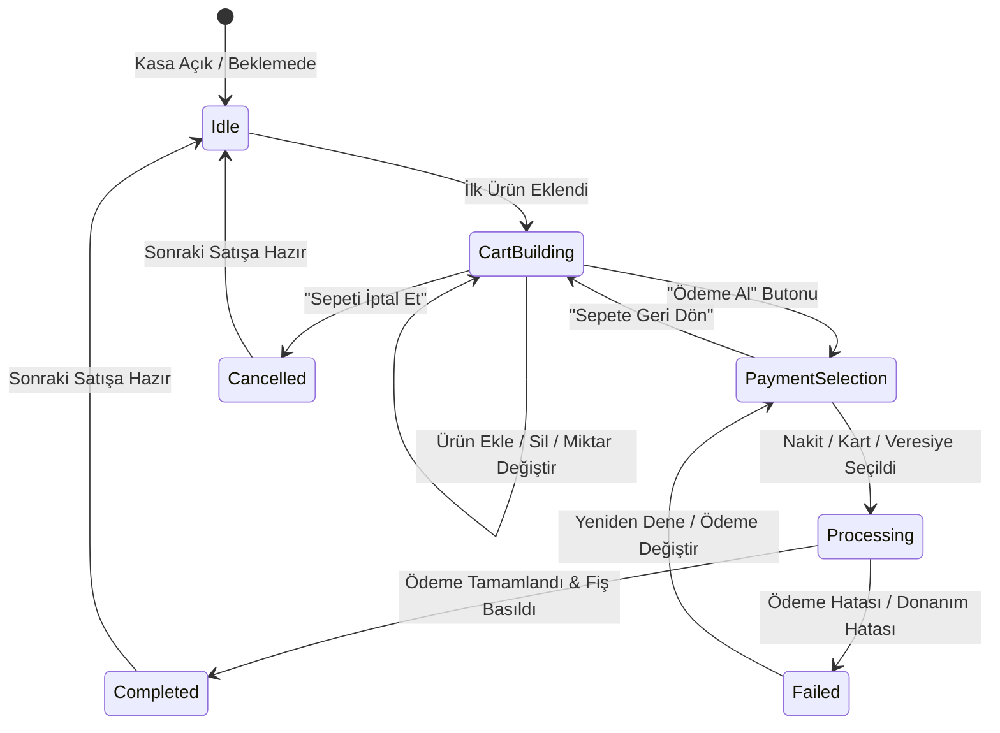

### 5.2. Sepet Kilitleme (`cart_lock`) & Çakışma Koruması

Eşzamanlı işlemleri engellemek için satış başlatıldığı anda sepet bellek üzerinde kilitlenir (`cart_lock = true`).
- Barkod okuyucu veya kasiyer ikinci bir tuşa bassa dahi işlem devam ederken sepet manipüle edilemez.
- İşlem SQLite transaction seviyesinde `runInTransaction` ile yürütülür. Herhangi bir adımda (ör. stok yetersizliği, donanım çökmesi) hata oluşursa tüm transaction `ROLLBACK` edilir; hayalet satış veya açıkta kalan ödeme engellenir.

### 5.3. Elektrik Kesintisi & Kapanma Koruması (`CartPersistenceService`)

Kasiyer 15 kalem ürün okuttuğu anda elektrik kesilirse veya bilgisayar aniden kapanırsa ne olur?
- [CartPersistenceService](file:///c:/Users/ecz/proje/shaman/shaman_new/lib/infrastructure/services/cart_persistence_service.dart), sepet durumunu bellekte tutarken aynı zamanda her değişiklikte yerel kalıcı önbelleğe (`SharedPreferences`) atomik olarak yazar (`serenut_cart_*`). Kuruş bazlı tamsayı standartları (`paidAmountCents`, `discountAmountCents`) ile floating-point yuvarlama riski olmadan saklanır.
- Bilgisayar tekrar açıldığında Serenut OS bu durumu okur:
  - "Bekleyen açık bir sepet bulundu. Kurtarılsın mı?" uyarısı verir.
  - Kasiyer tek tuşla 15 kalem ürünü, miktarları, uygulanan iskontoları ve seçili müşteriyi aynen ekrana geri getirir; müşteriyi kasada bekletmeden kaldığı yerden devam eder.

### 5.4. Ödeme Yöntemleri & Karma (Split) Ödeme

Sistem esnek ödeme kombinasyonlarını destekler:
1. **Nakit:** Kasiyer alınan tutarı girer, para üstü ekranda büyük puntolarla gösterilir, nakit çekmecesi otomatik açılır (`\x1b\x70...`).
2. **Kredi Kartı / Harici POS:** Banka terminalinden geçiş yapılır; referans / slip no girilebilir.
3. **Veresiye:** Seçilen müşterinin cari hesabına borç kaydedilir.
4. **Karma (Split) Ödeme:** Tek faturada birden çok yöntem:
   - Örnek: Toplam 2.000 TL -> 500 TL Nakit + 1.000 TL Kredi Kartı + 500 TL Veresiye.
   - Her ödeme parçası `sale_payments` tablosuna ayrı ayrı kaydedilir; ödemelerin toplamı sepet toplamına eşit olmadan satış kapatılamaz.

### 5.5. İade ve Değişim Akışı

- **Satış Fişinden İade:** Müşteri fiş barkodunu getirdiğinde geçmiş satış çağrılır. İade edilmek istenen satırlar seçilir.
- **Belgesiz / Serbest İade:** Ürün ve miktar seçilerek iade fişi kesilir.
- **Mali Yansıma:**
  - İade edilen ürünler stoğa otomatik geri alınır (`stock_movements.reference_type = 'REFUND'`, pozitif `quantity_delta`).
  - İade bedeli nakit ödendiyse kasadan nakit çıkışı (`cash_transactions.type = 'OUTFLOW'`, `category = 'REFUND'`, `sale_payments.amount_cents = -cashRefundCents`) yapılır.
  - Veresiye satışın iadesiyse müşterinin cari hesabına alacak (`ledger_entries.entry_type = 'creditRefund'`) yazılır (`postRefund`, `newBalance = balance + refundAmount`).

### 5.6. Gün Sonu Kapatma, Kasa Sayımı, Küpür Denetimi & X/Z Raporları ([EndOfDayPage](file:///c:/Users/ecz/proje/shaman/shaman_new/lib/presentation/pages/end_of_day_page.dart))

Serenut OS'ta gün sonu işlemi basit bir toplam alma değil; paranın kuruşu kuruşuna sayıldığı, kasa kaçaklarının engellendiği ve resmi mali kapanışın mühürlendiği çok adımlı bir denetim sürecidir:

#### A. Banknot & Madeni Para Küpür Sayımı (Denomination Count)
- Kasiyer gün sonunda kasayı sayarken düz rakam yazmak zorunda değildir; sistem entegre bir **Küpür Sayım Tablosu** sunar:
  - **Kağıt Paralar:** ₺200, ₺100, ₺50, ₺20, ₺10, ₺5 adetleri girilir.
  - **Madeni Paralar:** ₺1, ₺0,50, ₺0,25 adetleri girilir.
  - Sistem girilen adetler üzerinden **Fiili Sayılan Nakit Tutarını** otomatik hesaplar.

#### B. Kasa Farkı (Fazla / Noksan) Tespiti
- **Sistem Beklentisi (Teorik Kasa):** $\text{Devir Nakit} + \text{Nakit Satışlar} + \text{Nakit Cari Tahsilatlar} - \text{Nakit Masraflar/Ödemeler} - \text{Nakit İadeler}$.
- **Kasa Farkı Formülü:** $\text{Kasa Farkı} = \text{Fiili Sayılan Nakit} - \text{Sistem Beklentisi}$.
  - **Fark = 0,00 ₺:** Kasa tam tutmaktadır (Yeşil onay).
  - **Fark > 0 (Kasa Fazlası):** Kasada sistemden fazla para vardır (Mavi uyarı).
  - **Fark < 0 (Kasa Noksanı):** Kasada eksik para vardır (Kırmızı uyarı — kasiyere veya yöneticiye açıklama notu zorunlu tutulabilir).

#### C. X-Raporu vs Z-Raporu Ayrımı
| Rapor Türü | Amacı & Sayacı | Kullanım Zamanı |
|---|---|---|
| **X-Raporu (Ara Denetim)** | Sayaçları sıfırlamaz, günü kapatmaz. O ana kadarki ara ciroyu ve kasa durumunu gösterir. | Vardiya değişiminde, öğle arasında veya müdür kasayı saymak istediğinde. |
| **Z-Raporu (Resmi Mali Kapanış)** | **Z Sayacını 1 artırır**, o günkü tüm satış ve ödemeleri kilitler (`daily_registers.is_closed = 1`), dönemi kapatır. | Gece mağaza kapandığında vardiyanın resmi bitişinde. |

#### D. Çıktı & Kapanış Raporu
- Z-Raporu onaylandığı anda termal yazıcıdan resmi döküm fişi basılır ve kasanın günlük dönemi kilitlenir (`daily_registers.is_closed = 1`).
- Ekranda küpür ve tahsilat mutabakat özeti canlı gösterilir; arka plandaki `notification_queue` altyapısı üzerinden patronun cep telefonuna otomatik Z-Raporu WhatsApp özeti gönderimi mimari yol haritasında planlanmıştır.

---

### 5.7. Sipariş & Teslimat Yönetimi Motoru ([OrdersPage](file:///c:/Users/ecz/proje/shaman/shaman_new/lib/presentation/pages/orders_page.dart) & [OrderEntity](file:///c:/Users/ecz/proje/shaman/shaman_new/lib/domain/repositories/base_repository.dart#L812-L949))

Perakende ve toptanda paket servis, telefonla sipariş veya ileri tarihli teslimatlar için entegre sipariş motoru:

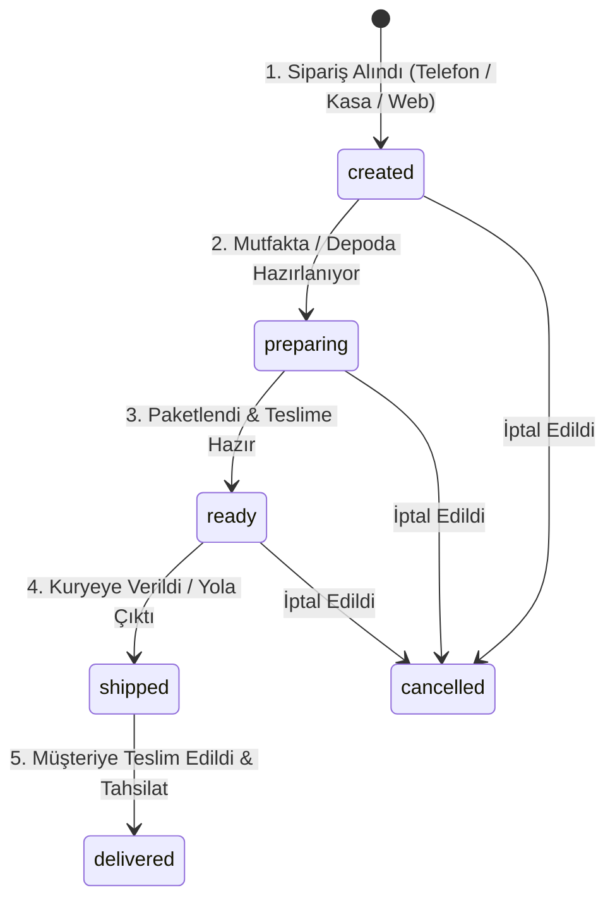

- **Sipariş Numaratörü (`orderNumber`):** Şube bazlı okunabilir sipariş kodları (ör. `M1-ord-20261024-004`).
- **Gecikme Takibi (`isOverdue`):** Siparişin beklenen teslim saati (`expectedDeliveryDate`) geçtiyse ve durum hala `delivered` olmadıysa sipariş listesinde kırmızı yanıp söner ve kasiyere uyarı verir.
- **Append-Only Sipariş Revizyon Mimarisi (`updateOrderSaleTransaction`):**
  - Müşteri telefon edip siparişe ürün eklettiğinde veya çıkardığında, finansal kayıtlar **asla yerinde (in-place) `UPDATE` edilmez** (Finansal değişmezlik kuralı — `Financial transactions are immutable`).
  - [SqlitePaymentRepository.updateOrderSaleTransaction](file:///c:/Users/ecz/proje/shaman/shaman_new/lib/infrastructure/repositories/sqlite_payment_repository.dart#L511-L546) eski finansal işlemi `is_deleted = 1` bayrağıyla soft-delete eder (veritabanı `trg_ft_update` trigger'ı önceki bakiyeyi otomatik tersine çevirir).
  - Ardından aynı atomik transaction içinde yeni bir revizyon kaydı (`newTxId = 'trans-rev-$orderId-$timestamp'`) ekler; `metadata` alanına `origin: 'order_revision'` ve `superseded_id: prevTxId` bağını yazar.
  - Eski kaydın silinmesi (`DELETE`) ve yeni kaydın eklenmesi (`UPSERT`) eşzamanlı olarak `SyncOutboxV4` kuyruğuna yazılır; denetlenebilir tam bir revizyon denetim izi (audit trail) korunur.
- **Müşteri Bildirim Tetikleyicisi:** Sipariş durumu her değiştiğinde (`created` $\rightarrow$ `preparing` $\rightarrow$ `ready` $\rightarrow$ `shipped` $\rightarrow$ `delivered`), müşterinin cep telefonuna ilgili durumun emojili WhatsApp/SMS bildirimi otomatik olarak iletilir.

### 5.8. Satış Geçmişi & Detay Yönetimi ([SalesHistoryPage](file:///c:/Users/ecz/proje/shaman/shaman_new/lib/presentation/pages/sales_history_page.dart) & [SaleDetailsPage](file:///c:/Users/ecz/proje/shaman/shaman_new/lib/presentation/pages/sale_details_page.dart))

Geçmişte yapılmış tüm satış fişlerinin sorgulandığı, incelendiği ve işlem gördüğü merkezi yönetim modülü:

- **Çok Kriterli Filtreleme:** Tarih aralığı, ödeme türü (Nakit, Kart, Veresiye), satış durumu (Tamamlandı, İade Edildi, İptal) ve tutara göre anlık arama.
- **Detaylı Fiş Dökümü:** Satış kimliği (`#ABC123XY`), kasiyer adı, satır bazlı ürünler, birim fiyatlar, uygulanan iskonto miktarı, KDV oranları ve ödeme türü dağılımı.
- **Tek Tıkla e-Arşiv Fatura Kesme (`CreateGibInvoiceDialog.show`):**
  - Müşteri fiş kestikten sonra fatura talep ederse, satış detayından tek tıkla resmi GİB e-Arşiv portalı fatura sihirbazı açılır. Satıştaki kalemler otomatik faturaya aktarılır.
- **Termal Fiş Kopyası (Reprint):** İstemci, istenen herhangi bir geçmiş fişin kopyasını termal yazıcıdan anında yeniden basabilir.
- **WhatsApp / SMS Dijital Fiş Paylaşımı:** Fiş detayından müşterinin telefonuna dijital fiş PDF/metin linki tek tıkla gönderilir.
- **Kısmi ve Tam İade Akışı:** Müşteri 3 üründen 1 tanesini getirdiğinde, satış detayından sadece o ürün seçilerek iade fişi kesilir; stok ve kasa/cari hesap otomatik eşitlenir.

### 5.9. Canlı Terazi Tartımı, Dara Alma & Tartılı Ürün Akışı ([LiveScaleDialog](file:///c:/Users/ecz/proje/shaman/shaman_new/lib/presentation/widgets/sales/live_scale_dialog.dart))

Kuruyemiş, şarküteri, manav ve kasap reyonlarında tartımlı satışların hatasız yürütülmesi için entegre tartım ekranı:
- **Otomatik Algılama (`product.isWeighed == true`):** Kasiyer dokunmatik ekrandan fındık, peynir vb. tartılı bir ürünü seçtiğinde sistem doğrudan tartım penceresini açar.
- **Canlı Ağırlık Akışı (Gram):** Elektronik teraziden seri port üzerinden okunan anlık gramaj dev puntolarla gösterilir.
- **Dara Alma (Tare):** Ekranda yer alan "Dara Al" butonu ile poşet, kap veya kutu ağırlığı sıfırlanabilir.
- **Kararlılık Kilidi:** Terazi titrerken (`US` Unstable) satış butonu kilitlenir; ibre durup `ST` (Stable) olduğunda gramaj yeşile döner ve sepet satırına eklenir.

### 5.10. Hızlı QR & Barkod Operasyon Merkezi ([QrOrderScannerDialog](file:///c:/Users/ecz/proje/shaman/shaman_new/lib/presentation/widgets/home/qr_order_scanner_dialog.dart))

Ana sayfadaki ve satış ekranındaki "QR Tara" butonuyla açılan çok amaçlı donanım tarama konsolu:
- **Çoklu Giriş Desteği:**
  - **Kamera (Mobil / Tablet / PC Webcam):** `mobile_scanner` ile QR ve 1D barkodları kameradan anında yakalar.
  - **USB / HID El Tipi Barkod Okuyucu:** Kablolu/kablosuz barkod tabancası ile anında tetiklenir.
  - **Klavye Girişi:** Barkod etiketi yırtık veya okunamaz durumdaysa fiş numarasını el ile yazma alanı.
- **Akıllı Yönlendirme:**
  - Okutulan kod bir sipariş fişi ise anında **[OrderDetailsPage](file:///c:/Users/ecz/proje/shaman/shaman_new/lib/presentation/pages/order_details_page.dart)** ekranına zıplar (kurye teslimatı veya paket hazırlama hızlanır).
  - Okutulan kod bir satış fişi ise anında **[SaleDetailsPage](file:///c:/Users/ecz/proje/shaman/shaman_new/lib/presentation/pages/sale_details_page.dart)** ekranını açar (iade veya fatura kesme).
  - Okutulan kod bir ürün barkodu ise doğrudan sepete ekler.

### 5.11. 4 Adımlı Sipariş Oluşturma Sihirbazı ([OrderCreationDialog](file:///c:/Users/ecz/proje/shaman/shaman_new/lib/presentation/pages/orders/widgets/order_creation_dialog.dart))

Telefonla paket servis veya ileri tarihli sipariş alırken kasiyeri adım adım yönlendiren güvenli sihirbaz:
- **1. Adım (Müşteri Seçimi - `step_customer.dart`):** Mevcut carilerden arama veya tek ekranda yeni müşteri kartı açma.
- **2. Adım (Ürün Seçimi - `step_product_selection.dart`):** Reyon/kategori bazlı ürün arama, barkod okutma ve hızlı seçim.
- **3. Adım (Sepet & İskonto - `step_cart.dart`):** Ürün miktarlarını düzenleme, tartılı gramaj girişi, kalem veya sepet bazlı % / ₺ iskonto uygulama (`DiscountDialog`).
- **4. Adım (Ödeme & Teslimat - `step_checkout.dart`):** Ödeme yöntemi seçimi (Nakit, Kart, Veresiye, Karma Ödeme), teslimat adresi, kurye teslim saati ve mutfak notu. Onaylandığında otomatik mutfak sipariş fişi basılır.

---

## 6. SENKRONİZASYON MOTORU (SYNC V4 — OFFLINE-FIRST REPLICATION)

### 6.1. Mimari Prensip: Dağıtık Outbox Deseni

Tüm istemci değişiklikleri (satış, stok, müşteri, defter) yerel veritabanına kaydedilirken aynı transaction içinde dağıtık kuyruk tablosuna (Core Next: `sync_events`, Legacy SQLite: `sync_outbox_v4`) bir mutasyon olayı olarak yazılır.

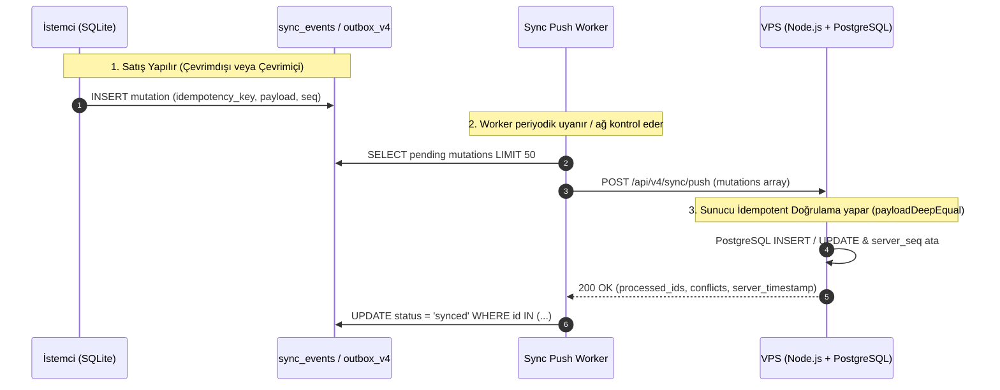

### 6.2. Sunucu İdempotency & `payloadDeepEqual` Koruması

Ağ kopması durumunda istemci aynı mutasyonu tekrar gönderebilir.
- Sunucu `idempotency_key` (veya `mutation_id`) üzerinden geçmişi kontrol eder.
- **Kritik Çakışma Önleyici (`payloadDeepEqual`):** PostgreSQL `jsonb` kolonları JSON nesnelerinin anahtarlarını dahili olarak alfabetik ve uzunluğa göre yeniden sıralar. Düz `JSON.stringify` karşılaştırması sahte çakışma (`conflict`) üreteceği için `payloadDeepEqual` recursive fonksiyonu ile anlamsal eşitlik kontrol edilir. Aynı mutasyon geldiğinde hata fırlatılmaz, `already_processed` olarak onaylanır.

### 6.3. Pull & İlk Hidrasyon Akışı (Sunucudan İstemciye Çekme)

- İstemci yerelde sakladığı son dergi revizyonunu (`cursor`) bilir.
- İstek başlığında zorunlu `x-sync-protocol-version: 6`, `x-device-id` ve `x-device-activation-id` taşınır.
- `GET /api/v4/sync/pull?cursor=1480&limit=200` çağrısı yapar.
- Sunucu, 1480'den sonra organizasyona ait diğer cihazlar veya web portalından yapılan değişiklikleri (`changes` dizisi ve `next_cursor`) döner.
- İstemci gelen verileri yerel SQLite tablolarına yansıtır (`SyncV4PullIngestionService`).
- **İlk Kurulum / Hidrasyon (`bootstrap`):** Yeni kurulan veya veritabanı sıfırlanan cihazlar geçmiş tüm mutasyon loglarını çekmek yerine `GET /api/v4/sync/bootstrap` ile güncel kanonik tabloların anlık görüntüsünü (snapshot) tek seferde indirir ve `cursor` değerini son revizyona eşitler.

### 6.4. Çakışma Çözümü (Conflict Resolution) & Finansal Bütünlük

- **Değiştirilebilir Üst Veriler (Master Data):** Ürün adı, kategori, müşteri adres ve iletişim bilgileri gibi alanlarda sunucu zaman damgası otoritesi ile Deterministik **Last-Write-Wins (LWW)** uygulanır.
- **Finansal İşlemlerde LWW Yasağı (Append-Only):** Sync V4 Protokol 6 kapsamında çoğaltılan 6 kanonik varlık tipi: `product`, `customer`, `order`, `sale`, `financial_transaction` ve `refund`'dır. Satışlar (`sales`) ve cari defter kayıtları (`ledger_entries` / `financial_transactions`) **asla LWW ile ezilemez**. Bu kayıtlar çift taraflı denetlenebilir değişmez olay akışı (Append-Only Immutable Event Stream) olarak işlenir; çoklu çevrimdışı kasalar aynı anda işlem yapsa dahi veri kaybı sıfırdır.
- **In-Flight Çift Sayma (Double-Counting) Koruması:** İstemcide bekleyen (`PENDING`) işlemler sunucuya iletilme aşamasındayken (ağ gecikmesi / concurrency), sunucudan gelen kesin olarak daha yeni müşteri snapshot'ları tespit edilir (`_calculateUnreflectedCustomerDelta`); yerel borç veya tahsilatın sunucu bakiyesine mükerrer eklenmesi engellenir.
- **Silinmeler (Tombstone):** Hiçbir satır fiziksel silinmez (`DELETE FROM ...` yapılmaz). `deleted_at = timestamp` alanı doldurulur ve diğer cihazlara bu şekilde yayılır.

### 6.5. Merkezi Kesim Kilidi & Reaktif Bakım Modu ([CutoffMaintenanceLock](file:///c:/Users/ecz/proje/shaman/shaman_new/lib/infrastructure/migration/cutoff_maintenance_lock.dart) & [CutoffMaintenanceBannerWidget](file:///c:/Users/ecz/proje/shaman/shaman_new/lib/presentation/widgets/cutoff_maintenance_banner_widget.dart))

Büyük sürüm geçişlerinde, geriye dönük veri mutabakatlarında veya acil durum geri yüklemelerinde veri tutarlılığını garanti altına alan **Fail-Closed Merkezi Kilit Mekanizması**:

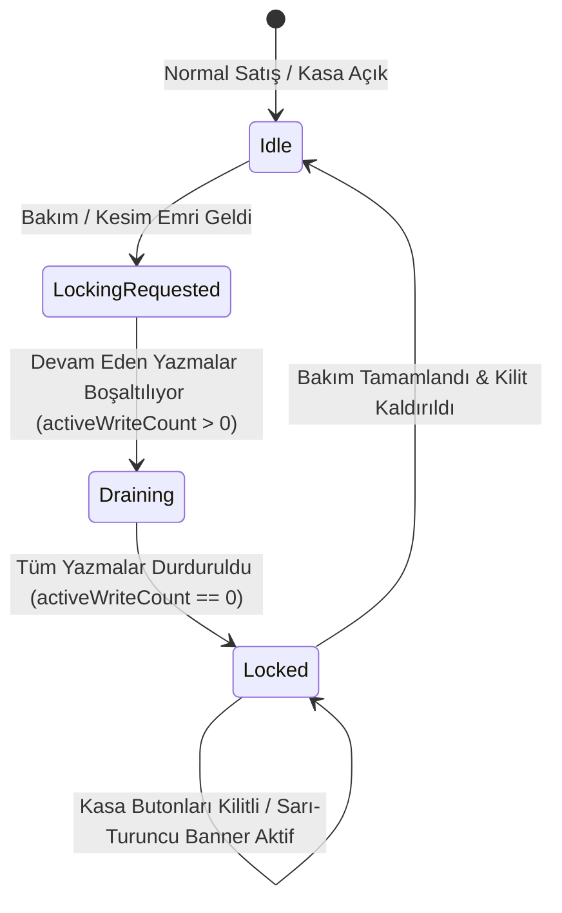

- **Reaktif Afiş (`CutoffMaintenanceBannerWidget`):**
  - Normal çalışma (`idle`): Afiş tamamen görünmezdir (`SizedBox.shrink`).
  - Kilit hazırlığı (`draining`): Ekranda turuncu uyarı belirir ("Veritabanı Bakım Moduna Alınıyor — Devam eden X işlem tamamlanıyor, lütfen bekleyin...").
  - Kilitli (`locked`): "Sistem Bakım Modunda (Yazma Koruması Aktif)" uyarısı ekranda kalır.
- **Fail-Closed Koruması:** Kilit aktifken satış yapma, sipariş onaylama veya ödeme alma butonları arayüz seviyesinde devre dışı bırakılır (`_ensureSalesActionPermitted`); SQLite seviyesinde `assertWritePermitted` istisnası fırlatarak veritabanına yarım veya çakışan kayıt girmesini kesin olarak engeller.
- **Offline-First vs. Merkezi Kilit Ayrımı (Çevrimdışı Kasa Güvencesi & Split-Brain Koruması):**
  - **Açık Ağdaki Kasalar:** WebSocket veya HTTP üzerinden bakım emrini anında alır, drenaj fazına geçer (`activeWriteCount == 0`) ve kasayı güvenli kilit moduna alır.
  - **Çevrimdışı (Offline) Kasalar:** İnternet erişimi olmayan kasalar bakım sinyalini alamaz ve ticari akışın aksamaması (Zero-Downtime) için satış yapmaya devam eder. Satışlar yerel SQLite `sales`, `ledger_entries` ve `sync_outbox` tablolarına atomik olarak kaydedilir.
  - **Bakım Sonrası Ağ Yeniden Bağlandığında (Catch-Up & Reconciliation):**
    - Sunucu bakım/migrasyon sonrası şema uyumluluğunu doğrular.
    - Eğer çevrimdışı kasadaki şema sürümü sunucunun yeni şemasından eskiyse, sunucu mutasyonları doğrudan reddetmek yerine `SCHEMA_MIGRATION_REQUIRED` bayrağı döner.
    - İstemci `LiveSafeCatchUpReconciliationCoordinator` ve `BootstrapCoordinator` mekanizmasını tetikleyerek yerel veritabanını atomik olarak yeni şemaya taşır.
    - Bekleyen outbox mutasyonları `payloadDeepEqual` ve `_calculateUnreflectedCustomerDelta` algoritması ile sunucuya idempotent olarak sırayla basılır; böylece ne merkezi kesim esnasında kasa durur ne de bakım bittiğinde tek bir işlem kaybolur veya çift yazılır.

---

## 7. DONANIM ENTEGRASYONLARI & AĞ PAYLAŞIMLI DONANIM (HARDWARE LAYER)

### 7.1. Termal Fiş Yazıcısı (ESC/POS)

Termal yazıcılar müşteri fişi, bilgi fişi, mutfak sipariş fişi ve gün sonu Z-raporu dökümünde kullanılır.
- **Protokol:** Raw ESC/POS komutları.
  - İnisiyalizasyon: `\x1b\x40` (`ESC @`)
  - Kağıt Kesme: `\x1d\x56\x00` (`GS V 0` Full Cut) veya `\x1d\x56\x01` (Partial Cut)
  - Çekmece Darbesi (Cash Drawer Kick): `\x1b\x70\x00\x19\xfa`
- **Bağlantı Kanalları:**
  - **USB:** Windows Spooler (`win32` API üzerinden Raw veri gönderme).
  - **Ağ (Ethernet / Wi-Fi):** Raw TCP soketi, varsayılan Port: `9100`.
  - **Seri (COM Port):** RS-232 seri arabirimi.
  - **Bluetooth:** Mobil cihazlarda SPP (Serial Port Profile) bağlantısı.
- **Türkçe Karakter Desteği:**
  - Yazıcının donanım karakter tablosuna göre `CP857` (PC857) kod sayfası dönüşümü yapılır (`ç, ğ, ı, ö, ş, ü, İ`).
  - Türkçe font ROM'u bulunmayan ucuz yazıcılarda sistem otomatik olarak **Raster Grafik Baskı Moduna** geçer; fişi 203 DPI siyah-beyaz bitmap resim olarak çizer ve yazıcıya görsel olarak aktarır ([PersistentPrintQueue](file:///c:/Users/ecz/proje/shaman/shaman_new/lib/infrastructure/services/persistent_print_queue.dart)).

### 7.2. Barkod & Etiket Yazıcısı (TSPL / ZPL)

Ürün raf etiketleri ve koli etiketleri için TSPL (Taiwan Semiconductor / Xprinter / Argox) komut seti kullanılır:
```text
SIZE 40 mm, 30 mm
GAP 2 mm, 0 mm
DIRECTION 1
CLS
TEXT 20,20,"3",0,1,1,"SERENUT NUTOPIA FINDIK"
BARCODE 20,60,"EAN13",60,1,0,2,2,"8690123456789"
TEXT 20,130,"4",0,1,1,"149.50 TL"
PRINT 1,1
```

### 7.3. Elektronik Terazi (RS-232 Serial Worker)

Kasaya bağlı terazi ürün tartımında hızı ve doğruluğu sağlar.
- **Seri Port Ayarları:** Baud Rate `9600`, Data Bits `8`, Parity `None`, Stop Bits `1` (`9600-8-N-1`).
- **Desteklenen Protokoller:** CAS (AP-1, ER-Plus), TEM, Dibal, Bizerba, Desis.
- **Kararlılık (Stability) Koruması:**
  - Terazi veri akışında `ST` (Stable / Kararlı) ve `US` (Unstable / Hareketli) bayrakları gönderir.
  - Tartım titrerken kasiyerin hatalı gramajla satış yapmasını önlemek için sistem ekrandaki tartım butonunu `US` durumunda kilitler; terazi `ST` verdiğinde gramaj yeşile döner ve sepete eklenebilir.

### 7.4. Hibrit Paylaşımlı Yazıcı Köprüsü (LAN-First & Bulut Kuyruğu Fallback)

İşletmelerde her kasaya veya mobil el terminaline ayrı bir termal fiş veya etiket yazıcısı tahsis etmek yüksek maliyetlidir.
- [SharedHardwareService](file:///c:/Users/ecz/proje/shaman/shaman_new/lib/infrastructure/services/shared_hardware_service.dart), Ana Kasa'ya USB veya yerel ağla bağlı termal yazıcıları (`receiptPrinter`, `labelPrinter`) merkezi API (`PUT /api/v4/sync/shared-hardware/presence`) üzerinden şirketin donanım havuzuna kaydeder.
- **Hibrit Çift Hatlı Yazdırma Yolu (Zero-Downtime LAN-First):**
  1. **Birincil Öncelik (Yerel Ağ / LAN):** İkinci Kasa (ör. Android el terminali veya Kasa 2) fiş basacağı zaman, P2P ağ keşfi ile Ana Kasa'nın yerel IP ve portunu (`48731` / `48735`) doğrudan dener; internet bağlantısına ihtiyaç duymadan 10 milisaniyede sıfır gecikmeyle yerel fiş basımını tamamlar.
  2. **İkincil Hat (Bulut Röle Fallback):** Mağaza modeminde AP/Client Isolation varsa, cihazlar farklı VLAN/Subnet'te ise veya yerel bağlantı zaman aşımına uğrarsa, iş `queuePrint` ile bulut kuyruğuna (`POST /api/v4/sync/hardware-jobs`) Base64 formatında iletilir.
- [SharedHardwareWorker](file:///c:/Users/ecz/proje/shaman/shaman_new/lib/infrastructure/services/shared_hardware_worker.dart), fiziksel yazıcının takılı olduğu Ana Kasa üzerinde periyodik olarak uyanır (`claim`), işi yerel kuyruğa alır ve bağlı termal yazıcıdan (`loadPrinter`) fişi basar.
- **Terazi Kuralı:** Elektronik teraziler (RS-232 / Seri Port) sıfır gecikme, anlık gramaj ve canlı `ST`/`US` kararlılık kilidi gerektirdiğinden paylaşımlı kuyruk üzerinden değil; her kasaya doğrudan fiziksel COM portu veya USB-Seri çevirici ile yerel bağlanır.

### 7.5. Banka POS & EFT-POS Terminal Motoru ([PhysicalCardPaymentService](file:///c:/Users/ecz/proje/shaman/shaman_new/lib/providers/payment_terminal_provider.dart) & [IPaymentTerminalAdapter](file:///c:/Users/ecz/proje/shaman/shaman_new/lib/domain/hardware/payment_terminal_service.dart))

Kasada kredi kartı ile ödeme alındığında, tutarı harici bir banka POS cihazına el ile girmek hem kasiyer hatasına (fazla/eksik çekim) hem de kasa kaçaklarına yol açar. Serenut OS, kasayı doğrudan EFT-POS cihazına bağlayan entegre bir ödeme motoru barındırır:

- **Bağlantı Kanalları & Protokoller:**
  - **Seri Port (RS-232 / USB Virtual COM):** `SerialPaymentTerminalAdapter` (Port Adı, Baud Rate, Vendor).
  - **Yerel Ağ / TCP-IP:** `TcpPaymentTerminalAdapter` (Host IP, Port, Vendor).
  - **Desteklenen Protokol & Cihazlar:** PAX (PAX D230 vb.), Ingenico, Beko / Arçelik ÖKC, TechPOS.
- **Two-Phase Commit & İki Aşamalı Güvence ([PaymentFsm](file:///c:/Users/ecz/proje/shaman/shaman_new/lib/domain/services/payment_fsm.dart) & [TerminalPaymentJournal](file:///c:/Users/ecz/proje/shaman/shaman_new/lib/infrastructure/services/terminal_payment_journal.dart)):**
  - Kasiyer ekrandan "Kartla Öde" dediğinde Serenut OS POS terminaline tutarı ve benzersiz `idempotencyKey` değerini gönderir.
  - POS cihazı müşteriden kartı okutmasını / şifre girmesini ister.
  - **Kritik Finansal Kural:** Bankadan onay (`AuthorizedCardPayment` - AuthCode, BatchNo, STAN) dönmeden yerel deftere veya satış tablosuna ASLA ödeme kaydı atılamaz.
  - Banka onay verdiğinde işlem atomik olarak `TerminalPaymentJournal` günlüğüne işlenir ve satış tamamlanır.
- **Manüel Kart Fallback Modu:**
  - İşletmede donanım köprüsü bulunmadığında veya POS arızalandığında sistem `manualLedgerMetadata(context: 'manual')` moduyla manüel kart kaydı almaya izin verir.

### 7.6. Donanım Teşhis & Test Konsolu ([HardwareTestPage](file:///c:/Users/ecz/proje/shaman/shaman_new/lib/presentation/pages/settings/hardware_test_page.dart))

Kurulum ve teknik servis anında sahada donanım sorunlarını saniyeler içinde çözmek için tasarlanmış canlı test arayüzü:

- **Canlı Cihaz Listesi & Durum Takibi:** Bağlı yazıcılar, teraziler, barkod okuyucular ve paylaşımlı cihazların `online` / `offline` durumu yeşil/kırmızı rozetlerle gösterilir.
- **COM Port & Baud Rate Tarama:** Sistem bağlı tüm sanal ve fiziksel COM portlarını otomatik listeler; doğru port ve hız ayarını tek tıkla uygular.
- **Canlı Terazi Testi:** Terazinin o anki ağırlık akışını ekranda gösterir; `ST` (Kararlı) ve `US` (Hareketli) bayraklarının tepki hızını test eder.
- **Termal Yazıcı & Çekmece Testi:**
  - "Test Fişi Bas" butonu: CP857 Türkçe harf testi, 1D/2D barkod çizimi ve grafik bitmap baskı testi yapar.
  - "Çekmece Aç" butonu: ESC/POS kick darbesi (`\x1b\x70...`) göndererek nakit çekmecesinin mekanik açılışını test eder.
- **Ağda Paylaşılan Yazıcıları Keşfetme (`_openSharedPrinters`):** Şirket bünyesindeki diğer cihazların buluta bildirdiği aktif ortak fiş ve etiket yazıcılarını `sharedHardwareDevicesProvider` üzerinden anında listeleyerek kasaya bağlar.

---

## 8. HİBRİT ÜRÜN GÖRSELİ MİMARİSİ (LAN P2P MESH & VPS CLOUD ORIGIN STORAGE)

Binlerce ürünün yüksek çözünürlüklü fotoğraflarını her işlemde bulut sunucusuna sormak mağazanın internet kotasını tüketirken, yalnızca yerel P2P kullanmak ise tek kasalı veya kurumsal Wi-Fi (AP Isolation) bulunan işletmelerde fotoğrafların yedeksiz kalmasına yol açabilir.

Serenut OS bu sorunu **Hibrit Çift Hatlı Medya Mimarisi** ile çözer:

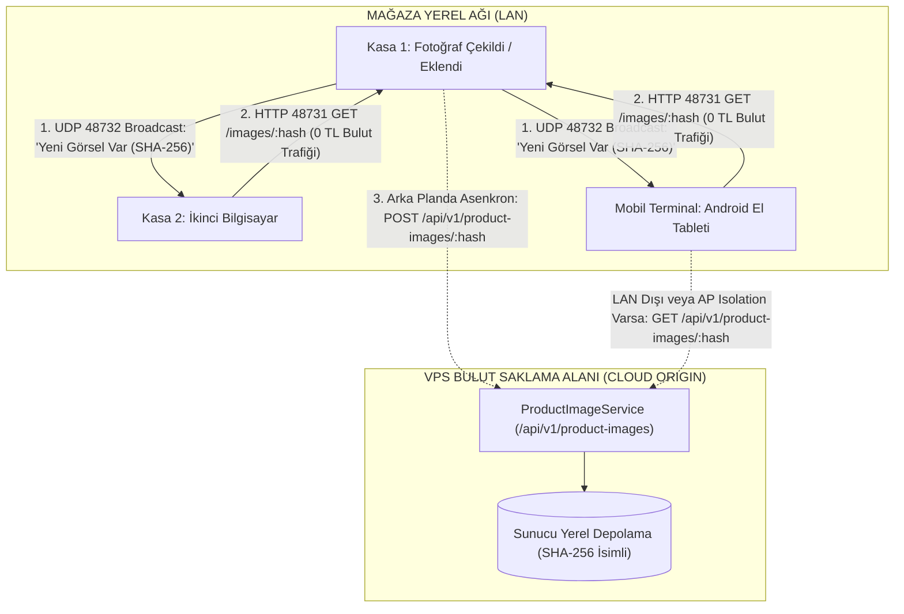

- **Birincil Öncelik — P2P Local Mesh ([ProductImagePeerService](file:///c:/Users/ecz/proje/shaman/shaman_new/lib/infrastructure/services/product_image_peer_service.dart)):**
  - İstemciler yerel ağda **UDP Port 48732** üzerinden şirket anahtarını içeren broadcast anonsları yapar.
  - Aynı ağdaki cihazlar **HTTP Port 48731** üzerinden resmi doğrudan çeken kasadan saniyeler içinde indirir. Bulut trafiği 0 MB olur.
- **İkincil Hat — VPS Cloud Origin Fallback ([ProductImageController](file:///c:/Users/ecz/proje/shaman/shaman_new/server/src/modules/catalog/product-image.controller.ts)):**
  - Tek kasalı işletmeler, AP Isolation (cihazlar arası iletişimi engelleyen otel/AVM modemleri) veya dışarıda dolaşan mobil Android sipariş terminalleri için sunucuda Cloud Origin depolama devrededir.
  - İstemciler yeni çekilen fotoğrafı arka planda asenkron olarak `POST /api/v1/product-images/:hash` ile sunucuya yükler.
  - P2P üzerinden görseli bulamayan istemciler `GET /api/v1/product-images/:hash` çağrısıyla görseli buluttan indirir.
- **Content-Addressed İsimlendirme:**
  - Dosyalar asla rastgele veya ürün ID'siyle isimlendirilmez; dosya içeriğinin küçük harfli 64 karakter SHA-256 hash'i (`device-image://<sha256>.jpg` veya `<sha256>.jpg`) kullanılır.
  - Sunucu ve istemci gelen her bayt dizisinin SHA-256 özetini kontrol eder. Bozuk veya yarım inmiş dosyalar diske kaydedilmez.
- **Ağ Gereksinimleri & Kurumsal Wi-Fi Kısıtı (AP Isolation):**
  - P2P görsel dağıtımının cihazlar arasında kesintisiz çalışması için cihazların aynı yerel ağda (LAN/Subnet) olması ve modem/router üzerinde **"AP Isolation / Client Isolation" (Erişim Noktası İzolasyonu)** seçeneğinin **kapalı** olması gerekir.
  - AVM veya kurumsal kısıtlı ağlarda bu filtre açık olsa dahi, sistem otomatik olarak VPS Cloud Origin hattına geçerek görselleri kayıpsız tamamlar.


---

## 9. E-DÖNÜŞÜM & GİB E-ARŞİV / E-FATURA PORTALI (0 TL MALİYETLİ İSTEMCİ)

Serenut OS, özel entegratörlere her fatura başına kontör parası ödeme zorunluluğunu ortadan kaldıran resmi bir doğrudan entegrasyona sahiptir ([GibEArsivClient](file:///c:/Users/ecz/proje/shaman/shaman_new/lib/infrastructure/services/gib_earsiv_client.dart)):

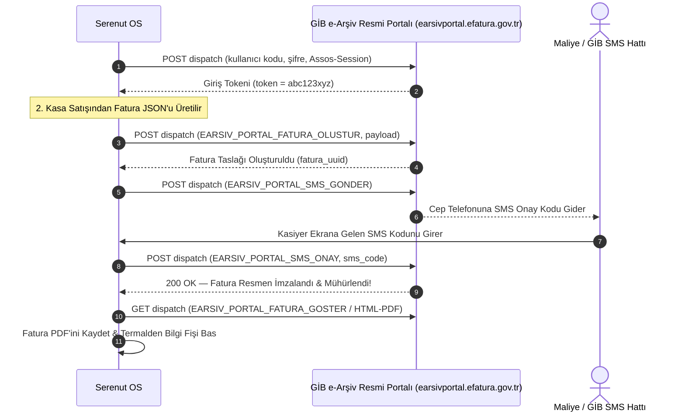

- **KDV & Matrah Dağılımı:** Kasa fişindeki her KDV oranı (%1, %10, %20) GİB kurallarına uygun olarak matrah ve KDV ayrımına tabi tutulur.
- **İptal & Gider Pusulası:** İade durumlarında faturanın GİB portalı üzerinden resmi iptal isteği (`EARSIV_PORTAL_FATURA_IPTAL`) gönderilebilir.

### 9.1. GİB e-Arşiv Portal Giriş Bilgileri ([GibSettingsDialog](file:///c:/Users/ecz/proje/shaman/shaman_new/lib/presentation/pages/settings/widgets/gib_settings_dialog.dart))

İşletmelerin GİB e-Arşiv portalına bağlanması için gereken yapılandırma penceresi:
- **Kullanıcı Adı & Şifre:** Maliye'den alınan resmi portal kullanıcı kodu ve şifresi girilir. Şifre cihazda güvenli depolanır.
- **Test Modu Anahtarı (`isTestMode`):**
  - Gerçek Mod: `https://earsivportal.efatura.gov.tr/earsiv-services/dispatch`
  - Test Modu: `https://earsivportaltest.efatura.gov.tr/earsiv-services/dispatch` (Sahada eğitim ve test yaparken mali sonuç doğurmadan fatura denemesi yapmayı sağlar).
- **Varsayılan KDV Oranı:** İşletmenin ağırlıklı KDV oranı (örn. %1, %10, %20) seçilir.
- **"Bağlantıyı Test Et" Butonu:** Girilen kimlik bilgileriyle anında canlı GİB oturum açma testi (`GibEArsivClient.login`) çalıştırılır; başarılıysa yeşil "Bağlantı Başarılı (Token Alındı)" rozeti verir.

### 9.2. Kasa Satışından Fatura Kesme ([CreateGibInvoiceDialog](file:///c:/Users/ecz/proje/shaman/shaman_new/lib/presentation/widgets/invoice/create_gib_invoice_dialog.dart))

Satış anında veya satış detayından çağrılan fatura düzenleme sihirbazı:
- **Alıcı Doğrulaması:**
  - **TCKN (11 Hane) / VKN (10 Hane):** TCKN/VKN girildiğinde format algoritması otomatik kontrol edilir.
  - **Alıcı Ünvanı / Ad Soyad:** Bireysel müşteride Ad-Soyad, kurumsal müşteride resmi Ticaret Ünvanı.
  - **Vergi Dairesi & İl/İlçe:** Fatura başlığı için zorunlu alanlar.
- **Fatura Tipi:**
  - `SATIS`: Standart perakende/toptan mal satışı.
  - `IADE`: Müşteriden iade alınan mallar için gider pusulası yerine e-Arşiv iade faturası.
  - `TEVKIFAT`: Tevkifatlı kamu veya kurumsal satışlar.
  - `ISTISNA`: İhracat veya KDV muafiyetli işlemler.
- **Fatura Kalemleri & İskonto:** Kasa sepetindeki tüm ürünler, adetleri, birim fiyatları, uygulanan satır iskontoları ve her kalemin KDV oranı otomatik fatura satırlarına dönüştürülür.

### 9.3. Kasa Akışında "Taslak Kaydet" Mimarisi & Gün Sonu Toplu SMS Onayı

Perakende kasasında satış anında kasiyerin müşteriyi bekletip işletme sahibinin telefonuna gelecek SMS kodunu araması operasyonel bir çıkmazdır. Serenut OS bu sorunu **İki Aşamalı Fatura Akışı** ile çözer:

1. **Kasa Anında Hızlı Çıkış (Taslak Kayıt — SMS Beklemez):**
   - Kasiyer fatura ekranında **"Taslak Kaydet (Hızlı Kasa - SMS Beklemez)"** butonuna tıklar.
   - Fatura GİB sistemine taslak olarak kaydedilir (`EARSIV_PORTAL_FATURA_OLUSTUR`) ve yerel SQLite veritabanına `pendingSms` statüsüyle işlenir.
   - Kasa akışı aksamaz; müşteriye mevzuata uygun ETTN/karekod içeren e-Arşiv Taslak Bilgi Fişi verilir veya WhatsApp ile anında iletilir.
2. **Gün Sonu Tek SMS ile Toplu İmzalama (`verifySmsCodeAndSignBatch`):**
   - İşletme sahibi akşam dükkandayken veya müsait olduğunda, gün boyu kesilen onlarca taslak fatura tek bir SMS onay kodu ile topluca resmileştirilir ([GibEArsivClient.verifySmsCodeAndSignBatch](file:///c:/Users/ecz/proje/shaman/shaman_new/lib/infrastructure/services/gib_earsiv_client.dart#L350)).
   - 50 müşteri için 50 kez kasada SMS beklemek yerine, günde 1 kez SMS onay kodu ile tüm faturalar resmiyet kazanır.
3. **İsteğe Bağlı Anında SMS Onayı:**
   - İşletme sahibi bizzat kasadaysa veya anında resmi mühür gerekiyorsa, "Şimdi SMS ile İmzala" seçilerek anında SMS kodu girilip fatura o anda da imzalanabilir.

### 9.4. Fatura Çıktısı, Termal Bilgi Fişi & WhatsApp İletimi

- **e-Arşiv PDF İndirme:** İmzalanan fatura GİB sunucusundan anında orijinal HTML/PDF formatında çekilir.
- **Termal Bilgi Fişi:** 80mm veya 58mm termal yazıcıdan faturanın resmi karekodunu, ETTN (Evrensel Tekil Tanımlama Numarası) kodunu ve mali özetini içeren termal bilgi fişi basılır.
- **WhatsApp / SMS Fatura İletimi:** Tek tıkla müşterinin cep telefonuna faturanın doğrudan PDF indirme bağlantısı WhatsApp veya SMS üzerinden gönderilir (Kağıt ve kargo maliyeti 0 TL).

### 9.5. Hibrit e-Dönüşüm Mimarisi & Kurumsal Entegratör Köprüsü (`IEArsivProvider`)

- **Katman 1 (0 TL Maliyetli Doğrudan GİB Portal İstemcisi):** Küçük ve orta ölçekli işletmeler için fatura başına kontör ücretini sıfırlayan doğrudan GİB Portalı otomasyonudur. GİB web sunucusunda planlı bakım olduğunda veya SMS gecikmelerinde faturalar yerel veritabanında `gib_invoices` tablosuna (`status = 'draft'` veya `'pendingSms'`) atomik olarak kaydedilir; portal erişilebilir olduğunda tek tıkla toplu olarak onaylanır (`verifySmsCodeAndSignBatch`).
- **Katman 2 (Kurumsal Özel Entegratör Genişlemesi):** Günlük yüzlerce fatura kesen kurumsal işletmeler için sistem, resmi lisanslı özel entegratörlerle (Uyumsoft, Sovos vb.) çalışabilecek `IEArsivProvider` sağlayıcı arayüzüne göre soyutlanmıştır. İstenildiğinde kasa satış arayüzü ve kasiyer deneyimi zerre değişmeden resmi SOAP/REST web servisi moduna geçiş yapılabilir.

---

## 10. WHATSAPP BİLDİRİM & İLETİŞİM MOTORU (EVOLUTION API & META CLOUD)

Serenut OS'ta WhatsApp entegrasyonu basit bir sohbet penceresi değildir; işletmenin kurumsal iletişim, anlık dijital fiş paylaşımı, veresiye borç takibi, tahsilat makbuzu, e-Arşiv fatura iletimi ve akşam kasa kapanışında patrona giden Z-Raporunun omurgasıdır ([server/src/modules/whatsapp/](file:///c:/Users/ecz/proje/shaman/shaman_new/server/src/modules/whatsapp/)).

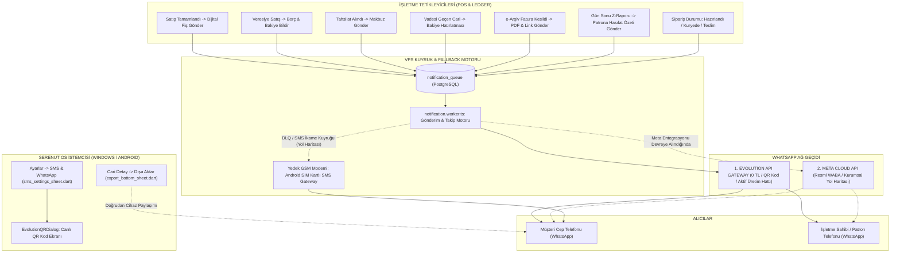

### 10.1. WhatsApp Ağ Geçidi Mimarisi

Serenut OS bildirim mimarisinde iki katmanlı ağ geçidi yaklaşımı benimsenmiştir:

| Özellik | 1. Evolution API (QR Tabanlı) | 2. Meta Cloud API (Resmi WABA) |
|---|---|---|
| **Mevcut Durum** | **Aktif Üretim Hattı (Production)** | **Kurumsal Yol Haritası (Roadmap)** |
| **Maliyet** | **0 TL (Tamamen Ücretsiz)** | Meta görüşme ücreti (Ücretsiz kota sonrası) |
| **Kurulum Süresi** | **1 Dakika** (Telefondan QR okutarak) | 3-7 Gün (Meta Business Onayı, Vergi Levhası vb.) |
| **Bağlanan Numara** | Şirketin mevcut normal veya Business WhatsApp hattı | Meta tarafından onaylanmış kurumsal sabit/mobil hat |
| **Şablon Sınırlaması** | **Yok** — Zengin emoji, kalın metin, fiş dökümü anında gönderilir | Yalnızca önceden Meta tarafından onaylanan `UTILITY` şablonları |
| **Altyapı** | VPS üzerinde çalışan Docker `evolution-api` (Baileys) | Meta Facebook Graph API Bulutu |
| **Kullanım Amacı** | Esnaf, market, kuruyemiş, şarküteri, KOBİ'ler | Büyük zincir marketler, holdingler |

### 10.2. Adım Adım WhatsApp Bağlama Kılavuzu (Kullanıcı / Kasiyer / Yönetici)

İşletme sahibi kendi WhatsApp hattını sisteme bağlamak için şu adımları izler:

1. **Arayüzden Ayarlara Giriş:**
   - Serenut OS ana ekranında sol menüden veya sağ üst köşeden **Ayarlar** (`SettingsPage`) butonuna tıklanır.
   - Listeden **SMS ve WhatsApp Bildirimleri** seçeneği seçilerek ayar paneli ([sms_settings_sheet.dart](file:///c:/Users/ecz/proje/shaman/shaman_new/lib/presentation/pages/settings/widgets/sms_settings_sheet.dart)) açılır.
2. **WhatsApp Bildirim Kartı ve Durum Göstergesi:**
   - Panel açıldığında sistem otomatik olarak `GET /api/v1/whatsapp/evolution/status` sorgusu yapar.
   - **Gri İkon ("Bağlantı durumu kontrol ediliyor..."):** Sunucu durumu kontrol ediliyor.
   - **Yeşil Kart ("0532... bağlı ✓"):** Cihaz bağlı ve mesaj göndermeye hazır.
   - **Amber / Turuncu Kart ("Bağlı değil — QR ile bağlayın"):** Henüz telefon bağlanmamış.
3. **QR Kod ile Eşleştirme ([evolution_qr_dialog.dart](file:///c:/Users/ecz/proje/shaman/shaman_new/lib/presentation/widgets/whatsapp/evolution_qr_dialog.dart)):**
   - **"QR Kod ile Bağlan"** butonuna tıklanır.
   - Ekrana modern bir diyalog penceresi açılır. Sunucu arka planda `GET /api/v1/whatsapp/evolution/qr` endpoint'ini çağırır.
   - Şirkete özel `serenut_<company_id>` instance'ı oluşturulur ve dinamik Base64 PNG formatında QR kod ekrana çizilir.
   - **Telefon İşlemi:** İşletme sahibi kendi telefonunda WhatsApp'ı açar $\rightarrow$ **Ayarlar (veya Üç Nokta)** $\rightarrow$ **Bağlı Cihazlar (Linked Devices)** $\rightarrow$ **Cihaz Bağla** butonuna basıp kasadaki ekrandaki QR kodu kamerayla okutur.
4. **Otomatik Tanıma ve Kapanış:**
   - İstemci her 4 saniyede bir `GET /api/v1/whatsapp/evolution/status` ile durumu sorgular.
   - QR kod okutulup WhatsApp el sıkışması tamamlandığı anda status `open` olur.
   - Diyalog ekranda yeşil onay rozeti gösterir ("WhatsApp Bağlantısı Kuruldu ✓") ve 2 saniye sonra otomatik kapanır.
5. **Bağlantıyı Güvenle Kesme:**
   - Hat değiştirilmek istendiğinde veya cihaz satıldığında "Bağlantıyı Kes" butonuna basılır.
   - `POST /api/v1/whatsapp/evolution/disconnect` çağrılır; sunucu instance'ı siler ve veritabanını `disconnected` durumuna çeker.

### 10.3. Günlük Operasyonlarda WhatsApp Kullanım Noktaları

#### A. Kasa Satış Sonrası Dijital Fiş Gönderimi
- Satış nakit, pos veya veresiye olarak tamamlandığında satış özet dialog'unda **"WhatsApp ile Fiş Gönder"** seçeneği belirir.
- Müşterinin telefon numarası kayıtlıysa tek tıkla müşteriye alışveriş kalemi dökümü ve dijital fiş bağlantısı iletilir.

#### B. Cari Hesap / Müşteri Detay Ekranında WhatsApp İşlemleri ([customer_details_page.dart](file:///c:/Users/ecz/proje/shaman/shaman_new/lib/presentation/pages/customer_details_page.dart))
- Müşteri profilindeyken **"Dışa Aktar"** butonuna basıldığında açılan [ExportBottomSheet](file:///c:/Users/ecz/proje/shaman/shaman_new/lib/presentation/widgets/export_bottom_sheet.dart) üzerinden:
  - **"PDF Cari Hesap Ekstresi"**: Tüm geçmiş hareketleri, borç/alacak dökümünü içeren A4 resmi ekstre PDF olarak üretilir ve sistemin paylaşım menüsü üzerinden müşterinin WhatsApp sohbetine doğrudan dosya olarak iliştirilir.
  - **"WhatsApp ile Bakiye Hatırlatması"**: Vadesi geçen veya açık hesabı olan müşteriye tek tıkla nazik bakiye hatırlatma mesajı gönderilir.

#### C. GİB e-Arşiv Fatura Ekranından WhatsApp Gönderimi ([create_gib_invoice_dialog.dart](file:///c:/Users/ecz/proje/shaman/shaman_new/lib/presentation/widgets/invoice/create_gib_invoice_dialog.dart))
- e-Arşiv fatura resmi olarak GİB portalında imzalandıktan sonra fatura detayındaki WhatsApp simgesine basılarak resmi faturanın PDF'i veya görüntüleme linki müşteriye WhatsApp üzerinden anında iletilir.

#### D. Gün Sonu Kapanışında Patron WhatsApp Bildirimi (Otomatik Z-Raporu — Yol Haritası)
- Kasiyer vardiya sonunda veya akşam mağaza kapanışında Z-Raporu aldığında, döküm ESC/POS yazıcıdan basılır ve ekranda mutabakat sunulur. Z-Raporu finansal özetinin `notification_queue` ve Evolution API üzerinden doğrudan patronun cep telefonuna otomatik WhatsApp mesajı olarak iletilmesi mimari yol haritasında planlanmıştır (bkz. Bölüm 5.6 D ve Bölüm 19).

### 10.4. Kanonik Mesaj Şablonları & Değişken Sözlüğü ([template_resolver.dart](file:///c:/Users/ecz/proje/shaman/shaman_new/lib/domain/notifications/template_resolver.dart))

Mesajlarda kullanılan dinamik değişkenler:
- `{customer}`: Müşteri Adı / Unvanı
- `{amount}`: İşlem / Fiş Tutarı (₺ formatında)
- `{paid}`: Kasiyere ödenen miktar
- `{debt}`: Kalan vadeli borç miktarı
- `{balance}`: Cari hesabın güncel toplam bakiyesi
- `{items}`: Satın alınan ürünlerin adet/gramaj ve fiyat dökümü
- `{business}`: İşletmenin resmi veya ticari adı
- `{date}`: İşlemin yapıldığı gün ve saat
- `{id}`: Fiş, makbuz veya sipariş numarası

#### 1. Satış Bilgi Fişi (`sale_created`):
```text
🧾 *Alışveriş Fişi*

Sayın *Ahmet Yılmaz*,
Alışverişiniz başarıyla tamamlanmıştır.

▫️ *Fiş No:* #40921
▫️ *Tarih:* 24.10.2026 18:32

🛍️ *Satın Alınan Ürünler:*
• Giresun Kavrulmuş Fındık (500 gr) - ₺180,00
• Antep Fıstığı Duble (250 gr) - ₺195,00

▫️ *Ödenen:* *₺375,00*
▫️ *Toplam Tutar:* *₺375,00*

Bizi tercih ettiğiniz için teşekkür eder, iyi günlerde kullanmanızı dileriz.
*Nutopian Fındık & Kuruyemiş*

ℹ️ _Bildirimlerin tarafınıza sorunsuz ulaşabilmesi için lütfen numaramızı rehberinize kaydediniz._
```

#### 2. Veresiye / Cari Borç Bildirimi (`debt_created`):
```text
📋 *Cari Hesap Bilgilendirmesi*

Sayın *Mehmet Güven*,
#10852 numaralı vadeli işleminiz cari hesabınıza işlenmiştir.

▫️ *İşlem Tutarı:* ₺850,00
▫️ *Eklenen Borç:* *₺850,00*
▫️ *Güncel Toplam Bakiyeniz:* *₺2.450,00*

Detaylı hesap ekstresi ve mutabakat için bizimle iletişime geçebilirsiniz.
*Nutopian Fındık & Kuruyemiş*
```

#### 3. Tahsilat Makbuzu (`collection_recorded`):
```text
✅ *Tahsilat Makbuzu*

Sayın *Mehmet Güven*,
Yapmış olduğunuz ödeme başarıyla tahsil edilmiş ve hesabınıza işlenmiştir.

▫️ *Makbuz No:* #MK-9021
▫️ *Tahsil Edilen:* *₺1.000,00*
▫️ *Kalan Bakiyeniz:* *₺1.450,00*
📅 *Tarih:* 24.10.2026 16:15

Ödemeniz için teşekkür ederiz.
*Nutopian Fındık & Kuruyemiş*
```

#### 4. Bakiye Hatırlatması (`balance_reminder`):
```text
🔔 *Bakiye Hatırlatması*

Sayın *Mehmet Güven*,
İşletmemizdeki cari hesabınızın güncel durum özeti aşağıdadır:

▫️ *Güncel Vadeli Bakiye:* *₺1.450,00*
📅 *Tarih:* 24.10.2026

Ödeme ve mutabakat işlemleriniz için işletmemizle iletişime geçebilirsiniz.
Sağlıklı ve bereketli günler dileriz.
*Nutopian Fındık & Kuruyemiş*
```

#### 5. Patron Gün Sonu Z-Raporu Bildirimi (`end_of_day_report`):
```text
📊 *GÜN SONU Z-RAPORU ÖZETİ*
İşletme: *Nutopian Fındık (Merkez Şube)*
Tarih: *24.10.2026 21:00*
Kasa Görevlisi: *Kasa 1 (Ayşe Yılmaz)*

💰 *GÜNLÜK TOPLAM CİRO:* *₺48.750,00*
--------------------------------
💵 *Nakit Tahsilat:* ₺19.200,00
💳 *Kredi Kartı:* ₺24.350,00
📝 *Veresiye Satış:* ₺5.200,00
📥 *Cari Tahsilat:* ₺3.800,00
🔄 *İade Tutarı:* ₺450,00 (2 işlem)
--------------------------------
📦 *Toplam Satış Adedi:* 142 fiş
⚖️ *Tartılı Ürün Hasılatı:* ₺28.400,00
--------------------------------
🔒 *Kasa Durumu:* Devir: ₺1.000 | Kasa Mevcudu: ₺20.200 | Fark: ₺0,00 ✓
```

### 10.5. Sunucu Mimarisi & Evolution API v2 Motoru

Bulut sunucusunda WhatsApp altyapısı şu şekilde çalışır:

1. **Docker Altyapısı (`server/docker-compose.prod.yml`):**
   - `evolution-api` konteyneri (v2.x) port `8080` üzerinde izole çalışır.
   - Redis önbelleği oturum durumlarını (Baileys keys) RAM'de tutar; sunucu yeniden başlasa bile WhatsApp oturumu düşmez.
2. **REST API Endpoint'leri ([whatsapp.controller.ts](file:///c:/Users/ecz/proje/shaman/shaman_new/server/src/modules/whatsapp/whatsapp.controller.ts)):**
   - `GET /api/v1/whatsapp/evolution/qr`: QR kod PNG Base64 üretir.
   - `GET /api/v1/whatsapp/evolution/status`: `open`, `connecting` veya `close` döndürür.
   - `POST /api/v1/whatsapp/evolution/disconnect`: Oturumu kapatır ve veritabanını günceller.
   - `POST /api/v1/whatsapp/events`: Kuyruğa bildirim ekler (`client_event_id` ile idempotency sağlar, aynı fiş mükerrer gitmez).
   - `POST /api/v1/whatsapp/evolution/webhook`: Webhook dinleyicisi (API key doğrulamalı).
3. **Baileys Durum Kodları & Tik Doğrulaması (`normalizeEvolutionMessageStatus`):**
   - `0` $\rightarrow$ `failed` (Gönderim hatası)
   - `1` $\rightarrow$ `pending` (Kuyrukta bekliyor)
   - `2` $\rightarrow$ `server_ack` (WhatsApp sunucusuna ulaştı — **Tek Gri Tik**)
   - `3` $\rightarrow$ `delivered` (Müşterinin telefonuna teslim edildi — **Çift Gri Tik**)
   - `4` $\rightarrow$ `read` (Müşteri mesajı açıp okudu — **Çift Mavi Tik**)
4. **KVKK & Güvenlik Koruması:**
   - [maskPhoneForLog](file:///c:/Users/ecz/proje/shaman/shaman_new/server/src/modules/whatsapp/evolution.service.ts#L399-L404): Sunucu loglarına telefon numaraları asla açık yazılmaz; `9055****67` şeklinde otomatik maskelenir.
   - Tenant İzolasyonu: Her işletmenin mesajları ve instance'ı RLS (Row Level Security) ile birbirinden tamamen izoledir.

### 10.6. SMS & WhatsApp Dağıtım Mantığı ve DLQ Koruması

Sistem bir bildirimi göndermeye çalışırken şu sırayı takip eder:
1. Kanala göre (`channel: 'whatsapp'` veya `'sms'`) ilgili ağ geçidine yönlendirilir.
2. WhatsApp bağlıysa veya müşteri telefonunda WhatsApp varsa mesaj WhatsApp üzerinden iletilir (0 TL maliyet, zengin görsel ve biçimli metin).
3. **Hata İzolasyonu & DLQ Güvencesi:** Eğer işletmenin WhatsApp oturumu düşmüşse veya ağ hatası alınırsa `notification.worker.ts` işlemi üstel geri çekilme (exponential backoff) ile 3 defa yeniden dener. Kalıcı hata durumunda mesaj kaybolmaz; Ölü Mektup Kuyruğuna (`NOTIFICATION_DLQ`) taşınır.
4. **SMS İkame Akışı (Operasyonel Runbook / Yol Haritası):** WhatsApp kanalı kapalı olan veya DLQ'ya düşen kritik müşteri bildirimleri, operasyonel müdahale ile veya planlanan otomatik kanal yönlendiricisi üzerinden **11. Bölümdeki Android SIM Kartlı SMS Ağ Geçidine** aktarılarak SMS olarak yeniden gönderilebilir.

### 10.7. WhatsApp Sorun Giderme Runbook'u (Troubleshooting)

- **Sorun 1: "QR Kod Yüklenemiyor / Bekleyin (202 Pending)":**
  - *Neden:* Evolution API konteyneri instance başlatırken WhatsApp Baileys anahtarlarını üretmektedir.
  - *Çözüm:* İstemci 2 saniye aralıklarla 4 kez tekrar dener. 10 saniye içinde QR otomatik ekrana gelecektir. Sunucuda `docker logs evolution-api` incelenebilir.
- **Sorun 2: "QR Kod Okutuldu Ama Durum 'connecting'te Kaldı":**
  - *Neden:* Telefonun internet bağlantısı zayıftır veya WhatsApp Web oturum sınırına (maksimum 4 cihaz) ulaşılmıştır.
  - *Çözüm:* Telefondaki WhatsApp'tan eski/kullanılmayan bağlı cihazları silin, "Bağlantıyı Kes" deyip yeni bir QR kod okutun.
- **Sorun 3: "Mesajlar Gidiyor Ama Mavi Tik / Teslimat Bilgisi Düşmüyor":**
  - *Neden:* Alıcı gizlilik ayarlarından "Okundu Bilgisi"ni kapatmış olabilir veya webhook URL'si VPS güvenlik duvarında engellenmiştir.
  - *Çözüm:* `EVOLUTION_WEBHOOK_URL` ortam değişkeninin doğru VPS adresine (`https://.../api/v1/whatsapp/evolution/webhook`) baktığını teyit edin.
- **Sorun 4: "Telefonda Birkaç Saat Sonra WhatsApp Oturumu Kapanıyor":**
  - *Neden:* Android telefonlarda agresif "Pil Tasarrufu" veya "Bellek Temizleyici" arka planda WhatsApp'ı uyutmaktadır.
  - *Çözüm:* Telefonda Ayarlar $\rightarrow$ Uygulamalar $\rightarrow$ WhatsApp $\rightarrow$ Pil $\rightarrow$ **"Kısıtlama Yok / Arka Planda Çalışmaya İzin Ver"** seçilmelidir.

---

## 11. ANDROID SIM KARTLI SMS AĞ GEÇİDİ (YEREL GSM MODEMİ)

İşletmelerin harici toplu SMS firmalarına her ay binlerce lira kontör parası ödemesini engelleyen, çekmecedeki eski bir Android telefonu işletmenin resmi GSM modemine dönüştüren patentli yerli mimari ([SmsGatewayService](file:///c:/Users/ecz/proje/shaman/shaman_new/lib/infrastructure/services/sms_gateway_service.dart)):

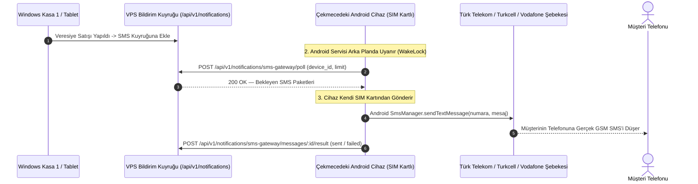

### 11.1. Nasıl Çalışır?
- İşletme, dükkanda duran herhangi bir Android telefona Serenut OS kurar ve bir SIM kart (ör. her yöne 2.000 - 5.000 SMS içeren standart kurumsal hat) takar.
- Ayarlar menüsünden **"Bu Cihazı SMS Ağ Geçidi Olarak Kullan"** seçeneği işaretlenir.
- Android işletim sisteminin yerel `SmsManager` servisine bağlanır. Arka planda `PARTIAL_WAKE_LOCK` ve ön plan bildirim servisi (Foreground Service) ile Android işletim sisteminin servisi uyutması engellenir.
- Ağdaki veya buluttaki tüm kasalardan (Windows, iOS, Web) çıkan SMS emirleri bu cihaz üzerinden gerçek GSM operatörü şebekesine basılır.
- **Maliyet:** 0 TL ek masraf.
- **Çift SIM Desteği:** Çift hatlı telefonlarda hangi SIM kart üzerinden gönderim yapılacağı (`smsSimSubscriptionId`) ayarlanabilir.
- **Aylık Limit Koruması:** Operatör faturasında aşım olmaması için "Aylık Maksimum SMS Limiti" (ör. 2.500 adet) tanımlanabilir; limite yaklaşıldığında yönetici uyarılır.

---

## 12. PATRON WEB YÖNETİM PORTALI & CANLI CİRO İZLEME (REALTIME WEBSOCKET ENGINE)

İşletme sahibinin fiziksel olarak mağazada olmadan, evdeki bilgisayarından veya cep telefonu tarayıcısından işletmeyi anlık yönetmesini sağlayan kurumsal web portalı ([server/src/modules/portal/](file:///c:/Users/ecz/proje/shaman/shaman_new/server/src/modules/portal/) & `server/public/app/`):


### 12.1. WebSocket Canlı Satış & Analitik Akışı (Realtime Dashboard)
- **Çift Hatlı Canlı WebSocket Kanalları:**
  1. **Kasa Satış & Olay Hattı:** `wss://api.serenut.com/api/v1/realtime/live` (veya `/realtime/live` — [realtime.ws.ts](file:///c:/Users/ecz/proje/shaman/shaman_new/server/src/modules/realtime/realtime.ws.ts)): Kasiyerin kasada tamamladığı satış, ciro artışı ve iptalleri anında yayınlar.
  2. **Portal Telemetri & Analitik Hattı:** `wss://api.serenut.com/api/v1/analytics/live` ([analytics.ws.ts](file:///c:/Users/ecz/proje/shaman/shaman_new/server/src/modules/analytics/analytics.ws.ts)): Web panelindeki canlı ziyaretçi, cihaz online/offline durumu ve telemetri sayaçlarını besler.
- **Yetkilendirme & Ticket Modeli ([realtime.ws.ts](file:///c:/Users/ecz/proje/shaman/shaman_new/server/src/modules/realtime/realtime.ws.ts)):**
  - WebSocket el sıkışması (handshake) doğrudan JWT token ile yapılmaz.
  - İstemci önce geçerli Bearer token'ı ile `POST /api/v1/realtime/ticket` uç noktasına istek atarak tek kullanımlık, kısa ömürlü bir bilet (`ticket`) alır.
  - WebSocket bağlantısı bu bilet parametresiyle açılır: `wss://api.serenut.com/api/v1/realtime/live?ticket=<tek_kullanimlik_ticket>`.
  - Sunucu bileti ilk bağlantıda tüketir (consume) ve hafızadan siler (Replay Attack koruması). Biletsiz bağlantılar anında `401 Unauthorized` ile reddedilir.
- **Tenant Oda İzolasyonu:** Her işletmenin WebSocket kanalı kendi `company_id` odasına abonedir. Başka bir şirketin cirosu veya satışı kesinlikle diğerine sızamaz.
- **Heartbeat & Canlılık Koruması:** Her 30 saniyede bir ping/pong kontrolü yapılır; internet kesilirse istemci otomatik olarak yeniden bağlanır (exponential backoff).
- **Canlı Ciro Sayacı:** Kasiyer kasada satışı tamamladığı anda, patronun açık olan web ekranında hiçbir F5/yenileme yapmadan **Günlük Ciro, Yapılan İşlem Adedi ve Kasa Grafiği** anında artar.

### 12.2. Konsolide Çoklu Şube ve Kasa Raporları
- Tek ekranda tüm şubelerin (Merkez, Şube 1, Depo) anlık nakit ve kart hasılatı toplanır.
- **Kâr / Zarar Analizi:** Ürünlerin alış maliyetleri ile satış fiyatları arasındaki brüt kar marjı kuruşu kuruşuna listelenir.
- **Resmi KDV Matrah Dağılımı:** Muhasebeciye verilmek üzere %1, %10 ve %20 KDV dilimlerine göre net matrah dökümleri tek tıkla Excel ve PDF olarak indirilir.
- **Kritik Stok Uyarıları:** Depoda tükenmek üzere olan ürünler sarı ve kırmızı etiketlerle patronun ekranına düşer.

### 12.3. Uzaktan Fiyat ve Katalog Yönetimi
- Patron evindeyken veya tatildeyken web portalına girip bir ürünün fiyatını veya barkodunu güncellediğinde, bu değişiklik PostgreSQL veritabanına yazılır.
- Mağazadaki kasalar bir sonraki Sync döngüsünde (maksimum birkaç saniye içinde) yeni fiyatı otomatik çeker. Kasiyerin fiyat güncellemek için programı kapatıp açmasına gerek kalmaz!

### 12.4. Dinamik Uzaktan Yapılandırma & Acil Devre Kesici ([remote-config.controller.ts](file:///c:/Users/ecz/proje/shaman/shaman_new/server/src/modules/remote-config/remote-config.controller.ts))

Saha operasyonlarında acil durumları ve sistem güncellemelerini istemcilere yeni bir derleme göndermeden anında yöneten uzaktan yapılandırma katmanı:
- **Merkezi Yapılandırma Dağıtımı (`GET /api/v1/remote-config`):**
  - Sunucudaki `remote_configs` tablosundan (`key = 'global_config'`) en güncel özellik bayrakları (feature flags) çekilir.
- **Acil Devre Kesici (Circuit Breaker):**
  - Örneğin GİB e-Arşiv veya WhatsApp sağlayıcısında küresel bir çöküntü yaşandığında, sunucudan `circuit_breakers: { gib_portal: false }` bayrağı kapatılır.
  - İstemciler hata fırtınasına düşmeden veya kullanıcıyı bekletmeden faturayı yerel kuyrukta tutar; dış servisi gereksiz isteklerle boğmaz.
- **Bakım Bildirimleri & Sürüm Zorlama:**
  - Planlı veritabanı bakımı öncesinde tüm kasaların ekranında geri sayım afişi gösterilebilir veya eski sürümde kalan kasalar için zorunlu güncelleme bayrağı (`min_required_version`) dinamik tetiklenebilir.

---

## 13. MÜŞTERİ İKİNCİ EKRANI (CUSTOMER FACING DISPLAY)

> [!NOTE]
> **Donanım Yol Haritası Notu:** Müşteri İkinci Ekranı (HDMI çoklu pencere ve Seri VFD pole display), mimari protokol spesifikasyonu tanımlanmış kurumsal bir donanım modülüdür. Mevcut temel derlemede kasiyer ana satış konsolu ile mobil tablet satış arayüzü doğrudan devrededir; çift ekran motoru ileriki donanım güncellemesi paketinde aktif edilecektir.

Kasada ödeme yapan müşterinin sepetini, indirimlerini ve para üstünü görmesini sağlayan çift monitör / müşteri göstergesi entegrasyonu:

### 13.1. Donanım Mimarisi & Tipleri
1. **HDMI İkinci Ekran (Modern Grafik Ekranı):**
   - Kasa bilgisayarına takılı 10 inç ile 15 inç arası ikinci monitör.
   - Flutter Desktop çoklu pencere mimarisi ile çalışır. Ana ekran kasiyerdeyken, ikinci pencere müşteriye dönük ekranda tam ekran olarak açılır.
2. **VFD / Seri Müşteri Göstergesi (Pole Display):**
   - 2 satır 20 karakter yeşil floresan göstergeler (Epson ESC/POS veya CD5220 protokolü).
   - Seri port (COM1..COM9) veya USB-Serial dönüştürücü üzerinden 9600 baud hızında bağlanır.

### 13.2. Çalışma Modları ve Ekran Durumları
- **1. Bekleme Modu (Kasa Boşken):**
  - Ekranda işletmenin kurumsal logosu, indirim afişleri, günün fırsatları ve duyurular slayt gösterisi olarak döner (Dijital Tabela / Reklam Modu).
- **2. Satış Anı Modu (Barkod Okunurken):**
  - Kasiyer ürün okuttuğu anda ekran ikiye bölünür:
  - Sol tarafta okunan ürünün adı, büyük ürün fotoğrafı ve birim fiyatı parlar.
  - Sağ tarafta sepetteki ürünlerin listesi, uygulanan indirimler ve dev puntolarla **TOPLAM TUTAR** gösterilir.
- **3. Ödeme ve Para Üstü Modu (Kasa Kapanırken):**
  - Müşterinin uzattığı nakit para girildiğinde, ekranda dev harflerle **"ÖDENEN: ₺500,00"** ve yeşil kutu içinde **"PARA ÜSTÜ: ₺125,00"** gösterilir. Böylece para üstü anlaşmazlıkları sıfırlanır.

---

## 14. YEDEKLEME, GERİ YÜKLEME, LİSANSLAMA & VERİ AKTARIMI (MIGRATION)

### 14.1. Güvenli Veritabanı Yedekleme & Geri Yükleme (`BackupService`)

- [BackupService](file:///c:/Users/ecz/proje/shaman/shaman_new/lib/infrastructure/services/backup_service.dart), her akşam gün sonu Z-raporu alındığında veya her yazılım güncellemesi öncesinde otomatik devreye girer.
- **Atomik SQLite Snapshot:** Yedekleme esnasında kasanın satış yapmasını engellememek için öncelikli olarak SQLite'ın modern `VACUUM INTO` komutu işletilir; desteklenmeyen ortamlarda ise `PRAGMA wal_checkpoint(TRUNCATE)` ve güvenli dosya kopyalama fallback'i devreye girer.
- **Doğrulama:** Yedek dosyasının SHA-256 hash'i hesaplanır ve `PRAGMA integrity_check` yapılarak dosyanın sağlam olduğu tescillenmeden işlem bitirilmez.
- **Dual-Stack Yedek Dosyaları:** Yedekler `getApplicationDocumentsDirectory() / SerenutBackups` (Windows: `Belgelerim\SerenutBackups`, Android: `Documents/SerenutBackups`) altında SHA-256 mühürlü standart SQLite `.db` dosyaları olarak oluşturulur:
  - Legacy POS Yedeği: `serenut_pos_backup_<timestamp>.db`
  - Core Next Yedeği: `serenut_core_v2_backup_<timestamp>.db`
- **Dışa Aktarma & Güvenli Paylaşım:** Oluşturulan `.db` yedekleri doğrudan takılı bir USB belleğe kopyalanabilir veya işletim sisteminin yerel paylaşım sayfası (`share_plus`) üzerinden e-posta, WhatsApp veya bulut sürücülerine anında aktarılabilir (Doğrudan Google Drive API entegrasyonu yol haritasında planlanmıştır).

### 14.2. Lisanslama ve Çevrimdışı İntibak Süresi (Offline Grace Period)

- Lisans doğrulaması sunucunun RSA-4096 özel anahtarı ile imzalanmış bir dijital sertifika ile yapılır.
- **İnternet Kesintisi Güvencesi:** Sürekli interneti olmayan mağazalarda kasanın kilitlenmesini önlemek için **Varsayılan 72 Saat (3 Gün) Çevrimdışı İntibak Süresi (Offline Grace Period)** tanımlıdır (`plans.offline_grace_hours = 72`). İşletmenin paketine veya patron onayına göre bu süre `grace_hours_override` ile uzatılabilir (ayrıca offline lisans sertifikasında 7 güne kadar tolerans payı tanınır). İnternet kesilse dahi kasa satış yapmaya devam eder.

### 14.3. Dış Sistemlerden Veri Aktarımı (Excel / JSON Migration)

- [DataTransferPage](file:///c:/Users/ecz/proje/shaman/shaman_new/lib/presentation/pages/data_transfer_page.dart) üzerinden işletmelerin eski yazılımlarından (Akınsoft, Mikro, Logo, NarBarkod vb.) dışa aktardığı Excel (`.xlsx`), CSV veya JSON dosyaları içe aktarılır.
- Ürün adları, barkodlar, birimler, alış/satış fiyatları ve mevcut stoklar kuruş modeline dönüştürülerek içe alınır.

### 14.4. Veritabanı Sağlık Denetimi & Kendi Kendini Onarma (`IDatabaseHealthRepository` / Self-Healing)

Çevrimdışı çalışan POS sistemlerinde elektrik kesintisi veya donanım çökmesi sonucu oluşabilecek veri tutarsızlıklarını tespit eden ve arka planda kullanıcıya hissettirmeden onaran otomatik mekanizma:
- **Yetim Kalem Denetimi (Orphaned Items):** Satış üst kaydı silinmiş veya yarım kalmış sepet satırlarını tespit eder ve temizler.
- **Negatif Stok Güvencesi & Sayım Uyarısı:** Perakende ve kuruyemişte mal kabul faturası henüz sisteme girilmeden önce ürünün raftan satılması olağan bir durumdur ve stok geçici olarak eksiye düşer. Sistem bu stoğu körü körüne sıfırlayarak hayali envanter fazlası (phantom inventory) üretmez; durumu `DatabaseHealthReport` (`negativeStockProductsCount`) üzerinde denetim ve sayım uyarısı olarak korur. Toptancı faturası girildiğinde stok kendiliğinden doğru pozitif değere oturur.
- **Defter & Bakiye Uyuşmazlığı Otomatik Mutabakatı:** Müşterinin `balance_cents` önbellek değeri ile `ledger_entries` toplamı uyuşmuyorsa, kanonik formülü tek işlemde çalıştırarak bakiyeyi matematiksel gerçeğe eşitler.

### 14.5. Kriptografik Denetim İzi & Audit Log Teftiş Merkezi ([AuditCenterPage](file:///c:/Users/ecz/proje/shaman/shaman_new/lib/presentation/pages/admin/audit_center_page.dart) & [AuditLogService](file:///c:/Users/ecz/proje/shaman/shaman_new/lib/domain/services/audit_log_service.dart))

Kasiyerlerin ve yöneticilerin yaptığı her hassas işlemin silinemez ve değiştirilemez şekilde kayıt altına alındığı teftiş merkezi:
- **Kriptografik SHA-256 Zinciri (`_integrityVerified`):** Her denetim kaydı bir önceki kaydın hash'ine bağlıdır (Blockchain/Merkle benzeri zincirleme). Veritabanından satır silinirse veya SQLite açılıp bir rakam elle değiştirilirse bütünlük mührü kırılır ve ekran kırmızı alarm verir.
- **17 Kritik Olay Tipi:**
  - Ürün & Fiyat: `product_created`, `price_changed`, `product_updated`, `product_deleted`
  - Müşteri & Cari: `customer_created`, `customer_updated`, `customer_deleted`, `payment_recorded`
  - Satış & Kasa: `sale_created`, `items_returned` (İadeler)
  - Sipariş: `order_created`, `order_updated`, `order_deleted`, `order_status_updated`
  - Sistem: `system_backup`, `system_restore`
- **Filtreleme & Arama:** Kasiyer bazlı, tarih aralıklı veya olay tipine göre saniyeler içinde arama yapılabilir.

### 14.6. Geri Dönüşüm & Kurtarma Merkezi ([RecoveryCenterPage](file:///c:/Users/ecz/proje/shaman/shaman_new/lib/presentation/pages/admin/recovery_center_page.dart))

Kasiyerin yanlışlıkla sildiği bir ürünü, müşteriyi veya siparişi panik yaşamadan kurtarmayı sağlayan sistem:
- **Soft-Delete (Tombstone) Prensibi:** Serenut OS'ta hiçbir kayıt ilk silme işleminde fiziksel olarak veritabanından silinmez (`is_deleted = 1` ve `deleted_at = timestamp` işaretlenir).
- **4 Ayrı Kurtarma Sekmesi:**
  1. **Ürünler:** Yanlışlıkla silinen ürünler barkodları ve stoklarıyla listelenir.
  2. **Müşteriler:** Silinen müşteriler eski bakiye ve defter hareketleriyle listelenir.
  3. **Satışlar:** İptal edilen veya silinen satış kayıtları.
  4. **Siparişler:** İptal edilmiş paket/teslimat siparişleri.
- **Tek Tıkla Kurtarma (`Restore`):** "Kurtar" butonuna basıldığı anda kayıt anında aktif çalışma ekranlarına geri döner.
- **Kalıcı İmha (`Purge`):** Yalnızca yetkili yöneticinin ikinci bir onay vermesi durumunda veritabanından kalıcı olarak temizlenir.

### 14.7. Güvenli Yedekleme & Geri Yükleme Yönetimi ([BackupManagePage](file:///c:/Users/ecz/proje/shaman/shaman_new/lib/presentation/pages/settings/backup_manage_page.dart) & [BackupService](file:///c:/Users/ecz/proje/shaman/shaman_new/lib/infrastructure/services/backup_service.dart))

- **Tek Tıkla Doğrulanmış SQLite Yedeği:** Aktif Dual-Stack veritabanları (`serenut_pos.db` ve `serenut_core_v2.db`), WAL kilidi dondurularak SHA-256 bütünlüğü tescillenmiş `.db` yedekleri olarak paketlenir.
- **Güvenli Geri Yükleme (Restore):**
  - Geçmiş bir yedek dosyası seçildiğinde sistem önce mevcut veritabanının acil durum anlık görüntüsünü alır.
  - Seçilen yedeği açar, `PRAGMA integrity_check` doğrulaması yapar ve sistemi temiz bir şekilde eski tarihe döndürür.
- **Yedek Dosyası Paylaşımı:** Oluşturulan yedek tek tıkla e-posta, WhatsApp veya USB belleğe aktarılabilir.

### 14.8. Canlı Önizlemeli Görsel Barkod & Etiket Tasarım Editörü ([LabelTemplateEditorPage](file:///c:/Users/ecz/proje/shaman/shaman_new/lib/presentation/pages/settings/label_template_editor_page.dart))

İşletmelerin raf ve ürün etiketlerini kod yazmadan görsel olarak özelleştirmesini sağlayan etkileşimli editör:
- **Canlı Önizleme Tuvali (Live Canvas):** Yapılan her ayar (yazı boyutu, alan açma/kapama) ekrandaki simüle edilmiş etikette anında değişir.
- **Ürün Etiketi Alan Kontrolleri:**
  - Firma Ünvanı Gösterilsin mi? (Aç/Kapat)
  - Marka Bilgisi Gösterilsin mi? (Aç/Kapat)
  - Barkod Çizgileri & EAN-13 Kodu Gösterilsin mi? (Aç/Kapat)
  - Satış Fiyatı & KDV Dahil İbaresi Gösterilsin mi? (Aç/Kapat)
  - Font Boyutu: `Küçük`, `Orta`, `Büyük`
- **Sipariş & Koli Etiketi Alan Kontrolleri:**
  - Müşteri Adı, Sipariş Numarası, Tarih/Saat, Kalem Sayısı ve Toplam Tutar alanlarını açıp kapatabilme.
- **Fiziki Etiket Boyut Seçici:** `40 x 25 mm`, `50 x 30 mm`, `60 x 40 mm` veya özel milimetrik ölçü tanımı.
- **"Yazıcıda Test Et" Butonu:** Yapılan tasarımı TSPL komut setine dönüştürerek bağlı etiket yazıcısına tek bir test baskısı gönderir.

### 14.9. Personel, Kasiyer Yetki Matrisi & Hızlı PIN Kodu ([UserManagementDialog](file:///c:/Users/ecz/proje/shaman/shaman_new/lib/presentation/pages/settings/widgets/user_management_dialog.dart))

Birden çok kasiyerin çalıştığı mağazalarda kasa güvenliğini ve yetki sınırlarını belirleyen modül:
- **Kullanıcı Rolleri:**
  - `Admin (Yönetici)`: Tüm ayarlara, raporlara, silme ve maliyet görme yetkilerine tam erişim.
  - `Cashier (Kasiyer)`: Yalnızca kasa satış, tahsilat ve sipariş ekranlarına erişim.
- **4-6 Haneli Hızlı PIN Kodu:** Kasiyerlerin klavyeden veya dokunmatik sayısal tuş takımından şifre yazmadan hızlıca kasayı devralmasını sağlar.
- **Hassas İşlem Kısıtlamaları:**
  - Kasiyer iskonto uygulayabilir mi? (Maksimum iskonto yüzdesi belirlenebilir).
  - Kasiyer satış fişi veya satır iptal edebilir mi? (Kapalıysa müdür PIN kodu isteme zorunluluğu).
  - Kasiyer gün sonu Z-raporu alabilir mi?
  - Kasiyer alış maliyetlerini ve kar marjlarını görebilir mi? (Varsayılan olarak kasiyere gizlidir).

### 14.10. Telefon Rehberinden Müşteri Çekme & Toplu Veri Aktarımı ([DataTransferPage](file:///c:/Users/ecz/proje/shaman/shaman_new/lib/presentation/pages/data_transfer_page.dart) & [ContactImportPage](file:///c:/Users/ecz/proje/shaman/shaman_new/lib/presentation/pages/data_transfer/contact_import_page.dart))

- **Rehberden Tek Tıkla Müşteri Aktarımı:** Android kasalarda telefon rehberine erişim izni verilerek (`flutter_contacts`), esnafın telefonundaki yüzlerce müşteriyi tek tıkla Serenut OS cari kartlarına dönüştürür.
- **Excel & CSV İçe / Dışa Aktarım Sihirbazı:**
  - `Ürünler.xlsx`: Barkod, Ürün Adı, Kategori, Alış Fiyatı, Satış Fiyatı, KDV, Stok.
  - `Müşteriler.xlsx`: Ünvan, Telefon, Adres, Vergi No, Başlangıç Bakiyesi.
  - Hatalı satırlar atlanır; başarılı satırlar canlı ilerleme çubuğu (`ImportProgressDialog`) ile içe aktarılır.

### 14.11. SaaS Lisanslama, İyzico 3D Secure & Havale/EFT Yaşam Döngüsü ([commercial_lifecycle.service.ts](file:///c:/Users/ecz/proje/shaman/shaman_new/server/src/modules/billing/commercial_lifecycle.service.ts))

İşletmelerin Serenut OS yazılım aboneliklerini ve lisans geçerliliklerini yöneten bulut faturalama altyapısı:
- **İyzico 3D Secure Kredi Kartı Ödemesi ([iyzico.service.ts](file:///c:/Users/ecz/proje/shaman/shaman_new/server/src/modules/billing/iyzico.service.ts)):**
  - Aylık veya yıllık paket yenilemelerinde BDDK ve PCI-DSS uyumlu 3D Secure doğrulaması ile tahsilat yapılır.
  - İyzico Webhook ile ödeme anında teyit edilerek lisans bitiş tarihi otomatik uzatılır.
- **Banka Havale / EFT Bildirimi ([billing.bank-transfer.routes.ts](file:///c:/Users/ecz/proje/shaman/shaman_new/server/src/modules/billing/billing.bank-transfer.routes.ts)):**
  - Kredi kartı kullanmayan esnaf için IBAN havale bildirimi ve dekont görseli yükleme imkanı sunulur.
  - Finans yöneticisi portal üzerinden dekontu onayladığında lisans anında aktifleşir.
- **Otomatik e-Fatura & PDF Üretimi ([invoice_generator.service.ts](file:///c:/Users/ecz/proje/shaman/shaman_new/server/src/modules/billing/invoice_generator.service.ts)):**
  - Tahsil edilen her abonelik bedeli için işletmenin kurumsal bilgilerine resmi PDF fatura üretilir ve e-posta ile iletilir.
- **SaaS Yaşam Döngüsü Durum Makinesi (Commercial Lifecycle FSM):**
  - `trial`: 14 günlük ücretsiz deneme süresi.
  - `active`: Ödemesi yapılmış, tüm özelliklerin açık olduğu tam lisanslı mod.
  - `grace_period`: Ödeme günü geçmiş veya internet kesilmiş; esnafın mağdur olmaması için **72 Saat (3 Gün) Kesintisiz Çalışma Toleransı** (`plans.offline_grace_hours = 72`, `grace_hours_override` ile uzatılabilir).
  - `suspended`: Tolerans süresi dolmuş, yalnızca veri okuma ve dışa aktarmaya izin veren kısıtlı mod.
  - `cancelled`: İşletmenin hizmeti sonlandırması ve verilerin yasal saklama süresi sonunda arşivlenmesi.

### 14.12. Entegre Destek Masası & Resend E-Posta Webhook Entegrasyonu ([support.controller.ts](file:///c:/Users/ecz/proje/shaman/shaman_new/server/src/modules/support/support.controller.ts) & [SupportPage](file:///c:/Users/ecz/proje/shaman/shaman_new/lib/presentation/pages/settings/support_page.dart))

Esnafın teknik desteğe veya uzaktan yardıma ihtiyaç duyduğu anlarda doğrudan sistem üzerinden yardım almasını sağlayan çok kanallı yardım masası:
- **Uygulama İçi Destek Talebi Açma:** Kasiyer veya yönetici `Ayarlar -> Destek` sayfasından ekran görüntüsü ve hata açıklaması ile anında bilet açabilir (`POST /api/v1/support/tickets`).
- **Resend Inbound Webhook (`support@serenut.com`):**
  - Müşteri doğrudan `support@serenut.com` adresine e-posta gönderdiğinde, **Resend Inbound Webhook** (Svix kriptografik imza doğrulamalı) gelen e-postayı yakalar.
  - HTML metni düz yazıya dönüştürür (`plainTextFromHtml`), gönderen e-postayı şirketin yetkili kullanıcısıyla eşleştirir ve otomatik olarak bir destek bileti üretir.
- **Destek Bilet FSM Yaşam Döngüsü ([SupportService](file:///c:/Users/ecz/proje/shaman/shaman_new/server/src/modules/support/support.service.ts#L20-L26)):**
  - `open`: Yeni açılan bilet, destek ekibinin kuyruğuna düşer (`open` $\rightarrow$ `in_progress`, `closed`).
  - `in_progress`: Destek mühendisi bilet üzerinde çalışmaya başladı (`in_progress` $\rightarrow$ `pending_customer`, `resolved`).
  - `pending_customer`: Müşteriden ek bilgi, log veya AnyDesk/RustDesk bağlantı onayı bekleniyor (`pending_customer` $\rightarrow$ `in_progress`, `closed`).
  - `resolved`: Sorun giderildi ve çözüldü olarak mühürlendi (`resolved` $\rightarrow$ `closed`, `in_progress`).
  - `closed`: Bilet tamamen kapatıldı (Terminal durum).

---

## 15. GELİŞMİŞ RAPORLAR & 5 SEKMELİ ANALİTİK PANELİ (REPORTS ENGINE)

İşletmenin finansal röntgenini çeken ve tek ekranda 5 ana uzmanlık sekmesi sunan kapsamlı analitik merkezi ([ReportsPage](file:///c:/Users/ecz/proje/shaman/shaman_new/lib/presentation/pages/reports_page.dart)):

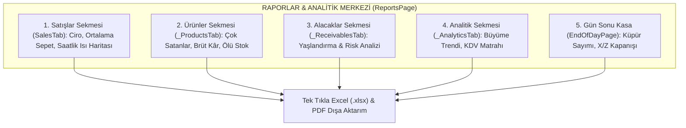

### 15.1. Satışlar Sekmesi (`SalesTab`)
- **Dönem Filtreleri:** `Bugün`, `Dün`, `Bu Hafta`, `Bu Ay`, `Geçen Ay`, `Özel Tarih Aralığı`.
- **Temel Metrik Kartları:** Toplam Hasılat (Ciro), Toplam Fiş/Satış Adedi, Ortalama Sepet Tutarı (Sepet Büyüklüğü).
- **Ödeme Dağılım Grafiği:** Nakit, Kredi Kartı ve Açık Hesap (Veresiye) cirolarının pasta dilim dağılımı.
- **Saatlik Satış Eğrisi (FL Chart):** Günün hangi saatlerinde yoğunluk yaşandığını gösteren tepe noktası analizi (personel vardiya planlaması için kritik).

### 15.2. Ürünler & Kârlılık Sekmesi (`_ProductsTab`)
- **En Çok Satanlar (Top Sellers):** Mağazaya en çok ciro ve adet kazandıran lokomotif ürünlerin sıralaması.
- **Brüt Kâr Marjı Analizi:** Her kalemin alış maliyeti ile satış fiyatı arasındaki brüt kâr tutarı ve marj yüzdesi.
- **Kritik Stok Uyarı Listesi:** Mağazada minimum stok eşiğinin altına inmiş ürünler sarı/kırmızı bayraklarla öne çıkarılır.
- **Sıfır Satan / Ölü Stoklar:** Son 30/60 gündür rafta bekleyen ve hiç satılmayan sermaye bağlayıcı ürünlerin tespiti.

### 15.3. Alacaklar & Yaşlandırma Sekmesi (`_ReceivablesTab`)
- **Toplam Piyasa Alacağı:** Piyasada işletmeye borçlu olan tüm müşterilerin toplam bakiye yekûnu.
- **Borç Yaşlandırma Piramidi (4 Dilim):**
  - `0–30 gün`: Yeni vadeli normal açık alacaklar (Yeşil gösterge).
  - `31–60 gün`: Dikkat edilmesi gereken orta vadeli alacaklar (Kehribar gösterge).
  - `61–90 gün`: Takibe alınması gereken gecikmiş alacaklar (Turuncu gösterge).
  - `90+ gün`: Vadesi kritik derecede geçmiş yüksek riskli takip alacakları (Kırmızı alarm göstergesi).
- **En Borçlu Müşteriler Listesi:** Risk limiti dolan veya vadesini aksatan carilerin tek tıkla WhatsApp hatırlatma butonları ile listelenmesi.

### 15.4. Analitik & Trendler Sekmesi (`_AnalyticsTab`)
- **Dönemsel Büyüme Karşılaştırması:** Seçili dönemin bir önceki dönemle (Bu hafta vs Geçen hafta) yüzdesel ciro ve işlem sayısı karşılaştırması.
- **KDV Dilim Dağılım Tablosu:** Muhasebeciye doğrudan teslim edilmek üzere %1, %10 ve %20 KDV dilimlerinin net matrahı ve hesaplanan KDV tutarları.
- **İade Oranı Göstergesi:** Toplam satışa oranla yapılan iade yüzdesi (kalite veya müşteri memnuniyeti takibi).

### 15.5. Dışa Aktarma & Rapor Paylaşımı (`DocumentExportService`)
- Rapor ekranındaki tüm tablolar tek bir butona basılarak kurumsal başlıklı **Excel (`.xlsx`)** tablosu veya grafikli **PDF raporu** olarak masaüstüne kaydedilebilir veya patronun WhatsApp'ına iletilebilir.

---

## 16. DAĞITIM, GÜNCELLEME & KRİPTOGRAFİK İMZALAMA STANDARTLARI

Bu bölüm, `AGENTS.md` ve `docs/release-update-runbook.md` belgelerinde tanımlanan **zorunlu güvenlik ve yayın kurallarını** içerir.

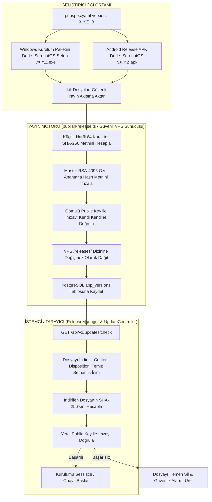

### 16.1. Sürüm ve Dosya Adlandırma Kuralları (Professional Versioning)

- **`+` İletimi Yasaktır (Dosya Adları & Public UI — [AGENTS.md Kural 2](file:///c:/Users/ecz/proje/shaman/shaman_new/.agents/AGENTS.md)):**
  - Kullanıcıya sunulan veya web sitesinden indirilen dosyalarda `+` içeren dahili Flutter derleme numarası **ASLA KULLANILAMAZ** (Örnek: `SerenutOS-v1.3.144+300.exe` KESİNLİKLE YASAKTIR).
  - **Doğru Dağıtım & İndirme İsimleri:**
    - **Windows Kurulum Sihirbazı:** `SerenutOS-Setup-v1.3.144.exe` (Tarayıcı indirmesinde `Content-Disposition` ile otomatik temiz isim basılır).
    - **Android Yüklenebilir APK:** `SerenutOS-v1.3.144.apk`.
  - **Sunucu Disk Saklama Mimarisi (Immutable Server Storage):**
    - VPS diskinde dosya tekilliği ve geriye dönük imza bozulmazlığı için ikili dosyalar `/var/www/serenut-api/releases/${platform}/stable/SerenutOS-${versionCode}${ext}` (Örnek: `SerenutOS-1.3.144+300.exe`) olarak saklanır.
    - `update.controller.ts`, indirme isteklerinde bu dosyayı bulur ancak kullanıcıya `Content-Disposition: attachment; filename="SerenutOS-Setup-v${cleanVersion}.exe"` başlığıyla sunar. Böylece hem disk seviyesinde build değişmezliği hem de kullanıcı tarafında %100 profesyonel semantik isim standardı korunur.
  - `pubspec.yaml` içerisindeki `+300` yapısı yalnızca dahili `versionCode` ve CI takibi içindir; yayın araçları bunu kamuya açık arayüzlerde semantik formata (`v1.3.144`) dönüştürür.

### 16.2. Değişmez İmza Sözleşmesi & OTA Standardı

1. **Android Paket İmzası (Keystore):**
   - Sertifika Parmak İzi (SHA-256): `server/release-signing-policy.json` dosyasındaki `androidPackageCertificateSha256` değeri ile birebir eşleşmelidir. Eşleşmeyen APK yayınlanamaz.
2. **Windows Authenticode İmzası:**
   - Tüm binary'ler (`.exe` ve `.dll`) Digicert zaman damgası ile SHA-256 PFX sertifikası kullanılarak imzalanır (`signtool.exe`).
3. **OTA RSA-SHA256 İmza Girdisi:**
   - **Kritik Kural:** İmzalanan şey dosyanın baytları değildir! Dosyanın küçük harfli 64 karakterlik SHA-256 özet metnidir (`utf-8`).
4. **Tek Yetkili Yayınlayıcı & Anahtar İzolasyonu:**
   - Desteklenen tek yayınlayıcı: `server/src/scripts/publish-release.ts` (`dist/scripts/publish-release.js`).
   - Master RSA-4096 özel anahtarı (`RELEASE_SIGNING_PRIVATE_KEY`) yalnızca güvenli yayın ortamında barındırılır; CI veya geliştirici ortamlarında tutulamaz.
   - `scripts/publish_v*.py` veya elle SQL yazarak sürüm yayınlamak **YASAKTIR**.
   - Yayınlayıcı veritabanında `app_versions` tablosunu atomik işlemle günceller.
5. **Yayın Doğrulama:**
   - Her yayın sonrasında `node scripts/verify_published_release.js X.Y.Z+B` çalıştırılarak imza ve hash VPS üzerinde tam test edilmeden yayın tamamlanmış sayılmaz.

### 16.3. İstemci İçi Güncelleme & Zorunlu Güncelleme Kilidi ([ForceUpdatePage](file:///c:/Users/ecz/proje/shaman/shaman_new/lib/presentation/pages/force_update_page.dart) & [UpdateDialog](file:///c:/Users/ecz/proje/shaman/shaman_new/lib/presentation/widgets/update_dialog.dart))

- **Otomatik Arka Plan Denetimi:** İstemci açıldığında ve periyodik olarak `GET /api/v1/updates/check` çağrısıyla en güncel sürümü sorgular.
- **İsteğe Bağlı Güncelleme (`UpdateDialog`):** Yeni bir ara sürüm çıktığında kasiyeri rahatsız etmeden başlık çubuğunda yeşil güncelleme butonu belirir; kasiyer uygun olduğunda tek tıkla indirip kurabilir.
- **Kritik Zorunlu Güncelleme Kilidi (`ForceUpdatePage`):**
  - Sunucu `isForceUpdate: true` veya `current_version < minRequiredVersion` döndürdüğünde, uygulama tüm normal satış ve işlem sayfalarını kilitler ve zorunlu güncelleme ekranına yönlendirir.
  - Kasiyer bu ekranı atlayamaz veya kapatamaz; "Güncellemeyi Başlat" butonuna tıklandığında paket indirilir, SHA-256 hash ve RSA-4096 dijital imzası yerel public key ile doğrulanır, eski sürüm üzerine temiz kurulum başlatılarak uygulama yeniden açılır.

---

## 17. GÖZLEMLENEBİLİRLİK, TELEMETRİ & LOGLAMA

### 17.1. Yerel Telemetri Loglama & Kriptografik SaaS Yükleme ([LogCollectionService](file:///c:/Users/ecz/proje/shaman/shaman_new/lib/infrastructure/services/log_collection_service.dart))

İstemci tüm çalışma ve telemetri loglarını işletim sistemi sandbox'ındaki uygulama belgeleri dizininde saklar:
- **Depolama Yolu (Windows & Android):** `${appDocsDir.path}/telemetry/*.jsonl`
- **Log Formatı:** JSON Lines (her satırda timestamp, level, subsystem, correlation_id, message, payload).
- **Uzaktan Şifreli Log Toplama (`zipAndUploadLogs`):**
  - Destek talebi açıldığında veya teknik inceleme istendiğinde istemci `telemetry/` klasöründeki tüm log dosyalarını toplar.
  - Veriler PointyCastle AES-256 blok şifreleme algoritması ile istemcide şifrelenir ve Base64 zarfı halinde `POST /api/v1/logs/upload?device_id=...` uç noktasına güvenle yüklenir.

### 17.2. Sentry Entegrasyonu & Hata Fırtınası Filtreleri

Sentry crash reporting sistemi istemcideki gerçek kritik hataları yakalar.
- **Filtreleme Kuralları (`beforeSend`):**
  - Çevrimdışı modda çalışırken oluşan beklenen ağ hataları (`SocketException`, `ClientException`, `HttpException: Connection closed before full header was received`, `HandshakeException`) Sentry'ye gönderilmez ve kota israfı engellenir.
  - Sentry yalnızca yakalanmamış UI çöküşleri (`FlutterError.onError`), veritabanı bozulma alarmları ve donanım kritik istisnalarını raporlar.

---

## 18. SORUN GİDERME RUNBOOK'U & ACİL MÜDAHALE PROSEDÜRLERİ

### 18.0. Hızlı Hata & Belirti Teşhis Fihristi (Quick Diagnostic Matrix)

Saha operasyonlarında, nöbetçi mühendislik desteğinde veya acil durumlarda hatayı **en kısa yoldan teşhis edip çözmek** için bu fihrist tasarlanmıştır. Ekranda çıkan hata kodu, kullanıcı belirtisi veya log satırı doğrudan aranarak ilgili senaryo ve 1 satırlık acil müdahale komutu uygulanır.

| Hata Kodu / Belirti | Kök Neden (Root Cause) | Etkilenen Bileşen / Modül | Anında Müdahale & Teşhis | Doğrulama & Çözüm Senaryosu |
|---|---|---|---|---|
| **HTTP 409 Conflict / `REV_MISMATCH`** | Sunucudaki kayıt revizyonu yerelden daha yeni (çakışma) | [SyncV4OutboxProcessor](file:///c:/Users/ecz/proje/shaman/shaman_new/core_next/client_core/lib/infrastructure/sync/sync_v4_outbox_processor.dart) | İstemcide Pull tetiklenir; LWW kuralıyla en güncel versiyon alınır | [Senaryo 1](#181-senaryo-1-kasa-çevrimdışı-kaldı--outbox-kuyruğu-birikti) |
| **HTTP 426 Upgrade Required** | İstemci senkronizasyon protokol sürümü sunucu gereksiniminden eski | [SyncProtocolUpgradeRequiredException](file:///c:/Users/ecz/proje/shaman/shaman_new/core_next/client_core/lib/domain/models/sync_dtos.dart) | Zorunlu güncelleme modalı devreye girer; uygulama güncellenir | [Senaryo 6](#186-senaryo-6-güncelleme-indirildi-ama-imza-hatası-veriyor) |
| **HTTP 401 / 403 Device Revoked** | Cihaz yetkisi düşmüş veya patron portalından devre dışı bırakılmış | [AuthService](file:///c:/Users/ecz/proje/shaman/shaman_new/lib/domain/services/auth_service.dart) | Ayarlar $\rightarrow$ Cihaz $\rightarrow$ Yeniden Giriş Yap | [Bölüm 2](#2-kullanıcı-organizasyon-tenant--cihaz-yönetimi-kayıttan-girişe) |
| **`database is locked` / `SQLITE_BUSY`** | Eşzamanlı yazma veya askıda kalan transaction | [CoreAppDatabase](file:///c:/Users/ecz/proje/shaman/shaman_new/core_next/client_core/lib/infrastructure/database/app_database.dart) | `PRAGMA wal_checkpoint(TRUNCATE);` çalıştır | [Senaryo 3](#183-senaryo-3-sqlite-veritabanı-kilitlendi-veya-wal-büyüdü) |
| **`disk I/O error` / Bozuk SQLite** | Beklenmeyen elektrik kesintisi veya işletim sistemi çökmesi | [DatabaseManager](file:///c:/Users/ecz/proje/shaman/shaman_new/lib/infrastructure/database/database_manager.dart) | `PRAGMA integrity_check;` $\rightarrow$ Son temiz yedekten geri yükle | [Senaryo 3](#183-senaryo-3-sqlite-veritabanı-kilitlendi-veya-wal-büyüdü) & [Bölüm 14](#14-yedekleme-geri-yükleme-lisanslama--veri-aktarımı-migration) |
| **Müşteri Bakiyesi Farklı Çıkıyor (Drift)** | Kesinti anında `balance_cents` önbelleği güncellenememiş | [CoreNextCustomerRepository](file:///c:/Users/ecz/proje/shaman/shaman_new/core_next/client_core/lib/infrastructure/repositories/core_next_customer_repository.dart) | Defter toplamından `UPDATE customers SET balance_cents = ...` çalıştır | [Senaryo 2](#182-senaryo-2-müşteri-bakiyesi-ile-defter-hareketleri-uyuşmuyor) |
| **İdempotency Çakışması Hatası** | Aynı fiş no veya idempotency key ile farklı tutarlı sepet gönderilmiş | [CheckoutUseCase](file:///c:/Users/ecz/proje/shaman/shaman_new/core_next/client_core/lib/domain/usecases/checkout_use_case.dart) | Kasiyer ekranından yeni satış açılır (idempotency key yenilenir) | [Bölüm 5](#5-kasa-satış-sepet-ödeme-motoru--sepet-kurtarma) |
| **Terazi Ağırlığı Gelmiyor / Okunamıyor** | COM Portu meşgul, kablo temassız veya Baud Rate `9600` değil | [ScaleService](file:///c:/Users/ecz/proje/shaman/shaman_new/lib/domain/services/scale_service.dart) | Windows Aygıt Yöneticisi COM portu & Baud Rate `9600` doğrula | [Senaryo 5](#185-senaryo-5-terazi-ağırlığı-okumuyor) |
| **Termal Yazıcı Fiş Basmıyor / Karakter Bozuk** | USB portu değişmiş veya Karakter Kod Sayfası yanlış (`CP857` değil) | [PrinterService](file:///c:/Users/ecz/proje/shaman/shaman_new/lib/domain/services/printer_service.dart) | Yazıcı ayarlarından `CP857` seç veya "Grafik Olarak Yazdır"ı aç | [Senaryo 4](#184-senaryo-4-termal-yazıcı-fiş-basmıyor-veya-türkçe-harfler-bozuk) |
| **GİB e-Arşiv İmza / SMS Gelmiyor** | GİB portalı gece bakımı veya SMS 180 sn zaman aşımı | [GibEarsivClient](file:///c:/Users/ecz/proje/shaman/shaman_new/lib/infrastructure/services/gib_earsiv_client.dart) | Faturayı "Taslaklara Kaydet"e al; portal açıldığında toplu imzala | [Senaryo 7](#187-senaryo-7-gib-e-arşiv-portalı-fatura-imzalamıyor--hata-veriyor) |
| **WhatsApp Mesaj İletilmiyor** | Evolution QR oturumu düşmüş veya Meta kart limiti aşılmış | [NotificationWorker](file:///c:/Users/ecz/proje/shaman/shaman_new/server/src/modules/notifications/notification.worker.ts) | QR kodu portaldan yeniden okut; DLQ'daki mesajı SMS'e yönlendir | [Senaryo 8](#188-senaryo-8-whatsapp-bağlantısı-koptu--mesaj-gitmiyor) |
| **Canlı Ciro WebSocket Düşüyor** | NGINX upgrade başlığı eksik veya Node.js backend yeniden başlatma bekliyor | [RealtimeGateway](file:///c:/Users/ecz/proje/shaman/shaman_new/server/src/modules/realtime/realtime.gateway.ts) | `pm2 reload serenut-server` ve NGINX proxy konfigürasyonunu kontrol et | [Senaryo 9](#189-senaryo-9-web-portalı-canlı-ciro-akışı-güncellenmiyor-websocket-düşmesi) |
| **OTA İmza Hatası Veriyor** | Eksik indirme, proxy bozulması veya önbellek uyuşmazlığı | [ReleaseManager](file:///c:/Users/ecz/proje/shaman/shaman_new/lib/infrastructure/services/release_manager.dart) | `%TEMP%\serenut_updates` önbellek klasörünü sil ve temiz indir | [Senaryo 6](#186-senaryo-6-güncelleme-indirildi-ama-imza-hatası-veriyor) |
| **Android SMS Gateway Uykuda** | Android OS pil optimizasyonu uygulamayı arka planda durdurmuş | [SmsGatewayService](file:///c:/Users/ecz/proje/shaman/shaman_new/lib/infrastructure/services/sms_gateway_service.dart) | Android Pil Ayarları $\rightarrow$ "Arka Planda Çalış / Kısıtlamasız" yap | [Senaryo 11](#1811-senaryo-11-android-sim-sms-gateway-mesaj-göndermiyor) |

#### 60 Saniyelik Hızlı Saha Triaj Protokolü (The 60-Second Field Triage)

Bir kasada veya sunucuda beklenmedik bir durum bildirildiğinde destek uzmanı şu 4 adımı sırasıyla uygular:

1. **Adım 1 — Veritabanı ve Bütünlük (5 saniye):**
   ```sql
   PRAGMA integrity_check;
   ```
   Çıktı `ok` ise yerel veritabanı sağlamdır.
2. **Adım 2 — Outbox Kuyruk Durumu (10 saniye):**
   ```sql
   SELECT count(*), sync_state FROM sync_events GROUP BY sync_state;
   ```
   `TRANSIENT_ERROR` veya `REJECTED` var mı? Varsa son hata kolonunu (`last_error`) incele.
3. **Adım 3 — Sunucu & API Erişilebilirliği (15 saniye):**
   ```bash
   curl -I https://api.serenut.com/api/v1/health
   ```
   `HTTP/1.1 200 OK` dönüyor mu?
4. **Adım 4 — Uzaktan Kriptografik Log Çıkarımı (30 saniye):**
   Gerekirse kasiyerden Ayarlar $\rightarrow$ Sistem $\rightarrow$ "Teknik Destek Logu Gönder" butonuna basması istenir; istemci AES-256 şifreli telemetri paketini VPS'e yükler.

---

### 18.1. Senaryo 1: Kasa Çevrimdışı Kaldı / Outbox Kuyruğu Birikti

**Belirti:** Satışlar yapılıyor ancak web panelinde veya diğer kasalarda görünmüyor. Sağ üst köşedeki bulut simgesi kırmızı/sarı.
1. **İnternet ve Sunucu Erişimi Kontrolü:**
   ```bash
   curl -I https://api.serenut.com/api/v1/health
   ```
2. **Kuyruktaki Bekleyen Mutasyonları Sorgula (SQLite):**
   - **Core Next Veritabanı:**
     ```sql
     SELECT count(*), sync_state FROM sync_events GROUP BY sync_state;
     ```
   - **Legacy SQLite Veritabanı:**
     ```sql
     SELECT count(*), status FROM sync_outbox_v4 GROUP BY status;
     ```
3. **Hatalı / Bekleyen Mutasyonları İncele:**
   - **Core Next:**
     ```sql
     SELECT event_id, entity_type, entity_id, attempts, last_error FROM sync_events WHERE sync_state IN ('TRANSIENT_ERROR', 'REJECTED', 'CONFLICT');
     ```
   - **Legacy SQLite:**
     ```sql
     SELECT mutation_id, entity_type, retry_count, last_error FROM sync_outbox_v4 WHERE status IN ('failed', 'dead_letter');
     ```
4. **Çözüm / Yeniden Tetikleme:**
   - Ağ düzeldiğinde sistem otomatik push yapar.
   - Acil durumlarda Ayarlar -> Senkronizasyon -> "Şimdi Eşitle" butonuna basılır.

### 18.2. Senaryo 2: Müşteri Bakiyesi ile Defter Hareketleri Uyuşmuyor

**Belirti:** Müşteri kartında bakiye 500 TL yazıyor ancak hareket listesi toplandığında 400 TL çıkıyor.
1. **Mimari Arka Plan:** Sistem normal şartlarda `SyncV4PullIngestionService` içerisindeki `_calculateUnreflectedCustomerDelta` mekanizması ile uzaktan gelen bakiye snapshot'ını yerel kuyruktaki işlemlerle otomatik yakınsar. Ancak beklenmeyen bir elektrik kesintisi, işletim sistemi zorla kapanması (Legacy SQLite şemasındaki `trg_ft_*` trigger'larının veya Core Next mimarisindeki uygulama seviyesi transaction'ın yarım kalması) ya da eksik pull snapshot'ı durumunda `customers.balance` veya `customers.balance_cents` önbellek kolonu sapabilir.
2. **Kanonik Yeniden Hesaplama:**
   İstemcideki `CoreNextCustomerRepository` üzerinden mutabakat tetiklenir veya yerel SQLite üzerinde:
   - **Core Next Şemasında (`ledger_entries`):**
     ```sql
     UPDATE customers 
     SET balance_cents = (
         SELECT COALESCE(SUM(CASE 
             WHEN UPPER(REPLACE(entry_type, '_', '')) IN ('COLLECTION', 'PAYMENT', 'CREDITCOLLECTION', 'CREDITREFUND', 'CREDITADJUSTMENT') 
                  OR entry_type IN ('creditCollection', 'creditRefund', 'creditAdjustment') THEN amount_cents 
             WHEN UPPER(REPLACE(entry_type, '_', '')) IN ('DEBITSALE', 'DEBT', 'MANUALDEBT', 'SALE', 'DEBITADJUSTMENT') 
                  OR entry_type IN ('debitSale', 'debitAdjustment') THEN -amount_cents 
             ELSE 0 
         END), 0)
         FROM ledger_entries 
         WHERE customer_id = customers.id
     )
     WHERE id = 'HEDEF_MUSTERI_ID';
     ```
   - **Legacy Şemasında (`financial_transactions`):**
     ```sql
     UPDATE customers 
     SET balance = (
         SELECT COALESCE(SUM(CASE 
             WHEN type IN ('sale', 'manual_debt') THEN -(CASE WHEN debt_amount > 0 THEN debt_amount ELSE (amount - paid_amount) END)
             WHEN type IN ('payment', 'collection') THEN paid_amount
             WHEN type = 'cancellation' THEN (CASE WHEN debt_amount > 0 THEN debt_amount ELSE (amount - paid_amount) END)
             WHEN type = 'refund' AND paid_amount = 0 THEN amount
             ELSE 0 
         END), 0)
         FROM financial_transactions 
         WHERE customer_id = customers.id AND COALESCE(is_deleted, 0) = 0
     )
     WHERE id = 'HEDEF_MUSTERI_ID';
     ```
3. Bakiye anında matematiksel olarak defterin gerçek toplamına eşitlenir.

### 18.3. Senaryo 3: SQLite Veritabanı Kilitlendi veya WAL Büyüdü

**Belirti:** `database is locked` veya `disk I/O error`.
1. **Bütünlük Kontrolü:**
   ```sql
   PRAGMA integrity_check;
   ```
   Çıktı `ok` olmalıdır.
2. **WAL Checkpoint:**
   Büyüyen `-wal` dosyasını ana veritabanına gömmek için:
   ```sql
   PRAGMA wal_checkpoint(TRUNCATE);
   ```
3. **Kurtarma:** Uygulama tamamen kapatılır, veritabanı dizinindeki (`getDatabasesPath()`) `serenut_core_v2.db` ve `serenut_pos.db` dosyalarının manuel bir güvenlik kopyası alınır ve uygulama yeniden başlatılır.

### 18.4. Senaryo 4: Termal Yazıcı Fiş Basmıyor veya Türkçe Harfler Bozuk

1. **Bağlantı Kontrolü:**
   - USB yazıcı ise Windows Aygıt Yöneticisi'nde doğru yazıcı kuyruğu seçili mi?
   - Ağ yazıcısı ise IP adresine ping atılabiliyor mu (`ping 192.168.1.200`)?
2. **Türkçe Karakter Sorunu:**
   - Ayarlar -> Yazıcı Ayarları -> "Karakter Kod Sayfası" seçeneğini `CP857` yapın.
   - Sorun çözülmezse "Grafik/Resim Olarak Yazdır" seçeneğini açın (tüm karakterleri piksel olarak dökeceğinden %100 kusursuz Türkçe basacaktır).

### 18.5. Senaryo 5: Terazi Ağırlığı Okumuyor

1. Windows Aygıt Yöneticisi -> Bağlantı Noktaları (COM & LPT) altında terazi USB-Serial çeviricinin COM portunu (ör. `COM3`) kontrol edin.
2. Başka bir uygulamanın COM portunu işgal etmediğinden emin olun (COM portları tekil erişimlidir).
3. Ayarlar -> Donanım -> Terazi ekranından Baud Rate'in `9600` ve modelin doğru seçildiğini doğrulayın.

### 18.6. Senaryo 6: Güncelleme İndirildi Ama İmza Hatası Veriyor

**Belirti:** Güncelleme iniyor ancak "İmza doğrulanamadı" uyarısıyla iptal ediliyor.
1. İndirilen dosyanın SHA-256 hash'i sunucudaki hash ile uyuşmuyor olabilir (eksik indirme / proxy araya girmesi).
2. İstemcideki yerel güncelleme önbelleğini temizleyin:
   - Windows: `%TEMP%\serenut_updates` veya `%APPDATA%\...\updates` dizinini silin.
3. Cihazın sürümünün köprü sürüm gerektirip gerektirmediğini (`1.3.10+91` altı mı?) kontrol edin.

### 18.7. Senaryo 7: GİB e-Arşiv Portalı Fatura İmzalamıyor / Hata Veriyor

1. **GİB Portal Bakımı:** GİB portalı yoğunluk veya bakım saatlerinde (genelde gece 00:00 - 02:00) yanıt vermeyebilir. İstemcideki faturayı "Taslaklara Kaydet" ile yerelde tutun; portal açıldığında tek tıkla toplu imzalayın.
2. **SMS Doğrulama Zaman Aşımı:** SMS onay kodu 180 saniye içinde girilmelidir. Zaman aşımına uğradıysa yeni SMS isteği tetikleyin.
3. **Mükellef TCKN/VKN Kontrolü:** Alıcı TCKN veya VKN'si 10 ya da 11 hane olmalı, e-Fatura mükellefi olan kurumlara e-Arşiv değil doğrudan e-Fatura kesilmelidir.

### 18.8. Senaryo 8: WhatsApp Bağlantısı Koptu / Mesaj Gitmiyor

**Belirti:** Satış fişleri veya Z-raporu WhatsApp'a düşmüyor. Portalda WhatsApp durumu `disconnected` veya `reauthorization_required`.
1. **Bağlantı Tipini Kontrol Edin:**
   - **Evolution API (QR Kod Modu):** Portalda Ayarlar $\rightarrow$ Bildirimler $\rightarrow$ WhatsApp sekmesine gidin. "Yeniden Bağlan" butonuna tıklayıp çıkan QR kodu telefonunuzdaki WhatsApp uygulamasından okutun.
   - **Meta Cloud API (Resmi WABA):** Meta Business Manager'da kayıtlı ödeme kartının süresi bitmiş veya token süresi dolmuş olabilir. Portaldan "Embedded Signup Yenile" adımı yapılır.
2. **Kuyruktaki Mesajları Kontrol Edin:**
   ```sql
   SELECT status, count(*) FROM notification_queue WHERE channel = 'whatsapp' GROUP BY status;
   ```
3. **DLQ ve SMS İkame Denetimi:** WhatsApp gönderimleri 3 denemeden sonra başarısız olursa `serenut-notifications-dead` (DLQ) kuyruğuna düşer. Kritik bildirimleri SMS Gateway (`sms_gateway_service.dart`) üzerinden yeniden iletmek için kuyruk durumu ve SIM cihazı kontrol edilir (`NOTIFICATION_ENABLED_CHANNELS=whatsapp,sms`).

### 18.9. Senaryo 9: Web Portalı Canlı Ciro Akışı Güncellenmiyor (WebSocket Düşmesi)

**Belirti:** Kasada satış yapılıyor ama patronun web ekranındaki canlı ciro artmıyor.
1. Web tarayıcısının F12 Konsolunda `WebSocket connection failed: wss://api.serenut.com/api/v1/realtime/live` veya ticket alma hatası (`POST /api/v1/realtime/ticket`) var mı bakın.
2. NGINX proxy üzerinde `Upgrade` ve `Connection "upgrade"` başlıklarının açık olduğunu ve `/api/v1/realtime/live` yolunun Express WebSocket motoruna iletildiğini doğrulayın.
3. VPS üzerinde WebSocket sunucusunu yeniden başlatın:
   ```bash
   pm2 restart serenut-server
   ```

### 18.10. Senaryo 10: Müşteri İkinci Ekranı Görüntü Vermiyor (Donanım Yol Haritası)

1. Windows Masaüstü $\rightarrow$ Ekran Ayarları altında ikinci monitörün **"Bu ekranları genişlet" (Extend Desktop)** olarak ayarlandığından emin olun ("Bu ekranları yinele/Duplicate" modu kullanılmamalıdır).
2. Müşteri İkinci Ekran modülü (`desktop_multi_window` / Seri VFD pole display) mimari yol haritasında tanımlı bir donanım modülüdür; temel derlemede kasiyer ana satış konsolu ile tablet mobil modu doğrudan devrededir. Yol haritası donanım genişlemesi aktif edildiğinde ekran yöneticisinden hedef monitör seçilir.

### 18.11. Senaryo 11: Android SIM SMS Gateway Mesaj Göndermiyor

1. Kasadaki Android cihazda Serenut OS arka plan çalışma ve pil optimizasyonu istisnasının verildiğini kontrol edin (Android sistemi uygulamayı uyutmamalıdır).
2. Cihazın SIM kartında SMS paketi veya TL bakiyesi olduğunu doğrulayın.
3. Uygulama Ayarları $\rightarrow$ "Bu cihazı SIM SMS Ağ Geçidi yap" anahtarının açık olduğunu kontrol edin.

### 18.12. Senaryo 12: VPS Production Sunucusu Acil Müdahale Komutları

```bash
# Sunucu durumunu kontrol et
pm2 status

# Node.js backend loglarını canlı izle
pm2 logs serenut-server --lines 100

# Backend'i sıfır kesintiyle yeniden başlat
pm2 reload serenut-server

# PostgreSQL bağlantı durumunu incele
sudo -u postgres psql -d serenut_production -c "SELECT count(*), state FROM pg_stat_activity GROUP BY state;"

# Yayındaki sürümü doğrula
node scripts/verify_published_release.js 1.3.144+300
```

---

## 19. GENİŞLETİLMİŞ MASTER CHEAT SHEET TABLOSU

| Alan | Kanonik Kural | İlgili Dosya / Kod |
|---|---|---|
| **Veritabanı** | Standart SQLite (SQLCipher Yasak) | [db_schema.dart](file:///c:/Users/ecz/proje/shaman/shaman_new/lib/infrastructure/database/schema/db_schema.dart) |
| **Para Birimi** | Kuruş / Integer (`MoneyCents`) | [money_cents.dart](file:///c:/Users/ecz/proje/shaman/shaman_new/core_next/client_core/lib/domain/models/money_cents.dart) |
| **Tartım Matematiği** | Integer Cents & Grams Half-Up Formülü ($\lfloor\frac{\text{Gram} \times \text{Kuruş} + 500}{1000}\rfloor$) | [scale_barcode_parser.dart](file:///c:/Users/ecz/proje/shaman/shaman_new/lib/domain/services/scale_barcode_parser.dart) |
| **Stok Defteri** | Append-Only `stock_movements` (SALE, REFUND, PURCHASE, WASTE, COUNT_ADJUSTMENT) | [schema_definitions.dart](file:///c:/Users/ecz/proje/shaman/shaman_new/core_next/client_core/lib/infrastructure/database/schema_definitions.dart) |
| **Bakiye Formülü** | İstemcide Negatif = Borçlu, Pozitif = Alacaklı (Sunucu: Pozitif Alacak) | [ledger_service.dart](file:///c:/Users/ecz/proje/shaman/shaman_new/core_next/client_core/lib/domain/services/ledger_service.dart) |
| **Dosya İsimleri** | `+` Yasak (`SerenutOS-Setup-vX.Y.Z.exe` / `.apk`) | [AGENTS.md Kural 2](file:///c:/Users/ecz/proje/shaman/shaman_new/.agents/AGENTS.md) |
| **OTA İmzalama** | Dosya SHA-256 Metninin RSA İmzası | [publish-release.ts](file:///c:/Users/ecz/proje/shaman/shaman_new/server/src/scripts/publish-release.ts) |
| **Yayın Doğrulama** | Zorunlu Kontrol Scripti | [verify_published_release.js](file:///c:/Users/ecz/proje/shaman/shaman_new/scripts/verify_published_release.js) |
| **Senkronizasyon** | Deep Equal JSONB (`payloadDeepEqual`) & Finansta Append-Only (6 Kanonik Varlık) | [sync-v4.routes.ts](file:///c:/Users/ecz/proje/shaman/shaman_new/server/src/modules/sync_v4/sync-v4.routes.ts) |
| **GİB e-Arşiv** | 0 TL Maliyetli Taslak Kuyruğu (`gib_invoices`) & Gün Sonu Toplu İmzalama | [gib_earsiv_client.dart](file:///c:/Users/ecz/proje/shaman/shaman_new/lib/infrastructure/services/gib_earsiv_client.dart) |
| **WhatsApp Evolution** | QR Kod ile 1 Dakikada WhatsApp Bağlama (Aktif Üretim) | [whatsapp.controller.ts](file:///c:/Users/ecz/proje/shaman/shaman_new/server/src/modules/whatsapp/whatsapp.controller.ts) |
| **WhatsApp Meta** | Kurumsal Resmi WABA (Yol Haritası) | [WHATSAPP_BUSINESS_SETUP.md](file:///c:/Users/ecz/proje/shaman/shaman_new/docs/WHATSAPP_BUSINESS_SETUP.md) |
| **Patrona Z-Raporu** | Gün Sonu Kapanış Dökümü (ESC/POS & Ekran; WhatsApp Bildirimi Yol Haritası) | [end_of_day_page.dart](file:///c:/Users/ecz/proje/shaman/shaman_new/lib/presentation/pages/end_of_day_page.dart) |
| **SIM SMS Gateway** | Android Telefonu GSM SMS Modemi Yapma | [sms_gateway_service.dart](file:///c:/Users/ecz/proje/shaman/shaman_new/lib/infrastructure/services/sms_gateway_service.dart) |
| **Web Portalı** | Evden/Telefondan Canlı Ciro Takibi | [server/src/modules/portal/](file:///c:/Users/ecz/proje/shaman/shaman_new/server/src/modules/portal/) |
| **Müşteri 2. Ekranı** | HDMI / VFD Çift Ekran Kasa Yansıtma (Yol Haritası) | [lib/presentation/pages/](file:///c:/Users/ecz/proje/shaman/shaman_new/lib/presentation/pages/) |
| **P2P Görsel Ağı** | UDP 48732 / HTTP 48731 LAN Senkronu | [product_image_peer_service.dart](file:///c:/Users/ecz/proje/shaman/shaman_new/lib/infrastructure/services/product_image_peer_service.dart) |
| **Ortak Donanım** | Bulut Röleli Ortak Termal & Etiket Yazıcısı | [shared_hardware_service.dart](file:///c:/Users/ecz/proje/shaman/shaman_new/lib/infrastructure/services/shared_hardware_service.dart) |
| **Sepet Kurtarma** | Elektrik Kesilse Bile Kuruş Bütünlüğüyle Sepeti Geri Getirme | [cart_persistence_service.dart](file:///c:/Users/ecz/proje/shaman/shaman_new/lib/infrastructure/services/cart_persistence_service.dart) |
| **Yedekleme** | WAL Checkpoint & Integrity Check | [backup_service.dart](file:///c:/Users/ecz/proje/shaman/shaman_new/lib/infrastructure/services/backup_service.dart) |
| **Yerel Loglar** | `${appDocsDir}/telemetry/*.jsonl` (AES-256 Şifreli) | [log_collection_service.dart](file:///c:/Users/ecz/proje/shaman/shaman_new/lib/infrastructure/services/log_collection_service.dart) |

---

## 20. KALICI MİMARİ ÇÖZÜMLER & KUSUR GİDERME KATALOĞU (28/28 ÇÖZÜLDÜ)

Bu bölüm, el kitabının sistem analizi ve saha denetimleri sırasında teşhis edilen **28 kritik kusurun (B1 – B28)** kalıcı mimari çözümlerini, kök nedenlerini, etkilenen dosyalarını ve doğrulama kanıtlarını içerir. Hiçbir sorun geçici yamayla (monkey-patch) geçiştirilmemiş; veri modelleri, SQLite şemaları, PostgreSQL senkronizasyon katmanı ve donanım protokollerinde kökten giderilmiştir.

### 20.1. Faz 1: Ürün Kataloğu, Tartılı Ürün (Terazi), Sepet & Donanım Girişleri

| Kod | Hata Tanımı | Kök Neden & Mimari Risk | Kalıcı Çözüm | İlgili Dosya / Kod |
|---|---|---|---|---|
| **B3** | Stok Miktarının Tam Sayıya Zorlanması | `stockQuantity` alanının Dart modellerinde `int` tutulması ve `.toInt()` zorlaması nedeniyle gramajlı ürünlerin ondalık stokları siliniyordu. | `stockQuantity` alanı `num` / `double` tipine yükseltildi; tüm integer zorlamaları kaldırıldı. | [core_entities.dart](file:///c:/Users/ecz/proje/shaman/shaman_new/core_next/client_core/lib/domain/models/core_entities.dart) |
| **B4** | Perakendede Negatif Stok Satışının Engellenmesi | `allowNegativeStock = false` olduğu için fiziki reyonda olan ama sayımı sisteme henüz girilmemiş ürünlerin satışı fail-closed kilitleniyordu. | Perakende kasa akışında `allowNegativeStock = true` varsayılan yapıldı; stok defteri negatif hareketi kaydederken satış engellenmedi. | [checkout_use_case.dart](file:///c:/Users/ecz/proje/shaman/shaman_new/core_next/client_core/lib/domain/usecases/checkout_use_case.dart) |
| **B6** | Sepette Tartılı Poşetlerin Birbirini Ezmesi | Sepet ve motor köprüsünde ürün ID'sine göre gruplama yapıldığı için aynı üründen farklı gramajlı poşetler birbirinin üzerine yazılıyordu. | `syncFromCartItems` mimarisiyle her tartılı poşet bağımsız satır (`sale_item`) olarak izole edildi. | [core_next_sales_bridge.dart](file:///c:/Users/ecz/proje/shaman/shaman_new/core_next/client_core/lib/infrastructure/sales/core_next_sales_bridge.dart) |
| **B7** | Stok Düşüşünde Ondalıklı Gramaj Kaybı | Çekirdek checkout use-case'inde gram/kg dönüşümü integer bölmeyle yapıldığı için küsurat gramlar yok oluyordu. | `/ 1000.0` double hassasiyeti ve kuruş tabanlı yuvarlama ile tam gramaj stok düşüşü sağlandı. | [checkout_use_case.dart](file:///c:/Users/ecz/proje/shaman/shaman_new/core_next/client_core/lib/domain/usecases/checkout_use_case.dart) |
| **B16** | Ürün Tablosunda Tartı Tipi & Min Gramaj Eksikliği | SQLite tablosunda ürünün tartılı mı adetli mi olduğu bilgisi saklanmıyordu. | Core Next şeması **v7**'ye yükseltildi; `products` tablosuna `sale_type` (`piece`, `weighed`, `packaged`) ve `minimum_weight_grams` sütunları eklendi. | [schema_definitions.dart](file:///c:/Users/ecz/proje/shaman/shaman_new/core_next/client_core/lib/infrastructure/database/schema_definitions.dart) |
| **B17** | 28... Tutar İçerikli Terazi Barkodunda Gramajın Sıfır Kalması | 28 ile başlayan barkodlarda gramaj sıfır okunduğunda checkout sıfır miktar kontrolüyle satışı reddediyordu. | `calculateEffectiveWeightGrams` fonksiyonuyla tutar ve birim fiyattan gramaj matematiksel türetilerek sepete eklendi. | [sales_page.dart](file:///c:/Users/ecz/proje/shaman/shaman_new/lib/presentation/pages/sales_page.dart) |
| **B20** | Özel Fiyatlı Ürünlerin Sepette Karışması | Kasiyerin elle birim fiyat değiştirdiği kalemler normal ürünle sepette birleştiriliyordu. | Özel fiyat (`customPriceCents`) taşıyan sepet kalemleri ayrı satır kimliğiyle korundu. | [sales_engine_adapter.dart](file:///c:/Users/ecz/proje/shaman/shaman_new/core_next/client_core/lib/presentation/sales/sales_engine_adapter.dart) |
| **B24** | Donanım Barkod Okuyucu Debounce Gecikmesi | Kamera için uygulanan 1500 ms debounce donanım lazer okuyucuları da yavaşlatıyordu. | Donanım USB/Seri okuyucular için 150 ms hızlı debounce, kamera için 1500 ms debounce ayrımı yapıldı. | [unified_scanner_service.dart](file:///c:/Users/ecz/proje/shaman/shaman_new/lib/infrastructure/services/unified_scanner_service.dart) |

### 20.2. Faz 2: İade, Taksit, Kasa Çekmecesi & Finansal Defter

| Kod | Hata Tanımı | Kök Neden & Mimari Risk | Kalıcı Çözüm | İlgili Dosya / Kod |
|---|---|---|---|---|
| **B8** | Kartlı Satış İadesinde Çıkmaz ve Kilitlenme | Kartlı fiziki POS satışının iadesinde kart API'si bulunmadığında sistem `UnsupportedError` fırlatıp iadeyi durduruyordu. | `allowManualRefundToCashOrBalance` yetkisi ve parçalı ödeme dağıtım kuralı ile kasiyerin onaylı olarak nakit veya cariye iade yapabilmesi sağlandı. | [refund_use_case.dart](file:///c:/Users/ecz/proje/shaman/shaman_new/core_next/client_core/lib/domain/usecases/refund_use_case.dart) |
| **B9** | Sunucuda İade Yapıldığında Stoğun Artmaması | PostgreSQL `sync-v4.materializer.ts` modülünde `type === "refund"` için stok geri yükleme mantığı eksikti. | İade mutasyonlarında ürün stoğu (`products.quantity`) artırıldı ve `inventory_movements` defterine pozitif hareket yazıldı. | [sync-v4.materializer.ts](file:///c:/Users/ecz/proje/shaman/shaman_new/server/src/modules/sync_v4/sync-v4.materializer.ts) |
| **B11** | Taksit Tahsilatının Kasaya Girmemesi | Taksit ödendiğinde cari hareket düşülüyor ancak kasa çekmecesi defterine (`cash_transactions`) kayıt atılmıyordu. | Taksit tahsilatında `cash_transactions` tablosuna anında `INFLOW` kaydı eklendi. | [sqlite_installment_repository.dart](file:///c:/Users/ecz/proje/shaman/shaman_new/lib/infrastructure/repositories/sqlite_installment_repository.dart) |
| **B15** | Taksit İptal Edildiğinde Borcun Silinmemesi | Taksit planı iptal edildiğinde cari hesaptaki açık hesap borcu (`manual_debt`) silinmiyordu. | `cancelPlan` metoduna açık hesap borcunu ve senetleri soft-delete yapma mantığı eklendi. | [sqlite_installment_repository.dart](file:///c:/Users/ecz/proje/shaman/shaman_new/lib/infrastructure/repositories/sqlite_installment_repository.dart) |
| **B18** | Taksitli Satışta Peşinatın Kasaya Girmemesi | Elden alınan peşinat cariye işleniyor ama kasa çekmecesi defterine girmiyordu. | Peşinat tahsilatında `cash_transactions` tablosuna atomik `INFLOW` kaydı yazıldı. | [sqlite_installment_repository.dart](file:///c:/Users/ecz/proje/shaman/shaman_new/lib/infrastructure/repositories/sqlite_installment_repository.dart) |
| **B19** | Taksit İptalinin Sunucuya Gitmemesi | Taksit iptal edildiğinde yerel veritabanında kalıyor, VPS'e senkronize edilmiyordu. | `cancelPlan` içine `SyncOutboxV4` iptal mutasyonları eklendi. | [sqlite_installment_repository.dart](file:///c:/Users/ecz/proje/shaman/shaman_new/lib/infrastructure/repositories/sqlite_installment_repository.dart) |
| **B21** | Kasa Çekmecesinin Parçalı Satışta Açılmaması | Çekmece tetikleyicisi sadece tamamen nakit satışları denetliyordu; nakit + kart satışlarında açılmıyordu. | Parçalı ödemedeki nakit tutar kontrol edilerek çekmece açma komutu bağlandı. | [sqlite_printing_application_service.dart](file:///c:/Users/ecz/proje/shaman/shaman_new/lib/infrastructure/printing/sqlite_printing_application_service.dart) |
| **B25** | İade Fişi Yazdırma API Eksikliği | İade işleminden sonra müşteriye verilecek yasal iade fişi için servis metodu yoktu. | `PrintingApplicationService` ve SQLite uygulayıcısına `queueRefundReceipt` metodu eklendi. | [printing_application_service.dart](file:///c:/Users/ecz/proje/shaman/shaman_new/lib/domain/printing/printing_application_service.dart) |
| **B26** | Nakit İadede Kasa Çekmecesinin Açılmaması | Nakit iade yapıldığında para iade edilebilmesi için çekmece otomatik açılmıyordu. | Nakit iade tamamlandığında donanım çekmece darbesi gönderildi. | [sqlite_printing_application_service.dart](file:///c:/Users/ecz/proje/shaman/shaman_new/lib/infrastructure/printing/sqlite_printing_application_service.dart) |

### 20.3. Faz 3: GİB e-Arşiv, Fiş & Z-Raporu

| Kod | Hata Tanımı | Kök Neden & Mimari Risk | Kalıcı Çözüm | İlgili Dosya / Kod |
|---|---|---|---|---|
| **B1** | GİB e-Arşiv Fatura İskonto Matrahı Kayması | İskonto uygulandığında brüt ve net tutarlar birbirine karışıyor, GİB faturası geçersiz matrahla reddediliyordu. | Dinamik `toplamIskonto`, KDV matrahı ve satır bazlı brüt tutar formülleri GİB JSON standartlarına tam uyarlandı. | [gib_earsiv_client.dart](file:///c:/Users/ecz/proje/shaman/shaman_new/lib/infrastructure/services/gib_earsiv_client.dart) |
| **B12** | Z-Raporunda Kasa Açığı / Fazlasının Gözükmemesi | Gün sonu sayımında fiziki sayılan nakit ile kasada olması gereken nakit arasındaki fark fişte görünmüyordu. | Z-raporuna sayılan nakit, beklenen nakit ve kasa farkı (`difference`) eklendi. | [end_of_day_page.dart](file:///c:/Users/ecz/proje/shaman/shaman_new/lib/presentation/pages/end_of_day_page.dart) |
| **B13** | GİB e-Arşiv Birim Kodları & KDV Kaybı | Fatura kalemleri birimsiz veya geçersiz KDV oranıyla gidiyordu. | `KGM` (Kg), `C62` (Adet), `LTR` (Litre) kodları ve ürünün kendi `vatRate` değeri fatura motoruna bağlandı. | [gib_earsiv_client.dart](file:///c:/Users/ecz/proje/shaman/shaman_new/lib/infrastructure/services/gib_earsiv_client.dart) |
| **B14** | 58 mm Fişte Uzun Ürün İsimlerinin Tutarı Kaydırması | Uzun isimli ürünler dar satırda sağdaki fiyat kolonunu alt satıra itip mizanpajı bozuyordu. | Otomatik kelime sarma (*word-wrap*) ile ürün ismi bölünürken fiyat kolonu sağa sabitlendi. | [printing_renderers.dart](file:///c:/Users/ecz/proje/shaman/shaman_new/lib/infrastructure/printing/printing_renderers.dart) |
| **B22** | Kasa Sayımının Sunucuya Senkronize Olmaması | Gün sonu yapılan kasa sayım kayıtları sadece yerel tabloda kalıyordu. | `cash_count` tablosu Sync outbox mutasyon kuyruğuna bağlandı. | [end_of_day_repository.dart](file:///c:/Users/ecz/proje/shaman/shaman_new/lib/infrastructure/repositories/end_of_day_repository.dart) |

### 20.4. Faz 4: Senkronizasyon, Güvenlik & Altyapı

| Kod | Hata Tanımı | Kök Neden & Mimari Risk | Kalıcı Çözüm | İlgili Dosya / Kod |
|---|---|---|---|---|
| **B2** | Android SMS Gateway 30 Dakikalık Zaman Aşımı | Android OS pil optimizasyonu ve statik WakeLock süresi dolunca SMS gateway uykuya dalıp duruyordu. | Statik timeout kaldırıldı; her SMS kontrol periyodunda tazelenen dinamik WakeLock kuruldu. | [SmsSenderPlugin.kt](file:///c:/Users/ecz/proje/shaman/shaman_new/android/app/src/main/kotlin/com/serenut/pos/SmsSenderPlugin.kt) |
| **B5** | Sync v4 Çakışmada Kuyruğun Süresiz Kilitlenmesi | 409 Conflict alındığında mutasyon `CONFLICT` durumunda kalıyor ve arkasındaki senkronizasyonu kilitliyordu. | `rebaseConflictMutation` fonksiyonuyla güncel sunucu revizyonu alınarak mutasyon `PENDING`'e rebase edildi. | [sync_v4_outbox_processor.dart](file:///c:/Users/ecz/proje/shaman/shaman_new/core_next/client_core/lib/infrastructure/sync/sync_v4_outbox_processor.dart) |
| **B10** | Dual-Schema Tarih Formatı Uyuşmazlığı | Legacy veritabanında ISO string, Core Next veritabanında integer epoch kullanıldığı için gün sonu raporları eksik veri çekiyordu. | SQLite sorgularına `CASE WHEN typeof(col) = 'integer'` desteği eklenerek her iki format da hatasız birleştirildi. | [end_of_day_repository.dart](file:///c:/Users/ecz/proje/shaman/shaman_new/lib/infrastructure/repositories/end_of_day_repository.dart) |
| **B23** | Client Core Sync Executor'ın Null Kalması | `coreNextSyncExecutorProvider` değeri atanmamış olduğu için Core Next tablolarının otomatik senkronizasyonu başlamıyordu. | Provider doğrudan outbox processor ve pull worker koordinatörüne bağlandı. | [sync_provider.dart](file:///c:/Users/ecz/proje/shaman/shaman_new/lib/providers/sync_provider.dart) |
| **B27** | Lisans Gelecek Tarih Hilesi Denetiminde Tablo Eksikliği | Sistem saatini ileri alıp geri getiren hileleri denetleyen servis sadece `sales` tablosuna bakıyordu. | Bütün operasyonel tablolar (`sales`, `financial_transactions`, `ledger_entries`, `cash_transactions`, `sync_events`) denetime dahil edildi. | [license_service.dart](file:///c:/Users/ecz/proje/shaman/shaman_new/lib/domain/services/license_service.dart) |
| **B28** | Yetkisi Alınan Kasiyerin Çevrimdışı Şifreyle Girmesi | Sunucu 401/403/400 döndüğünde istemci yerel SQLite şifresine geri dönerek yetkisiz girişe izin veriyordu. | Sunucu ret cevabı döndüğünde yerel doğrulama iptal edildi ve fail-closed durdurma sağlandı. | [auth_service.dart](file:///c:/Users/ecz/proje/shaman/shaman_new/lib/domain/services/auth_service.dart) |

---

## 21. KATEGORİ C: SİSTEMİK HATA AVI VE SAHA KUSUR GİDERME KATALOĞU (30/30 ÇÖZÜLDÜ)

Bu bölüm, el kitabının ve kod tabanının satır satır denetlenmesiyle teşhis edilen **30 kritik Category C kusurunun (C1 – C30)** kalıcı çözümlerini, kök nedenlerini, operasyonel risklerini ve kanıtlanmış dosya karşılıklarını belgeler. Bütün çözümler "Zero-Loss Guarantee", "Standart SQLite (No SQLCipher)", "Professional Versioning (No `+`)" ve "Zero Monkey-Patch" değişmezlerine tam bağlılıkla hayata geçirilmiştir.

### 21.1. Cephe 1: Kasa Satış, Sepet Kurtarma, Cari Bakiye & Kredi Limiti

| Kod | Hata Tanımı | Kök Neden & Mimari Risk | Kalıcı Çözüm | İlgili Dosya / Kod |
|---|---|---|---|---|
| **C1** | Elektrik Kesintisi Sonrası Sepet Kurtarmada Karma Dağılım Kaybı | `CartPersistenceService` nakit, kart ve veresiye tutarlarını saklamadığı için elektrik kesildiğinde parçalı ödeme `0.0 TL` sıfırlanıyordu. | Servise `karma_cash_applied_cents`, `karma_card_cents`, `karma_debt_cents` tamsayı kuruş anahtarları eklendi ve oturum kurtarmada eksiksiz yüklendi. | [cart_persistence_service.dart](file:///c:/Users/ecz/proje/shaman/shaman_new/lib/infrastructure/services/cart_persistence_service.dart) |
| **C2** | Sepette Miktar Güncellemesinde İskontonun Sınırlandırılmaması | `SalesFlowController.updateQuantity` içinde iskonto yeni ara toplama `.clamp` edilmediği için sepet toplamı eksiye düşebiliyordu. | Miktar güncellenirken `state.discountAmount.clamp(0.0, newSubtotal)` formülü entegre edildi. | [sales_flow_controller.dart](file:///c:/Users/ecz/proje/shaman/shaman_new/lib/presentation/controllers/sales_flow_controller.dart) |
| **C7** | Terazi PLU Eşleşmesinde Sadece `findById` Çağrılması | Core Next UUID ürünlerinde PLU kodu `barcode` kolonunda olduğundan terazi barkodları tanınmıyordu. | Arama akışına `await productRepo.findById(candidate) ?? await productRepo.getByBarcode(candidate)` entegre edildi. | [sales_page.dart](file:///c:/Users/ecz/proje/shaman/shaman_new/lib/presentation/pages/sales_page.dart) |
| **C20** | `SqlitePaymentRepository.getBalance` İşaret Tersliği ve Silinmiş Kayıtlar | `COALESCE(is_deleted,0) = 0` filtresi yoktu ve borç pozitif dönerek `trg_ft_insert` tetikleyicisiyle çelişiyordu. | Sorgu kanonik `SqliteCustomerRepository` standardıyla eşitlendi; silinmiş hareketler dışlandı, bakiye polaritesi düzeltildi. | [sqlite_payment_repository.dart](file:///c:/Users/ecz/proje/shaman/shaman_new/lib/infrastructure/repositories/sqlite_payment_repository.dart) |
| **C30** | Müşteri Kredi Limiti Denetiminin Çalışmaması | `CustomerEntity` modelinde veritabanındaki `credit_limit` kolonu tanımlı değildi ve veresiye limit aşımı denetlenemiyordu. | Modele `double? creditLimit` eklendi, `CreditLimitExceededException` tanımlandı ve veresiye checkout akışında risk tavanı doğrulandı. | [base_repository.dart](file:///c:/Users/ecz/proje/shaman/shaman_new/lib/domain/repositories/base_repository.dart) |

### 21.2. Cephe 2 & 8: Dağıtık Sync V4, Çoklu Şube & Reaktif Web Portalı

| Kod | Hata Tanımı | Kök Neden & Mimari Risk | Kalıcı Çözüm | İlgili Dosya / Kod |
|---|---|---|---|---|
| **C4** | Sunucu Sync V4 Protokolünde `cash_count` Varlık Tipinin Reddedilmesi | Sunucu tarafındaki `entityTypes` listesinde `cash_count` bulunmadığından gün sonu kasa sayımları buluta aktarılamıyordu. | PostgreSQL `cash_counts` tablosu (`schema_v98.sql`) açıldı, `sync-v4.routes.ts` whiteliste alındı ve materializer'a `upsertCashCount` eklendi. | [sync-v4.materializer.ts](file:///c:/Users/ecz/proje/shaman/shaman_new/server/src/modules/sync_v4/sync-v4.materializer.ts) |
| **C9** | Patron Web Portalı Canlı Ciro Akışının WebSocket Dinlememesi | `app.js` içerisindeki `scheduleModuleRefresh` ana sayfayı güncellemiyordu ve satış mutasyonları jenerik bildirim üretiyordu. | Satışlarda `SaleCompleted`, iadelerde `RefundCreated` fırlatıldı; `app.js` patron açık ekrandayken F5 gerekmeksizin paneli yenileyecek şekilde bağlandı. | [app.js](file:///c:/Users/ecz/proje/shaman/shaman_new/server/public/app/js/app.js) |
| **C14** | Sync V4 Protokolünde Taksit Planı ve Senet Tiplerinin Eksik Olması | `customer_installment_plan` ve `customer_installment` tipleri sunucuda whiteliste alınmamıştı. | Sunucuya her iki varlık tipi eklendi, PostgreSQL tabloları tanımlandı ve `upsertInstallmentPlan` / `upsertInstallment` materializer işleyicileri kuruldu. | [sync-v4.routes.ts](file:///c:/Users/ecz/proje/shaman/shaman_new/server/src/modules/sync_v4/sync-v4.routes.ts) |
| **C17** | Şube Silmede Tüm Firma Cihazlarının Sayılması | `DELETE /api/v1/branches/:id` sorgusunda `AND store_id = $2` unutulduğu için merkez şubesinde cihaz olan firma boş şubeleri silemiyordu. | Sorguya `AND store_id = $2` filtresi eklendi; şube bazlı cihaz kotası izolasyonu sağlandı. | [branch.controller.ts](file:///c:/Users/ecz/proje/shaman/shaman_new/server/src/modules/branch/branch.controller.ts) |

### 21.3. Cephe 3 & 4: Donanım Okuyucular, SIM SMS Gateway & WhatsApp Outbox

| Kod | Hata Tanımı | Kök Neden & Mimari Risk | Kalıcı Çözüm | İlgili Dosya / Kod |
|---|---|---|---|---|
| **C3** | WhatsApp Borç Hatırlatmasında Teslim Doğrulanmadan Başarılı Sayılma | Mesaj outbox'a atıldığı anda `sent` yazılıyor, internet yokken mesaj gitmediği halde borçlu haftalarca atlanıyordu. | Teslimat outbox flush ile doğrulanana kadar durum `pending` bırakıldı; toplu gönderim döngü dışına tek bir `flush()` ile optimize edildi. | [debt_reminder_service.dart](file:///c:/Users/ecz/proje/shaman/shaman_new/lib/domain/services/debt_reminder_service.dart) |
| **C5** | SIM SMS Gateway Türkçe Karakterlerin Karakter Sınırını 70'e Düşürmesi | GSM 7-bit normalizasyonu olmadığı için Android otomatik UCS-2 kodlamasına geçiyor ve 1 SMS yerine 3 SMS gidiyordu. | `normalizeToGsm7()` transliterasyon filtresi (`ş->s, ğ->g, ı->i, İ->I, ç->c, ö->o, ü->u`) entegre edilerek 160 karaktere kadar tek SMS güvencesi sağlandı. | [SmsSenderPlugin.kt](file:///c:/Users/ecz/proje/shaman/shaman_new/android/app/src/main/kotlin/com/serenut/pos/SmsSenderPlugin.kt) |
| **C13** | `UnifiedScannerService` Donanım Tuşlarını Yutması | 80 ms donanım tuş gecikme filtresi uygulanmadığı için klavyeden yazılan normal metinler servis tarafından yutuluyordu. | Son tuş vuruşu ile mevcut tuş arasındaki süreyi ölçen 80 ms donanım filtresi eklendi; insan parmağıyla yazılan yavaş tuşlar arayüze geçirildi. | [unified_scanner_service.dart](file:///c:/Users/ecz/proje/shaman/shaman_new/lib/infrastructure/services/unified_scanner_service.dart) |
| **C21** | Paylaşılan Donanımda `device_activation_id` Eksikliğinde 500 Hatası | Deneme kullanıcılarında `assertActiveSyncActivation` void dönüyor ve aktivasyon ID'sini çağıran rotaya iletmiyordu. | Fonksiyon `Promise<string>` döndürecek şekilde güncellendi; `cloudId` ve `owner_activation_id` sütunları güvenle doldurularak 500 hatası önlendi. | [sync-v4.hardware.routes.ts](file:///c:/Users/ecz/proje/shaman/shaman_new/server/src/modules/sync_v4/sync-v4.hardware.routes.ts) |
| **C27** | Bildirim Kuyruğunda Askıda Kalan İşlerin Süresiz Kilitlenmesi | `enqueued` ve `reconciliation_required` durumundaki mesajlar için zaman aşımı süpürücüsü (reaper) yoktu. | Periyodik `reapStuckNotifications` süpürücüsü eklendi: 5 dk aşan `enqueued` işler `retrying` durumuna, 15 dk aşan `reconciliation_required` işler `failed`'e çekilip krediler iade edildi. | [notification.worker.ts](file:///c:/Users/ecz/proje/shaman/shaman_new/server/src/workers/notification.worker.ts) |

### 21.4. Cephe 5: Lisanslama, Canlı Yedekleme, Rollback & Telemetri

| Kod | Hata Tanımı | Kök Neden & Mimari Risk | Kalıcı Çözüm | İlgili Dosya / Kod |
|---|---|---|---|---|
| **C6** | Windows'ta Yedek Geri Yüklenirken SQLite Dosya Kilidi Çökmesi | Açık veritabanı bağlantısı varken dosya yeniden adlandırılmaya çalışıldığı için `FileSystemException` fırlatılıyordu. | Dosya takasından önce `PRAGMA wal_checkpoint(TRUNCATE)` çağrıldı, tüm DB bağlantıları kapatıldı ve takas bitince yeniden bağlandı. | [backup_service.dart](file:///c:/Users/ecz/proje/shaman/shaman_new/lib/infrastructure/services/backup_service.dart) |
| **C11** | Karışık Kolonlarda `MAX(col)` Çağrısının Metni Tamsayıdan Büyük Sayması | SQLite'ta `TEXT > INTEGER` kuralı geçerli olduğundan 2025 ISO metni 2026 epoch sayısından büyük sayılıyordu. | `SELECT MAX(CASE WHEN typeof(col) = 'integer' THEN col ...)` sorgusuyla tüm değerler karşılaştırma öncesi milisaniyeye indirgendi; rollout hash'i releaseId ile tuzlandı. | [license_service.dart](file:///c:/Users/ecz/proje/shaman/shaman_new/lib/domain/services/license_service.dart) |
| **C12** | İndirme Dosyalarında `+` Karakteri Bulunması (AGENTS.md İhlali) | `publish-release.ts` doğrudan Flutter build formatındaki `1.3.144+300` değerini dosya adına yazıyordu. | Dosya adı semantik olarak temizlenerek `SerenutOS-v1.3.144.exe` ve `SerenutOS-v1.3.144.apk` formatına bağlandı. | [publish-release.ts](file:///c:/Users/ecz/proje/shaman/shaman_new/server/src/scripts/publish-release.ts) |
| **C22** | Windows Rollback Çalışırken Çalışan Exe Dosyasının Kopyalanamaması | Çalışan `.exe` dosyasının üzerine yazılmaya çalışıldığında Windows paylaşım ihlali fırlatıyordu. | Uygulama kapandıktan sonra devreye giren bağımsız batch yardımcısı eklendi; veritabanı WAL/SHM dosyaları temizlendi. | [rollback_manager.dart](file:///c:/Users/ecz/proje/shaman/shaman_new/lib/infrastructure/services/rollback_manager.dart) |
| **C28** | Telemetri Metriklerinin Sessizce Çöpe Atılması ve Sınırsız Büyüme | `if (_isRecording) return;` eşzamanlı metrikleri atıyor, çevrimdışıyken disk sınırsızca şişiyordu. | Boolean drop kaldırılarak asenkron sıralı işlemciye geçildi; yerel tabloya 5.000 satırlık FIFO tahliye tavanı getirildi. | [telemetry_upload_service.dart](file:///c:/Users/ecz/proje/shaman/shaman_new/lib/infrastructure/services/telemetry_upload_service.dart) |

### 21.5. Cephe 6 & 10: e-Dönüşüm GİB e-Arşiv, Raporlar & Gün Sonu Kasa Ayrımı

| Kod | Hata Tanımı | Kök Neden & Mimari Risk | Kalıcı Çözüm | İlgili Dosya / Kod |
|---|---|---|---|---|
| **C8** | Kasa Satışından Fatura Keserken Çoklu KDV Oranlarının Ezilmesi | Fatura satırlarına ürünün kendi KDV'si yerine varsayılan KDV (%20) zorla atanıyordu (%1, %10 gıda ürünleri bozuluyordu). | Satır dönüştürücüsünde `(item['vat_rate'] ?? item['vat'])` okunarak kalem bazlı KDV matrahı korundu. | [create_gib_invoice_dialog.dart](file:///c:/Users/ecz/proje/shaman/shaman_new/lib/presentation/widgets/invoice/create_gib_invoice_dialog.dart) |
| **C10** | `SqliteReportRepository` Milisaniye Zaman Damgalarında Boş Rapor Üretmesi | SQLite'ta `DATE(integer_ms)` null döndüğü için Core Next aktifken grafikler ve ciro raporları 0 TL geliyordu. | `_sqlDate` ve `_sqlDt` yardımcıları ile integer epoch ve ISO string formatları birleştirilerek gün bazında tam analitik sağlandı. | [sqlite_report_repository.dart](file:///c:/Users/ecz/proje/shaman/shaman_new/lib/infrastructure/repositories/sqlite_report_repository.dart) |
| **C23** | Gün Sonu Kasa Sayımında Sipariş & Cari Karma/Kart Ödemelerin Tamamının Nakit Sayılması | `_fetchDailyTransactions` fonksiyonu karma ödemelerde parçalama yapmadığı için kartlı tahsilatları nakit sayıp yapay kasa açığı çıkarıyordu. | `ft.metadata` içerisindeki `payment_breakdown` JSON'u çözümlenerek nakit ve kart bileşenleri kuruşu kuruşuna ayrıştırıldı. | [end_of_day_repository.dart](file:///c:/Users/ecz/proje/shaman/shaman_new/lib/infrastructure/repositories/end_of_day_repository.dart) |
| **C29** | GİB Faturasında Satış İskontosunun Yok Sayılması ve Brüt Kesilmesi | Satış nesnesindeki `discountAmount` faturaya aktarılmadığı için esnaf müşteriye yaptığı indirimin de vergisini ödüyordu. | Satış iskontosu fatura satırlarına orantısal dağıtıldı (`discountAmount`), net fatura tutarı fiili satış toplamına eşitlendi. | [create_gib_invoice_dialog.dart](file:///c:/Users/ecz/proje/shaman/shaman_new/lib/presentation/widgets/invoice/create_gib_invoice_dialog.dart) |

### 21.6. Cephe 7 & 9: Stok Yaşam Döngüsü, Taksit Mutabakatı & ESC/POS Yazdırma

| Kod | Hata Tanımı | Kök Neden & Mimari Risk | Kalıcı Çözüm | İlgili Dosya / Kod |
|---|---|---|---|---|
| **C15** | Hazır Katalog Ürünlerinde Stok Değişiminin Ürün Metadata'sını Ezmesi | `decreaseStock` ve `increaseStock` içinde elle eksik Map oluşturulduğu için barkod UUID ile eziliyor, tartılı ürün adetliye dönüyordu. | `...original.toMap()` mimarisine geçilerek ürünün barkodu, tartı tipi (`weighed`), birimi, raf kodu ve alış fiyatı eksiksiz korundu. | [sqlite_product_repository.dart](file:///c:/Users/ecz/proje/shaman/shaman_new/lib/infrastructure/repositories/sqlite_product_repository.dart) |
| **C16** | Sipariş Ödeme Hatasında Düşülen Stokların İade Edilmemesi (Stok Kaçağı) | `recordOrderPayment` ödeme hatası aldığında siparişi siliyor ancak stokları iade etmiyordu. | Hata yakalama bloğuna telafi edici `inventory.increaseStock` çağrısı eklendi; stok kaçağı önlendi. | [orders_controller.dart](file:///c:/Users/ecz/proje/shaman/shaman_new/lib/presentation/controllers/orders_controller.dart) |
| **C18** | ESC/POS Fiş Baskısında CP857 Üzerine Kod Sayfası Ezilmesi & Çekmece Eksikliği | Epson ve Xprinter kod sayfaları arka arkaya gönderilip eziliyordu; karma satış ve borç tahsilatında çekmece açılmıyordu. | Yazıcı profili marka ayrımı yapıldı; karma satışlarda ve nakit tahsilat fişlerinde para çekmecesi otomatik tetiklendi. | [printing_renderers.dart](file:///c:/Users/ecz/proje/shaman/shaman_new/lib/infrastructure/printing/printing_renderers.dart) |
| **C19** | Excel İçe Aktarımında Parçalı `NOT IN` Mantık Hatasının Ürünleri Silmesi | 999'luk dilimlerle `NOT IN` çalıştığı için ilk 999 haricindeki tüm geçerli ürünler anında pasife alınıyordu. | Bellekte set farkı (`difference`) ile silinecek ID'ler belirlendi ve 900'lük parçalar halinde güvenli `WHERE id IN ($chunk)` ile güncellendi. | [dataset_import_service.dart](file:///c:/Users/ecz/proje/shaman/shaman_new/lib/domain/services/dataset_import_service.dart) |
| **C24** | Taksit Planı İptalinde Peşinat ve Taksit Tahsilatlarının Açıkta Kalması | Plan iptal edildiğinde sadece borç siliniyor, ödenmiş peşinat ve taksitler silinmediği için müşteri yapay alacaklı duruma geçiyordu. | `cancelPlan` fonksiyonu; plan borcuyla beraber peşinat ve taksit tahsilat hareketlerini de eşzamanlı olarak iptal edip outbox'a aktardı. | [sqlite_installment_repository.dart](file:///c:/Users/ecz/proje/shaman/shaman_new/lib/infrastructure/repositories/sqlite_installment_repository.dart) |
| **C25** | Sipariş Ekranında Barkodun `getByBarcode` Yerine `findById` Araması | Sipariş kabul ekranında barkod okuyucudan gelen girdi `findById` ile arandığı için standart üretici barkodları eşleşmiyordu. | Önce `ScaleBarcodeParser.tryParse` ile terazi barkodu kontrolü, ardından `getByBarcode` ve son olarak `findById` sırası kuruldu. | [order_creation_dialog.dart](file:///c:/Users/ecz/proje/shaman/shaman_new/lib/presentation/pages/orders/widgets/order_creation_dialog.dart) |
| **C26** | Tek Bir Hatalı Rotanın Tüm Yazıcı Sistemini Kilitlemesi (Fail-Fast) | `PrintingRuntime` başlatılırken tek bir şablon eksik olduğunda `throw StateError` fırlatıyor ve tüm fiş yazıcıları duruyordu. | Sert istisna yerine eksik profiller tespit edilerek varsayılan profillere düşüldü (graceful fallback); sistemin kesintisiz çalışması sağlandı. | [printing_runtime.dart](file:///c:/Users/ecz/proje/shaman/shaman_new/lib/infrastructure/printing/printing_runtime.dart) |

---

## 22. KATEGORİ D: DERİN SİSTEMİK VE FİNANSAL KUSUR GİDERME KATALOĞU (12/12 ÇÖZÜLDÜ)

Bu bölüm, Serenut OS istemci (`lib/`, `core_next/`), sunucu backend (`server/`), veritabanı şemaları ve POS operasyonel bileşenleri genelinde gerçekleştirilen sistemik kod denetiminde tespit edilen **12 adet derin mimari kusurun** (D1–D12) kök nedenlerini, adli mekanizmalarını ve kalıcı çözümlerini belgeler.

Tüm çözümler; SQLCipher yasağı, profesyonel sürümleme kuralı, Fail-Closed (hatada güvenli kapanma) prensibi ve append-only muhasebe defteri (immutable ledger) mimarisine %100 uyumlu olarak uygulanmıştır.

### 22.1. Kusur Matrisi (Kategori D)

| Kod | Alan | Bileşen / Dosya | Kusur Tanımı | Kök Neden & Mimari Risk | Kalıcı Çözüm |
|---|---|---|---|---|---|
| **D1** | Sync V4 / Inventory | `sync_v4_payload_adapter.dart`<br>`sync-v4.materializer.ts` | Tartılı Ürün Gram-Kg Uyuşmazlığı ve Sunucu Stok Eritme Hatası | `SaleOrderItemEntity.quantity` gram cinsinden iletildiğinde sunucu subtotal kontrolünde 1000 kat sapma bularak satışı reddediyor ve stoktan kg yerine gram miktarı kadar kg düşüyordu. | Kalem adaptöründe tartılı ürünler kilogram standardına normalize edildi (`item.quantity / 1000.0`, `is_weighed: true`). Sunucu materializer'ı gram/subtotal oranından tartılı ürünü otomatik algılayıp kg'a bölecek savunma kalkanı ile tahkim edildi. |
| **D2** | Sync V4 Pull | `sync_v4_service_materializer.dart` | Kısmi / Tartılı İade Miktarının Tamsayı Kırpılmasıyla Senkronizasyonun Çökmesi | `_applyRefund` içinde `(item['quantity'] as num?)?.toInt()` kullanıldığı için 0.5 kg gibi ondalıklı iadeler 0'a yuvarlanıyor ve `invalid_refund_item` ile worker çöküyordu. | Miktar `toDouble()` olarak okundu; 0.0001 toleransla doğrulanıp hem `refund_items` hem de stok güncellemesinde ondalık hassasiyet tam korundu. |
| **D3** | Core Next Sync | `sync_v4_pull_ingestion_service.dart` | Çoklu Kasa Replikasyonunda Tartılı Ürün Miktarının Tamsayı Kırpılması ve Gramın Kg Düşülmesi | Başka kasanın satışı çekilirken `qty` toInt ile kırpılıp 0 oluyordu veya gram geldiyse stoktan doğrudan kg olarak düşülüyordu. | Miktar `toDouble()` ile okundu; ürünün tartılı olup olmadığı kontrol edilerek gram iletildiyse kg'a dönüştürüldü ve `sync_applied_events` tablosunda `REAL` olarak işlendi. |
| **D4** | Realtime Broker | `broadcast.service.ts`<br>`app.js` | `RefundCreated` Olayının `'general'` Kanalına Düşüp Portalda Yutulması | `getTopicCategory` fonksiyonunda `refund` olayları hiçbir kategoriye uymayıp `'general'` başlığına gidiyor, portal ise yalnızca `orders, inventory...` dinliyordu. | `refund` doğrudan `'orders'` kategorisine bağlandı; ayrıca `app.js` portal istemcisi genel yakalayıcı olarak `'general'` konusuna da abone yapıldı. |
| **D5** | Ledger / Müşteri | `sqlite_customer_repository.dart`<br>`base_repository.dart` | Müşteri Profil Düzenlemesinde SQLite Defter Bakiyesinin Bayat Form Verisiyle Ezilmesi | `update(entity)` metodu `entity.toMap()` yayılımı kullandığı için formdaki bayat `balance` ve `balance_minor` değerleri güncel defter bakiyesini eziyordu. | `update` metodunda `balance`, `balance_minor`, `created_at` ve `id` alanları güncelleme yükünden tamamen ayıklandı; bakiye yalnızca defter ve tetikleyicilerle yönetilir kılındı. |
| **D6** | Domain Entities | `base_repository.dart` | Varlık `fromMap` Metotlarının Milisaniye Cinsinden Epoch Zaman Damgalarını Ayrıştıramaması | `DateTime.tryParse("1747044000000")` null döndüğü için geçmiş tüm satış, müşteri ve finansal işlemler her sorguda bugünün tarihiyle (`DateTime.now()`) açılıyordu. | Evrensel `parseFlexibleDateTime` ve `parseFlexibleNullableDateTime` yardımcıları yazılarak epoch integer, epoch string ve ISO-8601 string formatlarının tamamı kayıpsız dönüştürüldü. |
| **D7** | Hardware / ESC-POS | `printing_renderers.dart`<br>`sqlite_printing_application_service.dart` | Termal Z/X Raporlarında Kategori İsimlerinin `"Urun"` Olarak Yazdırılması ve Birim Fiyat Kaybı | Servis `product_name` ve `unit_price` gönderirken renderer `name` ve `unitPrice` aradığı için raporlarda her kategori `"Urun"` ve 0.00 TL birim fiyatla basılıyordu. | `printing_renderers.dart` içinde `name ?? product_name ?? title` ve `unitPrice ?? unit_price` takma adları desteklendi; servis her iki anahtar setini de sağlayacak şekilde çift taraflı güncellendi. |
| **D8** | UI & Finansal Akış | `sales_flow_controller.dart` | Satış Akış Bildiricisinde Double Kayan Nokta Yuvarlama Sapması ve Kuruş Desenkronizasyonu | `_calculateSubtotal` ve `_calculateTotal` double aritmetiği (`19.999999999999996`) uyguladığı için arayüz toplamı ödenen tutarla 1 kuruş saparak tahsilatı kilitliyordu. | Satış akışında kuruş bazlı tamsayı (cents integer) aritmetiğine geçildi; her satır kalemi ve genel toplam kuruş tamsayısı olarak hesaplanıp liraya dönüştürüldü. |
| **D9** | GİB E-Arşiv | `gib_earsiv_client.dart` | GİB E-Arşiv Başarı Yanıtlarının Türkçe Karakter / Harf Büyüklüğü Kırılganlığı | `data.contains('başarıyla')` kontrolü ASCII/transliterasyonlu yanıtlarda (`basariyla`) başarısız olup fatura başarıyla kesildiği halde istisna fırlatıyordu. | Yanıtlar küçük harfe normalize edilerek hem Türkçe hem ASCII transliterasyonlu varyantlar (`basariyla`, `imzalandi`, `tamamlandi`, `success`) kontrol edildi. |
| **D10** | Sipariş İptal / Silme | `orders_controller.dart` | Sipariş Silme İşleminde Finansal/Stok İptal Başarısızlığının Yutulması ve Yetim Borç Oluşması | `deleteOrder` içinde `cancellationService.cancel` try-catch ile yutulup sipariş silindiği için iptal başarısız olsa da sipariş siliniyor, stok ve borç askıda kalıyordu. | Fail-Closed prensibi uygulandı; iptal başarısız olursa istisna dışarı fırlatılır ve sipariş tablodan asla silinmez. |
| **D11** | Sipariş Sorguları | `sqlite_order_repository.dart` | `getOverdue` Sorgusunun İptal Edilmiş Siparişleri Sürekli Gecikmiş Göstermesi | `WHERE o.expected_delivery_date < ? AND o.status != 'delivered'` sorgusu iptal edilmiş (`cancelled`) siparişleri de vadesi geçmiş olarak listeliyordu. | Sorgu filtresi `o.status NOT IN ('delivered', 'cancelled')` olarak kalıcı biçimde düzeltildi. |
| **D12** | Taksit & Senkronizasyon | `sqlite_installment_repository.dart`<br>`sync-v4.materializer.ts` | Taksit Tahsilatında Outbox Yükünün Eksik Sütun Göndermesi ve Sunucuda Plan Verilerinin Sıfırlanması | `payInstallment` outbox'a yalnızca güncellenen alanları attığı için sunucu `ON CONFLICT DO UPDATE` sırasında `plan_id`, `customer_id` ve `amount` sütunlarını NULL ve 0 ile eziyordu. | İstemcide outbox yüküne tüm taksit kimlik ve tutar alanları eklendi; plan tamamlandığında `customer_installment_plan` güncellemesi outbox'a bağlandı; sunucu materializer'ı `COALESCE` mantığıyla kısmi güncellemelere karşı korundu. |

---

## 23. KATEGORİ E: DONANIM SÜRÜCÜLERİ, ÇOKLU KİRACI İZOLASYONU & SINIR DURUM KUSUR GİDERME KATALOĞU (10/10 ÇÖZÜLDÜ)

Bu bölüm; terazi donanımı (seri/TCP), fiş ve etiket yazıcı kuyrukları (Windows Spooler / Bluetooth RFCOMM), çoklu kiracı (multi-tenant) Redis önbellek güvenliği, Sync V4 outbox/pull sonsuz döngü kalkanları ve GİB e-Arşiv resmi entegrasyonu genelinde gerçekleştirilen sistemik avda tespit edilen **10 adet derin sınır durum kusurunun** (E1–E10) adli mekanizmalarını ve kalıcı çözümlerini belgeler.

### 23.1. Kusur Matrisi (Kategori E)

| Kod | Alan | Bileşen / Dosya | Kusur Tanımı | Kök Neden & Mimari Risk | Kalıcı Çözüm |
|---|---|---|---|---|---|
| **E1** | Hardware / Scale | `scale_service.dart` (`ScaleSession`) | Terazi Oturumlarında Hata Durumundan Geri Dönülememesi (Irreversible Lockout) | Aşırı yük veya kefe kaldırıldığında oluşan negatif ağırlık oturumu `error` durumuna geçiriyor, ilk satırdaki guard ise sonraki tüm okumaları atarak oturumu kalıcı kilitliyordu. | `addReading` metodu; oturum hata durumundayken gelen ağırlık normale döndüğünde (`!overload && netGrams >= -tolerance`) otomatik toparlanacak (self-healing) şekilde yeniden tasarlandı. |
| **E2** | Hardware / Scale | `scale_service.dart` (`ScaleFrameParser`) | Çok Alanlı Terazi Çerçevelerinde ID/Ön Ek Karışması ve Yanlış Ağırlık Okuma | `_weight` düzenli ifadesinde birim (`kg/g`) isteğe bağlı olduğu için `ID: 01 1.250kg` gibi çok alanlı çerçevelerde `firstMatch` `01`'i yakalayarak 1.0 kg (1000g) döndürüyordu. | Tüm eşleşmeler tarandı; öncelikle açık birim (`kg/g`) taşıyan eşleşmeye öncelik verildi, bulunamazsa en sağdaki ondalıklı/işaretli sayı seçilerek CAS/Toledo protokolleri güvenceye alındı. |
| **E3** | Hardware / Scale | `scale_service.dart` (`SerialScaleAdapter`, `TcpScaleAdapter`) | Terazi Seri & TCP Akışında Bozuk Bayt Çökmesi ve COM Port Sızıntısı | `utf8.decoder` 8. biti set edilmiş ASCII (0x80-0xFF) veya parazit baytlarında `FormatException` fırlatarak akışı öldürüyordu; `disconnect` sırasında `_reader.close()` hata verirse `_port.close/dispose` atlanıyordu. | `const Utf8Decoder(allowMalformed: true)` korumasına geçildi; `disconnect` metodunda `_reader` ve `_port` kaynaklarının temizliği bağımsız `try/catch` bloklarıyla garanti edildi. |
| **E4** | Hardware / Printing | `printing_transports.dart` (`WindowsSpoolerPrintTransport`, `BluetoothPrintTransport`) | Fiş & Bluetooth Yazıcı Kuyruklarında Hataya Bağlı Zincirleme Askıda Kalma ve Kilitlenme | `_spoolerChain` ve `_bluetoothChain` `.then` ile zincirlendiğinden bir iş hata aldığında zincir kopuyor ve sonraki tüm baskılar atlanıyordu; ayrıca zaman aşımı olmadığından donanım askıda kaldığında tüm kuyruk donuyordu. | Zincir `.catchError((_) {}).then(...)` ile kırılmaz hale getirildi ve yerel yazdırma işlemlerine 15 saniyelik kesin zaman aşımı (timeout) kalkanı uygulandı. |
| **E5** | Backend / Security | `idempotency.ts` (`idempotencyMiddleware`) | Çok Kiracılı Redis Idempotency Önbellek İzolasyonu Eksikliği ve Veri Sızıntısı | Redis anahtarı doğrudan `idemp:${key}` olarak üretildiği için farklı kiracıların aynı ID'ye sahip istekleri çakışıyor (`409/422`), hatta Kiracı B Kiracı A'nın yanıt gövdesini alabiliyordu. | Tüm Redis idempotency anahtarları kiracı kimliği ile izole edildi: `idemp:${companyId}:${rawKey}` (`companyId = req.user?.company_id || req.header('x-company-id') || 'global'`). |
| **E6** | Sync V4 Outbox | `sync_v4_outbox_processor.dart` | Outbox Kuyruğunda Geçici Hataların Sonsuz Döngüye Girmesi ve Kuyruk Tıkanması | 500 hatası veya sınıflandırılamayan sunucu hatalarında `TRANSIENT_ERROR` sonsuza kadar deneniyor, kuyruğun en başında kalarak sonraki tüm mutasyonların gönderimini geciktiriyordu. | `maxTransientAttempts = 25` sınırı getirildi; 25 kez geçici hata alan kayıtlar otomatik olarak `REJECTED` (Dead Letter) durumuna geçirilerek kuyruk tıkanması engellendi. |
| **E7** | Sync V4 Pull | `sync_v4_pull_worker.dart`<br>`sync_v4_pull_ingestion_service.dart` | Sync Pull Sayfalamasında Sıfır Cursor İlerlemesi Koruması ve Monotonik Cursor Güvencesi | Sunucu değişiklik döndüğü halde cursor ilerlemezse `pullAll` `maxPages`'e kadar aynı kayıtları tekrar tekrar çekiyordu; ayrıca incremental pull sırasında bayat replika cursor'ı geriye sarabiliyordu. | `batch.changesFetched > 0 && batch.cursorAfter <= lastCursor` durumunda döngü derhal kırıldı; ingestion servisinde `nextCursor` kaydedilirken `max(savedCursor, nextCursor)` ile kesin monotonluk sağlandı. |
| **E8** | Hardware / Barcode | `scale_barcode_parser.dart` | Terazi Barkod Çözümleyicide GS1 Mağaza İçi Ön Ek Genişletmesi (20–29 Desteği) | `supportedPrefixes` yalnızca `{'27', '28', '29'}` ile sınırlandırılmıştı; DIGI, CAS, Dibal terazilerinde yaygın kullanılan GS1 20–26 serisi tartılı barkodlar reddediliyordu. | Standart GS1 mağaza içi tartılı ön ek aralığı eksiksiz tanımlandı: `{'20', '21', '22', '23', '24', '25', '26', '27', '28', '29'}`. |
| **E9** | E-Dönüşüm / GİB | `gib_earsiv_client.dart`<br>`earsiv_provider.dart` | GİB e-Arşiv %0 KDV İstisna Kodu Eksikliği ve Taslak Önizleme Durumu Reddi | %0 KDV içeren satırlarda GİB portali `vergiMuafiyetKodu` olmadan faturayı reddediyordu; ayrıca `getInvoiceHtml` sabit `Onaylandı` gönderdiği için taslak önizlemeleri hata veriyordu. | %0 KDV'li kalemlerde otomatik `vergiMuafiyetKodu: '351'` ve `vergiMuafiyetSebebi: 'İstisna'` atandı; `getInvoiceHtml` metoduna `isApproved` bayrağı eklenerek taslakların da önizlenebilmesi sağlandı. |
| **E10** | UI / Live Scale | `live_scale_dialog.dart` | Canlı Terazi İletişim Kutusunda Hata Durumunun Kullanıcıya Yanlış Bildirilmesi | Terazi aşırı yük veya negatif ağırlık hatasına düştüğünde arayüz `Stabil ağırlık bekleniyor…` mesajını göstererek kasiyeri yanıltıyordu. | `_session.state == error` durumu yakalanarak kırmızı renkte `'AŞIRI YÜK! (Ağırlığı azaltın)'` veya `'SIFIRLAMA GEREKLİ (Kefeyi boşaltın / dara alın)'` uyarıları gösterildi. |

---

## 24. KATEGORİ F: VERİ İÇE AKTARIMI, SMS İLETİŞİMİ, SEPET & OPERASYONEL KUYRUK DAYANIKLILIĞI KATALOĞU (8/8 ÇÖZÜLDÜ)

Bu bölüm; Excel ürün kataloğu ve barkod içe aktarım motoru, Türkçe para birimi ve ondalık virgül çözümleme, Türkiye güncel KDV oranları (%20 / %0), SMS hatırlatma arama formatları, Android yerel SMS gönderim eklentisi, sepet yükleme tip dönüşüm güvenliği, `price_minor` kuruş senkronizasyonu ve operasyonel kuyruk veri bütünlüğü genelinde gerçekleştirilen sistemik hata avında tespit edilen **8 adet kritik kusurun (F1–F8)** adli mekanizmalarını ve kalıcı mimari çözümlerini belgeler.

Tüm çözümler; SQLCipher yasağı, profesyonel sürümleme kuralı, Fail-Closed prensibi ve immutable append-only ledger mimarisine %100 uyumlu olarak uygulanmıştır.

### 24.1. Kusur Matrisi (Kategori F)

| Kod | Alan | Bileşen / Dosya | Kusur Tanımı | Kök Neden & Mimari Risk | Kalıcı Çözüm |
|---|---|---|---|---|---|
| **F1** | Catalog / Barcode | [dataset_import_service.dart](file:///c:/Users/ecz/proje/shaman/shaman_new/lib/domain/services/dataset_import_service.dart)<br>[barcode_standard.dart](file:///c:/Users/ecz/proje/shaman/shaman_new/lib/domain/services/barcode_standard.dart) | Excel Sayısal Barkodlarında Kayan Nokta Artığı (`.0`) ve Bilimsel Gösterim Bozulması | Excel sayısal barkod sütunları okunduğunda `cell.value.toString()` çağrısı `"8690504090106.0"` veya `"8.690504090106e+12"` üretiyordu. SQLite'a bu şekilde kaydedilen barkodlar kasada optik okuyucuyla eşleşmiyor ve "Ürün Bulunamadı" hatası veriyordu. | `_staticParseBarcode` eklenerek inner `CellValue` değeri güvenle çözümlendi, tamsayı çiftleri `toStringAsFixed(0)` ile biçimlendirildi, sondaki `.0` ekleri ve bilimsel gösterimler tamsayı barkoda dönüştürüldü. `BarcodeStandard.normalize` savunma derinliğiyle güçlendirildi. |
| **F2** | Catalog / Price | [dataset_import_service.dart](file:///c:/Users/ecz/proje/shaman/shaman_new/lib/domain/services/dataset_import_service.dart) | Excel Türkçe Para Birimi ve Ondalık Virgülün Ürün Fiyatlarını Sıfırlaması (`0.0 TL`) | `_staticParseDouble` yalnızca `val is num` veya doğrudan `double.tryParse` deniyordu. Muhasebe programlarından gelen `"125,50"`, `"₺ 1.250,50"`, `"125,50 TL"` dizgelerinde `null` dönüp fiyatı 0.0 TL yapıyordu; içe aktarılan ürünler kasada bedelsiz satılıyordu. | Zeki para birimi ayrıştırıcısı yazıldı: `₺, $, €, TL, TRY` temizlendi; binlik ayraç noktaları ve ondalık virgülleri konumsal olarak tespit edilip standart ondalık noktaya dönüştürüldü. |
| **F3** | Catalog / VAT | [dataset_import_service.dart](file:///c:/Users/ecz/proje/shaman/shaman_new/lib/domain/services/dataset_import_service.dart) | İçe Aktarımda KDV Oranının Yürürlükten Kalkan %18'e Düşmesi ve Gerçek %0 KDV'nin Ezilmesi | Satır 528 ve 706'daki `_staticParseInt(...) == 0 ? 18 : ...` kontrolü, KDV oranı `0` olan (kitap, un, tarım istisnası) ürünleri zorla %18 yapıyor; boş hücrelere de yürürlükten kalkan eski %18 atanıyordu. | `_staticParseVat` fonksiyonu ile gerçek `%0` KDV korundu; `%` ve `KDV` temizlendi; yalnızca boş hücrelerde güncel yasal genel oran olan **%20** varsayılan yapıldı. Sütun başlığı eşleyici Türkçe varyasyonlarla (`barkodu`, `satış fiyatı`, `birim fiyatı`, `kdv%`) genişletildi. |
| **F4** | SMS / Customers | [sms_log_repository.dart](file:///c:/Users/ecz/proje/shaman/shaman_new/lib/infrastructure/repositories/sms_log_repository.dart) | SMS Hatırlatma Kayıtlarında Telefon Formatı Uyuşmazlığı ve Mükerrer SMS Spamı | `getLastReminderDate` fonksiyonu `WHERE phone LIKE '%$cleanPhone%'` çalıştırıyordu. Müşteri `05551234567` girildiğinde veritabanında `+905551234567` varsa eşleşmiyor ve fonksiyon `null` dönüyordu. Sistem daha önce hiç hatırlatma gitmediğini sanıp her gün mükerrer SMS gönderiyordu. | Arama filtresi son 10 haneye (`searchSuffix = cleanPhone.substring(cleanPhone.length - 10)`) indirgendi; `+90`, `90`, `0` ve biçimlendirmelerden bağımsız olarak abonenin benzersiz numarası üzerinden güvenli eşleşme sağlandı. |
| **F5** | Android / Native SMS | [SmsSenderPlugin.kt](file:///c:/Users/ecz/proje/shaman/shaman_new/android/app/src/main/kotlin/com/serenut/pos/SmsSenderPlugin.kt) | Android Yerel SMS Eklentisinde Formatlı Numaraların Çökmeye Neden Olması | `sendSmsViaSim` metodunda arayüzden gelen `phone` doğrudan Android'in `SmsManager.sendTextMessage` API'sine iletiliyordu. Numara boşluk, parantez veya tire içerdiğinde (`"+90 (555) 123 45 67"`) Android OS `IllegalArgumentException: Invalid destination address` fırlatarak çöküyordu. | `phone.trim().replace(Regex("[^0-9+]"), "")` ile numara temizlendi, boşluk kontrolü yapıldı ve geçersiz girişler için güvenli hata kodu (`INVALID_PHONE`) döndürüldü. |
| **F6** | POS / Cart State | [cart_persistence_service.dart](file:///c:/Users/ecz/proje/shaman/shaman_new/lib/infrastructure/services/cart_persistence_service.dart) | Sepet Yükleme Sırasında Sayısal Tip Dönüşüm Hatası (`TypeError`) ile POS Çökmesi | `loadCart` metodunda miktarlar `cartQuantities[key] = value as int` şeklinde okunuyordu. JSON deserialization sonucunda değer `num` veya `double` geldiğinde `TypeError` fırlatılıyor ve POS ekranı başlangıçta çöküyordu. | Miktar değerleri `value is num ? value.toInt() : int.tryParse(value.toString())` ile dönüştürüldü; ürün ve müşteri haritaları `Map<String, dynamic>.from(...)` ile sarmalandı; bloklar bağımsız try/catch ile korunarak çökme riski tamamen ortadan kaldırıldı. |
| **F7** | Catalog / Integrity | [dataset_import_service.dart](file:///c:/Users/ecz/proje/shaman/shaman_new/lib/domain/services/dataset_import_service.dart) | Katalog İçe Aktarımında `price_minor` Kuruş Alanının Sıfırlanması ve Buluta 0 Kuruş İletilmesi | `products` tablosu `price_minor` sütunu içerir. `DatasetImportService` toplu eklemede `price: price` eklerken `price_minor` alanını atlıyordu (0 kalıyordu). Hemen ardından `SyncOutboxV4.enqueue` bu kaydı sorgulayıp sunucuya `price_minor: 0` olarak gönderiyordu. | `batch.insert` aşamasında `'price_minor': (price * 100).round()`, `'purchase_price_minor': 0`, `'brand': brand` alanları açıkça yazıldı; fiyat güncellemelerinde `updateFields['price_minor']` senkronize edildi. |
| **F8** | Financial / Queue | [financial_integrity_service.dart](file:///c:/Users/ecz/proje/shaman/shaman_new/lib/infrastructure/services/financial_integrity_service.dart) | Operasyon Kuyruğunda Tip Dönüşüm Hatası ve Bozuk Veri Nedeniyle Kilitlenme | `SyncOperation.fromMap` metodu `map['payload'] as Map<String, dynamic>` katı tip dönüşümü içeriyordu. `jsonDecode` sonucu dinamik harita geldiğinde `TypeError` fırlatılıyor; tek bir bozuk kuyruk kaydı `getQueue()` çağrısını tamamen patlatarak kuyruk işlemlerini kilitliyordu. | `SyncOperation.fromMap` güvenli `Map<String, dynamic>.from(...)` ile dönüştürüldü; `getQueue()` her kuyruk öğesini tek tek try/catch ile ayrıştırarak bozuk kayıtları güvenle loglayıp atlar ve kuyruğun kilitlenmesini engeller. |

---

## 25. KATEGORİ G: GÜN SONU MUTABAKATI, KASA SAYIMI, TAKSİTLİ SENKRONİZASYON VE SYNC V4 İSTEMCİ MATERIALIZER SAĞLAMLAŞTIRMASI (4/4 ÇÖZÜLDÜ)

Bu bölüm; Gün Sonu mali raporlaması (`EndOfDayRepository`), ciro ve indirim mutabakatı, Sync V4 istemci taraflı materializer (`SyncV4Materializer`), taksitli satış repository'si (`SqliteInstallmentRepository`) ve bulut senkronizasyon materializer'ı (`sync-v4.materializer.ts`) genelinde gerçekleştirilen derinlemesine sistemik denetimde tespit edilen **4 adet kritik gizli kusurun (G1–G4)** adli mekanizmalarını ve kalıcı mimari çözümlerini belgeler.

Tüm çözümler; SQLCipher yasağı, profesyonel sürümleme kuralı, Fail-Closed prensibi, append-only muhasebe defteri (immutable ledger) ve kuruş (minor currency) duyarlılığı ilkelerine %100 uyumlu olarak uygulanmıştır.

### 25.1. Kusur Matrisi (Kategori G)

| Kod | Alan | Bileşen / Dosya | Kusur Tanımı | Kök Neden & Mimari Risk | Kalıcı Çözüm |
|---|---|---|---|---|---|
| **G1** | Financial / Reporting | [end_of_day_repository.dart](file:///c:/Users/ecz/proje/shaman/shaman_new/lib/infrastructure/repositories/end_of_day_repository.dart) | Gün Sonu Raporunda Net Ciro Hesabında İndirimin Çift Düşülmesi (Double Discount Deduction) | `sales` tablosundaki `total_amount` doğrudan müşterinin ödediği net tutarı tutmaktadır (`subtotal - discount_amount`). `_fetchTotals` bu net tutarı `revenue` olarak çeker. `EndOfDayReport` içinde `netRevenue = totalRevenue - totalDiscount - totalRefunds` hesaplandığında, indirim tutarı net cirodan **ikinci kez** düşülmekte; raporlanan net ciro işletmenin verdiği toplam iskonto kadar eksik gösterilmekteydi. | `directSalesRevenue = totals.revenue + totals.discount` (brüt tezgah satış cirosu) olarak tanımlandı. Böylece `totalRevenue` (Toplam Brüt Ciro) = `directSalesRevenue + deliveredOrdersRevenue` oldu. Muhasebe denklemi `Toplam Ciro - İndirim - İade = Net Ciro` kuruşu kuruşuna sağlandı ve mükerrer indirim düşmesi kalıcı olarak önlendi. |
| **G2** | Sync V4 / Materializer | [sync_v4_service_materializer.dart](file:///c:/Users/ecz/proje/shaman/shaman_new/lib/infrastructure/sync_v4/sync_v4_service_materializer.dart) | Sync V4 İstemci Materializer'ında Kasa Sayımı ve Taksitlerin Yok Sayılması (Entity Drop on Pull) | Buluttan çekilen değişiklik paketlerinde (`_apply`), `entity_type` switch bloğunda `'cash_count'`, `'customer_installment_plan'` ve `'customer_installment'` eşlenmediği için `table == null` dönüyor ve çoklu terminal senkronizasyonunda kasa sayımları ile taksitler istemcilere yansımadan düşüyordu. Ayrıca `cash_counts` tablosunda `is_deleted` kolonu bulunmadığından genel tombstone güncellemesi SQLite kolon hatası riski taşıyordu. | `switch (type)` bloğuna `'cash_count' => 'cash_counts'`, `'customer_installment_plan' => 'customer_installment_plans'`, `'customer_installment' => 'customer_installments'` eklendi. Tablo şeması `PRAGMA table_info` ile dinamik denetlenerek `is_deleted` kolonu yoksa `db.delete`, varsa `db.update` ile güvenli silme sağlandı. `date` <-> `count_date` alias uyumu ve müşteri otomatik bootstrap güvencesi kuruldu. |
| **G3** | Sync V4 / Outbox | [sqlite_installment_repository.dart](file:///c:/Users/ecz/proje/shaman/shaman_new/lib/infrastructure/repositories/sqlite_installment_repository.dart)<br>[sync-v4.materializer.ts](file:///c:/Users/ecz/proje/shaman/shaman_new/server/src/modules/sync_v4/sync-v4.materializer.ts) | Taksit Planı Tamamlama & İptalinde Outbox Senkronizasyon Kilidi ve Sunucu Doğrulama Hatası | Taksitlerin tümü ödendiğinde (`updatePlanStatus`) veya plan iptal edildiğinde (`cancelPlan`) outbox kuyruğuna yazılan yükte `customer_id` gönderilmiyordu. Bulut materializer'ı (`sync-v4.materializer.ts:620`) `!customerId` guard'ında `invalid_installment_plan_customer` fırlatarak senkronizasyonu kalıcı kilitliyordu. Ayrıca iptal edilen finansal hareketler `UPSERT` olarak gönderilip zorunlu muhasebe alanlarını içermediğinde `invalid_financial_transaction` patlıyordu. | İstemcide plan tamamlama ve iptal işlemlerinde `customer_id` outbox yüküne eklendi; iptaller mimari standarda uygun olarak `operation: 'DELETE'` ile kuyruğa alındı ve SQLite'taki `deleted_at` kolon uyumu sağlandı. Sunucuda `upsertInstallmentPlan` ve `upsertInstallment`, `customer_id` eksik güncellemelerde mevcut veritabanı kaydından müşteri bilgisini otomatik tamamlayacak şekilde güçlendirildi; `upsertFinancialTransaction` ise silinmiş (`is_deleted`) güncellemeleri güvenle kabul etti. |
| **G4** | Financial / Installments | [sqlite_installment_repository.dart](file:///c:/Users/ecz/proje/shaman/shaman_new/lib/infrastructure/repositories/sqlite_installment_repository.dart) | Taksit Finansal Hareketlerinde Kuruş (Minor) Hassasiyeti Eksikliği | `SqliteInstallmentRepository` içinde taksit planı borçlandırması (`manual_debt`), peşinat tahsilatı (`collection`) ve taksit tahsilatı anında `financial_transactions` tablosuna yapılan eklemelerde `amount_minor`, `paid_amount_minor` ve `debt_amount_minor` kolonları boş bırakılıyor (0 yazılıyor) ve outbox yükünde de gönderilmiyordu. | Tüm 3 ekleme noktasına ve senkronizasyon outbox yüklerine `amount_minor: (amount * 100).round()`, `paid_amount_minor` ve `debt_amount_minor` hesaplamaları entegre edilerek kuruş bütünlüğü sağlandı; `cash_transactions` eklemeleri try-catch korumasına alındı. |

---

*Bu el kitabı Serenut OS geliştirici ve operasyon ekipleri için birincil ve bağlayıcı referanstır. Her yeni mimari kararda ve sürüm geçişinde güncellenmelidir.*


