# Serenut OS — Sistem Mimarisi, Operasyonel Kullanım & Sorun Giderme Ana El Kitabı (Master Operating Manual)

> **Belge Sürümü:** 3.0.0 (The Definitive Master Architecture & Operations Manual)  
> **Hedef Sistem:** Serenut OS İstemcisi (Desktop Windows / Android) & Serenut Cloud (Node.js/TypeScript VPS & PostgreSQL)  
> **Amaç:** Kayıttan girişe, ürün yönetiminden cariye, donanımdan senkronizasyona, GİB e-Arşivden WhatsApp Business / Evolution QR entegrasyonuna, Patron Web Portalından Müşteri İkinci Ekranına, P2P görsel ağından kriptografik OTA sürüm imzalamaya kadar sistemin istisnasız tüm parçalarının ne şekilde çalıştığını açıklayan, sorun anında doğrudan referans alınabilecek nihai operasyonel ve teknik el kitabı.

---

## İÇİNDEKİLER

1. [Sistem Mimarisi & Temel İlkeler](#1-sistem-mimarisi--temel-ilkeler)
2. [Kullanıcı, Organizasyon (Tenant) & Cihaz Yönetimi (Kayıttan Girişe)](#2-kullanıcı-organizasyon-tenant--cihaz-yönetimi-kayıttan-girişe)
3. [Ürün Kataloğu, Fiyatlandırma, Barkodlar & Stok Motoru](#3-ürün-kataloğu-fiyatlandırma-barkodlar--stok-motoru)
4. [Müşteri, Cari Hesap, Veresiye, Senet, Taksit & Hızlı Tahsilat (Ledger Engine)](#4-müşteri-cari-hesap-veresiye-senet--defter-motoru-ledger-engine)
5. [Kasa Satış, Sepet, Ödeme Motoru, Satış Detay & Sepet Kurtarma](#5-kasa-satış-sepet-ödeme-motoru--sepet-kurtarma)
6. [Senkronizasyon Motoru (Sync V4 — Offline-First Replication)](#6-senkronizasyon-motoru-sync-v4--offline-first-replication)
7. [Donanım Entegrasyonları, EFT-POS Terminali & Ağ Paylaşımlı Donanım](#7-donanım-entegrasyonları--ağ-paylaşımlı-donanım-hardware-layer)
8. [Yerel Ağda Eşler Arası (P2P) Ürün Görseli Dağıtımı (LAN Peer Service)](#8-yerel-ağda-eşler-arası-p2p-ürün-görseli-dağıtımı-lan-peer-service)
9. [e-Dönüşüm & GİB e-Arşiv / e-Fatura Portalı (0 TL Maliyetli İstemci & SMS Doğrulama)](#9-e-dönüşüm--gib-e-arşiv--e-fatura-portalı-0-tl-maliyetli-istemci)
10. [WhatsApp Bildirim & İletişim Motoru (Evolution API & Meta Cloud)](#10-whatsapp-bildirim--iletişim-motoru-evolution-api--meta-cloud)
11. [Android SIM Kartlı SMS Ağ Geçidi (Yerel GSM Modemi)](#11-android-sim-kartlı-sms-ağ-geçidi-yerel-gsm-modemi)
12. [Patron Web Portalı & Canlı Ciro İzleme (Realtime WebSocket Engine)](#12-patron-web-portalı--canlı-ciro-izleme-realtime-engine)
13. [Müşteri İkinci Ekranı (Customer Facing Display — HDMI & VFD)](#13-müşteri-ikinci-ekranı-customer-facing-display)
14. [Yedekleme, Lisanslama, Teftiş (Audit), Geri Dönüşüm & Veri Aktarımı](#14-yedekleme-geri-yükleme-lisanslama--veri-aktarımı-migration)
15. [Gelişmiş Raporlar & 5 Sekmeli Analitik Paneli (Reports Engine)](#15-gelişmiş-raporlar--5-sekmeli-analitik-paneli-reportspage)
16. [Dağıtım, Güncelleme & Kriptografik İmzalama Standartları](#16-dağıtım-güncelleme--kriptografik-imzalama-standartları)
17. [Gözlemlenebilirlik, Telemetri & Loglama](#17-gözlemlenebilirlik-telemetri--loglama)
18. [Sorun Giderme Runbook'u & Acil Müdahale Prosedürleri](#18-sorun-giderme-runbooku--acil-müdahale-prosedürleri)
19. [Genişletilmiş Master Cheat Sheet Tablosu](#19-genişletilmiş-master-cheat-sheet-tablosu)

---

## 1. SİSTEM MİMARİSİ & TEMEL İLKELER

Serenut OS; perakende satış, market, kuruyemiş, şarküteri ve toptan ticaret yapan işletmeler için tasarlanmış, **"Offline-First" (Önce Çevrimdışı)** ve **"Zero-Loss Financial Guarantee" (Sıfır Finansal Kayıp)** prensiplerine dayalı dağıtık bir kurumsal işletim sistemidir.

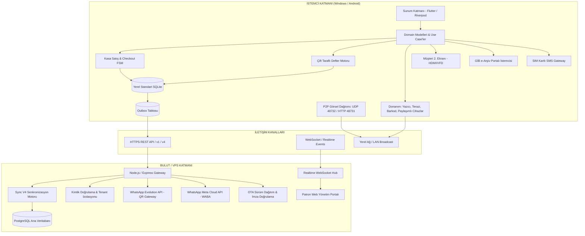

### 1.1. Temel Mimari Kararlar

1. **SQLCipher'ın Kaldırılması & Standart SQLite ([AGENTS.md Kural 1](file:///c:/Users/ecz/proje/shaman/shaman_new/.agents/AGENTS.md)):**
   - Mobil (Android) ve masaüstü (Windows) istemcilerinde şifreli `sqflite_sqlcipher` motoru tamamen kaldırılmıştır.
   - Yerel veritabanı motoru standart, şifresiz `sqflite` / `sqflite_common_ffi`'dir.
   - Veri güvenliği işletim sistemi izinleri (Android `/data/user/0/...` sandbox ve Windows `%APPDATA%` kullanıcı ACL'leri) ve VPS tarafındaki şifreli PostgreSQL bağlantısı ile sağlanır.
2. **Kuruş Bazlı Finansal Bütünlük (MoneyCents):**
   - Sistemde hiçbir para birimi SQLite `REAL` veya Dart/TS `double` olarak saklanamaz ve hesaplanamaz.
   - Tüm tutarlar, bakiyeler ve fiyatlar **kuruş cinsinden tam sayı (Integer)** olarak saklanır (ör. 100,50 TL = `10050` kuruş).
   - Bölme ve oran hesaplamalarında bankacılık standartlarında **Half-Up (0.5 ve üzeri yukarı)** yuvarlama uygulanır.
3. **Append-Only Defter (Ledger) Modeli:**
   - Cari hesaplarda hiçbir bakiye elle doğrudan `UPDATE` edilemez.
   - Defter kayıtları (`ledger_entries`) yalnızca eklenir (append-only); hata düzeltmeleri zıt yönlü düzeltme kaydı (`correction` / `reversal`) ile gerçekleştirilir.
4. **Offline-First Kesintisiz Satış:**
   - İnternet bağlantısı kopsa dahi istemci yerel SQLite veritabanı üzerinde 100 milisaniye altında tam hızla satış yapabilir, tahsilat alabilir, fiş kesebilir ve terazi okuyabilir.
   - Bağlantı geri geldiğinde `Sync V4` motoru biriken hareketleri kayıpsız olarak sunucuya aktarır.

---

## 2. KULLANICI, ORGANİZASYON (TENANT) & CİHAZ YÖNETİMİ (KAYITTAN GİRİŞE)

### 2.1. Organizasyon (Tenant) & Şube Yapısı

Her işletme bir `tenant` (kiracı) olarak izole edilir.
- **Tenant ID:** Benzersiz UUIDv4 (ör. `ten-019a28c3-4d56-7890-abcd-ef0123456789`).
- **Veri Ayrımı:** VPS üzerindeki PostgreSQL tablolarında (`tenants`, `users`, `products`, `customers`, `ledger_entries`, `sales`) her kayıtta zorunlu `tenant_id` kolonu bulunur ve Row-Level / Multi-Tenant indeksleri ile korunur.
- **Şube ve Depolar (`branches`):** Bir firmanın birden fazla kasası veya deposu olabilir. Her kasa bir şubeye bağlıdır.

### 2.2. Kullanıcı Kaydı & İlk Kurulum Akışı

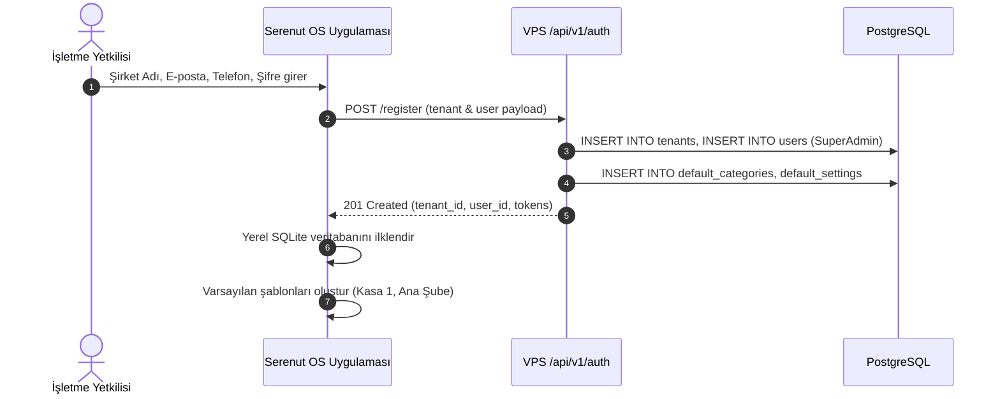

### 2.3. Cihaz Aktivasyonu & Donanım Parmak İzi (`device_fingerprint`)

Bir cihazın bir kasayı yönetebilmesi için organizasyon ile eşleştirilmesi gerekir:
1. İstemci ilk açılışında CPU ID, Anakart Seri No, Disk UUID ve MAC adresinden kriptografik bir `device_fingerprint` üretir ([DeviceFingerprintService](file:///c:/Users/ecz/proje/shaman/shaman_new/lib/infrastructure/services/device_fingerprint_service.dart)).
2. Yönetici portalından veya ana kasadan bir **Cihaz Aktivasyon Kodu / Eşleştirme Tokeni** alınır.
3. İstemci `POST /api/v1/devices/activate` isteği ile aktivasyon kodunu ve donanım parmak izini gönderir.
4. Sunucu cihazı doğrular ve cihaza özel `device_token` tahsis eder. Bu token yerel SQLite `app_settings` tablosunda ve güvenli depolama alanında saklanır.

### 2.4. Giriş (Login) & Oturum Yönetimi

Sistemde iki seviyeli kimlik doğrulama bulunur:

#### A. Yönetici / İlk Kurulum Girişi (E-posta + Şifre)
- `POST /api/v1/auth/login`
- Yanıt: `accessToken` (kısa ömürlü, 15 dk - 1 saat), `refreshToken` (uzun ömürlü, 30 gün), `user` ve `permissions`.
- Token'lar istemcide `SecureStorage` ve yerel SQLite oturum tablosunda tutulur.

#### B. Kasiyer Hızlı Giriş (4 Haneli PIN Kodu)
- Kasa operasyonlarında kasiyer değişimi çok hızlı olmalıdır.
- Kullanıcının 4 haneli PIN kodu yerel SQLite veritabanında tuzlanmış (salted) PBKDF2/Argon2 özeti olarak saklanır.
- **Offline PIN Doğrulama:** İnternet olmasa dahi kasiyer PIN kodunu girdiğinde yerel veritabanındaki hash ile karşılaştırılır ve anında oturum açılır ([PasswordHashService](file:///c:/Users/ecz/proje/shaman/shaman_new/lib/infrastructure/services/password_hash_service.dart)).

### 2.5. Rol Bazlı Yetkilendirme (RBAC)

| Rol | Yetkiler | Kısıtlamalar |
|---|---|---|
| **SuperAdmin / Firma Sahibi** | Tüm şubeler, kullanıcı açma, fiyat değiştirme, mali raporlar, silme/iptal işlemleri | Sınırsız |
| **Müdür (Manager)** | Kendi şubesinde stok girişi, fiyat görme, zayi/fire kaydı, iskonto yapabilme | Şirket silme ve lisans yönetimi kapalı |
| **Kasiyer (Cashier)** | Satış yapma, tahsilat alma, fiş yazdırma, ürün arama, müşteri bakiyesi görme | Mali raporları göremez, kısıtlı iskonto limiti, ürün fiyatını elden değiştiremez |
| **Depocu (Stock Clerk)** | Mal kabulü, sayım, stok hareketi girişi | Satış yapamaz, cari defter bakiyelerini göremez |

### 2.6. Sektörel Hazır Ürün & Kategori Tohumlama (`IndustryTemplateRegistry`)

Yeni bir işletme Serenut OS'a kaydolduğunda yüzlerce ürünü tek tek elle girmek zorunda kalmaz. Sistemde yerleşik [IndustryTemplateRegistry](file:///c:/Users/ecz/proje/shaman/shaman_new/lib/domain/models/industry_template.dart) motoru bulunur:
- **Kayıt Esnasında Seçim:** İşletme kaydolurken faaliyet alanını seçer:
  1. **Fındıkçı:** Hizmet, Kırma, Kavurma, Şekerleme & Ezme, Kremalar, Butik & Kurabiye kategorileri ve standart hizmet/kırma birim fiyatları tohumlanır.
  2. **Market:** Temel Gıda, İçecek, Temizlik, Şarküteri, Atıştırmalık kategorileri ve popüler EAN-13 barkodlu hazır ürünler yüklenir.
  3. **Kuruyemişçi:** Duble Antep Fıstığı, Giresun Fındığı, Kaju, Badem, Kabak Çekirdeği, Sarı Leblebi vb. tartılı (`isByWeight = true`) ve adetli ürünler tohumlanır.
  4. **Kafe:** Sıcak Kahveler, Soğuk İçecekler, Butik Tatlılar ve porsiyon bazlı menü kalemleri ilklendirilir.
- **Tek Tıkla Tohumlama:** SQLite veritabanı kurulurken ilgili şablonun ürünleri, varsayılan KDV oranları (%1, %10, %20), satış tipleri (tartılı/adetli) ve kategorileri saniyeler içinde tabloya yazılır.

---

## 3. ÜRÜN KATALOĞU, FİYATLANDIRMA, BARKODLAR & STOK MOTORU

### 3.1. Veri Yapısı (`products`, `barcode_units`, `categories`)

- `products`:
  - `id`: UUID (ör. `prod-xxx`).
  - `tenant_id`: Organizasyon kimliği.
  - `name`: Ürün adı (ör. "Kavrulmuş Fındık 500g").
  - `category_id`: Kategori referansı.
  - `sale_price_cents`: Satış fiyatı (kuruş).
  - `purchase_price_cents`: Alış/maliyet fiyatı (kuruş).
  - `vat_rate`: KDV oranı (ör. 1, 10, 20).
  - `unit_type`: Birim (`piece` - Adet, `kg` - Kilogram, `gram`, `liter`).
  - `stock_tracking`: Boolean (Stok takip edilsin mi?).
  - `current_stock_grams_or_pieces`: Mevcut stok miktarı.
  - `is_weighed`: Tartılı ürün mü? (Terazili mi?).
  - `deleted_at`: Tombstone silme damgası.
- `barcode_units`:
  - Bir ürüne birden fazla barkod atanabilir (ör. koli barkodu, tekil barkod, tedarikçi barkodu).
  - `barcode`: EAN-13, EAN-8 veya dahili barkod.
  - `multiplier`: Adet çarpanı (ör. 1 koli = 24 adet).

### 3.2. Para & Kuruş Modeli (`MoneyCents`) Kuralları

Finansal tutarlarda **Floating Point KESİNLİKLE YASAKTIR**.
```dart
// DOĞRU:
final int priceCents = 14950; // 149.50 TL
final int quantityGrams = 450; // 450 gram
// 1 kg = 1000 gram
// Tutar = (14950 * 450 + 500) ~/ 1000 = 6728 kuruş (67.28 TL) (Half-Up Yuvarlama)
final int totalCents = ((priceCents * quantityGrams) + 500) ~/ 1000;

// YANLIŞ:
double price = 149.50;
double total = price * 0.450; // 67.27500000000002 -> Finansal kayıp ve çakışma riski!
```

### 3.3. Barkod Ekosistemi & Tartılı/Terazili Ürün Çözümlemesi

Sistem barkod okuyucudan gelen girdiyi anında analiz eder:

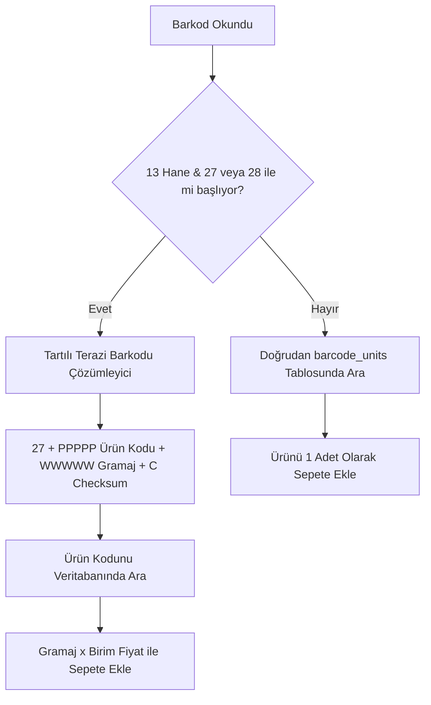

- **Standart Barkodlar:** EAN-13, EAN-8, Code 128, QR kodları doğrudan `barcode_units` tablosundan eşleştirilir.
- **Terazi Barkod Formatı (`27` ve `28` Serisi):**
  - Prefix: `27` veya `28` (2 hane)
  - PLU / Ürün Kodu: 5 hane (ör. `00142`)
  - Ağırlık / Değer: 5 hane (ör. `00450` -> 450 gram)
  - Kontrol Hanesi (Check Digit): 1 hane
  - Sonuç: Kasiyer teraziden basılmış etiketi okuttuğunda ekrana dokunmadan 450 gram fındık sepetine anında kuruşu kuruşuna eklenir.

### 3.4. Stok Hareketleri (Inventory Ledger)

Her stok değişimi bir `stock_movements` kaydı doğurur:
1. **`sale`:** Kasa satışı onaylandığında ilgili ürünlerin stoğu satılan miktar kadar düşürülür.
2. **`return`:** Müşteri iade getirdiğinde stok otomatik olarak artırılır.
3. **`purchase`:** Mal kabul / alış faturası girildiğinde stok artar ve alış maliyet fiyatı güncellenir.
4. **`waste` (Fire/Zayi):** Bozulan, kırılan ürünler stoktan açıklama ile düşülür.
5. **`count_adjustment` (Sayım Düzeltmesi):** Periyodik fiziki sayım sonucunda tespit edilen fark sisteme işlenir.

### 3.5. Barkodlu Raf Etiketi & Terazi Etiket Basım Motoru (`LabelModel` & TSPL)

Mağazadaki reyon düzeni ve terazili ürünler için entegre etiket basım motoru ([LabelModel](file:///c:/Users/ecz/proje/shaman/shaman_new/lib/domain/models/label_model.dart)):
- **Desteklenen Etiket Ebatları:**
  - `40 x 25 mm`: Kompakt raf etiketi (Barkod + Fiyat + Ürün Adı).
  - `50 x 30 mm`: Standart reyon ve paketleme etiketi (Marka, Raf Kodu, KDV, Birim Fiyat).
  - `60 x 40 mm` & `80 x 40 mm`: Geniş terazi ve kuruyemiş poşeti etiketi (Gramaj, QR Kod, Menşei: "TÜRKİYE", Parti/Lot No, Ambalaj Tarihi).
- **Yazıcı Dili ve Protokolü:**
  - Xprinter, Argox, Zebra, Bixolon rulo etiket yazıcıları için **TSPL (Taiwan Semiconductor Printer Language)** ve **EPL/ZPL** doğrudan binary soket veya Windows Spooler üzerinden sürülür.
  - Sürücü gerektirmeden saf TSPL komutları (örn. `SIZE 60 mm, 40 mm`, `GAP 3 mm`, `DENSITY 8`, `BARCODE 128`, `TEXT`, `PRINT 1`) ile milimetrik netlikte termal basım yapılır.
- **Toplu Etiket Basımı:** Ürün listesinden birden çok ürün seçilerek veya son güncellenen fiyatlar filtrelenerek tüm reyon için tek tıkla toplu raf etiketi yazdırılabilir.

---

## 4. MÜŞTERİ, CARİ HESAP, VERESİYE, SENET & DEFTER MOTORU (LEDGER ENGINE)

### 4.1. Çift Girişli Append-Only Defter Modeli

Müşteri bakiyesi asla `customers.balance = 5000` şeklinde elle güncellenmez. Tüm mali geçmiş `ledger_entries` tablosunda sıralı ve değiştirilemez bir defter olarak tutulur.

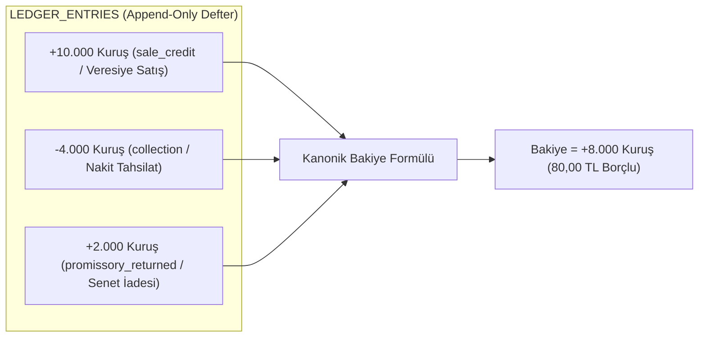

### 4.2. Kanonik Bakiye Formülü

Tüm sistem genelinde (Dart istemci, SQLite sorguları, Node.js VPS ve PostgreSQL görünümünde) geçerli **TEK VE DEĞİŞMEZ** formül:

$$\text{balance\_cents} = \sum \begin{cases} +\text{amount\_cents}, & \text{eğer type} \in ('sale\_credit', 'manual\_debt', 'promissory\_returned') \\ -\text{amount\_cents}, & \text{diğer tüm tiplerde} ('collection', 'sale\_return\_credit', 'payment') \end{cases}$$

- **Pozitif Bakiye ($> 0$):** Müşteri işletmeye **BORÇLU**dur.
- **Negatif Bakiye ($< 0$):** Müşterinin işletmede **ALACAĞI / AVANSI** vardır.
- **Sıfır Bakiye ($= 0$):** Hesap kapalıdır.

> [!IMPORTANT]
> **Değiştirilemezlik (Append-Only) Kuralı:**  
> Bir defter kaydı oluştuktan sonra asla `DELETE` veya `UPDATE` edilemez. Yanlış girilen bir tahsilat veya borç kaydı için zıt yönlü yeni bir kayıt (`entry_type = 'correction'` veya `'reversal'`) eklenir.

### 4.3. Veresiye (Açık Hesap) Satış Akışı

1. Kasa ekranında sepete ürünler eklenir.
2. Ödeme adımında "Veresiye / Cari" seçildiğinde sistem **Müşteri Seçimini Zorunlu Kılar**. Müşteri seçilmemişse işlem bloke edilir.
3. Müşterinin açık hesap limiti kontrol edilir (limit tanımlıysa ve aşılıyorsa yönetici onayı istenir).
4. Satış tamamlandığında tek bir atomik SQLite transaction içinde:
   - `sales` kaydı oluşturulur (`payment_status = 'pending'`).
   - `sale_payments` tablosuna `veresiye` tipi ödeme işlenir.
   - `ledger_entries` tablosuna `sale_credit` kaydı eklenir.
   - `customers` tablosundaki `balance_cents` önbelleği kanonik formülle artırılır.
   - Müşteriye SMS/WhatsApp bilgi mesajı göndermek üzere kuyruğa (`outbox`) olay yazılır.

### 4.4. Senet (Promissory Notes) Yaşam Döngüsü

Senetli satışlarda senetler ayrı bir portföy tablosunda (`promissory_notes`) takip edilir:
- **`pending` (Beklemede / Kasada):** Vadesi gelmemiş senet.
- **`collected` (Tahsil Edildi):** Müşteri ödemesini yaptı; cari hesaba tahsilat işlenir, kasa giriş kaydı doğar.
- **`returned_protest` (Protesto / İade Edildi):** Vadesinde ödenmeyen senet. Cari hesaba `promissory_returned` tipi ile otomatik borç yazılır.
- **`legal` (İcrada / Hukukta):** Hukuki takibe intikal etmiş senetler.

### 4.5. Müşteri Taksit Planları & Vadeli Taksit Takibi (`installment_models.dart`)

Vadeli ve taksitli çalışan işletmeler için sistemde entegre taksit planlayıcı motoru ([installment_models.dart](file:///c:/Users/ecz/proje/shaman/shaman_new/lib/domain/models/installment_models.dart)) bulunur:
- **Taksit Planı Mimarisi (`CustomerInstallmentPlanEntity`):**
  - `totalAmount`: Toplam satış tutarı.
  - `downPayment`: Satış anında alınan nakit/kart peşinat.
  - `financedAmount`: Kalan taksitlendirilecek bakiye (`totalAmount - downPayment`).
  - `installmentCount`: Taksit adedi (ör. 3, 6, 12 ay).
- **Aylık Taksit Hareketleri (`CustomerInstallmentEntity`):**
  - Her bir taksit bağımsız bir vade tarihi (`dueDate`), taksit tutarı (`amount`), ödenen miktar (`paidAmount`) ve ödeme tarihi taşır.
  - Taksit durumları: `pending` (Vadesi bekleniyor), `partial` (Kısmi ödendi), `paid` (Tamamı ödendi), `overdue` (Vadesi geçti!).
- **Otomatik Hatırlatma & Bakiye Entegrasyonu:** Taksit vadesi yaklaştığında veya geciktiğinde, sistem cari hesap üzerinden müşteriye otomatik WhatsApp/SMS ödeme hatırlatması gönderebilir.

### 4.6. Hızlı Müşteri Tahsilatı & Ödeme Alma Sayfası ([CollectionPage](file:///c:/Users/ecz/proje/shaman/shaman_new/lib/presentation/pages/collection_page.dart))

Cari hesaplardan nakit veya kartla para tahsilatı yapıldığında, kasiyerin hatasız ve anında işlem yapmasını sağlayan tam ekran tahsilat konsolu:

- **Canlı Bakiye Önizlemesi (Live Balance Preview):**
  - Kasiyer tutar alanına rakam yazdıkça ekran üçlü simülasyonla güncellenir:
    1. **Mevcut Borç:** Müşterinin cari hesap bakiyesi (ör. `1.250,00 ₺`).
    2. **Tahsil Edilen:** Girilen ödeme miktarı (ör. `500,00 ₺`).
    3. **Kalan Borç:** İşlem onaylandığında müşterinin kalacak net borcu (ör. `750,00 ₺` yeşil gösterge).
- **Ödeme Türü Seçimi:** Tek dokunuşla **Nakit** veya **Kredi Kartı** seçimi.
- **ESC/POS Tahsilat Makbuzu Basımı (`CustomerPaymentReceipt`):**
  - `_printReceipt` anahtarı açık olduğunda, tahsilat onaylandığı anda termal yazıcıdan resmi firma başlıklı, müşteri adı, ödenen tutar, kalan bakiye ve işlem zamanı içeren tahsilat makbuzu basılır.
- **Anında WhatsApp / SMS Tahsilat Dekontu:**
  - Tahsilat deftere (`ledger_entries`) yazıldığı anda müşterinin cep telefonuna dijital ödeme dekontu ve güncel kalan bakiye özeti WhatsApp üzerinden iletilir.

---

## 5. KASA SATIŞ, SEPET, ÖDEME MOTORU & SEPET KURTARMA

### 5.1. Checkout Sonlu Durum Makinesi (Finite State Machine)

Satış süreci belirli durumlardan geçer ve her durum geçişi sıkı kurallara bağlıdır:

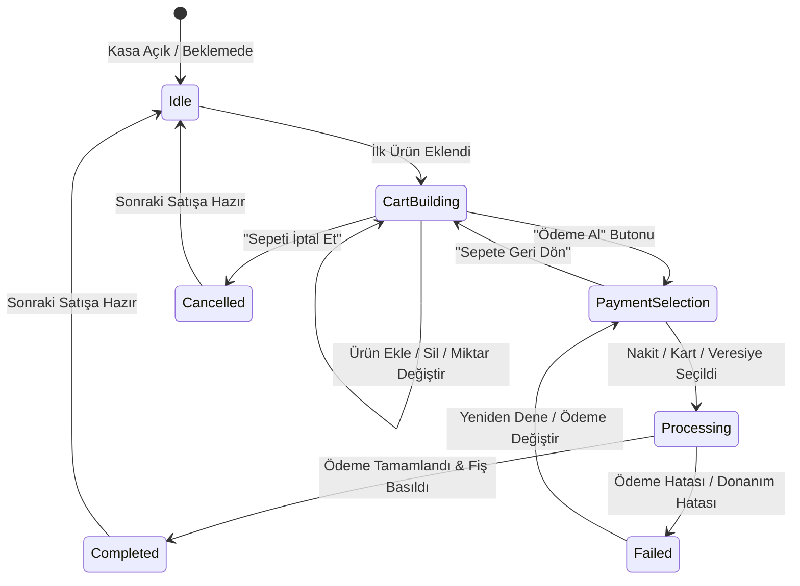

### 5.2. Sepet Kilitleme (`cart_lock`) & Çakışma Koruması

Eşzamanlı işlemleri engellemek için satış başlatıldığı anda sepet bellek üzerinde kilitlenir (`cart_lock = true`).
- Barkod okuyucu veya kasiyer ikinci bir tuşa bassa dahi işlem devam ederken sepet manipüle edilemez.
- İşlem SQLite transaction seviyesinde `runInTransaction` ile yürütülür. Herhangi bir adımda (ör. stok yetersizliği, donanım çökmesi) hata oluşursa tüm transaction `ROLLBACK` edilir; hayalet satış veya açıkta kalan ödeme engellenir.

### 5.3. Elektrik Kesintisi & Kapanma Koruması (`CartPersistenceService`)

Kasiyer 15 kalem ürün okuttuğu anda elektrik kesilirse veya bilgisayar aniden kapanırsa ne olur?
- [CartPersistenceService](file:///c:/Users/ecz/proje/shaman/shaman_new/lib/infrastructure/services/cart_persistence_service.dart), sepet durumunu bellekte tutarken aynı zamanda her değişiklikte yerel diske atomik JSON snapshot olarak yazar (`active_cart_recovery.json`).
- Bilgisayar tekrar açıldığında Serenut OS bu dosyayı okur:
  - "Bekleyen açık bir sepet bulundu. Kurtarılsın mı?" uyarısı verir.
  - Kasiyer tek tuşla 15 kalem ürünü ve seçili müşteriyi aynen ekrana geri getirir; müşteriyi kasada bekletmeden kaldığı yerden devam eder.

### 5.4. Ödeme Yöntemleri & Karma (Split) Ödeme

Sistem esnek ödeme kombinasyonlarını destekler:
1. **Nakit:** Kasiyer alınan tutarı girer, para üstü ekranda büyük puntolarla gösterilir, nakit çekmecesi otomatik açılır (`\x1b\x70...`).
2. **Kredi Kartı / Harici POS:** Banka terminalinden geçiş yapılır; referans / slip no girilebilir.
3. **Veresiye:** Seçilen müşterinin cari hesabına borç kaydedilir.
4. **Karma (Split) Ödeme:** Tek faturada birden çok yöntem:
   - Örnek: Toplam 2.000 TL -> 500 TL Nakit + 1.000 TL Kredi Kartı + 500 TL Veresiye.
   - Her ödeme parçası `sale_payments` tablosuna ayrı ayrı kaydedilir; ödemelerin toplamı sepet toplamına eşit olmadan satış kapatılamaz.

### 5.5. İade ve Değişim Akışı

- **Satış Fişinden İade:** Müşteri fiş barkodunu getirdiğinde geçmiş satış çağrılır. İade edilmek istenen satırlar seçilir.
- **Belgesiz / Serbest İade:** Ürün ve miktar seçilerek iade fişi kesilir.
- **Mali Yansıma:**
  - İade edilen ürünler stoğa otomatik geri alınır (`stock_movements.type = 'return'`).
  - İade bedeli nakit ödendiyse kasadan nakit çıkışı (`cash_transactions.type = 'refund'`) yapılır.
  - Veresiye satışın iadesiyse müşterinin cari hesabına alacak (`sale_return_credit`) yazılır.

### 5.6. Gün Sonu Kapatma, Kasa Sayımı, Küpür Denetimi & X/Z Raporları ([EndOfDayPage](file:///c:/Users/ecz/proje/shaman/shaman_new/lib/presentation/pages/end_of_day_page.dart))

Serenut OS'ta gün sonu işlemi basit bir toplam alma değil; paranın kuruşu kuruşuna sayıldığı, kasa kaçaklarının engellendiği ve resmi mali kapanışın mühürlendiği çok adımlı bir denetim sürecidir:

#### A. Banknot & Madeni Para Küpür Sayımı (Denomination Count)
- Kasiyer gün sonunda kasayı sayarken düz rakam yazmak zorunda değildir; sistem entegre bir **Küpür Sayım Tablosu** sunar:
  - **Kağıt Paralar:** ₺200, ₺100, ₺50, ₺20, ₺10, ₺5 adetleri girilir.
  - **Madeni Paralar:** ₺1, ₺0,50, ₺0,25 adetleri girilir.
  - Sistem girilen adetler üzerinden **Fiili Sayılan Nakit Tutarını** otomatik hesaplar.

#### B. Kasa Farkı (Fazla / Noksan) Tespiti
- **Sistem Beklentisi (Teorik Kasa):** $\text{Devir Nakit} + \text{Nakit Satışlar} + \text{Nakit Cari Tahsilatlar} - \text{Nakit Masraflar/Ödemeler} - \text{Nakit İadeler}$.
- **Kasa Farkı Formülü:** $\text{Kasa Farkı} = \text{Fiili Sayılan Nakit} - \text{Sistem Beklentisi}$.
  - **Fark = 0,00 ₺:** Kasa tam tutmaktadır (Yeşil onay).
  - **Fark > 0 (Kasa Fazlası):** Kasada sistemden fazla para vardır (Mavi uyarı).
  - **Fark < 0 (Kasa Noksanı):** Kasada eksik para vardır (Kırmızı uyarı — kasiyere veya yöneticiye açıklama notu zorunlu tutulabilir).

#### C. X-Raporu vs Z-Raporu Ayrımı
| Rapor Türü | Amacı & Sayacı | Kullanım Zamanı |
|---|---|---|
| **X-Raporu (Ara Denetim)** | Sayaçları sıfırlamaz, günü kapatmaz. O ana kadarki ara ciroyu ve kasa durumunu gösterir. | Vardiya değişiminde, öğle arasında veya müdür kasayı saymak istediğinde. |
| **Z-Raporu (Resmi Mali Kapanış)** | **Z Sayacını 1 artırır**, o günkü tüm satış ve ödemeleri kilitler (`daily_registers.is_closed = 1`), dönemi kapatır. | Gece mağaza kapandığında vardiyanın resmi bitişinde. |

#### D. Çıktı & WhatsApp Otomasyonu
- Z-Raporu onaylandığı anda termal yazıcıdan resmi döküm fişi basılır.
- Eşzamanlı olarak arka planda **Bölüm 10'da açıklanan `end_of_day_report` olayı tetiklenir** ve işletme sahibinin/patronun cep telefonuna günün toplam cirosu, nakit, kart, veresiye ve kasa farkı WhatsApp mesajı olarak anında düşer!

---

### 5.7. Sipariş & Teslimat Yönetimi Motoru ([OrdersPage](file:///c:/Users/ecz/proje/shaman/shaman_new/lib/presentation/pages/orders_page.dart) & [OrderEntity](file:///c:/Users/ecz/proje/shaman/shaman_new/lib/domain/repositories/base_repository.dart#L812-L949))

Perakende ve toptanda paket servis, telefonla sipariş veya ileri tarihli teslimatlar için entegre sipariş motoru:

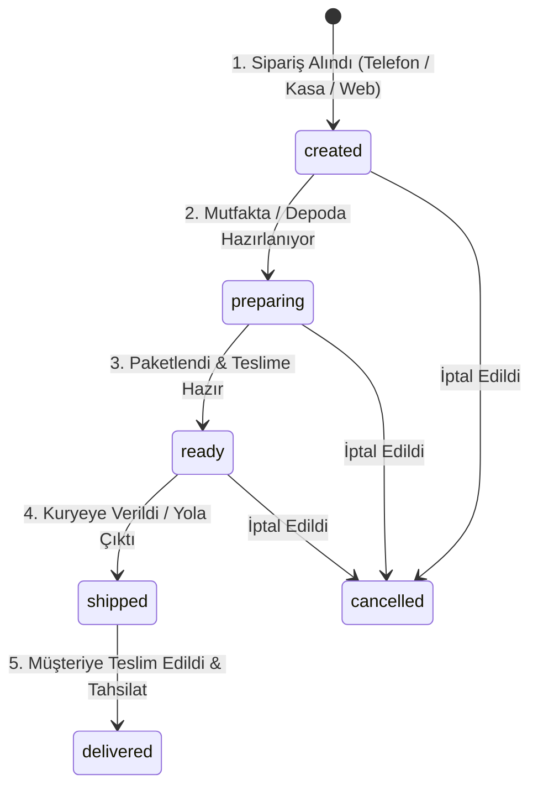

- **Sipariş Numaratörü (`orderNumber`):** Şube bazlı okunabilir sipariş kodları (ör. `M1-ord-20261024-004`).
- **Gecikme Takibi (`isOverdue`):** Siparişin beklenen teslim saati (`expectedDeliveryDate`) geçtiyse ve durum hala `delivered` olmadıysa sipariş listesinde kırmızı yanıp söner ve kasiyere uyarı verir.
- **In-Place Sipariş Güncelleme (`updateOrderSaleTransaction`):** Müşteri telefon edip siparişe ürün eklettiğinde veya çıkardığında, sistem eski kaydı silip yenisini açmaz; var olan sipariş kaydını ve bağlı finansal hareketleri atomik olarak günceller.
- **Müşteri Bildirim Tetikleyicisi:** Sipariş durumu her değiştiğinde (`created` $\rightarrow$ `preparing` $\rightarrow$ `ready` $\rightarrow$ `shipped` $\rightarrow$ `delivered`), müşterinin cep telefonuna ilgili durumun emojili WhatsApp/SMS bildirimi otomatik olarak iletilir.

### 5.8. Satış Geçmişi & Detay Yönetimi ([SalesHistoryPage](file:///c:/Users/ecz/proje/shaman/shaman_new/lib/presentation/pages/sales_history_page.dart) & [SaleDetailsPage](file:///c:/Users/ecz/proje/shaman/shaman_new/lib/presentation/pages/sale_details_page.dart))

Geçmişte yapılmış tüm satış fişlerinin sorgulandığı, incelendiği ve işlem gördüğü merkezi yönetim modülü:

- **Çok Kriterli Filtreleme:** Tarih aralığı, ödeme türü (Nakit, Kart, Veresiye), satış durumu (Tamamlandı, İade Edildi, İptal) ve tutara göre anlık arama.
- **Detaylı Fiş Dökümü:** Satış kimliği (`#ABC123XY`), kasiyer adı, satır bazlı ürünler, birim fiyatlar, uygulanan iskonto miktarı, KDV oranları ve ödeme türü dağılımı.
- **Tek Tıkla e-Arşiv Fatura Kesme (`CreateGibInvoiceDialog.show`):**
  - Müşteri fiş kestikten sonra fatura talep ederse, satış detayından tek tıkla resmi GİB e-Arşiv portalı fatura sihirbazı açılır. Satıştaki kalemler otomatik faturaya aktarılır.
- **Termal Fiş Kopyası (Reprint):** İstemci, istenen herhangi bir geçmiş fişin kopyasını termal yazıcıdan anında yeniden basabilir.
- **WhatsApp / SMS Dijital Fiş Paylaşımı:** Fiş detayından müşterinin telefonuna dijital fiş PDF/metin linki tek tıkla gönderilir.
- **Kısmi ve Tam İade Akışı:** Müşteri 3 üründen 1 tanesini getirdiğinde, satış detayından sadece o ürün seçilerek iade fişi kesilir; stok ve kasa/cari hesap otomatik eşitlenir.

---

## 6. SENKRONİZASYON MOTORU (SYNC V4 — OFFLINE-FIRST REPLICATION)

### 6.1. Mimari Prensip: Dağıtık Outbox Deseni

Tüm istemci değişiklikleri (satış, stok, müşteri, defter) yerel veritabanına kaydedilirken aynı transaction içinde `outbox` tablosuna bir mutasyon olayı olarak yazılır.


### 6.2. Sunucu İdempotency & `payloadDeepEqual` Koruması

Ağ kopması durumunda istemci aynı mutasyonu tekrar gönderebilir.
- Sunucu `idempotency_key` (veya `mutation_id`) üzerinden geçmişi kontrol eder.
- **Kritik Çakışma Önleyici (`payloadDeepEqual`):** PostgreSQL `jsonb` kolonları JSON nesnelerinin anahtarlarını dahili olarak alfabetik ve uzunluğa göre yeniden sıralar. Düz `JSON.stringify` karşılaştırması sahte çakışma (`conflict`) üreteceği için `payloadDeepEqual` recursive fonksiyonu ile anlamsal eşitlik kontrol edilir. Aynı mutasyon geldiğinde hata fırlatılmaz, `already_processed` olarak onaylanır.

### 6.3. Pull Akışı (Sunucudan İstemciye Çekme)

- İstemci son aldığı `server_seq` numarasını bilir.
- `GET /api/v4/sync/pull?since_seq=1480` çağrısı yapar.
- Sunucu, 1480'den sonra organizasyona ait diğer cihazlar veya web portalından yapılan değişiklikleri döner.
- İstemci gelen verileri yerel SQLite tablolarına yansıtır (`SyncV4PullAdapter`).

### 6.4. Çakışma Çözümü (Conflict Resolution)

- **Kural:** Sunucu zaman damgası otoritesi ile Deterministik **Last-Write-Wins (LWW)** uygulanır.
- **Silinmeler (Tombstone):** Hiçbir satır fiziksel silinmez (`DELETE FROM ...` yapılmaz). `deleted_at = timestamp` alanı doldurulur ve diğer cihazlara bu şekilde yayılır.

---

## 7. DONANIM ENTEGRASYONLARI & AĞ PAYLAŞIMLI DONANIM (HARDWARE LAYER)

### 7.1. Termal Fiş Yazıcısı (ESC/POS)

Termal yazıcılar müşteri fişi, bilgi fişi, mutfak sipariş fişi ve gün sonu Z-raporu dökümünde kullanılır.
- **Protokol:** Raw ESC/POS komutları.
  - İnisiyalizasyon: `\x1b\x40` (`ESC @`)
  - Kağıt Kesme: `\x1d\x56\x00` (`GS V 0` Full Cut) veya `\x1d\x56\x01` (Partial Cut)
  - Çekmece Darbesi (Cash Drawer Kick): `\x1b\x70\x00\x19\xfa`
- **Bağlantı Kanalları:**
  - **USB:** Windows Spooler (`win32` API üzerinden Raw veri gönderme).
  - **Ağ (Ethernet / Wi-Fi):** Raw TCP soketi, varsayılan Port: `9100`.
  - **Seri (COM Port):** RS-232 seri arabirimi.
  - **Bluetooth:** Mobil cihazlarda SPP (Serial Port Profile) bağlantısı.
- **Türkçe Karakter Desteği:**
  - Yazıcının donanım karakter tablosuna göre `CP857` (PC857) kod sayfası dönüşümü yapılır (`ç, ğ, ı, ö, ş, ü, İ`).
  - Türkçe font ROM'u bulunmayan ucuz yazıcılarda sistem otomatik olarak **Raster Grafik Baskı Moduna** geçer; fişi 203 DPI siyah-beyaz bitmap resim olarak çizer ve yazıcıya görsel olarak aktarır ([PersistentPrintQueue](file:///c:/Users/ecz/proje/shaman/shaman_new/lib/infrastructure/services/persistent_print_queue.dart)).

### 7.2. Barkod & Etiket Yazıcısı (TSPL / ZPL)

Ürün raf etiketleri ve koli etiketleri için TSPL (Taiwan Semiconductor / Xprinter / Argox) komut seti kullanılır:
```text
SIZE 40 mm, 30 mm
GAP 2 mm, 0 mm
DIRECTION 1
CLS
TEXT 20,20,"3",0,1,1,"SERENUT NUTOPIA FINDIK"
BARCODE 20,60,"EAN13",60,1,0,2,2,"8690123456789"
TEXT 20,130,"4",0,1,1,"149.50 TL"
PRINT 1,1
```

### 7.3. Elektronik Terazi (RS-232 Serial Worker)

Kasaya bağlı terazi ürün tartımında hızı ve doğruluğu sağlar.
- **Seri Port Ayarları:** Baud Rate `9600`, Data Bits `8`, Parity `None`, Stop Bits `1` (`9600-8-N-1`).
- **Desteklenen Protokoller:** CAS (AP-1, ER-Plus), TEM, Dibal, Bizerba, Desis.
- **Kararlılık (Stability) Koruması:**
  - Terazi veri akışında `ST` (Stable / Kararlı) ve `US` (Unstable / Hareketli) bayrakları gönderir.
  - Tartım titrerken kasiyerin hatalı gramajla satış yapmasını önlemek için sistem ekrandaki tartım butonunu `US` durumunda kilitler; terazi `ST` verdiğinde gramaj yeşile döner ve sepete eklenebilir.

### 7.4. Ağ Paylaşımlı Donanım Köprüsü (`SharedHardwareService`)

İşletmelerde her kasaya ayrı yazıcı veya terazi almak yüksek maliyetlidir.
- [SharedHardwareService](file:///c:/Users/ecz/proje/shaman/shaman_new/lib/infrastructure/services/shared_hardware_service.dart) ve [SharedHardwareWorker](file:///c:/Users/ecz/proje/shaman/shaman_new/lib/infrastructure/services/shared_hardware_worker.dart), USB üzerinden Ana Kasa'ya bağlı bir yazıcıyı ağda "Paylaşımlı Cihaz" olarak yayınlar.
- İkinci Kasa (ör. Android el terminali veya Kasa 2) satış yaptığında doğrudan ana kasaya veya bulut kuyruğuna bir `ClaimedHardwareJob` gönderir.
- Ana Kasa kuyruktaki işi alır, yerel termal yazıcısından fişi basar veya teraziden okuduğu ağırlığı Kasa 2'ye aktarır.

### 7.5. Banka POS & EFT-POS Terminal Motoru ([PhysicalCardPaymentService](file:///c:/Users/ecz/proje/shaman/shaman_new/lib/providers/payment_terminal_provider.dart) & [IPaymentTerminalAdapter](file:///c:/Users/ecz/proje/shaman/shaman_new/lib/domain/hardware/payment_terminal_service.dart))

Kasada kredi kartı ile ödeme alındığında, tutarı harici bir banka POS cihazına el ile girmek hem kasiyer hatasına (fazla/eksik çekim) hem de kasa kaçaklarına yol açar. Serenut OS, kasayı doğrudan EFT-POS cihazına bağlayan entegre bir ödeme motoru barındırır:

- **Bağlantı Kanalları & Protokoller:**
  - **Seri Port (RS-232 / USB Virtual COM):** `SerialPaymentTerminalAdapter` (Port Adı, Baud Rate, Vendor).
  - **Yerel Ağ / TCP-IP:** `TcpPaymentTerminalAdapter` (Host IP, Port, Vendor).
  - **Desteklenen Protokol & Cihazlar:** PAX (PAX D230 vb.), Ingenico, Beko / Arçelik ÖKC, TechPOS.
- **Two-Phase Commit & İki Aşamalı Güvence ([PaymentFsm](file:///c:/Users/ecz/proje/shaman/shaman_new/lib/domain/services/payment_fsm.dart) & [TerminalPaymentJournal](file:///c:/Users/ecz/proje/shaman/shaman_new/lib/infrastructure/services/terminal_payment_journal.dart)):**
  - Kasiyer ekrandan "Kartla Öde" dediğinde Serenut OS POS terminaline tutarı ve benzersiz `idempotencyKey` değerini gönderir.
  - POS cihazı müşteriden kartı okutmasını / şifre girmesini ister.
  - **Kritik Finansal Kural:** Bankadan onay (`AuthorizedCardPayment` - AuthCode, BatchNo, STAN) dönmeden yerel deftere veya satış tablosuna ASLA ödeme kaydı atılamaz.
  - Banka onay verdiğinde işlem atomik olarak `TerminalPaymentJournal` günlüğüne işlenir ve satış tamamlanır.
- **Manüel Kart Fallback Modu:**
  - İşletmede donanım köprüsü bulunmadığında veya POS arızalandığında sistem `manualLedgerMetadata(context: 'manual')` moduyla manüel kart kaydı almaya izin verir.

### 7.6. Donanım Teşhis & Test Konsolu ([HardwareTestPage](file:///c:/Users/ecz/proje/shaman/shaman_new/lib/presentation/pages/settings/hardware_test_page.dart))

Kurulum ve teknik servis anında sahada donanım sorunlarını saniyeler içinde çözmek için tasarlanmış canlı test arayüzü:

- **Canlı Cihaz Listesi & Durum Takibi:** Bağlı yazıcılar, teraziler, barkod okuyucular ve paylaşımlı cihazların `online` / `offline` durumu yeşil/kırmızı rozetlerle gösterilir.
- **COM Port & Baud Rate Tarama:** Sistem bağlı tüm sanal ve fiziksel COM portlarını otomatik listeler; doğru port ve hız ayarını tek tıkla uygular.
- **Canlı Terazi Testi:** Terazinin o anki ağırlık akışını ekranda gösterir; `ST` (Kararlı) ve `US` (Hareketli) bayraklarının tepki hızını test eder.
- **Termal Yazıcı & Çekmece Testi:**
  - "Test Fişi Bas" butonu: CP857 Türkçe harf testi, 1D/2D barkod çizimi ve grafik bitmap baskı testi yapar.
  - "Çekmece Aç" butonu: ESC/POS kick darbesi (`\x1b\x70...`) göndererek nakit çekmecesinin mekanik açılışını test eder.
- **Ağda Paylaşılan Donanımları Keşfetme (`_openSharedPrinters`):** Mağaza yerel ağındaki diğer kasaların paylaştığı tüm termal yazıcı ve terazileri mDNS/LAN üzerinden anında keşfeder.

---

## 8. YEREL AĞDA EŞLER ARASI (P2P) ÜRÜN GÖRSELİ DAĞITIMI (LAN PEER SERVICE)

Binlerce ürünün yüksek çözünürlüklü fotoğraflarını bulut sunucusuna yüklemek sunucu maliyetlerini artırır ve mağazanın internet kotasını tüketir.

Serenut OS bu sorunu **P2P Local-Area Mesh** ile çözer:

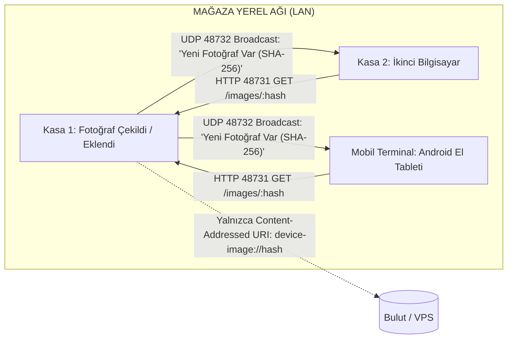

- **Sıfır Bulut Kota Tüketimi:** Bulut sunucusuna görsel dosyası yüklenmez! Yalnızca `device-image://<sha256>.jpg` referansı yazılır.
- **Otomatik Cihaz Keşfi ([ProductImagePeerService](file:///c:/Users/ecz/proje/shaman/shaman_new/lib/infrastructure/services/product_image_peer_service.dart)):**
  - İstemciler yerel ağda **UDP Port 48732** üzerinden şirket anahtarını içeren broadcast anonsları yapar.
  - Bir kasada ürün resmi eklendiğinde, ağdaki diğer cihazlar saniyeler içinde bunu fark eder.
  - Diğer kasalar **HTTP Port 48731** üzerinden resmi doğrudan resmi çeken kasadan indirir ve `%APPDATA%\...\product_images` dizinine kaydeder.
  - Cihaz kapalı olsa bile bir sonraki açılışta eksik görseller yerel ağdan otomatik tamamlanır.

---

## 9. E-DÖNÜŞÜM & GİB E-ARŞİV / E-FATURA PORTALI (0 TL MALİYETLİ İSTEMCİ)

Serenut OS, özel entegratörlere her fatura başına kontör parası ödeme zorunluluğunu ortadan kaldıran resmi bir doğrudan entegrasyona sahiptir ([GibEArsivClient](file:///c:/Users/ecz/proje/shaman/shaman_new/lib/infrastructure/services/gib_earsiv_client.dart)):

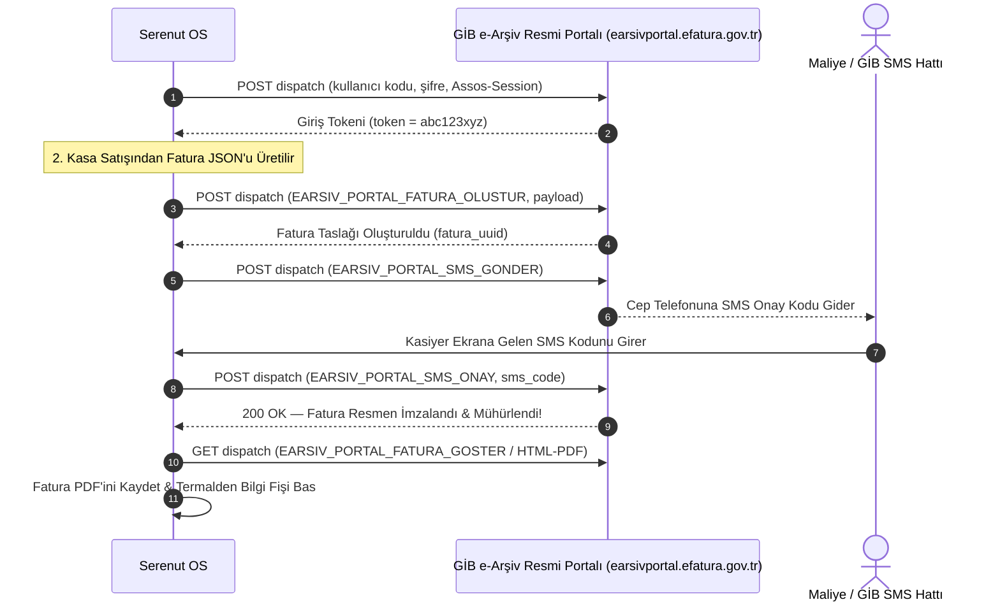

- **KDV & Matrah Dağılımı:** Kasa fişindeki her KDV oranı (%1, %10, %20) GİB kurallarına uygun olarak matrah ve KDV ayrımına tabi tutulur.
- **İptal & Gider Pusulası:** İade durumlarında faturanın GİB portalı üzerinden resmi iptal isteği (`EARSIV_PORTAL_FATURA_IPTAL`) gönderilebilir.

### 9.1. GİB e-Arşiv Portal Giriş Bilgileri ([GibSettingsDialog](file:///c:/Users/ecz/proje/shaman/shaman_new/lib/presentation/pages/settings/widgets/gib_settings_dialog.dart))

İşletmelerin GİB e-Arşiv portalına bağlanması için gereken yapılandırma penceresi:
- **Kullanıcı Adı & Şifre:** Maliye'den alınan resmi portal kullanıcı kodu ve şifresi girilir. Şifre cihazda güvenli depolanır.
- **Test Modu Anahtarı (`isTestMode`):**
  - Gerçek Mod: `https://earsivportal.efatura.gov.tr/earsiv-services/dispatch`
  - Test Modu: `https://earsivportaltest.efatura.gov.tr/earsiv-services/dispatch` (Sahada eğitim ve test yaparken mali sonuç doğurmadan fatura denemesi yapmayı sağlar).
- **Varsayılan KDV Oranı:** İşletmenin ağırlıklı KDV oranı (örn. %1, %10, %20) seçilir.
- **"Bağlantıyı Test Et" Butonu:** Girilen kimlik bilgileriyle anında canlı GİB oturum açma testi (`GibEArsivClient.login`) çalıştırılır; başarılıysa yeşil "Bağlantı Başarılı (Token Alındı)" rozeti verir.

### 9.2. Kasa Satışından Fatura Kesme ([CreateGibInvoiceDialog](file:///c:/Users/ecz/proje/shaman/shaman_new/lib/presentation/widgets/invoice/create_gib_invoice_dialog.dart))

Satış anında veya satış detayından çağrılan fatura düzenleme sihirbazı:
- **Alıcı Doğrulaması:**
  - **TCKN (11 Hane) / VKN (10 Hane):** TCKN/VKN girildiğinde format algoritması otomatik kontrol edilir.
  - **Alıcı Ünvanı / Ad Soyad:** Bireysel müşteride Ad-Soyad, kurumsal müşteride resmi Ticaret Ünvanı.
  - **Vergi Dairesi & İl/İlçe:** Fatura başlığı için zorunlu alanlar.
- **Fatura Tipi:**
  - `SATIS`: Standart perakende/toptan mal satışı.
  - `IADE`: Müşteriden iade alınan mallar için gider pusulası yerine e-Arşiv iade faturası.
  - `TEVKIFAT`: Tevkifatlı kamu veya kurumsal satışlar.
  - `ISTISNA`: İhracat veya KDV muafiyetli işlemler.
- **Fatura Kalemleri & İskonto:** Kasa sepetindeki tüm ürünler, adetleri, birim fiyatları, uygulanan satır iskontoları ve her kalemin KDV oranı otomatik fatura satırlarına dönüştürülür.

### 9.3. GİB SMS Onay Kodu Girişi & Resmi İmzalama

1. Serenut OS faturayı GİB sistemine taslak olarak kaydeder (`EARSIV_PORTAL_FATURA_OLUSTUR`).
2. GİB sunucusu işletme sahibinin maliyede kayıtlı cep telefonuna 6 haneli bir SMS onay kodu gönderir.
3. Kasiyerin ekranında açılan popup'a gelen SMS kodu girilir (`EARSIV_PORTAL_SMS_ONAY`).
4. GİB sistemi faturayı resmi Mali Mühür ile imzalar ve resmi `GIB2026000000001` fatura numarasını verir.

### 9.4. Fatura Çıktısı, Termal Bilgi Fişi & WhatsApp İletimi

- **e-Arşiv PDF İndirme:** İmzalanan fatura GİB sunucusundan anında orijinal HTML/PDF formatında çekilir.
- **Termal Bilgi Fişi:** 80mm veya 58mm termal yazıcıdan faturanın resmi karekodunu, ETTN (Evrensel Tekil Tanımlama Numarası) kodunu ve mali özetini içeren termal bilgi fişi basılır.
- **WhatsApp / SMS Fatura İletimi:** Tek tıkla müşterinin cep telefonuna faturanın doğrudan PDF indirme bağlantısı WhatsApp veya SMS üzerinden gönderilir (Kağıt ve kargo maliyeti 0 TL).

---

## 10. WHATSAPP BİLDİRİM & İLETİŞİM MOTORU (EVOLUTION API & META CLOUD)

Serenut OS'ta WhatsApp entegrasyonu basit bir sohbet penceresi değildir; işletmenin kurumsal iletişim, anlık dijital fiş paylaşımı, veresiye borç takibi, tahsilat makbuzu, e-Arşiv fatura iletimi ve akşam kasa kapanışında patrona giden Z-Raporunun omurgasıdır ([server/src/modules/whatsapp/](file:///c:/Users/ecz/proje/shaman/shaman_new/server/src/modules/whatsapp/)).

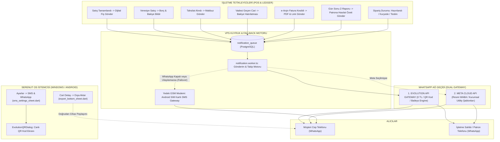

### 10.1. İkili Ağ Geçidi (Dual-Gateway) Mimarisi Karşılaştırması

Serenut OS iki farklı WhatsApp bağlantı modunu destekler:

| Özellik | 1. Evolution API (QR Tabanlı) | 2. Meta Cloud API (Resmi WABA) |
|---|---|---|
| **Maliyet** | **0 TL (Tamamen Ücretsiz)** | Meta görüşme ücreti (Ücretsiz kota sonrası) |
| **Kurulum Süresi** | **1 Dakika** (Telefondan QR okutarak) | 3-7 Gün (Meta Business Onayı, Vergi Levhası vb.) |
| **Bağlanan Numara** | Şirketin mevcut normal veya Business WhatsApp hattı | Meta tarafından onaylanmış kurumsal sabit/mobil hat |
| **Şablon Sınırlaması** | **Yok** — Zengin emoji, kalın metin, fiş dökümü anında gönderilir | Yalnızca önceden Meta tarafından onaylanan `UTILITY` şablonları |
| **Altyapı** | VPS üzerinde çalışan Docker `evolution-api` (Baileys) | Meta Facebook Graph API Bulutu |
| **Kullanım Amacı** | Esnaf, market, kuruyemiş, şarküteri, KOBİ'ler | Büyük zincir marketler, holdingler |

### 10.2. Adım Adım WhatsApp Bağlama Kılavuzu (Kullanıcı / Kasiyer / Yönetici)

İşletme sahibi kendi WhatsApp hattını sisteme bağlamak için şu adımları izler:

1. **Arayüzden Ayarlara Giriş:**
   - Serenut OS ana ekranında sol menüden veya sağ üst köşeden **Ayarlar** (`SettingsPage`) butonuna tıklanır.
   - Listeden **SMS ve WhatsApp Bildirimleri** seçeneği seçilerek ayar paneli ([sms_settings_sheet.dart](file:///c:/Users/ecz/proje/shaman/shaman_new/lib/presentation/pages/settings/widgets/sms_settings_sheet.dart)) açılır.
2. **WhatsApp Bildirim Kartı ve Durum Göstergesi:**
   - Panel açıldığında sistem otomatik olarak `GET /api/v1/whatsapp/evolution/status` sorgusu yapar.
   - **Gri İkon ("Bağlantı durumu kontrol ediliyor..."):** Sunucu durumu kontrol ediliyor.
   - **Yeşil Kart ("0532... bağlı ✓"):** Cihaz bağlı ve mesaj göndermeye hazır.
   - **Amber / Turuncu Kart ("Bağlı değil — QR ile bağlayın"):** Henüz telefon bağlanmamış.
3. **QR Kod ile Eşleştirme ([evolution_qr_dialog.dart](file:///c:/Users/ecz/proje/shaman/shaman_new/lib/presentation/widgets/whatsapp/evolution_qr_dialog.dart)):**
   - **"QR Kod ile Bağlan"** butonuna tıklanır.
   - Ekrana modern bir diyalog penceresi açılır. Sunucu arka planda `GET /api/v1/whatsapp/evolution/qr` endpoint'ini çağırır.
   - Şirkete özel `serenut_<company_id>` instance'ı oluşturulur ve dinamik Base64 PNG formatında QR kod ekrana çizilir.
   - **Telefon İşlemi:** İşletme sahibi kendi telefonunda WhatsApp'ı açar $\rightarrow$ **Ayarlar (veya Üç Nokta)** $\rightarrow$ **Bağlı Cihazlar (Linked Devices)** $\rightarrow$ **Cihaz Bağla** butonuna basıp kasadaki ekrandaki QR kodu kamerayla okutur.
4. **Otomatik Tanıma ve Kapanış:**
   - İstemci her 4 saniyede bir `GET /api/v1/whatsapp/evolution/status` ile durumu sorgular.
   - QR kod okutulup WhatsApp el sıkışması tamamlandığı anda status `open` olur.
   - Diyalog ekranda yeşil onay rozeti gösterir ("WhatsApp Bağlantısı Kuruldu ✓") ve 2 saniye sonra otomatik kapanır.
5. **Bağlantıyı Güvenle Kesme:**
   - Hat değiştirilmek istendiğinde veya cihaz satıldığında "Bağlantıyı Kes" butonuna basılır.
   - `POST /api/v1/whatsapp/evolution/disconnect` çağrılır; sunucu instance'ı siler ve veritabanını `disconnected` durumuna çeker.

### 10.3. Günlük Operasyonlarda WhatsApp Kullanım Noktaları

#### A. Kasa Satış Sonrası Dijital Fiş Gönderimi
- Satış nakit, pos veya veresiye olarak tamamlandığında satış özet dialog'unda **"WhatsApp ile Fiş Gönder"** seçeneği belirir.
- Müşterinin telefon numarası kayıtlıysa tek tıkla müşteriye alışveriş kalemi dökümü ve dijital fiş bağlantısı iletilir.

#### B. Cari Hesap / Müşteri Detay Ekranında WhatsApp İşlemleri ([customer_details_page.dart](file:///c:/Users/ecz/proje/shaman/shaman_new/lib/presentation/pages/customer_details_page.dart))
- Müşteri profilindeyken **"Dışa Aktar"** butonuna basıldığında açılan [ExportBottomSheet](file:///c:/Users/ecz/proje/shaman/shaman_new/lib/presentation/widgets/export_bottom_sheet.dart) üzerinden:
  - **"PDF Cari Hesap Ekstresi"**: Tüm geçmiş hareketleri, borç/alacak dökümünü içeren A4 resmi ekstre PDF olarak üretilir ve sistemin paylaşım menüsü üzerinden müşterinin WhatsApp sohbetine doğrudan dosya olarak iliştirilir.
  - **"WhatsApp ile Bakiye Hatırlatması"**: Vadesi geçen veya açık hesabı olan müşteriye tek tıkla nazik bakiye hatırlatma mesajı gönderilir.

#### C. GİB e-Arşiv Fatura Ekranından WhatsApp Gönderimi ([create_gib_invoice_dialog.dart](file:///c:/Users/ecz/proje/shaman/shaman_new/lib/presentation/widgets/invoice/create_gib_invoice_dialog.dart))
- e-Arşiv fatura resmi olarak GİB portalında imzalandıktan sonra fatura detayındaki WhatsApp simgesine basılarak resmi faturanın PDF'i veya görüntüleme linki müşteriye WhatsApp üzerinden anında iletilir.

#### D. Gün Sonu Kapanışında Patron WhatsApp Bildirimi (Otomatik Z-Raporu)
- Kasiyer vardiya sonunda veya akşam mağaza kapanışında Z-Raporu aldığı anda, kasiyerin hiçbir şey yapmasına gerek kalmadan sistem arka planda **Patronun WhatsApp Numarasına** günün finansal karnesini mesaj olarak atar.

### 10.4. Kanonik Mesaj Şablonları & Değişken Sözlüğü ([template_resolver.dart](file:///c:/Users/ecz/proje/shaman/shaman_new/lib/domain/notifications/template_resolver.dart))

Mesajlarda kullanılan dinamik değişkenler:
- `{customer}`: Müşteri Adı / Unvanı
- `{amount}`: İşlem / Fiş Tutarı (₺ formatında)
- `{paid}`: Kasiyere ödenen miktar
- `{debt}`: Kalan vadeli borç miktarı
- `{balance}`: Cari hesabın güncel toplam bakiyesi
- `{items}`: Satın alınan ürünlerin adet/gramaj ve fiyat dökümü
- `{business}`: İşletmenin resmi veya ticari adı
- `{date}`: İşlemin yapıldığı gün ve saat
- `{id}`: Fiş, makbuz veya sipariş numarası

#### 1. Satış Bilgi Fişi (`sale_created`):
```text
🧾 *Alışveriş Fişi*

Sayın *Ahmet Yılmaz*,
Alışverişiniz başarıyla tamamlanmıştır.

▫️ *Fiş No:* #40921
▫️ *Tarih:* 24.10.2026 18:32

🛍️ *Satın Alınan Ürünler:*
• Giresun Kavrulmuş Fındık (500 gr) - ₺180,00
• Antep Fıstığı Duble (250 gr) - ₺195,00

▫️ *Ödenen:* *₺375,00*
▫️ *Toplam Tutar:* *₺375,00*

Bizi tercih ettiğiniz için teşekkür eder, iyi günlerde kullanmanızı dileriz.
*Nutopian Fındık & Kuruyemiş*

ℹ️ _Bildirimlerin tarafınıza sorunsuz ulaşabilmesi için lütfen numaramızı rehberinize kaydediniz._
```

#### 2. Veresiye / Cari Borç Bildirimi (`debt_created`):
```text
📋 *Cari Hesap Bilgilendirmesi*

Sayın *Mehmet Güven*,
#10852 numaralı vadeli işleminiz cari hesabınıza işlenmiştir.

▫️ *İşlem Tutarı:* ₺850,00
▫️ *Eklenen Borç:* *₺850,00*
▫️ *Güncel Toplam Bakiyeniz:* *₺2.450,00*

Detaylı hesap ekstresi ve mutabakat için bizimle iletişime geçebilirsiniz.
*Nutopian Fındık & Kuruyemiş*
```

#### 3. Tahsilat Makbuzu (`collection_recorded`):
```text
✅ *Tahsilat Makbuzu*

Sayın *Mehmet Güven*,
Yapmış olduğunuz ödeme başarıyla tahsil edilmiş ve hesabınıza işlenmiştir.

▫️ *Makbuz No:* #MK-9021
▫️ *Tahsil Edilen:* *₺1.000,00*
▫️ *Kalan Bakiyeniz:* *₺1.450,00*
📅 *Tarih:* 24.10.2026 16:15

Ödemeniz için teşekkür ederiz.
*Nutopian Fındık & Kuruyemiş*
```

#### 4. Bakiye Hatırlatması (`balance_reminder`):
```text
🔔 *Bakiye Hatırlatması*

Sayın *Mehmet Güven*,
İşletmemizdeki cari hesabınızın güncel durum özeti aşağıdadır:

▫️ *Güncel Vadeli Bakiye:* *₺1.450,00*
📅 *Tarih:* 24.10.2026

Ödeme ve mutabakat işlemleriniz için işletmemizle iletişime geçebilirsiniz.
Sağlıklı ve bereketli günler dileriz.
*Nutopian Fındık & Kuruyemiş*
```

#### 5. Patron Gün Sonu Z-Raporu Bildirimi (`end_of_day_report`):
```text
📊 *GÜN SONU Z-RAPORU ÖZETİ*
İşletme: *Nutopian Fındık (Merkez Şube)*
Tarih: *24.10.2026 21:00*
Kasa Görevlisi: *Kasa 1 (Ayşe Yılmaz)*

💰 *GÜNLÜK TOPLAM CİRO:* *₺48.750,00*
--------------------------------
💵 *Nakit Tahsilat:* ₺19.200,00
💳 *Kredi Kartı:* ₺24.350,00
📝 *Veresiye Satış:* ₺5.200,00
📥 *Cari Tahsilat:* ₺3.800,00
🔄 *İade Tutarı:* ₺450,00 (2 işlem)
--------------------------------
📦 *Toplam Satış Adedi:* 142 fiş
⚖️ *Tartılı Ürün Hasılatı:* ₺28.400,00
--------------------------------
🔒 *Kasa Durumu:* Devir: ₺1.000 | Kasa Mevcudu: ₺20.200 | Fark: ₺0,00 ✓
```

### 10.5. Sunucu Mimarisi & Evolution API v2 Motoru

Bulut sunucusunda WhatsApp altyapısı şu şekilde çalışır:

1. **Docker Altyapısı (`server/docker-compose.prod.yml`):**
   - `evolution-api` konteyneri (v2.x) port `8080` üzerinde izole çalışır.
   - Redis önbelleği oturum durumlarını (Baileys keys) RAM'de tutar; sunucu yeniden başlasa bile WhatsApp oturumu düşmez.
2. **REST API Endpoint'leri ([whatsapp.controller.ts](file:///c:/Users/ecz/proje/shaman/shaman_new/server/src/modules/whatsapp/whatsapp.controller.ts)):**
   - `GET /api/v1/whatsapp/evolution/qr`: QR kod PNG Base64 üretir.
   - `GET /api/v1/whatsapp/evolution/status`: `open`, `connecting` veya `close` döndürür.
   - `POST /api/v1/whatsapp/evolution/disconnect`: Oturumu kapatır ve veritabanını günceller.
   - `POST /api/v1/whatsapp/events`: Kuyruğa bildirim ekler (`client_event_id` ile idempotency sağlar, aynı fiş mükerrer gitmez).
   - `POST /api/v1/whatsapp/evolution/webhook`: Webhook dinleyicisi (API key doğrulamalı).
3. **Baileys Durum Kodları & Tik Doğrulaması (`normalizeEvolutionMessageStatus`):**
   - `0` $\rightarrow$ `failed` (Gönderim hatası)
   - `1` $\rightarrow$ `pending` (Kuyrukta bekliyor)
   - `2` $\rightarrow$ `server_ack` (WhatsApp sunucusuna ulaştı — **Tek Gri Tik**)
   - `3` $\rightarrow$ `delivered` (Müşterinin telefonuna teslim edildi — **Çift Gri Tik**)
   - `4` $\rightarrow$ `read` (Müşteri mesajı açıp okudu — **Çift Mavi Tik**)
4. **KVKK & Güvenlik Koruması:**
   - [maskPhoneForLog](file:///c:/Users/ecz/proje/shaman/shaman_new/server/src/modules/whatsapp/evolution.service.ts#L399-L404): Sunucu loglarına telefon numaraları asla açık yazılmaz; `9055****67` şeklinde otomatik maskelenir.
   - Tenant İzolasyonu: Her işletmenin mesajları ve instance'ı RLS (Row Level Security) ile birbirinden tamamen izoledir.

### 10.6. Otomatik SMS Failover (Yedek Güvence Mantığı)

Sistem bir bildirimi göndermeye çalışırken şu sırayı takip eder:
1. Öncelikli olarak WhatsApp kontrol edilir.
2. WhatsApp bağlıysa veya müşteri telefonunda WhatsApp varsa mesaj WhatsApp üzerinden iletilir (0 TL maliyet, zengin görsel ve biçimli metin).
3. **Failover (Yedek Devreye Girme):** Eğer işletmenin WhatsApp oturumu düşmüşse, internet kesilmişse veya alıcı WhatsApp kullanmıyorsa `notification.worker.ts` mesajı düşürmez; otomatik olarak **11. Bölümdeki Android SIM Kartlı SMS Ağ Geçidine** veya bulut SMS kuyruğuna aktarır! Müşteri bilgilendirmesi asla kaybolmaz.

### 10.7. WhatsApp Sorun Giderme Runbook'u (Troubleshooting)

- **Sorun 1: "QR Kod Yüklenemiyor / Bekleyin (202 Pending)":**
  - *Neden:* Evolution API konteyneri instance başlatırken WhatsApp Baileys anahtarlarını üretmektedir.
  - *Çözüm:* İstemci 2 saniye aralıklarla 4 kez tekrar dener. 10 saniye içinde QR otomatik ekrana gelecektir. Sunucuda `docker logs evolution-api` incelenebilir.
- **Sorun 2: "QR Kod Okutuldu Ama Durum 'connecting'te Kaldı":**
  - *Neden:* Telefonun internet bağlantısı zayıftır veya WhatsApp Web oturum sınırına (maksimum 4 cihaz) ulaşılmıştır.
  - *Çözüm:* Telefondaki WhatsApp'tan eski/kullanılmayan bağlı cihazları silin, "Bağlantıyı Kes" deyip yeni bir QR kod okutun.
- **Sorun 3: "Mesajlar Gidiyor Ama Mavi Tik / Teslimat Bilgisi Düşmüyor":**
  - *Neden:* Alıcı gizlilik ayarlarından "Okundu Bilgisi"ni kapatmış olabilir veya webhook URL'si VPS güvenlik duvarında engellenmiştir.
  - *Çözüm:* `EVOLUTION_WEBHOOK_URL` ortam değişkeninin doğru VPS adresine (`https://.../api/v1/whatsapp/evolution/webhook`) baktığını teyit edin.
- **Sorun 4: "Telefonda Birkaç Saat Sonra WhatsApp Oturumu Kapanıyor":**
  - *Neden:* Android telefonlarda agresif "Pil Tasarrufu" veya "Bellek Temizleyici" arka planda WhatsApp'ı uyutmaktadır.
  - *Çözüm:* Telefonda Ayarlar $\rightarrow$ Uygulamalar $\rightarrow$ WhatsApp $\rightarrow$ Pil $\rightarrow$ **"Kısıtlama Yok / Arka Planda Çalışmaya İzin Ver"** seçilmelidir.

---

## 11. ANDROID SIM KARTLI SMS AĞ GEÇİDİ (YEREL GSM MODEMİ)

İşletmelerin harici toplu SMS firmalarına her ay binlerce lira kontör parası ödemesini engelleyen, çekmecedeki eski bir Android telefonu işletmenin resmi GSM modemine dönüştüren patentli yerli mimari ([SmsGatewayService](file:///c:/Users/ecz/proje/shaman/shaman_new/lib/infrastructure/services/sms_gateway_service.dart)):

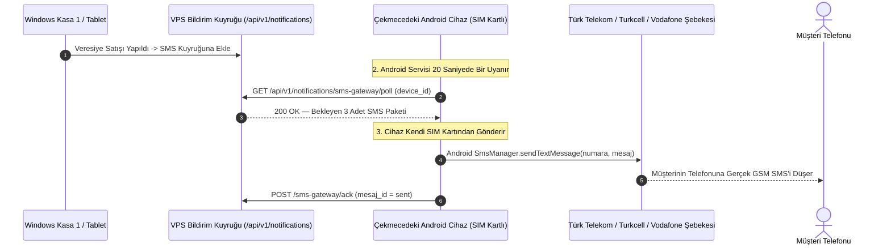

### 11.1. Nasıl Çalışır?
- İşletme, dükkanda duran herhangi bir Android telefona Serenut OS kurar ve bir SIM kart (ör. her yöne 2.000 - 5.000 SMS içeren standart kurumsal hat) takar.
- Ayarlar menüsünden **"Bu Cihazı SMS Ağ Geçidi Olarak Kullan"** seçeneği işaretlenir.
- Android işletim sisteminin yerel `SmsManager` servisine bağlanır.
- Ağdaki veya buluttaki tüm kasalardan (Windows, iOS, Web) çıkan SMS emirleri bu cihaz üzerinden gerçek GSM operatörü şebekesine basılır.
- **Maliyet:** 0 TL ek masraf.
- **Çift SIM Desteği:** Çift hatlı telefonlarda hangi SIM kart üzerinden gönderim yapılacağı (`smsSimSubscriptionId`) ayarlanabilir.
- **Aylık Limit Koruması:** Operatör faturasında aşım olmaması için "Aylık Maksimum SMS Limiti" (ör. 2.500 adet) tanımlanabilir; limite yaklaşıldığında yönetici uyarılır.

---

## 12. PATRON WEB YÖNETİM PORTALI & CANLI CİRO İZLEME (REALTIME WEBSOCKET ENGINE)

İşletme sahibinin fiziksel olarak mağazada olmadan, evdeki bilgisayarından veya cep telefonu tarayıcısından işletmeyi anlık yönetmesini sağlayan kurumsal web portalı ([server/src/modules/portal/](file:///c:/Users/ecz/proje/shaman/shaman_new/server/src/modules/portal/) & `server/public/app/`):

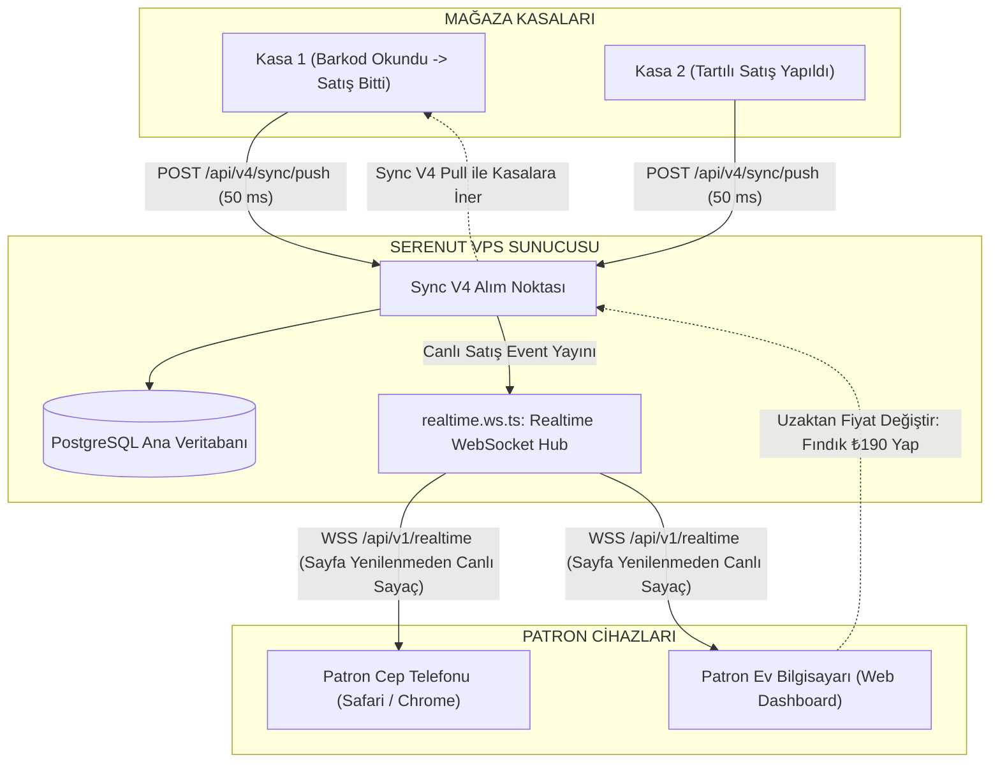

### 12.1. WebSocket Canlı Satış Akışı (Realtime Dashboard)
- **Bağlantı Endpoint'i:** `wss://api.serenut.com/api/v1/realtime` (veya yerel testte `ws://localhost:3000/api/v1/realtime`).
- **Yetkilendirme:** WebSocket handshake aşamasında geçerli kullanıcı JWT Bearer token'ı doğrulanır.
- **Tenant Oda İzolasyonu:** Her işletmenin WebSocket kanalı kendi `company_id` odasına abonedir. Başka bir şirketin cirosu veya satışı kesinlikle diğerine sızamaz.
- **Heartbeat & Canlılık Koruması:** Her 30 saniyede bir ping/pong kontrolü yapılır; internet kesilirse istemci otomatik olarak yeniden bağlanır (exponential backoff).
- **Canlı Ciro Sayacı:** Kasiyer kasada satışı tamamladığı anda, patronun açık olan web ekranında hiçbir F5/yenileme yapmadan **Günlük Ciro, Yapılan İşlem Adedi ve Kasa Grafiği** anında artar.

### 12.2. Konsolide Çoklu Şube ve Kasa Raporları
- Tek ekranda tüm şubelerin (Merkez, Şube 1, Depo) anlık nakit ve kart hasılatı toplanır.
- **Kâr / Zarar Analizi:** Ürünlerin alış maliyetleri ile satış fiyatları arasındaki brüt kar marjı kuruşu kuruşuna listelenir.
- **Resmi KDV Matrah Dağılımı:** Muhasebeciye verilmek üzere %1, %10 ve %20 KDV dilimlerine göre net matrah dökümleri tek tıkla Excel ve PDF olarak indirilir.
- **Kritik Stok Uyarıları:** Depoda tükenmek üzere olan ürünler sarı ve kırmızı etiketlerle patronun ekranına düşer.

### 12.3. Uzaktan Fiyat ve Katalog Yönetimi
- Patron evindeyken veya tatildeyken web portalına girip bir ürünün fiyatını veya barkodunu güncellediğinde, bu değişiklik PostgreSQL veritabanına yazılır.
- Mağazadaki kasalar bir sonraki Sync döngüsünde (maksimum birkaç saniye içinde) yeni fiyatı otomatik çeker. Kasiyerin fiyat güncellemek için programı kapatıp açmasına gerek kalmaz!

---

## 13. MÜŞTERİ İKİNCİ EKRANI (CUSTOMER FACING DISPLAY)

Kasada ödeme yapan müşterinin sepetini, indirimlerini ve para üstünü görmesini sağlayan çift monitör / müşteri göstergesi entegrasyonu:

### 13.1. Donanım Mimarisi & Tipleri
1. **HDMI İkinci Ekran (Modern Grafik Ekranı):**
   - Kasa bilgisayarına takılı 10 inç ile 15 inç arası ikinci monitör.
   - Flutter Desktop çoklu pencere mimarisi ile çalışır. Ana ekran kasiyerdeyken, ikinci pencere müşteriye dönük ekranda tam ekran olarak açılır.
2. **VFD / Seri Müşteri Göstergesi (Pole Display):**
   - 2 satır 20 karakter yeşil floresan göstergeler (Epson ESC/POS veya CD5220 protokolü).
   - Seri port (COM1..COM9) veya USB-Serial dönüştürücü üzerinden 9600 baud hızında bağlanır.

### 13.2. Çalışma Modları ve Ekran Durumları
- **1. Bekleme Modu (Kasa Boşken):**
  - Ekranda işletmenin kurumsal logosu, indirim afişleri, günün fırsatları ve duyurular slayt gösterisi olarak döner (Dijital Tabela / Reklam Modu).
- **2. Satış Anı Modu (Barkod Okunurken):**
  - Kasiyer ürün okuttuğu anda ekran ikiye bölünür:
  - Sol tarafta okunan ürünün adı, büyük ürün fotoğrafı ve birim fiyatı parlar.
  - Sağ tarafta sepetteki ürünlerin listesi, uygulanan indirimler ve dev puntolarla **TOPLAM TUTAR** gösterilir.
- **3. Ödeme ve Para Üstü Modu (Kasa Kapanırken):**
  - Müşterinin uzattığı nakit para girildiğinde, ekranda dev harflerle **"ÖDENEN: ₺500,00"** ve yeşil kutu içinde **"PARA ÜSTÜ: ₺125,00"** gösterilir. Böylece para üstü anlaşmazlıkları sıfırlanır.

---

## 14. YEDEKLEME, GERİ YÜKLEME, LİSANSLAMA & VERİ AKTARIMI (MIGRATION)

### 14.1. Güvenli Veritabanı Yedekleme & Geri Yükleme (`BackupService`)

- [BackupService](file:///c:/Users/ecz/proje/shaman/shaman_new/lib/infrastructure/services/backup_service.dart), her akşam gün sonu Z-raporu alındığında veya her yazılım güncellemesi öncesinde otomatik devreye girer.
- **WAL Dondurma:** Yedek alınmadan önce veritabanında `PRAGMA wal_checkpoint(TRUNCATE)` çalıştırılarak `-wal` dosyasındaki tüm veri ana `.db` dosyasına dökülür.
- **Doğrulama:** Yedek dosyasının SHA-256 hash'i hesaplanır ve `PRAGMA integrity_check` yapılarak dosyanın sağlam olduğu tescillenmeden işlem bitirilmez.
- **Harici / Bulut Yedek:** İsteğe bağlı olarak Google Drive API entegrasyonu veya takılı bir USB belleğe `.serenut_backup` uzantılı arşiv dosyası olarak kopyalanır.

### 14.2. Lisanslama ve Çevrimdışı İntibak Süresi (Offline Grace Period)

- Lisans doğrulaması sunucunun RSA-4096 özel anahtarı ile imzalanmış bir dijital sertifika ile yapılır.
- **İnternet Kesintisi Güvencesi:** Sürekli interneti olmayan mağazalarda kasanın kapanmasını önlemek için **15 Günlük Çevrimdışı İntibak Süresi (Grace Period)** tanımlıdır. İnternet 15 gün boyunca hiç gelmese bile kasa satış yapmaya devam eder.

### 14.3. Dış Sistemlerden Veri Aktarımı (Excel / JSON Migration)

- [DataTransferPage](file:///c:/Users/ecz/proje/shaman/shaman_new/lib/presentation/pages/data_transfer_page.dart) üzerinden işletmelerin eski yazılımlarından (Akınsoft, Mikro, Logo, NarBarkod vb.) dışa aktardığı Excel (`.xlsx`), CSV veya JSON dosyaları içe aktarılır.
- Ürün adları, barkodlar, birimler, alış/satış fiyatları ve mevcut stoklar kuruş modeline dönüştürülerek içe alınır.

### 14.4. Veritabanı Sağlık Denetimi & Kendi Kendini Onarma (`IDatabaseHealthRepository` / Self-Healing)

Çevrimdışı çalışan POS sistemlerinde elektrik kesintisi veya donanım çökmesi sonucu oluşabilecek veri tutarsızlıklarını tespit eden ve arka planda kullanıcıya hissettirmeden onaran otomatik mekanizma:
- **Yetim Kalem Denetimi (Orphaned Items):** Satış üst kaydı silinmiş veya yarım kalmış sepet satırlarını tespit eder ve temizler.
- **Negatif Stok Telafisi:** İstemcide çevrimdışı satış sırasında stok eksiye düştüyse (`stock_qty < 0`), sistem ürün hareket geçmişini tarayarak düzeltme mutasyonu üretir.
- **Defter & Bakiye Uyuşmazlığı Otomatik Mutabakatı:** Müşterinin `balance_cents` önbellek değeri ile `ledger_entries` toplamı uyuşmuyorsa, kanonik formülü tek işlemde çalıştırarak bakiyeyi matematiksel gerçeğe eşitler.

### 14.5. Kriptografik Denetim İzi & Audit Log Teftiş Merkezi ([AuditCenterPage](file:///c:/Users/ecz/proje/shaman/shaman_new/lib/presentation/pages/admin/audit_center_page.dart) & [AuditLogService](file:///c:/Users/ecz/proje/shaman/shaman_new/lib/domain/services/audit_log_service.dart))

Kasiyerlerin ve yöneticilerin yaptığı her hassas işlemin silinemez ve değiştirilemez şekilde kayıt altına alındığı teftiş merkezi:
- **Kriptografik SHA-256 Zinciri (`_integrityVerified`):** Her denetim kaydı bir önceki kaydın hash'ine bağlıdır (Blockchain/Merkle benzeri zincirleme). Veritabanından satır silinirse veya SQLite açılıp bir rakam elle değiştirilirse bütünlük mührü kırılır ve ekran kırmızı alarm verir.
- **17 Kritik Olay Tipi:**
  - Ürün & Fiyat: `product_created`, `price_changed`, `product_updated`, `product_deleted`
  - Müşteri & Cari: `customer_created`, `customer_updated`, `customer_deleted`, `payment_recorded`
  - Satış & Kasa: `sale_created`, `items_returned` (İadeler)
  - Sipariş: `order_created`, `order_updated`, `order_deleted`, `order_status_updated`
  - Sistem: `system_backup`, `system_restore`
- **Filtreleme & Arama:** Kasiyer bazlı, tarih aralıklı veya olay tipine göre saniyeler içinde arama yapılabilir.

### 14.6. Geri Dönüşüm & Kurtarma Merkezi ([RecoveryCenterPage](file:///c:/Users/ecz/proje/shaman/shaman_new/lib/presentation/pages/admin/recovery_center_page.dart))

Kasiyerin yanlışlıkla sildiği bir ürünü, müşteriyi veya siparişi panik yaşamadan kurtarmayı sağlayan sistem:
- **Soft-Delete (Tombstone) Prensibi:** Serenut OS'ta hiçbir kayıt ilk silme işleminde fiziksel olarak veritabanından silinmez (`is_deleted = 1` ve `deleted_at = timestamp` işaretlenir).
- **4 Ayrı Kurtarma Sekmesi:**
  1. **Ürünler:** Yanlışlıkla silinen ürünler barkodları ve stoklarıyla listelenir.
  2. **Müşteriler:** Silinen müşteriler eski bakiye ve defter hareketleriyle listelenir.
  3. **Satışlar:** İptal edilen veya silinen satış kayıtları.
  4. **Siparişler:** İptal edilmiş paket/teslimat siparişleri.
- **Tek Tıkla Kurtarma (`Restore`):** "Kurtar" butonuna basıldığı anda kayıt anında aktif çalışma ekranlarına geri döner.
- **Kalıcı İmha (`Purge`):** Yalnızca yetkili yöneticinin ikinci bir onay vermesi durumunda veritabanından kalıcı olarak temizlenir.

### 14.7. Güvenli Yedekleme & Geri Yükleme Yönetimi ([BackupManagePage](file:///c:/Users/ecz/proje/shaman/shaman_new/lib/presentation/pages/settings/backup_manage_page.dart) & [BackupService](file:///c:/Users/ecz/proje/shaman/shaman_new/lib/infrastructure/services/backup_service.dart))

- **Tek Tıkla Anlık Yedek (`.serenutbak`):** Veritabanı, ürün fotoğrafları ve sistem yapılandırması sıkıştırılmış ve bütünlüğü doğrulanmış tek bir arşiv dosyası olarak paketlenir.
- **Güvenli Geri Yükleme (Restore):**
  - Geçmiş bir yedek dosyası seçildiğinde sistem önce mevcut veritabanının acil durum anlık görüntüsünü alır.
  - Seçilen yedeği açar, `PRAGMA integrity_check` doğrulaması yapar ve sistemi temiz bir şekilde eski tarihe döndürür.
- **Yedek Dosyası Paylaşımı:** Oluşturulan yedek tek tıkla e-posta, WhatsApp veya USB belleğe aktarılabilir.

### 14.8. Canlı Önizlemeli Görsel Barkod & Etiket Tasarım Editörü ([LabelTemplateEditorPage](file:///c:/Users/ecz/proje/shaman/shaman_new/lib/presentation/pages/settings/label_template_editor_page.dart))

İşletmelerin raf ve ürün etiketlerini kod yazmadan görsel olarak özelleştirmesini sağlayan etkileşimli editör:
- **Canlı Önizleme Tuvali (Live Canvas):** Yapılan her ayar (yazı boyutu, alan açma/kapama) ekrandaki simüle edilmiş etikette anında değişir.
- **Ürün Etiketi Alan Kontrolleri:**
  - Firma Ünvanı Gösterilsin mi? (Aç/Kapat)
  - Marka Bilgisi Gösterilsin mi? (Aç/Kapat)
  - Barkod Çizgileri & EAN-13 Kodu Gösterilsin mi? (Aç/Kapat)
  - Satış Fiyatı & KDV Dahil İbaresi Gösterilsin mi? (Aç/Kapat)
  - Font Boyutu: `Küçük`, `Orta`, `Büyük`
- **Sipariş & Koli Etiketi Alan Kontrolleri:**
  - Müşteri Adı, Sipariş Numarası, Tarih/Saat, Kalem Sayısı ve Toplam Tutar alanlarını açıp kapatabilme.
- **Fiziki Etiket Boyut Seçici:** `40 x 25 mm`, `50 x 30 mm`, `60 x 40 mm` veya özel milimetrik ölçü tanımı.
- **"Yazıcıda Test Et" Butonu:** Yapılan tasarımı TSPL komut setine dönüştürerek bağlı etiket yazıcısına tek bir test baskısı gönderir.

### 14.9. Personel, Kasiyer Yetki Matrisi & Hızlı PIN Kodu ([UserManagementDialog](file:///c:/Users/ecz/proje/shaman/shaman_new/lib/presentation/pages/settings/widgets/user_management_dialog.dart))

Birden çok kasiyerin çalıştığı mağazalarda kasa güvenliğini ve yetki sınırlarını belirleyen modül:
- **Kullanıcı Rolleri:**
  - `Admin (Yönetici)`: Tüm ayarlara, raporlara, silme ve maliyet görme yetkilerine tam erişim.
  - `Cashier (Kasiyer)`: Yalnızca kasa satış, tahsilat ve sipariş ekranlarına erişim.
- **4-6 Haneli Hızlı PIN Kodu:** Kasiyerlerin klavyeden veya dokunmatik sayısal tuş takımından şifre yazmadan hızlıca kasayı devralmasını sağlar.
- **Hassas İşlem Kısıtlamaları:**
  - Kasiyer iskonto uygulayabilir mi? (Maksimum iskonto yüzdesi belirlenebilir).
  - Kasiyer satış fişi veya satır iptal edebilir mi? (Kapalıysa müdür PIN kodu isteme zorunluluğu).
  - Kasiyer gün sonu Z-raporu alabilir mi?
  - Kasiyer alış maliyetlerini ve kar marjlarını görebilir mi? (Varsayılan olarak kasiyere gizlidir).

### 14.10. Telefon Rehberinden Müşteri Çekme & Toplu Veri Aktarımı ([DataTransferPage](file:///c:/Users/ecz/proje/shaman/shaman_new/lib/presentation/pages/data_transfer_page.dart) & [ContactImportPage](file:///c:/Users/ecz/proje/shaman/shaman_new/lib/presentation/pages/data_transfer/contact_import_page.dart))

- **Rehberden Tek Tıkla Müşteri Aktarımı:** Android kasalarda telefon rehberine erişim izni verilerek (`flutter_contacts`), esnafın telefonundaki yüzlerce müşteriyi tek tıkla Serenut OS cari kartlarına dönüştürür.
- **Excel & CSV İçe / Dışa Aktarım Sihirbazı:**
  - `Ürünler.xlsx`: Barkod, Ürün Adı, Kategori, Alış Fiyatı, Satış Fiyatı, KDV, Stok.
  - `Müşteriler.xlsx`: Ünvan, Telefon, Adres, Vergi No, Başlangıç Bakiyesi.
  - Hatalı satırlar atlanır; başarılı satırlar canlı ilerleme çubuğu (`ImportProgressDialog`) ile içe aktarılır.

---

## 15. GELİŞMİŞ RAPORLAR & 5 SEKMELİ ANALİTİK PANELİ ([ReportsPage](file:///c:/Users/ecz/proje/shaman/shaman_new/lib/presentation/pages/reports_page.dart))

Serenut OS'un raporlama motoru, işletmenin finansal röntgenini çeken ve tek ekranda 5 ana uzmanlık sekmesi sunan kapsamlı bir analitik merkezidir:

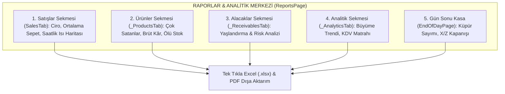

### 15.1. Satışlar Sekmesi (`SalesTab`)
- **Dönem Filtreleri:** `Bugün`, `Dün`, `Bu Hafta`, `Bu Ay`, `Geçen Ay`, `Özel Tarih Aralığı`.
- **Temel Metrik Kartları:** Toplam Hasılat (Ciro), Toplam Fiş/Satış Adedi, Ortalama Sepet Tutarı (Sepet Büyüklüğü).
- **Ödeme Dağılım Grafiği:** Nakit, Kredi Kartı ve Açık Hesap (Veresiye) cirolarının pasta dilim dağılımı.
- **Saatlik Satış Eğrisi (FL Chart):** Günün hangi saatlerinde yoğunluk yaşandığını gösteren tepe noktası analizi (personel vardiya planlaması için kritik).

### 15.2. Ürünler & Kârlılık Sekmesi (`_ProductsTab`)
- **En Çok Satanlar (Top Sellers):** Mağazaya en çok ciro ve adet kazandıran lokomotif ürünlerin sıralaması.
- **Brüt Kâr Marjı Analizi:** Her kalemin alış maliyeti ile satış fiyatı arasındaki brüt kâr tutarı ve marj yüzdesi.
- **Kritik Stok Uyarı Listesi:** Mağazada minimum stok eşiğinin altına inmiş ürünler sarı/kırmızı bayraklarla öne çıkarılır.
- **Sıfır Satan / Ölü Stoklar:** Son 30/60 gündür rafta bekleyen ve hiç satılmayan sermaye bağlayıcı ürünlerin tespiti.

### 15.3. Alacaklar & Yaşlandırma Sekmesi (`_ReceivablesTab`)
- **Toplam Piyasa Alacağı:** Piyasada işletmeye borçlu olan tüm müşterilerin toplam bakiye yekûnu.
- **Borç Yaşlandırma Piramidi:**
  - `0 - 30 Gün`: Yeni vadeli normal alacaklar.
  - `31 - 60 Gün`: Dikkat edilmesi gereken alacaklar.
  - `60+ Gün`: Vadesi geçmiş, yüksek riskli takip alacakları.
- **En Borçlu Müşteriler Listesi:** Risk limiti dolan veya vadesini aksatan carilerin tek tıkla WhatsApp hatırlatma butonları ile listelenmesi.

### 15.4. Analitik & Trendler Sekmesi (`_AnalyticsTab`)
- **Dönemsel Büyüme Karşılaştırması:** Seçili dönemin bir önceki dönemle (Bu hafta vs Geçen hafta) yüzdesel ciro ve işlem sayısı karşılaştırması.
- **KDV Dilim Dağılım Tablosu:** Muhasebeciye doğrudan teslim edilmek üzere %1, %10 ve %20 KDV dilimlerinin net matrahı ve hesaplanan KDV tutarları.
- **İade Oranı Göstergesi:** Toplam satışa oranla yapılan iade yüzdesi (kalite veya müşteri memnuniyeti takibi).

### 15.5. Dışa Aktarma & Rapor Paylaşımı (`DocumentExportService`)
- Rapor ekranındaki tüm tablolar tek bir butona basılarak kurumsal başlıklı **Excel (`.xlsx`)** tablosu veya grafikli **PDF raporu** olarak masaüstüne kaydedilebilir veya patronun WhatsApp'ına iletilebilir.

---

## 16. DAĞITIM, GÜNCELLEME & KRİPTOGRAFİK İMZALAMA STANDARTLARI

Bu bölüm, `AGENTS.md` ve `docs/release-update-runbook.md` belgelerinde tanımlanan **zorunlu güvenlik ve yayın kurallarını** içerir.

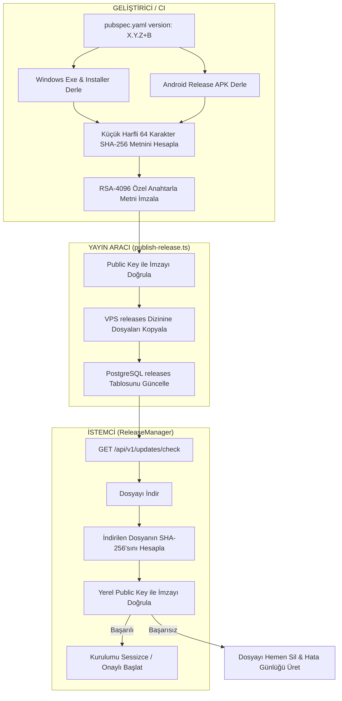

### 15.1. Sürüm ve Dosya Adlandırma Kuralları (Professional Versioning)

- **`+` İletimi Yasaktır (Dosya Adları & Public UI - AGENTS.md Kural 2):**
  - Kullanıcıya sunulan veya web sitesinden indirilen dosyalarda `+` içeren dahili Flutter derleme numarası **ASLA KULLANILAMAZ** (Örnek: `SerenutOS-v1.3.144+299.exe` YASAKTIR).
  - **Doğru Format:**
    - Görünen ve İndirilen Dosya Adı: `SerenutOS-v1.3.144.exe` ve `SerenutOS-v1.3.144.apk`.
  - `pubspec.yaml` içerisindeki `+299` yapısı sadece dahili `versionCode` ve CI takibi içindir; yayın araçları ve indirme servisleri bunu otomatik semantik formata (`v1.3.144`) çevirir.

### 15.2. Değişmez İmza Sözleşmesi & OTA Standardı

1. **Android Paket İmzası (Keystore):**
   - Sertifika Parmak İzi (SHA-256): `server/release-signing-policy.json` dosyasındaki `androidPackageCertificateSha256` değeri ile birebir eşleşmelidir. Eşleşmeyen APK yayınlanamaz.
2. **Windows Authenticode İmzası:**
   - Tüm binary'ler (`.exe` ve `.dll`) Digicert zaman damgası ile SHA-256 PFX sertifikası kullanılarak imzalanır (`signtool.exe`).
3. **OTA RSA-SHA256 İmza Girdisi:**
   - **Kritik Kural:** İmzalanan şey dosyanın baytları değildir! Dosyanın küçük harfli 64 karakterlik SHA-256 özet metnidir (`utf-8`).
4. **Tek Yetkili Yayınlayıcı:**
   - Desteklenen tek yayınlayıcı: `server/src/scripts/publish-release.ts` (`dist/scripts/publish-release.js`).
   - `scripts/publish_v*.py` veya elle SQL yazarak sürüm yayınlamak **YASAKTIR**.
5. **Yayın Doğrulama:**
   - Her yayın sonrasında `node scripts/verify_published_release.js X.Y.Z+B` çalıştırılarak imza ve hash VPS üzerinde tam test edilmeden yayın tamamlanmış sayılmaz.

---

## 16. GÖZLEMLENEBİLİRLİK, TELEMETRİ & LOGLAMA

### 16.1. Yerel Loglama (Structured JSONL)

İstemci tüm çalışma loglarını işletim sistemine özel yerel dizinde saklar:
- **Windows:** `%APPDATA%\Serenut OS Software Technologies A.Ş\Serenut OS\logs\app.log`
- **Android:** `/data/user/0/com.serenutos.pos/files/logs/app.log`
- **Log Formatı:** JSON Lines (her satırda timestamp, level, subsystem, correlation_id, message, payload).

### 16.2. Sentry Entegrasyonu & Hata Fırtınası Filtreleri

Sentry crash reporting sistemi istemcideki gerçek kritik hataları yakalar.
- **Filtreleme Kuralları (`beforeSend`):**
  - Çevrimdışı modda çalışırken oluşan beklenen ağ hataları (`SocketException`, `ClientException`, `HttpException: Connection closed before full header was received`, `HandshakeException`) Sentry'ye gönderilmez ve kota israfı engellenir.
  - Sentry yalnızca yakalanmamış UI çöküşleri (`FlutterError.onError`), veritabanı bozulma alarmları ve donanım kritik istisnalarını raporlar.

---

## 17. SORUN GİDERME RUNBOOK'U & ACİL MÜDAHALE PROSEDÜRLERİ

### 17.1. Senaryo 1: Kasa Çevrimdışı Kaldı / Outbox Kuyruğu Birikti

**Belirti:** Satışlar yapılıyor ancak web panelinde veya diğer kasalarda görünmüyor. Sağ üst köşedeki bulut simgesi kırmızı/sarı.
1. **İnternet ve Sunucu Erişimi Kontrolü:**
   ```bash
   curl -I https://api.serenut.com/api/v1/health
   ```
2. **Kuyruktaki Bekleyen Mutasyonları Sorgula (SQLite):**
   ```sql
   SELECT count(*), status FROM outbox GROUP BY status;
   ```
3. **Hatalı / Dead Letter'a Düşmüş Mutasyonu Bul:**
   ```sql
   SELECT id, aggregate_type, error_message, retry_count FROM outbox WHERE status = 'failed' OR status = 'dead_letter';
   ```
4. **Çözüm / Yeniden Tetikleme:**
   - Ağ düzeldiğinde sistem otomatik push yapar.
   - Acil durumlarda Ayarlar -> Senkronizasyon -> "Şimdi Eşitle" butonuna basılır.

### 17.2. Senaryo 2: Müşteri Bakiyesi ile Defter Hareketleri Uyuşmuyor

**Belirti:** Müşteri kartında bakiye 500 TL yazıyor ancak hareket listesi toplandığında 400 TL çıkıyor.
1. **İnceleme:** `customers.balance_cents` önbellek kolonu harici bir işlem veya kesinti yüzünden güncelliğini yitirmiş olabilir.
2. **Kanonik Yeniden Hesaplama:**
   İstemcideki `LedgerService.recalculateCustomerBalance(customerId)` çalıştırılır veya SQLite üzerinde:
   ```sql
   UPDATE customers 
   SET balance_cents = (
       SELECT COALESCE(SUM(CASE WHEN type IN ('sale_credit', 'manual_debt', 'promissory_returned') THEN amount_cents ELSE -amount_cents END), 0)
       FROM ledger_entries 
       WHERE customer_id = customers.id AND deleted_at IS NULL
   )
   WHERE id = 'HEDEF_MUSTERI_ID';
   ```
3. Bakiye anında matematiksel olarak defterin gerçek toplamına eşitlenir.

### 17.3. Senaryo 3: SQLite Veritabanı Kilitlendi veya WAL Büyüdü

**Belirti:** `database is locked` veya `disk I/O error`.
1. **Bütünlük Kontrolü:**
   ```sql
   PRAGMA integrity_check;
   ```
   Çıktı `ok` olmalıdır.
2. **WAL Checkpoint:**
   Büyüyen `-wal` dosyasını ana veritabanına gömmek için:
   ```sql
   PRAGMA wal_checkpoint(TRUNCATE);
   ```
3. **Kurtarma:** Uygulama tamamen kapatılır, `%APPDATA%\...\databases\core_next` dizinindeki veritabanının yedeği alınır ve uygulama yeniden başlatılır.

### 17.4. Senaryo 4: Termal Yazıcı Fiş Basmıyor veya Türkçe Harfler Bozuk

1. **Bağlantı Kontrolü:**
   - USB yazıcı ise Windows Aygıt Yöneticisi'nde doğru yazıcı kuyruğu seçili mi?
   - Ağ yazıcısı ise IP adresine ping atılabiliyor mu (`ping 192.168.1.200`)?
2. **Türkçe Karakter Sorunu:**
   - Ayarlar -> Yazıcı Ayarları -> "Karakter Kod Sayfası" seçeneğini `CP857` yapın.
   - Sorun çözülmezse "Grafik/Resim Olarak Yazdır" seçeneğini açın (tüm karakterleri piksel olarak dökeceğinden %100 kusursuz Türkçe basacaktır).

### 17.5. Senaryo 5: Terazi Ağırlığı Okumuyor

1. Windows Aygıt Yöneticisi -> Bağlantı Noktaları (COM & LPT) altında terazi USB-Serial çeviricinin COM portunu (ör. `COM3`) kontrol edin.
2. Başka bir uygulamanın COM portunu işgal etmediğinden emin olun (COM portları tekil erişimlidir).
3. Ayarlar -> Donanım -> Terazi ekranından Baud Rate'in `9600` ve modelin doğru seçildiğini doğrulayın.

### 17.6. Senaryo 6: Güncelleme İndirildi Ama İmza Hatası Veriyor

**Belirti:** Güncelleme iniyor ancak "İmza doğrulanamadı" uyarısıyla iptal ediliyor.
1. İndirilen dosyanın SHA-256 hash'i sunucudaki hash ile uyuşmuyor olabilir (eksik indirme / proxy araya girmesi).
2. İstemcideki yerel güncelleme önbelleğini temizleyin:
   - Windows: `%TEMP%\serenut_updates` veya `%APPDATA%\...\updates` dizinini silin.
3. Cihazın sürümünün köprü sürüm gerektirip gerektirmediğini (`1.3.10+91` altı mı?) kontrol edin.

### 17.7. Senaryo 7: GİB e-Arşiv Portalı Fatura İmzalamıyor / Hata Veriyor

1. **GİB Portal Bakımı:** GİB portalı yoğunluk veya bakım saatlerinde (genelde gece 00:00 - 02:00) yanıt vermeyebilir. İstemcideki faturayı "Taslaklara Kaydet" ile yerelde tutun; portal açıldığında tek tıkla toplu imzalayın.
2. **SMS Doğrulama Zaman Aşımı:** SMS onay kodu 180 saniye içinde girilmelidir. Zaman aşımına uğradıysa yeni SMS isteği tetikleyin.
3. **Mükellef TCKN/VKN Kontrolü:** Alıcı TCKN veya VKN'si 10 ya da 11 hane olmalı, e-Fatura mükellefi olan kurumlara e-Arşiv değil doğrudan e-Fatura kesilmelidir.

### 17.8. Senaryo 8: WhatsApp Bağlantısı Koptu / Mesaj Gitmiyor

**Belirti:** Satış fişleri veya Z-raporu WhatsApp'a düşmüyor. Portalda WhatsApp durumu `disconnected` veya `reauthorization_required`.
1. **Bağlantı Tipini Kontrol Edin:**
   - **Evolution API (QR Kod Modu):** Portalda Ayarlar $\rightarrow$ Bildirimler $\rightarrow$ WhatsApp sekmesine gidin. "Yeniden Bağlan" butonuna tıklayıp çıkan QR kodu telefonunuzdaki WhatsApp uygulamasından okutun.
   - **Meta Cloud API (Resmi WABA):** Meta Business Manager'da kayıtlı ödeme kartının süresi bitmiş veya token süresi dolmuş olabilir. Portaldan "Embedded Signup Yenile" adımı yapılır.
2. **Kuyruktaki Mesajları Kontrol Edin:**
   ```sql
   SELECT status, count(*) FROM notification_queue WHERE channel = 'whatsapp' GROUP BY status;
   ```
3. **Failover (Yedek Hat):** WhatsApp kapalı olduğunda sistemin otomatik olarak SIM SMS Gateway'e geçip geçmediğini kontrol edin (`NOTIFICATION_ENABLED_CHANNELS=whatsapp,sms`).

### 17.9. Senaryo 9: Web Portalı Canlı Ciro Akışı Güncellenmiyor (WebSocket Düşmesi)

**Belirti:** Kasada satış yapılıyor ama patronun web ekranındaki canlı ciro artmıyor.
1. Web tarayıcısının F12 Konsolunda `WebSocket connection failed: wss://api.serenut.com/ws` hatası var mı bakın.
2. NGINX proxy üzerinde `Upgrade` ve `Connection "upgrade"` başlıklarının açık olduğunu doğrulayın.
3. VPS üzerinde WebSocket sunucusunu yeniden başlatın:
   ```bash
   pm2 restart serenut-server
   ```

### 17.10. Senaryo 10: Müşteri İkinci Ekranı Görüntü Vermiyor

1. Windows Masaüstü $\rightarrow$ Ekran Ayarları altında ikinci monitörün **"Bu ekranları genişlet" (Extend Desktop)** olarak ayarlandığından emin olun ("Bu ekranları yinele/Duplicate" modu kullanılmamalıdır).
2. Serenut OS Ayarlar $\rightarrow$ Ekran Ayarları $\rightarrow$ "Müşteri Ekranını Etkinleştir" anahtarını açın ve hedef monitörü seçin.
3. İkinci ekranda reklam slaytları için bir görsel klasörü seçildiğini doğrulayın.

### 17.11. Senaryo 11: Android SIM SMS Gateway Mesaj Göndermiyor

1. Kasadaki Android cihazda Serenut OS arka plan çalışma ve pil optimizasyonu istisnasının verildiğini kontrol edin (Android sistemi uygulamayı uyutmamalıdır).
2. Cihazın SIM kartında SMS paketi veya TL bakiyesi olduğunu doğrulayın.
3. Uygulama Ayarları $\rightarrow$ "Bu cihazı SIM SMS Ağ Geçidi yap" anahtarının açık olduğunu kontrol edin.

### 17.12. Senaryo 12: VPS Production Sunucusu Acil Müdahale Komutları

```bash
# Sunucu durumunu kontrol et
pm2 status

# Node.js backend loglarını canlı izle
pm2 logs serenut-server --lines 100

# Backend'i sıfır kesintiyle yeniden başlat
pm2 reload serenut-server

# PostgreSQL bağlantı durumunu incele
sudo -u postgres psql -d serenut_production -c "SELECT count(*), state FROM pg_stat_activity GROUP BY state;"

# Yayındaki sürümü doğrula
node scripts/verify_published_release.js 1.3.144+299
```

---

## 18. GENİŞLETİLMİŞ MASTER CHEAT SHEET TABLOSU

| Alan | Kanonik Kural | İlgili Dosya / Kod |
|---|---|---|
| **Veritabanı** | Standart SQLite (SQLCipher Yasak) | [db_schema.dart](file:///c:/Users/ecz/proje/shaman/shaman_new/lib/infrastructure/database/schema/db_schema.dart) |
| **Para Birimi** | Kuruş / Integer (`MoneyCents`) | [money_cents.dart](file:///c:/Users/ecz/proje/shaman/shaman_new/core_next/client_core/lib/domain/money_cents.dart) |
| **Bakiye Formülü** | Pozitif = Borçlu, Negatif = Alacaklı | [db_triggers.dart](file:///c:/Users/ecz/proje/shaman/shaman_new/lib/infrastructure/database/schema/db_triggers.dart) |
| **Dosya İsimleri** | `+` Yasak (`SerenutOS-vX.Y.Z.exe`) | [AGENTS.md Kural 2](file:///c:/Users/ecz/proje/shaman/shaman_new/.agents/AGENTS.md) |
| **OTA İmzalama** | Dosya SHA-256 Metninin RSA İmzası | [publish-release.ts](file:///c:/Users/ecz/proje/shaman/shaman_new/server/src/scripts/publish-release.ts) |
| **Yayın Doğrulama** | Zorunlu Kontrol Scripti | [verify_published_release.js](file:///c:/Users/ecz/proje/shaman/shaman_new/scripts/verify_published_release.js) |
| **Senkronizasyon** | Deep Equal JSONB (`payloadDeepEqual`) | [sync-v4.routes.ts](file:///c:/Users/ecz/proje/shaman/shaman_new/server/src/modules/sync_v4/sync-v4.routes.ts) |
| **GİB e-Arşiv** | 0 TL Maliyetli Resmi Portal İstemcisi | [gib_earsiv_client.dart](file:///c:/Users/ecz/proje/shaman/shaman_new/lib/infrastructure/services/gib_earsiv_client.dart) |
| **WhatsApp Evolution** | QR Kod ile 1 Dakikada WhatsApp Bağlama | [whatsapp.controller.ts](file:///c:/Users/ecz/proje/shaman/shaman_new/server/src/modules/whatsapp/whatsapp.controller.ts) |
| **WhatsApp Meta** | Kurumsal Resmi WABA Embedded Signup | [WHATSAPP_BUSINESS_SETUP.md](file:///c:/Users/ecz/proje/shaman/shaman_new/docs/WHATSAPP_BUSINESS_SETUP.md) |
| **Patrona Z-Raporu** | Gün Sonu Kapanışında Otomatik WhatsApp Özeti | [end_of_day_page.dart](file:///c:/Users/ecz/proje/shaman/shaman_new/lib/presentation/pages/end_of_day_page.dart) |
| **SIM SMS Gateway** | Android Telefonu GSM SMS Modemi Yapma | [sms_gateway_service.dart](file:///c:/Users/ecz/proje/shaman/shaman_new/lib/infrastructure/services/sms_gateway_service.dart) |
| **Web Portalı** | Evden/Telefondan Canlı Ciro Takibi | [server/src/modules/portal/](file:///c:/Users/ecz/proje/shaman/shaman_new/server/src/modules/portal/) |
| **Müşteri 2. Ekranı** | HDMI / VFD Çift Ekran Kasa Yansıtma | [lib/presentation/pages/](file:///c:/Users/ecz/proje/shaman/shaman_new/lib/presentation/pages/) |
| **P2P Görsel Ağı** | UDP 48732 / HTTP 48731 LAN Senkronu | [product_image_peer_service.dart](file:///c:/Users/ecz/proje/shaman/shaman_new/lib/infrastructure/services/product_image_peer_service.dart) |
| **Ortak Donanım** | Kasalar Arası Ortak Yazıcı/Terazi | [shared_hardware_service.dart](file:///c:/Users/ecz/proje/shaman/shaman_new/lib/infrastructure/services/shared_hardware_service.dart) |
| **Sepet Kurtarma** | Elektrik Kesilse Bile Sepeti Geri Getirme | [cart_persistence_service.dart](file:///c:/Users/ecz/proje/shaman/shaman_new/lib/infrastructure/services/cart_persistence_service.dart) |
| **Yedekleme** | WAL Checkpoint & Integrity Check | [backup_service.dart](file:///c:/Users/ecz/proje/shaman/shaman_new/lib/infrastructure/services/backup_service.dart) |
| **Yerel Loglar** | `%APPDATA%\...\logs\app.log` | [log_collection_service.dart](file:///c:/Users/ecz/proje/shaman/shaman_new/lib/infrastructure/services/log_collection_service.dart) |

---
*Bu el kitabı Serenut OS geliştirici ve operasyon ekipleri için birincil ve bağlayıcı referanstır. Her yeni mimari kararda ve sürüm geçişinde güncellenmelidir.*
