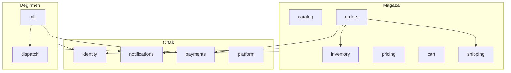

# 02 — Mimari

## 1. Teknoloji kararları (ADR özetleri)

| ADR | Karar | Gerekçe | Alternatif ve neden elendi |
|---|---|---|---|
| 001 | Modüler monolit | Tek ekip/tek VPS; dağıtım ve hata ayıklama basit; sınırlar net olursa sonra bölünür | Mikroservis: erken karmaşıklık |
| 002 | TypeScript her yerde | Tek dil, paylaşılan tipler/şemalar | — |
| 003 | NestJS + Fastify adaptörü (API) | Modül/DI yapısı ayrıştırmaya uygun; OpenAPI üretimi; hızlı | Express: yapı yok; Hono: ekosistem küçük |
| 004 | Next.js (App Router, SSR/ISR) vitrin | SEO, performans, görsel optimizasyonu | Statik: dinamik stok/fiyat zor; SPA: SEO zayıf |
| 005 | Admin: ayrı Vite+React SPA (`admin.` alt alan adı) | Güvenlik izolasyonu, vitrinden bağımsız dağıtım, SEO gerekmez | Vitrin içinde `/yonetim`: saldırı yüzeyi karışır |
| 006 | PostgreSQL 17 | İlişkisel bütünlük, işlem, JSONB, Türkçe tam metin arama | MySQL: gerek yok; NoSQL: para/stok için uygun değil |
| 007 | Düz SQL göçleri (dbmate) + Kysely sorgu katmanı | Güçlü tip güvenliği, sıfır ORM sihri, deterministik kısıtlar ve göç bağımsızlığı | Prisma/Drizzle: Kilit karar K3/K4 uyarınca elendi |
| 008 | `pg-boss` kuyruk (PostgreSQL tabanlı) | Redis'e gerek yok, işler veritabanında; transaction ile atomik | BullMQ: Redis ek bileşen/RAM |
| 009 | Oturum: sunucu tarafı oturum, `httpOnly` çerez, Postgres'te saklama | JWT iptal sorunu yok; basit | JWT: iptal/rotasyon karmaşık |
| 010 | Görseller: `sharp` ile boyutlandırma, yerel disk + `StorageDriver` arayüzü | Başta basit; sonra S3'e geçiş kolay | Baştan S3: ek maliyet |
| 011 | Arama: PostgreSQL tam metin (`turkish` + `unaccent`) | Ürün sayısı küçük | Meilisearch/Elastic: gereksiz |
| 012 | Monorepo: `pnpm` workspaces + Turborepo | Paylaşılan paketler, önbellek | Çoklu repo: tipleri senkron tutmak zor |
| 013 | Doğrulama: `zod` (paylaşılan) | Aynı şema istemci+sunucu | class-validator: tekrar |
| 014 | Test: Vitest (birim), Testcontainers/gerçek Postgres (entegrasyon), Playwright (E2E) | Gerçek DB ile güven | Mock DB: sahte güven |
| 015 | Gözlem: `pino` JSON log, OpenTelemetry hazır, Sentry hata, Uptime Kuma | Küçük VPS'e uygun | Tam Prometheus/Grafana: RAM yükü |

> Veritabanı ve sorgu katmanı mimarisi Kilit Kararlar (K2, K3, K4) gereği PostgreSQL 17 + dbmate + Kysely olarak kilitlenmiştir; spike yapılmaz.

## 2. Repo yapısı (`nutopia-platform`, yeni repo)

```
nutopia-platform/
├─ apps/
│  ├─ api/                 # NestJS
│  │  └─ src/modules/
│  │     ├─ identity/      # müşteri/personel kimliği, OTP, oturum, roller
│  │     ├─ catalog/       # ürün, varyant, kategori, medya
│  │     ├─ inventory/     # stok, rezerv, hareket
│  │     ├─ pricing/       # fiyat, KDV, kupon, indirim motoru
│  │     ├─ cart/          # sepet
│  │     ├─ orders/        # sipariş, durum makinesi
│  │     ├─ payments/      # sağlayıcı arayüzü, iyzico, PayTR, havale, webhook
│  │     ├─ shipping/      # kargo kuralları, etiket, takip
│  │     ├─ mill/          # talep, alım, tartı, iş, ücret   (DEĞİRMEN)
│  │     ├─ dispatch/      # şoför, rota, günlük plan         (DEĞİRMEN)
│  │     ├─ notifications/ # SMS, e-posta, şablon, kuyruk
│  │     ├─ invoicing/     # fatura/e-arşiv bağlayıcı
│  │     ├─ content/       # statik sayfa/SSS/duyuru
│  │     ├─ reporting/     # özetler, dışa aktarım
│  │     └─ platform/      # ayarlar, audit, feature flag, health
│  ├─ web/                 # Next.js vitrin + /degirmen
│  └─ admin/               # Vite React (yönetim + şoför PWA)
├─ packages/
│  ├─ contracts/           # zod şemaları, OpenAPI istemcisi, ortak tipler
│  ├─ money/               # kuruş/KDV/yuvarlama kütüphanesi (çok test edilen)
│  ├─ ui/                  # tasarım sistemi bileşenleri
│  └─ config/              # eslint, tsconfig, prettier
├─ infra/                  # compose, nginx, scripts, runbook
├─ docs/                   # bu plan paketi buraya taşınır
└─ .github/workflows/
```

## 3. Modül sınırları (bölünmeye hazırlık)

**Kurallar**
1. Bir modül, başka modülün **tablosuna doğrudan yazmaz/okumaz**; yalnızca o modülün `*.service` dışa aktarımını kullanır.
2. Modüller arası eşzamansız iletişim **outbox olayları** ile (örn. `OrderPaid`, `MillRequestWeighed`).
3. `mill` ve `dispatch`, `orders/catalog/inventory` içe aktarmaz (ters yön de yasak). Ortak olan yalnızca `identity`, `payments`, `notifications`, `platform`.
4. ESLint `no-restricted-imports` + `dependency-cruiser` ile CI'da zorunlu.
5. Ayırma günü: `mill`+`dispatch` ayrı uygulama olur; `payments` ve `identity` ya ortak paket ya ayrı servis; DB şeması zaten `mill.*` ayrı şemada olduğu için taşınır.

## 4. API kuralları
- REST, `/v1/...`, JSON. Hatalar `application/problem+json` (RFC 7807): `type, title, status, detail, code, requestId, errors[]`.
- Sayfalama: imleç (cursor) tabanlı; liste uçlarında `limit` üst sınırı.
- **İdempotensi:** `POST /orders`, ödeme başlatma, iade uçları `Idempotency-Key` başlığı ister; 24 saat saklanır.
- **Sürümleme:** kırıcı değişiklikte `/v2`. OpenAPI belgesi CI'da üretilir, `packages/contracts` istemcisi otomatik üretilir.
- Alan adlandırma: `camelCase` JSON, `snake_case` veritabanı.
- Zaman: UTC saklanır, ISO-8601; gösterim `Europe/Istanbul`.
- Para: `{ amount: 16500, currency: "TRY" }` (kuruş). Ağırlık: gram.
- Hız sınırı: IP + hesap bazlı; OTP, giriş, kupon, ödeme uçları için sıkı.
- CORS: yalnızca bilinen kökenler. CSRF: çerez tabanlı oturumlarda çift gönderim token + `SameSite=Lax/Strict`.
- Tüm yazma uçlarında `audit_log`.

### Uç nokta aileleri (ana hatlar)
| Alan | Örnek uçlar |
|---|---|
| Katalog (genel) | `GET /v1/products`, `/v1/products/:slug`, `/v1/categories` |
| Sepet | `GET/PUT /v1/cart`, `POST /v1/cart/items`, `POST /v1/cart/coupon` |
| Ödeme çıkışı | `POST /v1/checkout/quote`, `POST /v1/checkout/orders`, `POST /v1/payments/:orderId/init` |
| Webhook | `POST /v1/webhooks/iyzico`, `/v1/webhooks/paytr` |
| Sipariş (müşteri) | `GET /v1/orders/track/:token`, `GET /v1/me/orders` |
| Kimlik | `POST /v1/auth/otp/request`, `/verify`, `POST /v1/auth/logout` |
| Değirmen (müşteri) | `GET /v1/mill/services`, `POST /v1/mill/quote`, `POST /v1/mill/requests`, `GET /v1/me/mill-requests` |
| Admin | `/v1/admin/products`, `/orders`, `/mill/requests`, `/dispatch/plans`, `/settings`, `/staff` |
| Şoför | `GET /v1/driver/today`, `POST /v1/driver/pickups/:id/weigh`, `/complete` |

## 5. Kimlik ve yetki
- **Müşteri:** telefon+OTP (Değirmen için zorunlu), e-posta+OTP/şifresiz bağlantı (Mağaza için isteğe bağlı). Misafir sipariş, `track token` ile izlenir.
- **Personel:** e-posta+şifre (argon2id) + TOTP 2FA zorunlu; oturum süresi kısa, boşta zaman aşımı.
- **Roller:** `owner`, `manager`, `packer`, `driver`, `support` (+ özel izin kümeleri).
- İzin modeli: `resource:action` (örn. `orders:refund`, `mill:weigh`). Rol→izin tablosu veritabanında, `owner` dışında değiştirilemez.
- Şoför yalnızca kendisine atanmış alımları görür/değiştirir (satır düzeyi kontrol).
- OTP: 6 hane, 5 dk geçerli, 5 deneme, telefon başına saatlik üst sınır, aynı IP sınırı; mock sağlayıcı ile test.

## 6. Arka plan işleri (`pg-boss`)
| İş | Tetik | Not |
|---|---|---|
| `notify.sms/email` | olay | yeniden deneme + gecikmeli artış |
| `payment.reconcile` | 10 dk | beklemede ödemeleri sağlayıcıdan sorgular |
| `inventory.release-expired` | 1 dk | süresi dolan rezervleri iade eder |
| `order.auto-cancel` | günlük | ödenmemiş havale siparişleri |
| `media.process` | yükleme | boyutlar, webp/avif |
| `report.daily` | 07:00 | günlük özet e-posta |
| `backup.verify` | haftalık | yedeği test geri yükler (uyarı) |
| `mill.reminder` | gün öncesi | alım hatırlatma SMS |
| `shipping.poll-tracking` | 30 dk | kargo durumu çek |

## 7. Olay / outbox
- `outbox` tablosu: işlemle aynı transaction'da olay yazılır; işleyici `pg-boss` ile iletir. Çift işleme için tüketici tarafı idempotent.
- Olaylar: `OrderPlaced`, `OrderPaid`, `OrderShipped`, `OrderDelivered`, `OrderCancelled`, `PaymentRefunded`, `MillRequestCreated`, `MillRequestApproved`, `PickupScheduled`, `PickupWeighed`, `MillJobDone`, `MillDelivered`, `MillPaid`.

## 8. Yapılandırma ve sırlar
- `.env` yalnızca yerel; üretimde `docker secrets`/`sops+age` ile şifreli dosya. Depoda sır **asla**.
- Ortamlar: `local`, `staging`, `production`. Her ortamın ayrı veritabanı, ayrı sağlayıcı sandbox/live anahtarı.
- Özellik bayrakları: `settings.feature_flags` (kapıda ödeme, kupon, değirmen online ödeme…).

## 9. Günlükleme ve hata
- `requestId` her istekte, loglarda/hatalarda aynı. PII (telefon/adres) loglarda maskelenir; kart verisi sunucuya hiç gelmez.
- Sentry: yakalanmamış hata, ödeme webhook hatası, kuyruk başarısızlığı.
- Sağlık uçları: `/health/live`, `/health/ready` (DB + kuyruk).

## 10. Performans
- Katalog uçları kısa süreli önbellek (bellek içi + HTTP `Cache-Control`); Next.js ISR/`revalidateTag` ile ürün değişince geçersizleştirme.
- Görsel: `srcset`, `avif/webp`, `loading=lazy`, CDN önbelleği.
- N+1 sorgu yasağı; entegrasyon testlerinde sorgu sayısı sınırı.

## 11. Yerelleştirme
- Başlangıçta yalnız `tr-TR`, ama metinler `i18n` sözlüğünde. Tarih/para `Intl`. Adres yapısı: il, ilçe, mahalle, açık adres, posta kodu (resmî il/ilçe/mahalle veri seti içe aktarılır; sürüm numarası saklanır).

## 12. Kodlama standartları
- `strict` TypeScript, ESLint, Prettier, `commitlint` (conventional commits), PR şablonu, CODEOWNERS, zorunlu inceleme, CI yeşil olmadan birleştirme yok, trunk-based kısa dallar.
- Her modülde `README.md`: sorumluluk, olaylar, tablolar.

