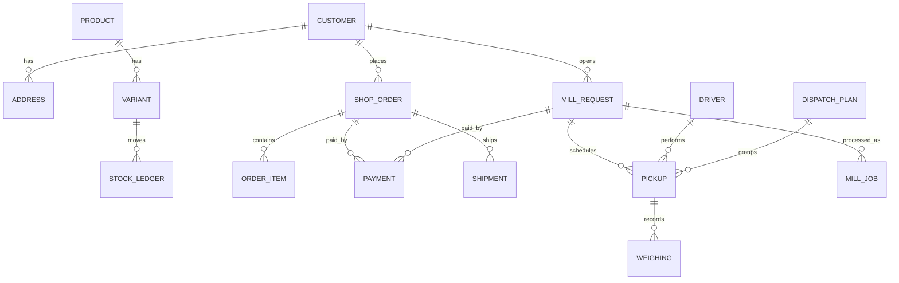

# 03 — Veri Modeli

> Gösterim: `PK` birincil, `FK` yabancı, `UQ` benzersiz, `IDX` indeks. Tüm tablolarda `id` (UUID v7, sıralı), `created_at`, `updated_at` (timestamptz). Para: `bigint` kuruş. Ağırlık: `integer` gram. Silme: yumuşak silme yalnızca katalogda (`deleted_at`); sipariş/ödeme/ağırlık kayıtları **silinmez**.
> Şemalar: `core`, `shop`, `mill`, `payments`, `ops` — ayırma kolaylığı için.

## 1. ER özeti

## 2. `core` şeması
**customers**: `id`, `phone` (E.164, UQ nullable), `phone_verified_at`, `email` (UQ nullable, küçük harf), `email_verified_at`, `full_name`, `marketing_consent` (bool), `marketing_consent_at`, `kvkk_notice_version`, `status` (active/blocked), `anonymized_at`.
 - En az biri (phone/email) dolu CHECK. İzin geçmişi `consent_log`.
**customer_addresses**: `customer_id FK`, `label`, `recipient_name`, `phone`, `city_code`, `district_code`, `neighborhood_code`, `line1`, `line2`, `postal_code`, `lat`, `lng` (değirmen için), `is_default`, `address_type` (shipping/pickup).
**staff**: `email UQ`, `password_hash` (argon2id), `totp_secret_enc`, `role`, `status`, `last_login_at`, `phone`.
**roles / permissions / role_permissions**: izin tabloları.
**sessions**: `id`, `subject_type` (customer/staff), `subject_id`, `token_hash UQ`, `ip`, `user_agent`, `expires_at`, `last_seen_at`, `revoked_at`.
**otp_codes**: `phone`, `code_hash`, `purpose`, `expires_at`, `attempts`, `consumed_at`, `ip`. IDX `(phone, created_at)`.
**consent_log**: `customer_id`, `type` (kvkk/marketing/cookie/ticari_ileti), `granted`, `source`, `ip`, `text_version`, `at`.
**settings**: `key PK`, `value jsonb`, `updated_by`. (kargo eşiği, indirim oranları…)
**feature_flags**: `key`, `enabled`, `rules jsonb`.
**audit_log**: `actor_type`, `actor_id`, `action`, `entity`, `entity_id`, `before jsonb`, `after jsonb`, `ip`, `request_id`, `at`. Yalnızca ekleme. IDX `(entity, entity_id, at)`.
**outbox**: `id`, `topic`, `payload jsonb`, `created_at`, `processed_at`, `attempts`.
**idempotency_keys**: `key`, `scope`, `request_hash`, `response jsonb`, `expires_at` (UQ `scope,key`).
**tr_geo**: `il`, `ilce`, `mahalle`, `kod`, `veri_surumu`.
**notifications**: `channel` (sms/email/whatsapp), `to`, `template`, `payload`, `status`, `provider_message_id`, `error`, `sent_at`, `related_type/id`.
**notification_templates**: `key`, `channel`, `body`, `variables`, `version`.

## 3. `shop` şeması
**categories**: `parent_id`, `slug UQ`, `name`, `description`, `sort`, `is_active`, `seo_title/desc`.
**products**: `slug UQ`, `name`, `short_desc`, `long_desc`, `category_id`, `status` (draft/active/archived), `tax_rate_bp` (örn. 1000 = %10), `brand`, `origin`, `ingredients`, `allergens`, `nutrition jsonb` (100 g başına), `storage_info`, `shelf_life_days`, `seo_*`, `search_tsv` (tsvector), `deleted_at`.
**product_media**: `product_id`, `variant_id?`, `storage_key`, `alt`, `sort`, `width`, `height`, `blurhash`.
**variants**: `product_id`, `sku UQ`, `label` ("300 g kavanoz"), `weight_g`, `price` (kuruş), `compare_at_price?`, `cost_price?`, `barcode`, `is_active`, `max_per_order`, `sort`. CHECK `price >= 0`.
**stock_levels**: `variant_id PK`, `on_hand`, `reserved`, `low_stock_threshold`. CHECK `reserved >= 0`, `on_hand >= 0`.
**stock_ledger** (yalnız ekleme): `variant_id`, `delta`, `reason` (purchase/sale/return/adjust/reserve/release/production), `ref_type`, `ref_id`, `note`, `actor`.
**stock_reservations**: `variant_id`, `order_id`, `qty`, `expires_at`, `status` (active/committed/released). IDX `expires_at`.
**carts**: `token UQ`, `customer_id?`, `currency`, `coupon_code?`, `expires_at`. **cart_items**: `cart_id`, `variant_id`, `qty`.
**coupons**: `code UQ`, `type` (percent/fixed/free_shipping), `value`, `min_subtotal`, `max_uses`, `max_uses_per_customer`, `first_order_only`, `starts_at`, `ends_at`, `is_active`, `stackable` (bool).
**coupon_redemptions**: `coupon_id`, `customer_key` (customer_id veya telefon hash), `order_id`, `amount`.
**discount_claims** (gazi/şehit): `customer_id`, `document_storage_key`, `status` (pending/approved/rejected), `reviewed_by`, `reviewed_at`, `valid_until`, `rate_bp`.
**shipping_zones / shipping_rates**: bölge, ağırlık/desi aralığı, ücret, `free_over`, `carrier`.
**shop_orders**: `number UQ` (okunur: `NT-2026-000123`), `customer_id?`, `guest_email`, `guest_phone`, `status`, `payment_status`, `fulfillment_status`, `currency`, `subtotal`, `discount_total`, `shipping_total`, `tax_total`, `grand_total`, `payment_method` (card/bank_transfer/cod), `coupon_code`, `shipping_address jsonb` (kopya), `billing_address jsonb`, `invoice_type` (individual/company), `tax_no`, `tax_office`, `company_name`, `customer_note`, `gift_note`, `track_token UQ`, `placed_at`, `paid_at`, `cancelled_at`, `cancel_reason`, `ip`, `user_agent`, `consent_snapshot jsonb` (mesafeli satış sözleşmesi sürümü, onay zamanı).
**order_items**: `order_id`, `variant_id`, `name_snapshot`, `sku_snapshot`, `unit_price`, `qty`, `tax_rate_bp`, `line_total`, `discount_alloc`.
**order_events**: `order_id`, `type`, `from`, `to`, `actor`, `note`, `at`.
**shipments**: `order_id`, `carrier`, `tracking_no`, `label_url`, `status`, `shipped_at`, `delivered_at`, `cost`, `raw jsonb`.
**returns / return_items**: `order_id`, `reason`, `status`, `refund_amount`, `received_at`.
**invoices**: `order_id`/`mill_request_id`, `type`, `number`, `provider_ref`, `issued_at`, `pdf_url`, `status`.
**stock_notify_requests** (v1.1).

## 4. `mill` şeması
**mill_services**: `code UQ` (kirma, kavurma, ezme, kk_1kg…), `name`, `description`, `is_active`, `steps jsonb`.
**mill_rate_cards**: `service_code`, `price_per_kg` (kuruş), `valid_from`, `valid_to`, `min_charge?`. Yeni fiyat = yeni satır (geçmiş korunur). IDX `(service_code, valid_from)`.
**mill_coverage**: `city_code`, `district_code`, `neighborhood_code?`, `pickup_fee`, `min_kg`, `is_active`, `pickup_weekdays`, `note`.
**mill_requests**: `number UQ` (`DG-2026-000045`), `customer_id`, `pickup_address_id` (+ `pickup_address jsonb` kopya, `lat/lng`), `service_code`, `est_kg`, `est_price`, `rate_snapshot`, `status`, `preferred_date`, `preferred_slot`, `customer_note`, `internal_note`, `delivery_mode` (courier_back/self_pickup), `delivery_address jsonb?`, `approved_by`, `approved_at`, `cancelled_reason`, `consent_snapshot`, `track_token`.
**dispatch_drivers**: `staff_id`, `vehicle_plate`, `capacity_kg`, `is_active`, `phone`.
**dispatch_plans**: `date`, `driver_id`, `status`, `note`. UQ `(date, driver_id)`.
**pickups**: `request_id`, `plan_id?`, `driver_id?`, `scheduled_date`, `slot`, `sequence`, `status` (planned/en_route/arrived/weighed/completed/failed/cancelled), `pickup_code_hash`, `started_at`, `arrived_at`, `completed_at`, `fail_reason`, `lat/lng_at_arrival?`.
**weighings**: `pickup_id` (veya `request_id` + `stage` = pickup/after_process/delivery), `gross_g`, `tare_g`, `net_g` (hesaplı CHECK `net=gross-tare`), `bag_count`, `moisture_pct?`, `scale_receipt_photo_key`, `weighed_by`, `weighed_at`, `customer_ack` (bool/kod).
**mill_jobs**: `request_id`, `lot_code UQ`, `input_net_g`, `steps jsonb`, `output_g?`, `yield_bp?` (kabuklu→iç oranı, baz puan), `started_at`, `finished_at`, `operator_id`, `notes`. Lot kodu müşteri bazlıdır, karıştırma yasaktır.
**mill_charges**: `request_id`, `kind` (service/pickup_fee/delivery_fee/discount/adjustment), `description`, `amount`, `rate_snapshot`, `basis_kg_g`. Kesin ücret bu satırların toplamıdır.
**mill_deliveries**: `request_id`, `mode`, `driver_id?`, `delivered_at`, `received_by`, `delivered_net_g`, `cash_collected?`.
**mill_events**: durum/denetim günlüğü.

## 5. `payments` şeması
**payments**: `id`, `target_type` (shop_order/mill_request), `target_id`, `provider` (iyzico/paytr/bank_transfer/cod), `provider_payment_id`, `provider_conversation_id UQ`, `amount`, `currency`, `status` (initiated/pending/authorized/captured/failed/cancelled/refunded/partially_refunded/expired), `installment`, `card_brand?`, `card_last4?`, `bin?`, `fraud_status`, `three_ds` (bool), `error_code`, `raw_redacted jsonb`, `initiated_at`, `completed_at`.
**refunds**: `payment_id`, `amount`, `reason`, `provider_refund_id`, `status`, `requested_by`.
**webhook_events**: `provider`, `event_id UQ`, `signature_valid`, `payload_redacted`, `received_at`, `processed_at`, `result`. Tekrar gelen olayı yok sayar.
**bank_transfers**: `payment_id`, `reference_code` (müşteriye gösterilen açıklama kodu), `confirmed_by`, `confirmed_at`, `bank_txn_ref?`.
**cod_collections**: `payment_id`, `collected_by`, `method` (cash/pos), `collected_at`, `settled_at`.
**ledger_entries** (çift kayıt benzeri sade defter): `account` (sales/shipping/tax/discount/refund/cash/bank), `debit`, `credit`, `ref`, `at` — mutabakat ve raporlar için.

## 6. İndeks ve kısıt ilkeleri
- Tüm FK'lerde indeks. Durum + zaman sorguları için bileşik indeks (`status, created_at`).
- `shop_orders(number)`, `mill_requests(number)`, `payments(provider_conversation_id)` benzersiz.
- Stok: `UPDATE shop.stock_levels SET reserved = reserved + :q WHERE variant_id = :v AND on_hand - reserved >= :q` — etkilenen satır 0 ise "stok yok". Satır kilidi yeterli, uygulama düzeyi kontrole güvenilmez.
- Durum geçişleri uygulamada durum makinesiyle, veritabanında `CHECK` + tetikleyici ile ikinci savunma (yasak geçişleri reddeder).
- Tüm tutar sütunlarında `CHECK (amount >= 0)` (iade ayrı tablo).
- Parçalama (partition) gerekmez; `audit_log`/`notifications` için aylık bölümleme ileride.

## 7. Veri saklama ve silme
| Veri | Saklama | Not |
|---|---|---|
| Sipariş/fatura/ödeme | 10 yıl (ticari/vergi mevzuatı — muhasebeci doğrulaması) | anonimleştirilemez, kişisel alanlar sınırlı |
| OTP kodları | 24 saat | silinir |
| Oturumlar | süre dolunca | silinir |
| Bildirim kayıtları | 1 yıl | gövde maskelenir |
| Pazarlama izni geçmişi | izin süresince + yasal süre | |
| Konum (şoför) | 30 gün | rıza ile |
| Gazi belgeleri | onaydan sonra 1 yıl, sonra silinir | özel nitelikli olabilir, KVKK görüşü al |
| Silme talebi | KVKK süreci: saklama zorunluluğu olmayanlar silinir/anonimleştirilir | `anonymized_at` |

