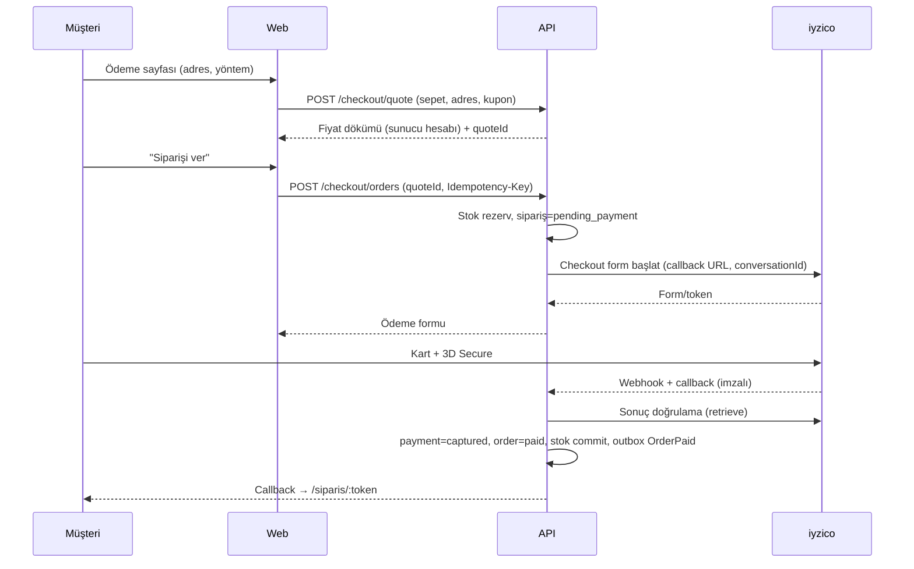
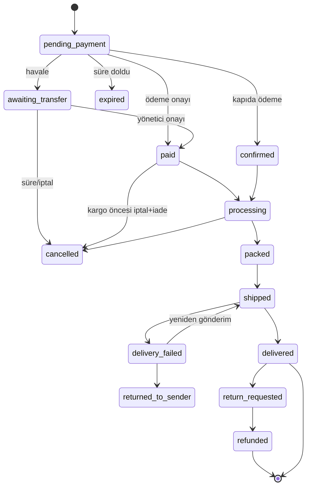

# 04 — Mağaza Akışları

## 1. Katalog yönetimi (Admin)
- **Ürün formu:** ad, slug (otomatik, düzenlenebilir, değişirse 301 kaydı), kategori, kısa/uzun açıklama, içindekiler, alerjen, besin tablosu (100 g başına), saklama koşulu, raf ömrü, menşei, SEO alanları, durum (taslak/yayında/arşiv).
- **Varyant:** SKU, etiket (gramaj), ağırlık (kargo hesabı), fiyat, karşılaştırma fiyatı, barkod, aktif/pasif, sipariş başı üst sınır.
- **Medya:** çoklu görsel yükleme, sürükle-sırala, alt metin zorunlu, otomatik boyutlar + WebP/AVIF, ilk görsel kapak. Üst sınır 8 MB/görsel, yalnız JPEG/PNG/WebP; dosya içeriği (magic bytes) doğrulanır, EXIF temizlenir.
- **Toplu işlemler:** CSV içe/dışa aktarım (SKU anahtarı), toplu fiyat güncelleme (önizleme + onay + geri alma), toplu yayından kaldırma.
- **Kalite kapıları (yayınlamadan önce):** en az 1 görsel, en az 1 aktif varyant, fiyat > 0, alerjen alanı dolu (gıda için zorunlu), KDV oranı seçili.
- **Sürüm geçmişi:** fiyat/stok/yayın durumu değişikliği `audit_log`'a.

## 2. Vitrin sayfaları ve davranış
| Sayfa | Yol | Not |
|---|---|---|
| Ana sayfa | `/` | iki yönlü giriş (Ürün / Değirmen), çok satanlar, güven unsurları |
| Kategori | `/urunler/:kategori` | filtre (kategori, fiyat, stok), sıralama, sayfalama |
| Ürün | `/urun/:slug` | galeri, varyant, stok durumu, besin/alerjen, SSS, ilgili ürünler, JSON-LD |
| Sepet | `/sepet` | miktar, kupon, kargo bedava çubuğu, tahmini toplam |
| Ödeme | `/odeme` | tek sayfa, adım göstergesi (iletişim → adres → teslimat → ödeme → özet) |
| Sipariş tamam | `/siparis/:token` | özet, takip, havale bilgisi (gerekirse) |
| Sipariş takip | `/takip` | numara + telefon son 4 hane veya token linki |
| Hesap | `/hesap/...` | siparişler, adresler, bilgiler, izinler |
| Statik | `/hakkimizda`, `/iletisim`, `/sss`, `/teslimat-iade`, `/gizlilik`, `/kvkk`, `/mesafeli-satis`, `/cerez` | içerik modülünden |

## 3. Sepet
- Sunucu tarafı sepet; çerezle `cart_token`. Giriş yapılırsa misafir sepeti hesaba birleşir (aynı varyantta miktar toplanır, üst sınır uygulanır).
- Her sepet okumasında fiyat/stok yeniden doğrulanır; değişiklik varsa kullanıcıya açık uyarı ("Fiyat güncellendi: …").
- Sepet 30 gün; terk edilmiş sepet hatırlatma (v1.1, yalnızca izinle).
- Miktar sınırları: 1…`max_per_order`, stoktan fazlası eklenemez.

## 4. İndirim/kupon motoru
**Sıra (deterministik):** satır fiyatı → ürün bazlı indirim → kupon → gazi/şehit indirimi (onaylıysa) → havale indirimi → kargo → KDV bilgisi.
- Yığılma: varsayılan **yığılmaz**; yalnız "kargo bedava" kuponu diğeriyle birleşebilir. Tek kural dosyası ve testi vardır.
- Kupon doğrulama: aktif, tarih, min tutar, toplam/müşteri başı limit, ilk sipariş. Kimlik anahtarı: giriş yoksa telefon+e-posta karması.
- Havale indirimi yalnız ürün tutarı üzerinden; kapıda ödemede uygulanmaz.
- Kupon "dene" uçları hız sınırlı (kaba kuvvet engeli).
- Yuvarlama: kuruşa, satır bazında en yakın, kalan farkı en büyük satıra ekle; `packages/money` içinde, özellik testi (property test) ile.
- **Gazi/şehit yakını:** hesapta/siparişte "indirim talebi" → belge yükleme → yönetici onayı → hesap bazlı geçerlilik. Onaysız siparişte indirim uygulanmaz; onay sonrası fark iade/tahsil (iade yolu). Alternatif: siparişi onay bekleyen duruma al. (Karar gerekli: **11-hazirlik** S-07)

## 5. Kargo hesabı
- Bölge (il grupları) × ağırlık/desi aralığı → ücret tablosu. Ücretsiz eşik (indirim sonrası ürün tutarı).
- Paket ağırlığı = Σ varyant ağırlık + ambalaj payı (ayar).
- Kargo seçenekleri başta **tek firma** (sabit); sonra firma/ücret karşılaştırma (toplayıcı API).
- Teslimat alanı: yalnız Türkiye. Adres doğrulama: il/ilçe/mahalle zorunlu seçim, telefon 05xx doğrulama, açık adres min uzunluk.
- Kargo süresi bilgisi ve kesim saati ayarı ("14:00'e kadar siparişler aynı gün").

## 6. Ödeme akışı (uçtan uca)

**Kritik kurallar**
1. Tutar **yalnız sunucuda** hesaplanır; istemci tutarı hiçbir yerde güvenilmez.
2. Webhook imza + sağlayıcıdan sonucu yeniden sorgulayarak doğrulanır (iki yönlü).
3. Webhook ve callback idempotent: aynı olay ikinci kez geldiğinde ek etki yok.
4. Ödeme sonucu belirsizse (zaman aşımı, kapanan sekme) sipariş `pending_payment` kalır; `payment.reconcile` işi sağlayıcıyı sorgular.
5. Rezerv süresi dolarsa ve ödeme yoksa sipariş `expired`; sonradan gelen başarılı ödeme için **stok yeniden kontrol edilir**, yoksa otomatik iade + müşteri bilgilendirme.
6. Havale: sipariş `awaiting_transfer`, 48 saat bekler, açıklama kodu ile eşleşme; yönetici onaylar; süre dolarsa iptal + stok iade; hatırlatma SMS'i.
7. Kapıda ödeme: sipariş `confirmed` (SMS onayı opsiyonel, sahte sipariş önlemi), tahsilat kargo mutabakatıyla.

## 7. Sipariş durumları

Üç ayrı eksen (`status`, `payment_status`, `fulfillment_status`) tutulur; ekranda tek özet gösterilir. Her geçiş `order_events` satırı, yetki ve neden alanı ister.

## 8. Stok mantığı
- Üç sayı: `on_hand`, `reserved`, `available = on_hand - reserved`.
- Rezerv: ödeme başlatılırken (15 dk). Commit: ödeme onayı → `on_hand` düşer, `reserved` düşer. Release: süre/iptal.
- Stok hareketleri `stock_ledger`'a, düzeltme neden zorunlu (sayım farkı, fire, hasar).
- Düşük stok eşiği → yöneticiye bildirim. Stok 0 → "Tükendi" rozeti, sepete eklenemez.
- Üretim girişi: değirmenden Nutopiano ürünü hazırlanınca manuel "üretim girişi" (v1.1'de parti/SKT takibi).
- Gıda: **parti ve son kullanma tarihi** takibi v1.1; MVP'de ürün bazında raf ömrü bilgisi + manuel kontrol.

## 9. Paketleme ve kargo operasyonu
- Admin "Hazırlanacaklar" ekranı: ödenmiş siparişler, ürün toplama listesi, paketleme fişi PDF (iç ürünler, hediye notu, alerjen uyarısı).
- Kargo etiketi: MVP'de kargo firmasının panelinden elle girilen takip numarası; v1.1'de API ile etiket ve takip numarası otomatik.
- Takip numarası girilince SMS ("Siparişiniz kargoda") + e-posta + takip linki.
- Teslim edildi: kargo API/yoklama veya elle işaretleme.

## 10. İade / iptal
- **Kargo öncesi iptal:** müşteri talep eder (veya yönetici), tam iade (kart: sağlayıcı iade API).
- **Gıda ürünlerinde cayma:** mevzuat çabuk bozulabilen/son kullanma tarihi geçebilecek ürünlerde cayma hakkına istisna tanır; yine de **hatalı/ayıplı/hasarlı ürün** için iade/değişim politikası yazılır. Metin hukuki danışmanla netleşir (08-guvenlik-yasal).
- Süreç: iade talebi → fotoğraf (hasar) → onay → kargo (satıcı karşılar) → ürün kontrolü → iade/yeniden gönderim.
- Kısmi iade: satır bazlı veya serbest tutar; toplam iadeler ödenen tutarı aşamaz (veritabanı kısıtı + servis kontrolü).

## 11. Bildirim şablonları (Mağaza)
| Olay | Kanal |
|---|---|
| Sipariş alındı | e-posta + SMS |
| Havale bilgisi + hatırlatma | e-posta + SMS |
| Ödeme alındı | e-posta |
| Kargoya verildi (takip no) | SMS + e-posta |
| Teslim edildi | e-posta |
| İptal/iade | e-posta + SMS |
| Düşük stok (yönetici) | e-posta |
| Yeni sipariş (yönetici) | SMS/WhatsApp (kendi numaranıza) + panel sesi |
Şablonlar veritabanında sürümlü, test gönderimi admin'den.

## 12. Admin ekranları (Mağaza)
Panel/özet · Siparişler (liste, filtre, detay, zaman çizelgesi, not, iade) · Hazırlanacaklar · Ürünler (liste, düzenle, toplu) · Kategoriler · Stok (seviye, hareket, sayım) · Kuponlar · İndirim talepleri (gazi) · Kargo kuralları · Müşteriler (arama, KVKK dışa aktarım/silme) · Raporlar (ciro, ürün, kupon, kargo) · Ayarlar (eşikler, mağaza bilgisi, e-posta/SMS şablonları, bakım modu).

## 13. Raporlar
Günlük/haftalık/aylık ciro, ürün bazlı satış, kategori, kupon etkisi, ödeme yöntemi dağılımı, iade oranı, kargo maliyeti, stok değeri. CSV dışa aktarım. KDV özeti muhasebeye (resmî beyan muhasebeciden).

