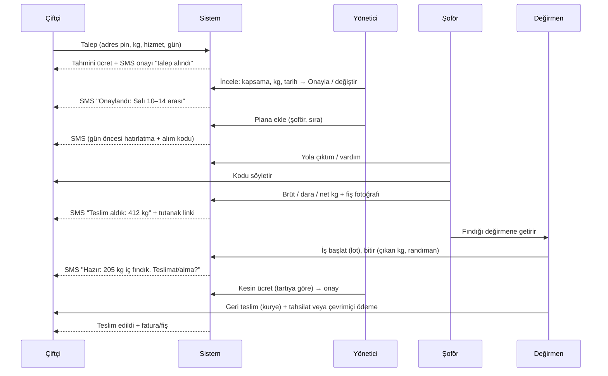
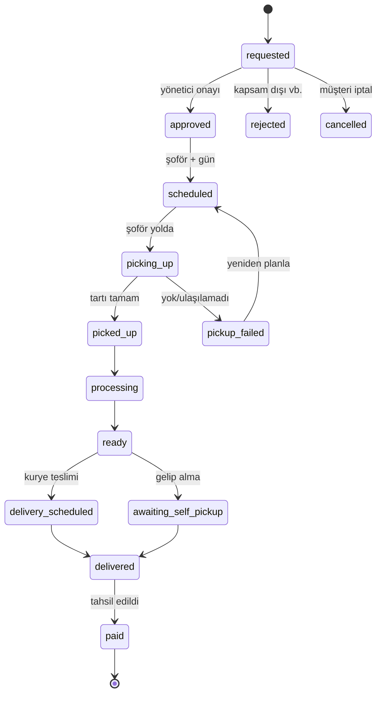

# 05 — Değirmen & Kurye

Amaç: çiftçi fındığını taşımadan işletsin; değirmen müşteri kazansın. Kendi şoför/araçla bahçeden alım, tartı, işleme, geri teslim.

## 1. Uçtan uca iş akışı


## 2. Talep durumları

Her geçişte `mill_events`, yetki ve gerekirse SMS.

## 3. Müşteri deneyimi (web `/degirmen`)
1. **Tanıtım + fiyat:** hizmetler, fiyat tablosu, hesaplayıcı (kabuklu kg × birim fiyat; randıman tahmini bilgilendirme).
2. **Talep sihirbazı (3 adım):**
   - Adım 1: hizmet(ler), tahmini kg (çuval sayısı yardımcı alan), teslim şekli (kurye geri getirsin / ben gelip alırım).
   - Adım 2: adres — il/ilçe/mahalle + harita pini (isteğe bağlı) + tarif ("büyük ceviz ağacının yanı"). Kapsam kontrolü anında.
   - Adım 3: telefon + SMS kodu, tercih edilen gün/zaman dilimi, not, KVKK ve hizmet koşulu onayı → gönder.
3. **Talep ekranı:** durum çizelgesi, ücret dökümü (tahmini/kesin), tartı tutanağı, SMS geçmişi, iptal butonu (alımdan önce).
4. Düşük teknik kullanıcı için: büyük yazı, tek eylemli ekranlar, **telefonla talep** seçeneği (yönetici panelden adına açar), WhatsApp/telefon bağlantısı.

## 4. Ücretlendirme
```
Kesin ücret = Σ (hizmet birim fiyatı × net_kg_esas)  +  alım ücreti  +  teslimat ücreti  −  indirimler  ± düzeltme
```
- **Esas kg:** hizmet türüne göre: girdi (kabuklu) net kg. Çuval dara standardı ayardır (örn. çuval başına 0,2 kg) veya fiilî dara girilir.
- **Birim fiyat:** `mill_rate_cards` zaman damgalı. Talep, açıldığı andaki fiyatı `rate_snapshot` olarak saklar; yönetici onayında kilitler. Fiyat değişirse mevcut talepler etkilenmez (karar: onaylananlar kilitli).
- **Alım/teslimat ücreti:** `mill_coverage` bölge bazlı; eşik üstü kg'da ücretsiz (ayar).
- **İndirim:** gazi/şehit yakını (onaylı), kampanya.
- **Tahmini ve kesin:** müşteriye önce tahmini; tartıdan sonra kesin. Sapma > %10 ise müşteri onayı (SMS "Onaylıyorum" yanıtı / panel butonu).
- Tüm kalemler `mill_charges` satırı; toplam hesaplama tek fonksiyon (`pricing.mill.calculate`) + çok sayıda test (sınır kg, yuvarlama).
- **Ödeme:** (a) teslimde nakit/POS, (b) çevrimiçi ödeme linki (iyzico, kuruş doğru, tutar kesinleşince oluşturulur), (c) havale. Fatura/fiş türü (bireysel çiftçi: **gelir vergisi/stopaj/çiftçi muhasebesi — muhasebeci**: hizmet faturası kime kesilir kontrolü).

## 5. Tartı, tutanak, izlenebilirlik
- **Tartı kaydı alanları:** brüt, dara, net, çuval sayısı, nem % (opsiyonel), fiş fotoğrafı, tartan kişi, zaman, müşteri onay kodu.
- **Müşteri onayı:** şoför "Tartıyı onaylıyor musunuz?" için müşterinin telefonuna **onay kodu** SMS'i; kod şoföre söylenir → tutanak kilitlenir. Alternatif: müşteri ekranda onaylar.
- Tutanak PDF/web sayfası (tarih, adres, brüt/dara/net, şoför, imza yerine kod).
- **Değirmende ikinci tartı** (kapıda kontrol): fark > eşik (örn. %1) ise uyarı ve yönetici incelemesi. Fire/randıman kaydı.
- **Parti (lot) kodu:** her müşteri talebi ayrı lot; makineye girişte lot etiketi; karışma önleme prosedürü (fiziksel süreç, ayrı kapsam: **operasyon kılavuzu**).
- **Randıman:** `yield_bp = çıkan_iç_g / girdi_kabuklu_g × 10000`; bilgi amaçlı, müşteriye gösterilir; olağan dışı (örn. < %35 veya > %65) otomatik uyarı.
- Gıda güvenliği: temizlik/kalibrasyon kaydı v2; MVP'de yalnız lot ve tartı izlenebilirliği.

## 6. Şoför uygulaması (admin içinde PWA, mobil öncelikli)
- Giriş: personel hesabı + 2FA yerine cihaz oturumu uzun (şoför kolaylığı) ama PIN korumalı; yetki yalnızca kendi alımları.
- **Bugün:** sıralı kartlar — müşteri adı, adres, harita bağlantısı (`geo:`/Google Maps), tahmini kg, not, saat aralığı, [Ara] [Yol tarifi] [Vardım].
- **Alım ekranı:** kod doğrula → çuval/brüt/dara/net gir (büyük sayısal klavye) → fiş foto → müşteri onay kodu → tamamla. Hata/erteleme nedeni listesi (ulaşılamadı, miktar farklı, ödeme sorunu…).
- **Çevrimdışı dayanıklılık:** zayıf sinyalde veriler cihazda kuyruğa alınır (IndexedDB), bağlantı gelince senkron; çakışmada sunucu zaman damgası kazanır, şoföre uyarı.
- **Konum:** yalnızca "Vardım" anında (tek seferlik) ve rıza ile; sürekli takip MVP dışı.
- Teslim turu: hazır işlerin geri teslim listesi, "tahsil edildi (nakit/kart)" işaretleme, makbuz/tutanak.
- Her kritik işlem çift onay (yanlış dokunmaya karşı), geri alma pencereli.

## 7. Yönetici operasyon ekranları
- **Talep kutusu:** yeni/onay bekleyen, filtre (ilçe, tarih, hizmet), harita görünümü (talepler pin olarak).
- **Planlama panosu:** gün bazlı takvim, şoför sütunları, sürükle-bırak; kapasite göstergesi (toplam tahmini kg / araç kapasitesi); basit rota sıralaması (en yakın komşu, v1.1; MVP elle).
- **Tartı denetimi:** farklar, onaysız tutanaklar.
- **İş kuyruğu (değirmen içi):** lot listesi, makine adımları, bitir/çıkan kg.
- **Teslim ve tahsilat:** hazır işler, teslim planı, tahsil edilmeyenler.
- **Kapsama ve fiyat yönetimi:** mahalle/ilçe tablosu, alım ücreti, min kg, günler.
- **Müşteri geçmişi:** taleplerin, randımanların, toplam hacim; sadakat/kupon.

## 8. Bildirimler (Değirmen)
| Olay | Alıcı | Kanal |
|---|---|---|
| Talep alındı | çiftçi | SMS |
| Onay/ret | çiftçi | SMS |
| Alım günü hatırlatma + alım kodu | çiftçi | SMS |
| Şoför yola çıktı | çiftçi | SMS (isteğe bağlı) |
| Tartı tutanağı + onay kodu | çiftçi | SMS |
| İş hazır | çiftçi | SMS |
| Ücret kesinleşti/ödeme linki | çiftçi | SMS |
| Yeni talep | yönetici | SMS + panel |
| Tartı farkı uyarısı | yönetici | panel + e-posta |
| Yarının planı | şoför | SMS/panel |
SMS metinleri kısa ve sade Türkçe; en fazla 1–2 SMS parçası; kimliği net ("Nutopia Değirmeni").

## 9. İstisnalar ve kenar durumlar
| Durum | Davranış |
|---|---|
| Müşteri evde yok | Şoför arar, 15 dk bekler; 2 deneme sonra `pickup_failed`, yeniden planla, SMS |
| Miktar tahminden çok farklı | Şoför araç kapasitesini/ücreti bildirir; sapma >%25 ise onay veya ikinci tur |
| Fındık nemli/çürük | Tartı notu + foto; hizmet koşulu "kalite tespiti" maddesi; yönetici kararı |
| Müşteri iptal | Alım öncesi serbest; alımdan sonra iade koşulları (ücret kalemi: alım ücreti) |
| Ücret anlaşmazlığı | Tartı tutanağı kanıt; yönetici düzeltme (denetimli) |
| Kapsam dışı adres | Uyarı + bekleme listesi / "kendin getir" yönlendirmesi |
| Tahsilat yapılamadı | Teslim bekletilir, hatırlatma, sorumlu yönetici |
| Şoför arızası/gecikme | Planı yeniden ata, müşteriye SMS |
| Aynı müşteri çoklu talep | Aynı adres+gün birleştirme önerisi |
| Sahte/spam talep | OTP zorunlu, hız sınırı, telefon başına açık talep limiti |

## 10. Mağaza ile bağ (ileride)
Aynı `customers` tablosu, ortak SMS giriş. Çapraz satış (teslimde Nutopiano kuponu) `OrderPlaced`/`MillDelivered` olayları üzerinden gevşek bağlı. `mill` modülü `shop` tablolarına dokunmaz.

## 11. Yasal ve vergi notları (doğrulanacak)
- Hizmet sözleşmesi/koşulları: kalite, fire, süre, sorumluluk, tartı kuralı, iptal.
- Çiftçi müşteri kişisel veri + adres/konum: KVKK aydınlatma.
- Fatura türü ve KDV oranı hizmet için muhasebeciyle teyit.
- Gıda işleme izni/kayıt (Gıda, Tarım ve Orman Müdürlüğü) ve kurye aracının gıda/ürün taşıma uygunluğu ayrı kontrol.

