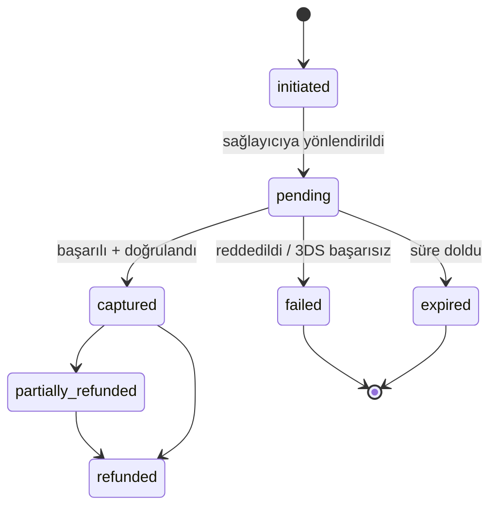

# 06 — Ödeme ve Finans

> Sağlayıcı API ayrıntıları (alan adları, imza algoritması, komisyon, taksit kuralları) başvuru sonrası **resmî dokümanla doğrulanır**; aşağıdaki tasarım sağlayıcıdan bağımsızdır.

## 1. Sağlayıcı seçimi
| Kriter | iyzico | PayTR |
|---|---|---|
| Entegrasyon | Barındırılan ödeme formu (checkout form) | iFrame/Link API |
| Pazar yeri/ödeme linki | Var | Link API var |
| Başvuru | Vergi levhası/şirket belgeleri | Benzer |
| Karar | **Birincil** | Yedek (arayüz hazır) |
Seçim kriterleri: komisyon, vade (para hesaba geçiş), iade/chargeback koşulları, destek, test ortamı kalitesi, 3D Secure zorunluluğu. **Başvuru süresi uzun olabilir; VPS/domain beklenmeden başlatılır** (11-hazirlik).

## 2. Sağlayıcı arayüzü (kodda)
```ts
interface PaymentProvider {
  init(input: { paymentId: string; amount: Money; buyer: Buyer; items: Item[];
                callbackUrl: string; conversationId: string }): Promise<{ redirectOrHtml: string; providerToken: string }>;
  retrieve(providerToken: string): Promise<ProviderResult>;     // doğrulama
  refund(input: { providerPaymentId: string; amount: Money; reason: string }): Promise<RefundResult>;
  cancel(input: { providerPaymentId: string }): Promise<void>;  // aynı gün iptal
  verifyWebhook(headers: Headers, rawBody: Buffer): WebhookEvent | null;
}
```
- Sağlayıcıya özel kod yalnız `payments/providers/*` içinde. Üst katman `captured/failed/...` durumlarıyla konuşur.
- `sandbox` ve `live` anahtarları ortam bazlı. Test ortamında sahte kartlarla otomatik testler.

## 3. Durum makinesi (payment)

- `captured` yalnız sağlayıcıdan **doğrulama sorgusu** başarılıysa. Callback yönlendirmesindeki parametrelere asla güvenilmez.
- Aynı sipariş için yeniden ödeme denemesi yeni `payment` satırı; yalnız biri `captured` olabilir (benzersiz kısmi indeks: sipariş başına tek `captured`).

## 4. Webhook işleme
1. Ham gövde saklanmadan önce imza doğrulanır (sabit zamanlı karşılaştırma). Geçersiz → 400, günlük, uyarı sayacı.
2. `webhook_events(event_id UQ)` kaydı; tekrar → 200 dön, işleme.
3. Olay işleme transaction içinde: ödeme durumu + sipariş durumu + stok commit + outbox.
4. Hata → 5xx dön (sağlayıcı yeniden dener) ve `pg-boss` ile iç yeniden deneme.
5. Sağlayıcı IP izin listesi (varsa) Nginx/Cloudflare kuralıyla ek savunma; asıl koruma imzadır.
6. Webhook gelmezse `payment.reconcile` işi 10 dk'da bekleyenleri sorgular, 24 saat sonra `expired`.

## 5. Taksit ve kart
- Taksit: başlangıçta yalnız peşin (+ sağlayıcı izin verirse 2/3 taksit). Komisyon farkı fiyata yansıtılmaz; karar iş tarafında (S-09).
- Kart verisi (PAN/CVV) **hiçbir noktada** sistemimize gelmez, loglanmaz; sağlayıcı formu. PCI DSS kapsamı SAQ-A düzeyi.
- 3D Secure zorunlu. Saklı kart (kayıtlı kart) MVP dışı.

## 6. İade
- Yönetici panelinden: tam/kısmi iade, neden zorunlu, çift onay (tutar > eşik için `owner`).
- Aynı gün iptal (void) vs iade (refund): sağlayıcı kuralına göre otomatik seçim.
- İade durumu asenkron: `refunds.status`; başarısız → uyarı + manuel yol.
- Toplam iade ≤ yakalanan tutar (DB kısıtı + servis).
- Müşteriye SMS/e-posta; banka süresi bilgisi ("5–10 iş günü").

## 7. Havale / EFT
- IBAN yönetim ayarında (**kodda sabit IBAN yok**). Müşteriye benzersiz açıklama kodu (`NT-123-AB7`).
- Yönetici elle eşleştirir (banka ekstresi). v1.1: banka CSV içe aktarım ve otomatik eşleşme önerisi.
- Süre: 48 saat; SMS hatırlatma 24. saatte.
- Yanlış tutar/açıklama durumları için "beklenmeyen havale" kuyruğu.

## 8. Kapıda ödeme
- Kargo firmasıyla kapıda tahsilat anlaşması gerekir (ücret/komisyon). Ürün/tutar sınırı ve ek ücret ayarı.
- Sahtecilik önlemi: SMS onayı, ilk sipariş limiti, bölge kısıtı.
- Tahsilat kargo mutabakat dosyasıyla eşlenir (`cod_collections`); fark → uyarı.
- Değirmen teslimde nakit/POS: şoför `tahsil edildi` işaretler, günlük kasa kapanış ekranı (yönetici onayı).

## 9. Defter ve mutabakat
- `ledger_entries`: satış, indirim, kargo, KDV, iade, nakit/banka kalemleri.
- **Günlük mutabakat:** sağlayıcı raporu (CSV/API) ↔ sistem `captured` ödemeleri ↔ banka girişi. Fark raporu yöneticiye.
- Komisyon/net hesap: `payments.provider_fee?` (sağlayıcıdan gelirse) → net gelir raporu.
- Chargeback (itiraz): kayıt + delil paketi (sipariş, kargo takip, IP, onay anı, mesafeli satış onayı).

## 10. Fatura / e-Arşiv
- **MVP:** sipariş/talep verisi CSV/Excel dışa aktarım, muhasebeci veya ön muhasebe programına girer.
- **v1.1:** özel entegratör (Paraşüt, Logo, Uyumsoft, Foriba/Sovos benzeri) API ile e-Arşiv/e-Fatura oluşturma; fatura PDF'i müşteriye e-posta, hesapta indirme.
- Fatura türü: bireysel (TCKN 11111111111 kuralları — muhasebeciden), kurumsal (VKN, vergi dairesi, unvan). Sipariş sırasında opsiyonel kurumsal fatura formu.
- Fatura numarası seri/sıra kuralı ve iptal/iade faturası (iade → iade faturası/gider pusulası kuralı muhasebeciyle).
- KDV oranı ürün bazlı; gıda ürünleri için **doğru oran muhasebeciyle teyit edilmeden yayına çıkılmaz**.

## 11. Sahtecilik / kötüye kullanım
- Sağlayıcının risk skoru `fraud_status` olarak saklanır; yüksek riskte siparişi `manual_review` durumuna alma ayarı.
- Kural örnekleri: aynı IP'den çok sayıda başarısız ödeme, farklı kartlarla art arda deneme → geçici engel.
- Teslimat adresi/telefon uyuşmazlığı, çok yüksek tutar, ilk sipariş + kapıda ödeme → manuel inceleme.

## 12. Test planı (ödeme)
| Senaryo | Beklenen |
|---|---|
| Başarılı ödeme | order paid, stok commit, SMS |
| 3DS başarısız | payment failed, rezerv devam, yeniden dene |
| Callback gelmedi, webhook geldi | yine paid |
| Webhook iki kez | tek etki |
| Webhook gelmedi | reconcile ile paid |
| İmza hatalı webhook | reddedilir, etkisiz |
| Rezerv doldu sonra ödeme | stok yoksa otomatik iade |
| Kısmi iade ×2 | toplam sınırı aşılamaz |
| Tutar manipülasyonu (istemci) | sunucu fiyatı kazanır |
| Eşzamanlı son stok ürünü | yalnız biri başarılı |

