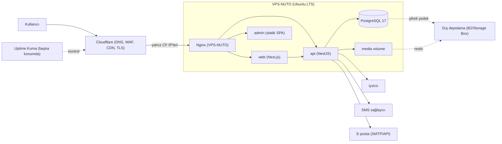
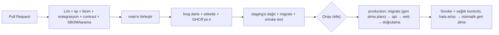

# 07 — Altyapı, VPS, Domain, Dağıtım

> Karar (kullanıcı): **Nutopiano ve Serenut ayrı VPS'lerde yönetilecek.** Bu belge Nutopiano VPS'ini tanımlar; Serenut ayrılma/temizlik maddeleri en sonda.

## 1. Mimari görünüm

## 2. VPS özellikleri
| Parametre | Öneri | Gerekçe |
|---|---|---|
| vCPU | 2 | API+SSR+DB için yeterli başlangıç |
| RAM | **4 GB** (asgari), 8 GB rahat | Postgres ~0,5 GB, API ~0,4, Next.js ~0,4, Nginx/OS ~0,5, tampon |
| Disk | 80 GB NVMe | görseller+DB+log; büyüme izlenir |
| OS | Ubuntu 24.04 LTS | uzun destek |
| Ağ | IPv4+IPv6, ≥1 TB trafik | |
| Konum | **Türkiye veya AB (İstanbul/Frankfurt)** | gecikme + KVKK yurt dışı aktarım değerlendirmesi |
| Yedek | sağlayıcı anlık görüntü (snapshot) + kendi dış yedeğimiz | |
| Sağlayıcı seçim kriterleri | fatura (TL, e-Arşiv), destek, DDoS koruma, IP itibarı (SMTP için), snapshot, API, ödeme kolaylığı | |
> Sağlayıcı kararı ayrı verilir (11-hazirlik S-03). Türkiye'de veri tutma tercihi KVKK sürecini sadeleştirir; yurt dışı seçilirse aktarım şartları hukuki değerlendirme gerektirir.

## 3. Domain ve DNS
| Kayıt | Tür | Değer | Not |
|---|---|---|---|
| `nutopiano.com` | A/AAAA (proxied) | VPS-NUTO | vitrin |
| `www` | CNAME → apex | | `www` → apex 301 |
| `api` | A/AAAA (proxied) | VPS-NUTO | API |
| `admin` | A/AAAA (proxied) | VPS-NUTO | yönetim; Cloudflare Access ile ek koruma (önerilir) |
| `staging` / `staging-api` / `staging-admin` | A/AAAA | staging VPS veya aynı VPS | HTTP basic auth + robots engeli |
| `mail` kayıtları | MX/SPF/DKIM/DMARC | e-posta sağlayıcı | gönderim alan adı itibarı |
| `degirmen.<alan>` (ileride) | CNAME | | ayırma günü |
- Alan adı sahibi kullanıcı hesabında; **2FA** + kayıt kilidi + otomatik yenileme + kayıt iletişim e-postası ayrı posta kutusu.
- DNSSEC açık (kayıt şirketi destekliyorsa). CAA kaydı: yalnız Let's Encrypt/Cloudflare CA.
- TTL: geçişten 48 saat önce 300 sn'ye düşürülür.
- Bugünkü `nutopiano.com` (statik site) mevcut sunucuda çalışıyorsa, geçiş planı §10.

## 4. Konteyner düzeni (`docker compose`, tek proje `nuto`)
| Servis | İmaj | Not |
|---|---|---|
| `nginx` | resmî `nginx:stable-alpine` veya ana makinede | TLS sonlandırma ana makine/Cloudflare Origin Cert |
| `web` | build edilen Next.js (`node:22-alpine`) | salt-okunur FS, root olmayan kullanıcı |
| `api` | NestJS (`node:22-alpine`) | `HEALTHCHECK`, bellek sınırı |
| `admin` | statik dosyalar Nginx'ten | ayrı konteyner gerekmez |
| `db` | `postgres:16-alpine` | yalnız iç ağ, volume, ayar dosyası |
| `migrate` | tek seferlik iş | dağıtımda çalışır |
| `backup` | `restic`/`pg_dump` betikleri | cron veya systemd timer |
- Ağlar: `edge` (nginx↔web/api), `internal` (api↔db). `db` hiçbir portu ana makineye yayınlamaz.
- Bellek sınırları (başlangıç): api 512 MB, web 512 MB, db 1 GB; `shared_buffers` 256 MB.
- Kalıcı veri: `/srv/nuto/{pgdata,media,backups}` — ayrı bağlama noktası/disk bölümü önerilir.
- İmajlar sürüm etiketli (`:1.4.2` + `:sha-<kısa>`), `latest` ile üretimde dağıtım yok.

## 5. Nginx
- TLS 1.2+/1.3, HSTS (uzun, ön yükleme dikkatli), OCSP stapling, modern şifre seti.
- Cloudflare IP aralıklarına izin, diğerleri reddedilir (origin kilidi); gerçek IP başlığı `CF-Connecting-IP`.
- Güvenlik başlıkları: `Content-Security-Policy` (ödeme sağlayıcısı alan adlarına izin, `nonce` tabanlı), `X-Content-Type-Options`, `Referrer-Policy`, `Permissions-Policy`, `frame-ancestors`.
- Hız sınırı bölgeleri: `/v1/auth/*`, `/v1/webhooks/*` (yüksek eşik), `/v1/checkout/*`.
- `client_max_body_size`: genel 2 MB, görsel yükleme yolu 10 MB.
- Statik/medya: `Cache-Control: public, max-age=31536000, immutable` (hash'li dosya adı).
- Gzip/Brotli; HTTP/2/3 (Cloudflare).
- `/health/*` yalnız iç ağ/izleme IP'si.
- Webhook yolları Cloudflare WAF'ta "bot challenge" dışında tutulur.
- Gizli dosya (`/.git`, `.env`) ve dizin listeleme kapalı.

## 6. Ana makine sertleştirme
- Kullanıcı: root girişi kapalı; `deploy` kullanıcısı (sudo yok/dar), `admin` kullanıcıları ayrı.
- SSH: yalnız anahtar (ed25519), parola kapalı, port değişikliği opsiyonel, `AllowUsers`, 2FA için `pam` opsiyonel; SSH kaynak IP'ye kısıtlama (mümkünse VPN/WireGuard üzerinden).
- Güvenlik duvarı (`ufw`): 80/443 (Cloudflare IP'lerine), 22 (kısıtlı), diğer hepsi kapalı. Docker'ın `iptables` kuralıyla `ufw` atlamasına karşı `DOCKER-USER` zinciri/yalnızca `127.0.0.1` bağlama.
- `fail2ban`, `unattended-upgrades` (güvenlik), `auditd` (temel), `needrestart`, saat senkronu (`chrony`), swap (1–2 GB), `sysctl` sertleştirme.
- Konteynerler: root olmayan, `read_only`, `cap_drop: [ALL]`, `no-new-privileges`, kaynak limitleri.
- Sırlar: `/etc/nuto/secrets/` (0600, root/deploy), compose `secrets`; depoda şifreli `sops`+`age` dosyası.
- Docker daemon günlük sınırı (`json-file`, boyut/adet), disk dolmasın.

## 7. Yedekleme ve felaket kurtarma
| Veri | Yöntem | Sıklık | Saklama | Hedef |
|---|---|---|---|---|
| PostgreSQL | `pgBackRest` WAL arşivleme (gün-1) + `restic` şifreli | sürekli WAL + günlük tam/artımlı (K14) | 14 günlük + 8 haftalık + 12 aylık | RPO ≤ 5 dk, PITR |
| Medya | `restic` artımlı | günlük | 30 gün | |
| Yapılandırma/sırlar | şifreli kopya ayrı yerde (parola yöneticisi + kasa) | değişimde | | |
| VPS snapshot | sağlayıcı | haftalık | 4 | hızlı geri dönüş |
- Dış hedef: **farklı sağlayıcı/konum** (Backblaze B2, Hetzner Storage Box, vb.). Şifreleme anahtarı ayrı yerde.
- **Geri yükleme testi:** aylık otomatik (`backup.verify`): temiz konteynerde geri yükle, satır sayısı/denetim toplamı kontrol, sonucu e-postayla bildir.
- RTO hedefi: 4 saat (yeni VPS + imaj + restic + DNS). Felaket runbook'u: adım adım, ezber gerektirmez.
- Yedek başarısızlığı = yüksek öncelikli uyarı.

## 8. İzleme ve uyarı
- **Uptime Kuma** (Serenut VPS'inde veya üçüncü bir yerde — çapraz izleme): HTTPS, API `/health/ready`, ödeme webhook uç noktası erişilebilirlik, SSL sona erme, DNS.
- Sentry: hata ve performans (örnekleme düşük).
- Ana makine: `netdata` veya hafif `node_exporter`+uyarı; eşikler: disk > %80, RAM > %85, yük, `docker` konteyner yeniden başlatma.
- Uygulama metrikleri: sipariş/dk, ödeme başarı oranı, webhook gecikmesi, kuyruk derinliği, başarısız iş sayısı.
- Uyarı kanalı: SMS/Telegram + e-posta; "uyku saatleri" dışı acil sınıf; haftalık özet.
- Log: `pino` JSON → `docker logs` döndürme + haftalık arşiv; arama için `lnav/jq`; Loki yalnızca ihtiyaç doğarsa.

## 9. CI/CD

- Yeni repo `nutopia-platform`, GitHub Actions; ortam başına ayrı dağıtım anahtarı (en az yetki), `environments` onay kuralı.
- Göç: ileri uyumlu (expand/contract). Üretimde destrüktif göç iki sürümde ayrılır. Göç öncesi anlık `pg_dump`.
- Dağıtım: `ssh deploy@host 'cd /srv/nuto && ./deploy.sh <tag>'` — `docker compose pull && up -d`, sağlık beklemesi, başarısızsa önceki etikete geri dönüş.
- Bağımlılık tarama (`npm audit`/`osv-scanner`), imaj tarama (`trivy`), gizli sızıntı taraması (`gitleaks`), Dependabot/Renovate.
- Ortam eşliği: staging prod'un küçültülmüş kopyası; sağlayıcılar sandbox.

## 10. Geçiş planı (bugünkü statik site → yeni platform)
1. Yeni VPS hazır, yeni platform staging'de test edildi.
2. İçerik/ürün verisi içe aktarıldı (`data.js` → ürün CSV).
3. 301 yönlendirme haritası: `/degirmen`, `/urunler`, `/hakkimizda`, `/iletisim` → yeni karşılıkları; `sitemap.xml` yenilenir; Search Console'a bildir.
4. Canlı öncesi: TTL düşür, ödeme canlı anahtarı, gerçek kartla küçük tutarlı test siparişi + iade, SMS/e-posta kontrolü, yedek/geri yükleme provası.
5. DNS geçişi (düşük trafik saati), eski sunucu 2 hafta salt-okunur yedek olarak bekler.
6. İzleme: 72 saat yoğun gözlem, hata bütçesi, geri dönüş planı (DNS'i eski adrese çevir).

## 11. Serenut'tan ayırma kontrol listesi
- [ ] Serenut VPS'inde `nutopiano.com` Nginx bloğunun, sertifikasının ve `/var/www/nutopiano` dizininin kaldırılması (**geçişten sonra**, yedeğiyle).
- [ ] Serenut `docker-compose`/`deploy` betiklerinde Nutopiano'ya dair hiçbir şey yok teyidi.
- [ ] Ortak kullanılan hesaplar ayrıştırılır: Cloudflare hesabı/bölgesi, GitHub organizasyonu/repo, Sentry projesi, SMS/e-posta sağlayıcı hesabı, parola yöneticisi kasası. Ortak anahtar **yeniden kullanılmaz**.
- [ ] Çapraz izleme: Uptime Kuma tek yerde olacaksa hangi VPS'te olacağı kararı (iki VPS birbirini izlesin, üçüncü bağımsız ucuz izleyici daha iyi).
- [ ] Serenut'un WhatsApp/Evolution entegrasyonu **Nutopiano ile paylaşılmaz** (resmî olmayan kanal ticari müşteri iletişimi için risk).
- [ ] Faturalama: iki VPS ayrı fatura/ayrı bütçe etiketi.
- [ ] Erişim: kimin hangi sunucuya SSH anahtarı var tablosu; ortak anahtar yok.

## 12. Maliyet (kaba tahmin, doğrulanacak)
| Kalem | Aylık |
|---|---|
| VPS (4 GB/2 vCPU) | ≈ 8–20 € eşdeğeri (sağlayıcıya göre) |
| Yedek depolama | ≈ 1–5 € |
| Alan adı | yıllık ≈ 10–20 € |
| Cloudflare | ücretsiz plan başlangıç |
| SMS | birim başı (kuruş seviyesi), hacme göre |
| E-posta gönderim | ücretsiz katman → ucuz plan |
| Ödeme komisyonu | işlem başı % + sabit (sağlayıcı) |
| Sentry/izleme | ücretsiz katman |
| e-Arşiv entegratör | aylık sabit + kontör |
Tüm rakamlar planlama amaçlı; sağlayıcı fiyatları seçim sırasında netleşir.

