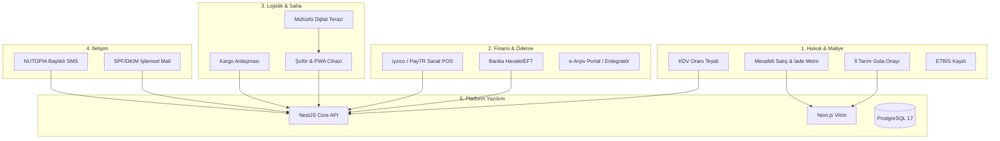

# 21 — Çapraz Risk, Bağımlılık ve Doğrulama Matrisi

> Bu belge; yazılım, hukuk, finans, gıda mevzuatı ve lojistik bileşenleri arasındaki tüm çapraz bağımlılıkları, tek bir bileşenin aksaması durumunda sistemin nasıl davranacağını (Fallback & Circuit Breaker) ve her bileşenin canlıya çıkış öncesi doğrulanma ölçütlerini içerir.

---

## 1. ÇAPRAZ BAĞIMLILIK VE ETKİ MATRİSİ



| Bağımlılık Zinciri | Birincil Sağlayıcı / Durum | Aksaması Durumunda Gecikme Riski | Acil Durum / Fallback Stratejisi |
|---|---|---|---|
| **Sanal POS (iyzico)** | iyzico evrak onayı gecikirse | Satışlar kredi kartı ile başlayamaz | **Fallback:** Havale/EFT (%5 indirim) ve Kapıda Ödeme aktif edilir. Sitede "Kredi kartı entegrasyonu güncelleniyor" bildirimi ile satış aksatılmaz. |
| **SMS Başlığı (NUTOPIA)** | BTK / Operatör başlık onayı uzarsa | Müşterilere SMS ile OTP ve takip no gidemez | **Fallback:** Başlık onaylanana kadar sağlayıcının sunduğu onaylı sayısal numara (`850...`) ile işlemsel SMS gönderimi sürdürülür. |
| **Kargo Entegrasyonu** | Kargo firması API şifrelerini geç verirse | Kargo takip linkleri otomatik üretilemez | **Fallback:** Sistem `ManualCarrier` moduna alınır. Personel, kargo şubesinden aldığı takip fişini paneldeki kutucuğa manuel yapıştırır (`12 §3`). |
| **Gıda Laboratuvar Analizi** | Besin değerleri resmi raporu yetişmezse | Web sitesindeki besin tablosu resmi belgeye dayanamaz | **Fallback:** Tablonun altına `Türk Gıda Kodeksi ortalama değerleri baz alınmıştır` ibaresi konur; sağlık iddiası içermeyen sade içerik listesi gösterilir. |
| **Dijital Terazi / Kantar** | Şoförün kantarı arızalanırsa | Sahada çuval ağırlığı ölçülemez | **Fallback:** Şoför çuvalları etiketleyip teslim alır; Değirmen tesisindeki resmi kantar tartısı esas alınarak müşteriye SMS ile tutanak onayı gönderilir. |
| **e-Arşiv Fatura API** | Entegratör yazılımı ilk güne yetişmezse | Sipariş anında otomatik e-fatura üretilemez | **Fallback:** Siparişler `ops.invoices` tablosunda `export_only` olarak birikir. Günlük Excel çıktısı mali müşavire iletilerek GİB portalından toplu kesilir. |

---

## 2. DEVRE KESİCİ (CIRCUIT BREAKER) VE DAYANIKLILIK POLİTİKALARI

### 2.1 Ödeme Sağlayıcı Kesintisi
- **Tetikleyici:** Son 5 dakika içindeki kart ödeme başlatma isteklerinin %30'undan fazlası iyzico tarafından `5xx` veya `Timeout (>15s)` dönerse.
- **Sistem Tepkisi:**
  1. API otomatik olarak `settings.feature_flags.card_payment_healthy = false` yapar.
  2. Vitrin ödeme adımında kredi kartı seçeneği geçici olarak grileşir: *"Kredi kartı altyapısında geçici bakım yapılmaktadır. Lütfen Havale/EFT veya Kapıda Ödeme tercih ediniz."*
  3. Sistem yöneticisine anında yüksek öncelikli SMS uyarısı düşer.
  4. Sağlayıcı 10 dakika boyunca periyodik sağlık sorgusundan (`health check`) başarıyla geçerse kart seçeneği otomatik geri açılır.

### 2.2 SMS Sağlayıcı Kesintisi
- **Tetikleyici:** Peş peşe 3 SMS gönderim isteği sağlayıcı API'sinden hata alırsa veya yanıt vermezse.
- **Sistem Tepkisi:**
  1. `SmsProvider` adaptör zincirindeki ikincil sağlayıcıya (`SecondarySmsProvider` - örn: İleti Merkezi) otomatik geçiş yapılır.
  2. İkincil sağlayıcı da yanıt vermezse, OTP gerektiren adımlarda e-posta doğrulama alternatifi ekranda belirir.

---

## 3. CANLIYA ÇIKIŞ ÖNCESİ (PRE-FLIGHT) DENETİM VE KİLİT MATRİSİ

Bu matristeki her bir madde **"EVET / TAMAM"** olmadan alan adı DNS yönlendirmesi yapılamaz:

```
[ ] HUKUK & YASAL
    ├── [ ] Mesafeli Satış Sözleşmesi ve Ön Bilgilendirme Formu avukat tarafından incelendi mi?
    ├── [ ] Cayma hakkı istisnası (Gıda ambalaj açılması) metinde açıkça yazıldı mı?
    ├── [ ] İl Tarım Müdürlüğü Gıda İşletme Kayıt No site footer'ına eklendi mi?
    └── [ ] ETBİS bildirimi tamamlandı mı?

[ ] FİNANS & VERGİ
    ├── [ ] Mali müşavirden fındık ürünleri ve değirmen hizmeti KDV oranları yazılı alındı mı?
    ├── [ ] iyzico canlı anahtarları (Live Keys) tanımlandı ve gerçek kartla 10 TL test siparişi + iadesi yapıldı mı?
    ├── [ ] Havale IBAN ve alıcı unvanı doğru girildi mi?
    └── [ ] 750 TL kargo bedava eşiği ve kargo maliyet matrisi doğrulandı mı?

[ ] LOJİSTİK & SAHA
    ├── [ ] Kargo şubesi ile kapıda ödeme tahsilat günleri netleşti mi?
    ├── [ ] Cam kavanoz airbag şişme ambalajları depoda hazır mı?
    ├── [ ] Şoförün kantarı ölçü-ayar mühürlü ve pilleri tam dolu mu?
    └── [ ] Şoför PWA uygulamasını telefonunda başarıyla açıp test alımı yaptı mı?

[ ] TEKNİK & GÜVENLİK
    ├── [ ] Yeni VPS sunucusunda PostgreSQL 17 ve pgBackRest WAL arşivleme devrede mi?
    ├── [ ] Dış yedekleme deposuna (B2/Storage Box) test geri yükleme (restore test) yapıldı mı?
    ├── [ ] Cloudflare SSL Full (Strict) modunda ve Nginx origin kilidi devrede mi?
    ├── [ ] Uptime Kuma harici izleme servisi HTTP, API ve SSL bitişini izliyor mu?
    └── [ ] Eski siteden gelecek URL'lerin 301 yönlendirme haritası Nginx'e yüklendi mi?
```

