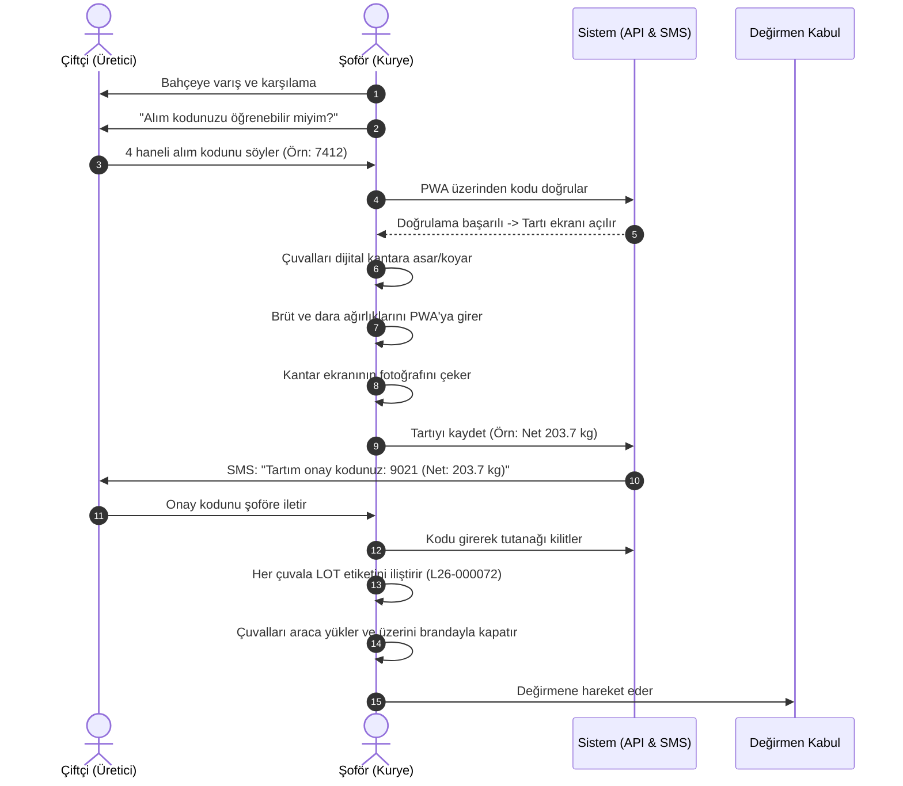
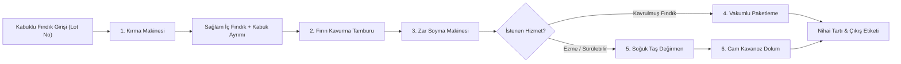

# 23 — Değirmen ve Lojistik Saha Operasyonları Standart Prosedürü (SOP)

> Bu belge; fındığın bahçeden alınmasından kantar tartısına, lot etiketlemesinden değirmen makinelerindeki kırma, kavurma, zar soyma, taş çekim ezme aşamalarına ve çiftçiye teslime kadar olan tüm **fiziki ve operasyonel** süreçlerin adım adım uygulanış kurallarını (SOP) içerir.
> Amaç: Sıfır ürün karışması (lot izolasyonu), sıfır tartı şüphesi, hijyen standartları ve hatasız muhasebeleşme.

---

## 1. GÖREV VE ROL DAĞILIMI

| Rol | Sorumluluk Alanı | Kullandığı Araçlar |
|---|---|---|
| **Saha Şoförü (Kurye)** | Bahçeye intikal, alım kodu doğrulama, yerinde dijital kantar tartımı, fiş çekimi, SMS onayı, nakliye | Şoför Mobil PWA, Kalibreli Asma/Yer Kantarı, Branda, Çuval Etiketleri |
| **Kabul Sorumlusu (Değirmen)** | Aracı karşılama, değirmen giriş tartısı (2. tartı), anomali kontrolü, parti (lot) kabulü | Tesis Kantarı, Barkod/Lot Yazıcı, Admin Paneli |
| **Değirmen Operatörü (Usta)** | Kırma makinesi, kavurma fırını, zar soyucu ve taş değirmen ezme sürecini yürütme, fire/randıman takibi | Makine Kontrol Panelleri, Hijyen Ekipmanı, Numune Alma Kapları |
| **Paketleme Personeli** | Çıkan iç fındık veya ezmeyi 1kg/500g vakumlu poşet veya cam kavanozlara doldurma, parti mühürleme | Vakum Makinesi, Hassas Terazi, Lot Etiketleri |
| **Operasyon Yöneticisi** | Günlük rota onaylama, tartı farkı onayları, müşteri anlaşmazlık yönetimi | Admin Paneli (`/admin/mill`) |

---

## 2. ADIM ADIM SAHA ALIM PROSEDÜRÜ (BAHÇE / KÖY)

### 2.1 Alım Sırasında Uyulacak Kesin Kurallar
1. **Çuval Güvenliği ve Karışma Önleme:** Araçta birden fazla çiftçinin fındığı taşınırken her çiftçinin çuvalları **renkli bağlama ipi** ve üzerine su geçirmez kalemle yazılmış/barkodlu **Lot Etiketi (Örn: L26-000072)** ile mühürlenir. Farklı üreticilerin çuvalları araç kasasında birbirine temas edecek şekilde dağınık bırakılamaz; aralarına ayırıcı file/branda konulur.
2. **Islak / Küflü Mahsul Durumu:** 
   - Fındık aşırı ıslak veya bariz küflü ise şoförün doğrudan reddetme yetkisi yoktur.
   - Durum PWA üzerinden *"Mahsul Nemli/Kurutma Gerektirir"* seçeneğiyle fotoğraflanarak işaretlenir.
   - Çiftçiye nem kaynaklı işleme firesinin yüksek çıkabileceği sözlü olarak hatırlatılır ve tutanağa işlenir.
3. **Müşteri Adreste Bulunamazsa:**
   - Şoför çiftçiyi telefonla arar. 15 dakika bekleme süresi tanınır.
   - Ulaşılamazsa kapı/bahçe görseli çekilerek talep `pickup_failed` durumuna alınır; çiftçiye otomatik SMS gönderilir.

---

## 3. DEĞİRMEN TESİSİ KABUL VE İKİNCİ TARTI (VERIFICATION)

1. **Araç Boşaltma:** Araç değirmene ulaştığında kabul sorumlusu çuvallardaki Lot Etiketlerini kontrol ederek indirir.
2. **Tesis Kantarı (İkinci Tartı):**
   - Çuvallar tesisin sabit zemin kantarında tekrar tartılır.
   - Tesis tartısı (`mill_intake`), sahadaki kantar tartısı (`field_intake`) ile sistemde karşılaştırılır.
3. **Tolerans Kontrolü:**
   - **Fark ≤ %1,0:** Normal kabul edilir (Taşıma sırasındaki hafif nem/toz kaybı). Tesis tartısı resmi işleme girdisi (`input_net_g`) olarak kilitlenir.
   - **Fark > %1,0 (Anomali):** Sistem otomatik olarak partiyi durdurur (`anomaly_flag = true`). Yönetici ve şoför huzurunda yeniden tartım yapılır. Tartı fişi fotoğraflanır ve yönetici onayı verilmeden fındık kırmaya alınamaz.

---

## 4. MAKİNE VE İŞLEME ETAPLARI (PARTİ BAZLI İZOLASYON)

Değirmende aynı anda yalnız **TEK BİR PARTİ (LOT)** işlenebilir. Bir partinin işlemi bitip makine hazneleri temizlenmeden bir sonraki partinin çuvalları açılamaz!

### 4.1 Aşama 1: Fındık Kırma
- Operatör, partiye ait çuvalları kırma makinesinin besleme haznesine döker.
- Kırma kalibre ayarı (fındık iriliğine göre elek seçimi) yapılır; çekirdeğin kırılmadan bütün çıkması sağlanır.
- Boş kabuklar tahliye helezonuna giderken sağlam iç fındıklar partiye ait temizleme kasalarında toplanır.
- İşlem bitiminde hazne içinde fındık kalmadığı gözle kontrol edilir.

### 4.2 Aşama 2: Kavurma Fırını
- İç fındık kavurma tamburuna aktarılır.
- Sıcaklık: `135°C - 150°C` aralığında, süre: `25 - 35 dakika` (Müşteri tercihine göre: Az/Normal/Çifte Kavrulmuş).
- Fırından çıkan fındıklar paslanmaz soğutma tepsisine dökülür; hava üfleyicilerle ısısı hızla 30°C altına düşürülür (Aroma kaybını önlemek için).

### 4.3 Aşama 3: Zar Soyma (Beyazlatma)
- Soğuyan fındıklar zar soyma makinesine girer.
- Silikon sürtünme merdaneleri ve hava aspiratörü ile kahverengi dış zar %95+ oranında soyularak ayrılır.
- Çıkan beyazlatılmış iç fındık son ayıklama bandından geçer (varsa çürük/yanık taneler elle ayıklanır).

### 4.4 Aşama 4: Taş Değirmende Ezme (Ezme Hizmeti İstenmişse)
- Beyazlatılmış fındık, soğuk sürtünmeli granit taş değirmene azar azar beslenir.
- **Sıcaklık Kontrolü:** Sürtünme ısısının `45°C`'yi aşmaması sağlanır (Fındığın doğal faydalı yağ asitlerinin yanmaması için).
- Değirmenden çıkan pürüzsüz, ipeksi akışkan ezme paslanmaz ara dinlendirme tankına alınır.

---

## 5. ÇIKIŞ TARTISI, RANDIMAN HESABI VE PAKETLEME

1. **Nihai Tartım:**
   - Çıkan toplam ürün miktarı (Vakumlu paketler veya ezme kavanozları) hassas terazide tartılır (`output_g`).
   - Sistem randımanı hesaplar: `Randıman = (Çıkan İç Fındık kg / Giren Kabuklu Fındık kg) * 100`.
   - *Beklenen Değer:* `%48 - %53` arası.
   - *Anomali:* Randıman `< %38` veya `> %62` çıkarsa sistem uyarı verir; operatör not girmek zorundadır (Örn: "Mahsulde boş fındık oranı yüksekti").
2. **Paketleme Standartları:**
   - **Vakum Paket:** Çift dikişli, hava almaz 90 mikron bariyerli poşetler kullanılır. Vakum derecesi: `%99`.
   - **Cam Kavanoz:** Kapak emniyet kilitli (vakumlu tık sesi veren kapak) kullanılır.
   - Her paketin üzerine etiket yapıştırılır: `Müşteri Adı`, `Lot No: L26-XXXXX`, `İşleme Tarihi`, `Net Ağırlık`.
3. **Müşteriye Hazır Bildirimi:**
   - Paketleme tamamlandığı anda operatör butona basar -> Çiftçiye otomatik SMS gider: *"Fındığınız işlendi ve paketlendi. Çıkan ürün: 104 kg. Kesin işleme bedeli: 1.140 TL. Teslimat için hazırlanıyor."*

---

## 6. GERİ TESLİMAT VE TAHSİLAT KAPANIŞI

1. **Teslimat Planı:**
   - Müşteri "Kurye geri getirsin" seçtiyse dağıtım planına eklenir; "Kendim teslim alacağım" seçtiyse tesis bekleme rafına (`Ready Shelf`) konur.
2. **Kapıda Teslimat:**
   - Şoför adrese gider, paketleri indirir.
   - Çiftçiye teslim fişini imzalatır veya SMS teslim kodunu doğrular.
   - Tahsilat Nakit, Mobil POS veya önceden Online Ödeme kontrol edilir.
3. **Gün Sonu Kasa Mutabakatı:**
   - Şoför değirmene döndüğünde gün boyu topladığı nakit parayı ve POS sliplerini muhasebeye teslim eder.
   - Sistemdeki `payments.cash_closings` ekranından kuruşu kuruşuna sayım yapılarak gün kapanışı onaylanır.

