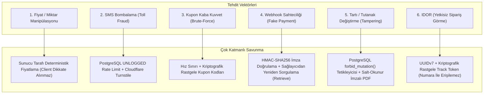

# 27 — Güvenlik Tehdit Modellemesi, Saldırı Vektörleri ve Savunma Matrisi (Threat Model)

> Bu belge; STRIDE ve OWASP ASVS standartlarına dayalı olarak Nutopia E-Ticaret ve Değirmen Platformu'na yönelik olası tüm siber saldırı vektörlerini, saldırganın motivasyonunu ve sistem seviyesindeki somut savunma bariyerlerini içerir.
> Bağlayıcı mimari: `12-mimari-kilit-kararlar.md` (K2, K12, K16, K17, K18).

---

## 1. STRIDE TEHDİT MODELİ VE SAVUNMA MEKANİZMALARI

---

## 2. DETAYLI SALDIRI SENARYOLARI VE TEKNİK ÖNLEMLER

### 2.1 İstemci Tarafı Fiyat Manipülasyonu (Tampering / Fiddler / DevTools)
- **Saldırı Senaryosu:** Kötü niyetli bir kullanıcı tarayıcı konsolundan veya bir proxy (Burp Suite) kullanarak `POST /v1/checkout/orders` isteğinde `itemsGrossKurus: 16500` değerini `100` (1 TL) yaparak sipariş oluşturmaya çalışır.
- **Savunma Mekanizması:**
  - İstemciden gelen hiçbir fiyat verisi API tarafından okunmaz veya kabul edilmez.
  - İstemci yalnızca `{ variantId, qty }` çiftini gönderir.
  - Sunucu `shop.variants` tablosundaki güncel `price_kurus` değerini okur, satır toplamını ve KDV'yi veritabanında hesaplar.
  - Toplam tutar eşleşmiyorsa işlem `400 Bad Request` ile reddedilir.

### 2.2 SMS Ağ Geçidi Kötüye Kullanımı (SMS Toll Fraud / Bombalama)
- **Saldırı Senaryosu:** Saldırgan botlar yazarak `POST /v1/auth/otp/request` uç noktasına rastgele telefon numaraları ile binlerce istek atarak işletmeye yüksek SMS faturası çıkarmak veya servisi tıkamak ister.
- **Savunma Mekanizması:**
  - **Katman 1 (Cloudflare WAF):** Bilinen bot IP'leri ve şüpheli user-agent'lar engellenir.
  - **Katman 2 (Cloudflare Turnstile CAPTCHA):** Aynı IP'den 3'ten fazla başarısız veya hızlı istek gelirse şeffaf CAPTCHA doğrulaması zorunlu tutulur.
  - **Katman 3 (Uygulama İçi Hız Sınırı - K12):**
    - IP başına: Dakikada en fazla 5 istek.
    - Telefon numarası başına: Saatte en fazla 5 OTP isteği (`core.settings.otp.per_phone_per_hour`).
    - Başarısız 5 denemede kod otomatik iptal edilir (`superseded_at`).

### 2.3 Sahte Ödeme Webhook'u İletimi (Elevation of Privilege)
- **Saldırı Senaryosu:** Saldırgan, sunucu IP'sini veya alan adını keşfedip doğrudan `POST /v1/webhooks/iyzico` adresine sahte bir `{"status": "SUCCESS", "conversationId": "..."}` JSON paketi göndererek siparişi bedava onaylatmaya çalışır.
- **Savunma Mekanizması:**
  - **Çift Doğrulama İlkesi:**
    1. **HMAC İmza Kontrolü:** İstek başlığındaki `X-IYZICO-SIGNATURE`, sunucudaki gizli anahtar (`secret_key`) ile doğrulanır. İmzasız veya yanlış imzalı istekler veritabanına dokunmadan `400 Bad Request` döner.
    2. **Ters Sorgu (Two-Way Verification):** İmza geçerli olsa bile sunucu webhook verisine doğrudan güvenmez; iyzico API'sini bizzat arayarak (`payment.retrieve(paymentId)`) ödemenin gerçekten kendi hesabına geçip geçmediğini doğrular.

### 2.4 Yetkisiz Veri Erişimi (IDOR - Insecure Direct Object References)
- **Saldırı Senaryosu:** Bir kullanıcı sipariş detayını `/siparis/142` olarak tahmin edip rakamı `/siparis/143` yaparak başka bir müşterinin adını, adresini ve telefonunu görmeye çalışır.
- **Savunma Mekanizması:**
  - Sıralı sayısal ID'ler URL'de asla kullanılmaz (`NT-2026-000142` yalnızca faturada yazan metindir).
  - Sipariş takip linkleri kriptografik olarak rastgele üretilen ve SHA-256 özeti veritabanında saklanan **gizli jetonlarla** açılır (`/siparis/trk_8f9a2b7c4d1e`).
  - Tahmin edilmesi matematiksel olarak imkansızdır.

### 2.5 Tartı Tutanaklarının Sonradan Değiştirilmesi (Repudiation / Veri Tahrifatı)
- **Saldırı Senaryosu:** Kötü niyetli bir personel veya saldırgan, veritabanına girip çiftçiden alınan fındık miktarını `203 kg`'dan `150 kg`'a düşürmek ister.
- **Savunma Mekanizması:**
  - `mill.weighings` tablosuna `core.forbid_mutation()` tetikleyicisi tanımlıdır. Bu tabloda `UPDATE` ve `DELETE` sorguları PostgreSQL motoru seviyesinde yasaklanmıştır (SQL çalıştırılsa bile DB hata fırlatır).
  - Düzeltme gerekiyorsa yeni bir tartı satırı girilir ve önceki tartı `supersedes_id` ile referans verilerek tarihçe korunur.
  - Tutanak oluşturulduğu an PDF belgesinin SHA-256 hash'i `core.documents` tablosuna kilitlenir.

---

## 3. PERSONEL YETKİ KONTROLÜ (LEAST PRIVILEGE)

| İşlem | Paketleme Personeli | Şoför | Destek | Yönetici (Manager) | İşletme Sahibi (Owner) |
|---|---|---|---|---|---|
| Siparişleri Görme | Yalnız Hazırlanacaklar | Hayır | Evet | Evet | Evet |
| Sipariş İptali / İade | Hayır | Hayır | Hayır | 2.500 ₺'ye kadar | Sınırsız |
| Fiyat Listesi Değiştirme | Hayır | Hayır | Hayır | Evet | Evet |
| Müşteri Telefon/Adres Maskesiz Görme | Hayır | Yalnız Kendi Rotaları | Evet | Evet | Evet |
| Personel Ekleme / Silme | Hayır | Hayır | Hayır | Hayır | Evet |
| Veritabanı Yedeği Alma / Geri Yükleme | Hayır | Hayır | Hayır | Hayır | Yalnız Sistem / Root |

