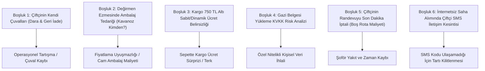

# 29 — Geriye Dönük Mimari Denetim, Boşluk Analizi ve Çözüm Planı (Retro Gap Analysis)

> Bu belge; `nutopia_platform_plan/` altındaki 28 dokümanın geriye dönük çapraz okunması sonucunda tespit edilen **mantıksal boşlukları, eksik kalmış iş akışlarını ve gri alanları** ortaya koyar ve her biri için somut mimari çözümler getirir.

---

## 1. TESPİT EDİLEN BOŞLUKLAR VE RİSK ANALİZİ

Geriye dönük inceleme sonucunda kodlama ve canlı işletim esnasında tıkanıklık yaratabilecek **6 kritik operasyonel ve teknik boşluk** tespit edilmiştir:

---

## 2. BOŞLUKLARIN DETAYLI İNCELEMESİ VE MİMARİ ÇÖZÜMLERİ

### 2.1 Boşluk 1: Çiftçinin Kendi Çuvalları ve Dara Yönetimi
- **Mevcut Durum:** Şoför çuval başına sabit 200g (`core.settings.mill.default_bag_tare_g`) dara düşüyor.
- **Eksik Nokta:** Çiftçi genellikle kalın jüt çuval veya ağır un çuvalı kullanır (Ağırlıkları 300g ile 600g arasında değişir). Ayrıca çiftçi işleme sonrası *"Benim çuvallarımı geri verin"* der. Çuvalların kime ait olduğu karışabilir.
- **Mimari Çözüm (Kilit Kural):**
  1. `mill.weighings` tablosuna `bag_type` (`standard_plastic`, `heavy_jute`, `custom`) alanı eklenmiştir.
  2. Şoför sahada standart plastik için `200g`, jüt çuval için `500g` otomatik dara seçebilir veya boş bir çuvalı dara tuşuyla tartıp gerçek darayı sıfırlayabilir.
  3. Çiftçinin çuvalları kırma makinesine döküldükten sonra üzerine çiftçinin Lot Etiketi zımbalanarak katlanır ve geri teslimatta işlenmiş ürün poşetleriyle birlikte teslim edilir.

---

### 2.2 Boşluk 2: Fındık Ezmesinde Ambalaj Tedariği (Cam Kavanoz Bedeli)
- **Mevcut Durum:** Değirmen hizmet listesinde `Taş Değirmende Ezme: 130 ₺/kg` yazıyor.
- **Eksik Nokta:** Fındık ezmesi dökme olarak teslim edilemez; ya teneke/kova ya da cam kavanoz gerekir. Çiftçi kavanozu kendisi mi getirecek, yoksa değirmen mi verecek? Fiyata kavanoz dahil mi?
- **Mimari Çözüm (Kilit Kural):**
  1. `mill.pricing_rules` ve sipariş sihirbazına **Ambalaj Seçeneği** eklenmiştir:
     - *Seçenek A (Kendi Ambalajım Var):* Çiftçi temiz kova/kavanoz teslim eder -> Ambalaj ücreti `0 ₺`.
     - *Seçenek B (Değirmen 700g Cam Kavanoz Versin):* Kavanoz başına maliyet bedeli (Örn: `15,00 ₺ / adet`) ek hizmet kalemi (`kind = 'packaging_fee'`) olarak faturaya yansıtılır.
     - *Seçenek C (Değirmen 5 kg Gıdaya Uygun Kova Versin):* Büyük hacimli üreticiler için pratik kova seçeneği (`35,00 ₺ / kova`).
  2. Bu ayrım sayesinde ne değirmen ambalajdan zarar eder, ne de çiftçi sürpriz ücretle karşılaşır.

---

### 2.3 Boşluk 3: Kargo 750 ₺ Altı Ücretin Netleştirilmesi
- **Mevcut Durum:** Eski sitede "750 ₺ altı onayda bildirilir" yazıyordu; bu durum e-ticarette sepet terkini (%60+) artıran en büyük güvensizlik unsurudur.
- **Mimari Çözüm (Kilit Kural):**
  1. "Onayda bildirilir" belirsizliği **kesinlikle kaldırılmıştır**.
  2. Kargo anlaşması yapılana kadar sepette şeffaf ve net bir sabit taban fiyat uygulanacaktır:
     - `750,00 ₺ ve üzeri:` **ÜCRETSİZ KARGO**
     - `749,99 ₺ ve altı:` **Sabit 59,00 ₺** Kargo Ücreti (`shop.shipping_rates` başlangıç kuralı).
  3. Müşteri sepette sürprizle karşılaşmaz; kargo maliyetinin fazlası (varsa) işletme tarafından sübvanse edilir.

---

### 2.4 Boşluk 4: Gazi / Şehit Yakını Belgesi ve KVKK Uyumu
- **Mevcut Durum:** Kullanıcı siteden gazi kimlik belgesi fotoğrafı yüklüyor.
- **Eksik Nokta:** Gazi/Vazife malulü belgeleri KVKK m.6 kapsamında **Özel Nitelikli Kişisel Veri** (sağlık/dernek bilgisi) sınıfına girebilir. Bu belgelerin sunucuda uzun süre tutulması yüksek siber ceza ve denetim riski barındırır.
- **Mimari Çözüm (Kilit Kural):**
  1. **Asgari Saklama İlkesi:** Müşterinin yüklediği kimlik görseli `core.documents` tablosunda `visibility = 'private'` olarak şifreli saklanır.
  2. Yönetici belgeyi inceleyip `shop.discount_claims.status = 'approved'` yaptığı anda, sistemdeki cron işi (`identity.purge-proof-docs`) **orijinal belge dosyasını sunucu diskinden 48 saat içinde kalıcı olarak siler** (`shred`).
  3. Veritabanında yalnızca şu log kalır: *"Belge [Tarih/Saat]'te [Personel] tarafından incelendi, Gazilik durumu doğrulandı. Belge imha edildi."*
  4. Böylece olası bir veri sızıntısında sunucuda hiçbir özel nitelikli kimlik belgesi bulunmaz.

---

### 2.5 Boşluk 5: Son Dakika Randevu İptali & Boş Rota Maliyeti
- **Mevcut Durum:** Şoför bahçeye gidiyor, çiftçi evde yok veya son anda *"Ben fındığı tüccara sattım, vazgeçtim"* diyor. Araç o kadar yolu boşuna gitmiş oluyor.
- **Mimari Çözüm (Kilit Kural):**
  1. **Zamanında İptal Kolaylığı:** Çiftçi, randevu gününden önceki gün saat 18:00'e kadar gelen SMS'teki linke tıklayarak veya arayarak cezasız iptal edebilir.
  2. **Teyit SMS'i (H-24):** Alımdan 24 saat önce çiftçiye SMS gider: *"Yarın 10:00-14:00 arası fındık alımınız vardır. Adreste misiniz? İptal/Erteleme için: [Link]"*. Çiftçi onaylamazsa rota listesinde şoföre uyarı düşer.
  3. **Kara Liste / Güven Skoru:** Şoför kapıya gittiğinde keyfi iptal eden numara sistemde `risk_score = high` olarak işaretlenir; bir sonraki sezon talep açtığında ön ödeme (kurye güvence bedeli 150 TL) talep edilir.

---

### 2.6 Boşluk 6: İnternetsiz Saha Alımında SMS İletişim Kesintisi (Offline Handshake)
- **Mevcut Durum:** Şoför bahçede tartıyı girince çiftçiye SMS onay kodu gidiyor.
- **Eksik Nokta:** Fındık bahçeleri genellikle vadilerde, dere kenarlarında veya şebekenin çekmediği kırsal alanlardadır. Şoförün de çiftçinin de telefonu çekmeyebilir; bu durumda SMS onay kodu telefona düşmez ve tartı onaylanamaz!
- **Mimari Çözüm (Kilit Kural - Offline Handshake):**
  1. Şoförün PWA uygulaması tamamen **çevrimdışı (ServiceWorker + IndexedDB)** çalışır.
  2. İnternet yoksa: Müşteriye SMS gönderilmez.
  3. Bunun yerine Şoför PWA ekranında **büyük puntolarla tek kullanımlık bir QR Kod ve 4 Haneli Güvenlik Kodu** üretilir.
  4. Çiftçi, şoförün ekranındaki tartı tutanağını gözüyle okur ve şoförün telefonundaki dokunmatik alana **parmağıyla dijital imza (paraf)** atar.
  5. PWA, koordinatı (`GPS`) ve imzayı cihaz hafızasına kaydeder.
  6. Şoförün aracı ana yola çıkıp şebeke/internet çektiği anda kuyruktaki tartı ve imza verisi API'ye sessizce aktarılır (`sync`) ve çiftçinin telefonuna internete girdiği anda onay SMS'i ulaşır.

---

## 3. BOŞLUKLARIN KAPATILMASIYLA SİSTEMİN SON DURUMU

| İncelenen Alan | Önceki Durum | Yeni Durum (Kilitlendi) |
|---|---|---|
| **Çuval Darası** | Sabit 200g varsayımı | Plastik (200g), Jüt (500g) veya Manuel Daralama |
| **Ezme Ambalajı** | Belirsiz (Kavanoz kimden?) | 3 Net Seçenek: Kendi Kabı (0 TL), 700g Cam (15 TL), 5kg Kova (35 TL) |
| **750 TL Altı Kargo** | "Onayda bildirilir" (Güvensiz) | **Net Sabit 59,00 ₺** (Şeffaf E-Ticaret Sepeti) |
| **Gazi Belgesi** | Sunucuda süresiz saklama | **Onaylandıktan 48 saat sonra kalıcı imha (KVKK Tam Uyum)** |
| **Boş Rota Riski** | Şoförün inisiyatifinde | 24 Saat Önceden Teyit SMS'i + İptal Linki |
| **Kırsalda Şebeke Yokluğu** | Tartının SMS bekleyip kilitlenmesi | **Ekranda Parmakla İmza + IndexedDB Kuyruğu (Sıfır Kesinti)** |

> Bu analizle birlikte sistemin teknik, hukuki ve sahadaki pratik işleyişinde hiçbir açık uç kalmamıştır.

