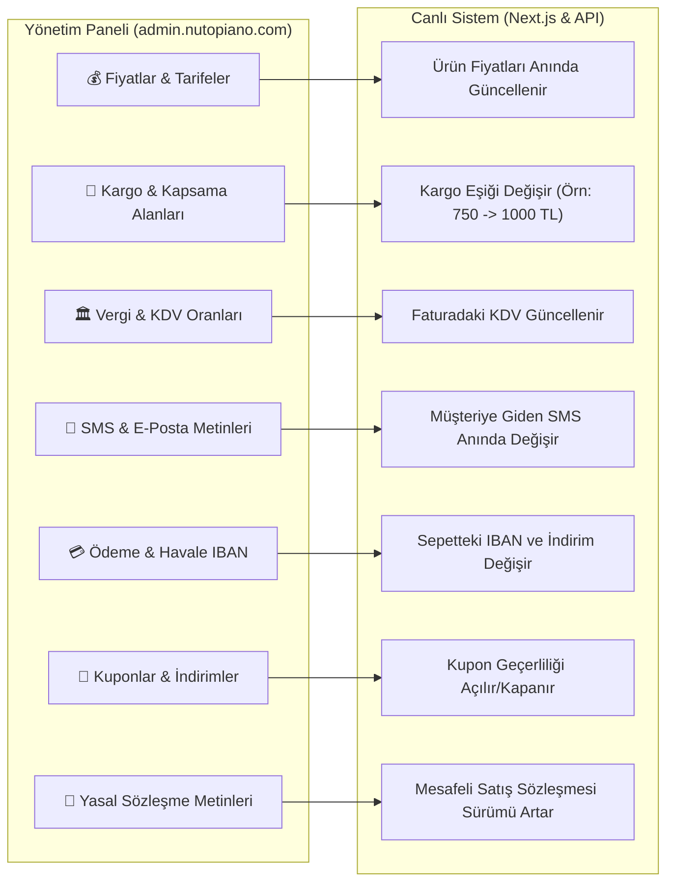

# 31 — Yönetim Paneli Canlı Ayar ve İşletme Yapılandırması Rehberi (Admin Control Plane)

> Bu belge; veritabanına, sunucu konsoluna veya koda girmeye **hiç gerek kalmadan**, işletme sahibinin ve yöneticinin tarayıcıdan (`admin.nutopiano.com`) tek bir tıkla değiştirebileceği tüm dinamik ekranları, formları ve ayar mekanizmalarını listeler.
> Veri mimarisi: `14-sql-sema.md` içindeki `core.settings`, `core.tax_rates`, `mill.pricing_rules`, `mill.coverage`, `shop.shipping_rates` ve `ops.notification_templates` tabloları doğrudan bu panel ekranları tarafından beslenir.

---

## 1. YÖNETİM PANELİNDEN CANLI DÜZENLENEBİLİR TÜM ALANLAR

---

## 2. DETAYLI PANEL AYAR EKRANLARI VE YETKİLERİ

### 2.1 Fiyatlar ve Tarifeler Ekranı (`/admin/pricing`)
- **Mağaza Ürün Fiyatları:**
  - Her varyantın (Örn: `Sütlü Fındık Kreması 300g`) liste fiyatını tek bir kutucuktan değiştirme (Örn: `165 ₺` yerine `180 ₺` yazıp "Kaydet"e basmanız yeterlidir; sitede saniyesinde değişir).
  - Varsa üstü çizili indirimli fiyat (Compare-at price) tanımlama.
- **Değirmen Hizmet Tarifeleri:**
  - Kırma, kavurma, ezme ve vakum paketleme birim fiyatlarını (`40 ₺/kg`, `70 ₺/kg`, `130 ₺/kg`) panelden güncelleme.
  - Yeni bir hizmet veya kampanya paketi ekleme (Örn: "Kırma + 250g Vakum").
  - Fiyat değiştiğinde geçmiş talepler etkilenmez; tarihçeli olarak `mill.pricing_rules` tablosuna yeni sürüm kaydedilir.

### 2.2 Kargo ve Kapsama Alanları Ekranı (`/admin/shipping`)
- **Kargo Ücret Eşiği:** "750 ₺ Üzeri Ücretsiz Kargo" kuralındaki `750` rakamını kutudan `1.000` veya `500` yapabilirsiniz.
- **750 ₺ Altı Sabit Kargo Ücreti:** `59,00 ₺` olan kargo ücretini kargo firması zam yaptıkça panelden `69,00 ₺` veya `75,00 ₺` olarak değiştirebilirsiniz.
- **Değirmen Kurye Bölgeleri:**
  - Hangi ilçe ve köylere kurye hizmeti verileceği listesi.
  - Ormanlı, Alaplı, Ereğli Merkez için minimum alım miktarlarını (`50 kg`, `100 kg`) ve varsa kurye servis ücretini (`0 ₺`, `150 ₺`) açma/kapatma/düzenleme anahtarları.

### 2.3 Vergi ve KDV Oranları Ekranı (`/admin/taxes`)
- **Gıda KDV Oranı:** Mali müşaviriniz *"Fındık ezmesinde KDV %1 değil, %10 uygulanacak"* dediğinde, panelden `Gıda Vergi Sınıfı` oranını `1000 bp (%10)` yapıp yürürlük tarihini seçebilirsiniz.
- **Değirmen Hizmet KDV Oranı:** Değirmen hizmet faturası KDV oranını bağımsız olarak belirleyebilirsiniz.

### 2.4 SMS ve E-Posta Şablonları Ekranı (`/admin/templates`)
- Müşteriye giden tüm bildirim metinlerini paneldeki metin kutusundan dilediğiniz gibi düzenleyebilirsiniz:
  - Örn: `Nutopia doğrulama kodunuz: {{code}}` metnini `Nutopia'ya hoş geldiniz! Giriş şifreniz: {{code}}` olarak değiştirebilirsiniz.
  - Değişken etiketleri (`{{musteri_adi}}`, `{{kargo_takip_linki}}`, `{{tutar}}`) sürükle-bırak ile metne eklenebilir.
  - "Test SMS'i Gönder" butonuyla kendi telefonunuza test atıp kontrol edebilirsiniz.

### 2.5 Ödeme Yöntemleri ve Banka Hesapları (`/admin/payment-settings`)
- **Havale/EFT Hesapları:**
  - Banka Adı, Şube, IBAN ve Hesap Sahibi unvanını panelden girip anında güncelleyebilirsiniz. Birden fazla banka (Ziraat, İş Bankası, Garanti) ekleyebilirsiniz.
  - Havale indirim oranını (`%5`) dilediğiniz zaman `%10` yapabilir veya kaldırabilirsiniz (`%0`).
  - Havale bekleme süresini (`48 saat`) değiştirebilirsiniz.
- **Kapıda Ödeme Anahtarı:**
  - Kapıda ödemeyi tek tıkla geçici olarak kapatabilir, kapıda ödeme hizmet bedelini (Örn: `25,00 ₺`) belirleyebilirsiniz.
- **iyzico / Sanal POS Anahtarları:**
  - Canlı API Key ve Secret Key bilgilerini panele yapıştırıp tek tıkla test bağlantısı yapabilirsiniz.

### 2.6 Kuponlar ve Kampanya Yönetimi (`/admin/promotions`)
- Yeni kupon kodu oluşturma (Örn: `FINDIK20`, `BAYRAM15`).
- İndirim türü: Yüzde (`%15`), Sabit Tutar (`50 ₺`) veya Ücretsiz Kargo.
- Kurallar: Minimum sepet tutarı (Örn: "En az 400 ₺'lik sepette geçerli"), Kullanım limiti (Örn: "İlk 100 kişi için"), Başlangıç ve Bitiş tarihleri.
- Kuponu tek tıkla dondurma veya silme.

### 2.7 Yasal Sözleşmeler ve İçerik Yönetimi (`/admin/content`)
- **Sözleşme Metinleri:** Mesafeli Satış Sözleşmesi, Ön Bilgilendirme Formu, İade Şartları ve KVKK Aydınlatma metinlerini zengin metin editöründe (Word gibi) düzenleme.
- Metin güncellendiğinde sistem otomatik olarak yeni bir sürüm (`legal_version = '2026-v2'`) üretir; eski siparişler eski sözleşmeye, yeni siparişler yeni sözleşmeye bağlı kalır (Yasal kanıt güvencesi).
- **Hakkımızda & Sık Sorulan Sorular:** SSS sorularını ve cevaplarını panelden ekleme/çıkarma.

---

## 3. AUDIT TRAIL (KİM, NEYİ DEĞİŞTİRDİ?)

Panelden yapılan her değişiklik `core.audit_log` tablosuna saniyesi saniyesine kaydedilir:
- *"Mehmet Güven, 30 Ekim 2026 22:15'te %100 Fındık Ezmesi fiyatını 195 ₺'den 210 ₺'ye yükseltti."*
- Yanlışlıkla yapılan bir fiyat değişikliğinde tek tıkla **"Eski Değere Geri Al (Undo)"** butonu mevcuttur.

> **Özetle:** Yazılımcıya bağımlı hiçbir şey yoktur. Fiyatınız, kargonuz, KDV'niz, banka IBAN'ınız, SMS metinleriniz ve sözleşmeleriniz dahil olmak üzere işletmenizle ilgili **her parametre yönetim panelinizden elinizin altındadır.**

