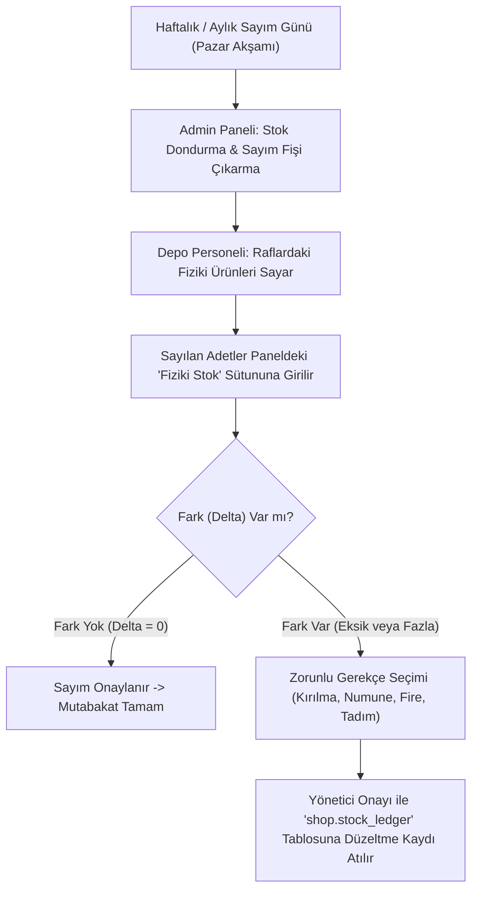

# 32 — Satış Sonrası Hizmetler, Depo Stok Sayımı ve Muhasebe Mutabakat Kılavuzu

> Bu belge; canlıya çıkışın ardından işletmenin günlük, haftalık ve dönem sonu operasyonlarında ihtiyaç duyacağı **fiziki stok sayım prosedürlerini**, **kargo desisi/fatura uyuşmazlığı çözümlerini**, **müşteri geri bildirim/yıldız puanlama moderasyonunu** ve **mali müşavir ile aylık KDV/satış mutabakatı** süreçlerini adım adım belirler.

---

## 1. DÖNEMSEL FİZİKİ STOK SAYIMI VE AMBAR MUTABAKATI

Platformdaki `shop.stock_levels` (sanal stok) ile Ormanlı deposundaki raflarda duran fiziki kavanoz/paketlerin eşleşmesi için uygulanacak prosedür:



### 1.1 Sayım Sırasında Uyulacak Kurallar
1. **Zamanlama:** Sayım, kargo sevkiyatlarının bittiği Pazar akşamları saat 19:00'dan sonra yapılır.
2. **Kırılma & Tadım Zayiatları:** Değirmene gelen ziyaretçilere ikram edilen veya rafta kaza ile kırılan kavanozlar gün içinde hemen çöpe atılamaz; barkodu admin paneli `/admin/inventory/adjust` ekranından okutularak gerekçe olarak `shrinkage (zayiat/tadım)` seçilip stoktan resmi olarak düşülür.
3. **Defter Değişmezliği:** Veritabanındaki `on_hand` sayısı doğrudan elle üzerine yazılarak değiştirilemez; arka planda mutlaka bir `delta` hareketi (`stock_ledger`) oluşmak zorundadır (Denetim izi güvencesi).

---

## 2. KARGO DESİ VE FATURA MUTABAKATI (DESİ AŞIMI KONTROLÜ)

Kargo firmaları ay sonunda işletmeye kargo faturası keserken desi ölçümlerini kendi otomatik hacim bantlarından geçirir. Zaman zaman 1 desilik bir kavanoz transfer merkezinde yanlışlıkla 3 desi olarak faturalandırılabilir.

### 2.1 Çapraz Kontrol Mekanizması
- Sistemde her varyantın ambalaj dahil kargo ağırlığı gram cinsinden (`ship_weight_g`) kayıtlıdır (Örn: Sütlü Fındık Kreması 300g = 520g / 1 Desi).
- Kargo firmasının ay başında gönderdiği Excel fatura dökümü admin panelindeki `/admin/shipping/reconcile` ekranına yüklenir.
- Sistem; sistemdeki sipariş desi/ağırlığı ile kargo firmasının fatura ettiği desiyi takip numarası (`tracking_no`) üzerinden satır satır kıyaslar:
  - **Uyumlu:** Yeşil işaretlenir.
  - **Hatalı Desi (Aşım):** Kırmızı işaretlenir (Örn: *Sipariş NT-104: Sistem 1 Desi - Kargo Faturası 4 Desi*).
- Panel tek tıkla **"Kargo İtiraz ve İade Tablosu"** üretir; bu liste kargo şubesine iletilerek haksız fatura bedelleri cari hesaptan düşürülür.

---

## 3. MÜŞTERİ YORUM VE DEĞERLENDİRME POLİTİKASI (REVIEWS MODERATION)

Platformda güveni en üst düzeye çıkaran ancak manipülasyona ve rakip karalamasına kapalı yorum mekanizması:

### 3.1 Yorum Kuralları
1. **Yalnızca Doğrulanmış Alıcılar:** Ürünü gerçekten satın alıp teslim almış (`orders.status = 'delivered'`) müşteriler dışındaki kimse yorum yazamaz veya puan veremez (`shop.reviews.order_item_id UNIQUE`).
2. **Yorum Daveti:** Sipariş teslim edildikten 5 gün sonra (müşterinin ürünü tatmasına fırsat tanınarak) müşteriye SMS/E-posta ile tek tıkla yorum yapabileceği özel bir bağlantı iletilir.
3. **Admin Onay Akışı (Moderasyon):**
   - Yapılan her yorum `/admin/reviews` ekranına `pending` olarak düşer.
   - Hakaret, argo veya rakip marka reklamı içermeyen tüm olumlu ve yapıcı olumsuz yorumlar yayınlanır.
   - Müşteri 1 veya 2 yıldız vermişse sistem işletme sahibine anında uyarı atar; müşteri temsilcisi yorumu yayına almadan önce müşteriyi arayarak telafi desteği sunar (Müşteri memnun edilirse puanını güncelleyebilir).

---

## 4. AYLIK MALİ MÜŞAVİR VE VERGİ MUTABAKAT PAKETİ

Her ayın 1'inde mali müşavirinizin muhasebe programına (Luca, Zirve, Mikro vb.) tek seferde aktarabileceği hazır finansal paket:

```
Admin Paneli -> Raporlar -> Aylık Muhasebe Paketi (İndir: ZIP)
  ├── 1_Satislar_KDV_Ayrimli.xlsx (Her satırda: Fatura No, Tarih, Vergi No, Matrah, KDV %1, KDV %10, Toplam)
  ├── 2_Iadeler_ve_Gider_Pusulalari.xlsx (İptal ve iade edilen faturaların dökümü)
  ├── 3_iyzico_Banka_Mutabakati.xlsx (Sanal POS komisyon kesintileri ve net hesaba geçen tutarlar)
  ├── 4_Kargo_Gider_Ozeti.xlsx (Kargo firmasına ödenen sevkiyat maliyetleri)
  └── 5_Degirmen_Hizmet_Hasilati.xlsx (Çiftçilere kesilen hizmet faturaları dökümü)
```

- Bu raporlar `reporting` şemasındaki güvenli görünümlerden (`views`) otomatik derlenir.
- Muhasebeciniz hiçbir zaman *"Şu günün ekstresi nerede, bu faturanın KDV'si neydi"* diye sormaz; her aybaşında bu paketi indirip doğrudan resmi beyannamesine işleyebilir.

