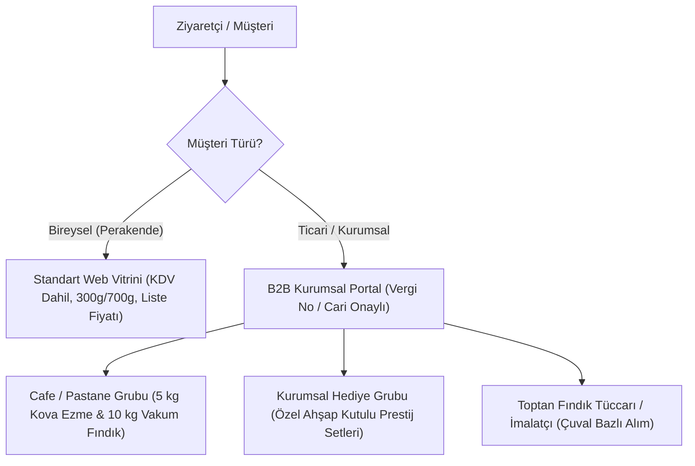

# 34 — Kurumsal Satış, Toptan Sipariş ve Fındık B2B Teklif Modülü (B2B Engine)

> Bu belge; pastaneler, oteller, kafeler, kurumsal hediye kutusu alıcıları ve toptan fındık/ezme siparişi vermek isteyen ticari müşteriler için tasarlanan **B2B Teklif ve Toptan Sipariş** mekanizmasını belirler.
> Veri mimarisi: `14-sql-sema.md` içindeki `shop.customer_groups`, `shop.price_lists` ve `shop.price_list_items` tabloları bu modülün motorudur.

---

## 1. B2B TOPTAN MÜŞTERİ SEGMENTASYONU

| Müşteri Grubu (`customer_groups`) | Tipik Alım | Özel İndirim / Fiyat Kuralı | Ödeme & Vade |
|---|---|---|---|
| **Bireysel (Standart)** | 1 - 3 Kavanoz | Standart Liste Fiyatı | Kredi Kartı / Havale / Kapıda |
| **Cafe & Pastane (`horeca`)** | 5kg Kova Ezme, 5kg Krokan | Toptan Liste Fiyatı (Liste fiyatından %25 indirimli) | Havale / 30 Gün Cari Vade |
| **Kurumsal Hediye (`corporate_gift`)** | 50 - 500 Adet Özel Kutu | Kademeli İndirim (Adet arttıkça birim fiyat düşer) | %50 Peşin, %50 Teslimatta |
| **İmalatçı & Sanayi (`bulk_raw`)** | 500 kg+ Çuval Fındık | Borsa / Serbest Piyasa Günlük Fiyatı | Peşin / Teminat Mektubu |

---

## 2. B2B SİPARİŞ VE FİYATLANDIRMA KURALLARI

1. **Giriş Yapılmadan Toptan Fiyat Gizliliği:**
   - Standart ziyaretçi siteye girdiğinde perakende fiyatları görür (`165 ₺`).
   - Vergi levhası onaylanmış bir B2B müşterisi telefon OTP'si ile giriş yaptığında, `shop.price_lists` tablosu devreye girer; ürün kartlarındaki fiyatlar otomatik olarak toptan fiyata (`125 ₺ + KDV`) dönüşür.
2. **Kademeli Fiyat İndirimi (Volume Tiers):**
   - Panelden tanımlanan kademeli fiyat tablosu sepette otomatik uygulanır:
     - 1 - 9 Adet: `165,00 ₺`
     - 10 - 49 Adet: `140,00 ₺` (%15 indirim)
     - 50+ Adet: `120,00 ₺` (%27 indirim)
3. **Minimum Sipariş Tutarı (MOQ - Minimum Order Quantity):**
   - B2B portalında toptan fiyatlardan faydalanabilmek için sepet minimum tutarı `5.000,00 ₺` olarak kilitlenir.

---

## 3. KURUMSAL HEDİYE TEKLİF SİHİRBAZI (`/kurumsal-teklif`)

Yılbaşı, bayram veya şirket etkinliklerinde 100-500 adet hediye kutusu almak isteyen kurumsal firmalar için interaktif web formu:

### 3.1 Teklif Formu Adımları
1. **Kutu Tipi Seçimi:**
   - *Seçenek A:* Ahşap Sandıklı Gurme Seti (1 Kavanoz Sütlü, 1 Kavanoz Ezme, 250g Krokan, 250g Kavrulmuş Fındık).
   - *Seçenek B:* Prestij Deri Kutu (2 Kavanoz Ezme + 500g Çifte Kavrulmuş Fındık).
   - *Seçenek C:* Özel Baskılı Karton Kraft Çanta.
2. **Kişiselleştirme (Branding):**
   - `[X] Ahşap kapağa firma logomuz lazerle kazınsın (+15 TL/kutu)`.
   - `[X] Kutu içine özel tebrik/hediye kartımız basılsın (+5 TL/kutu)`.
3. **Miktar ve Teslim Tarihi:**
   - Adet: `150 Adet`.
   - İstenen Teslim Tarihi: `15 Aralık 2026`.
4. **Firma Bilgileri & Anında Proforma PDF:**
   - Şirket Unvanı, Vergi No, İrtibat Kişisi, E-posta, Telefon.
   - Form gönderildiği anda sistem `ops.invoices` motoru üzerinden saniyeler içinde **Resmi Kaşeli Proforma Fatura & Teklif PDF'i** üretip firmanın e-postasına iletir ve satış yöneticisinin paneline alarm düşürür.

---

## 4. TİCARİ CARİ HESAP VE VADELİ SATIŞ YÖNETİMİ

Düzenli olarak haftalık 50 kg fındık ezmesi alan yerel pastaneler ve kafeler için vadeli cari hesap kuralları:
- **Kredi Limiti (`credit_limit_kurus`):** Yönetici pastaneye panelden `25.000,00 ₺` kredi limiti ve `30 Gün` vade tanımlar.
- **Sipariş Oluşturma:** Pastane sipariş verirken ödeme yöntemi olarak `Cari Hesaba Yaz (Veresiye)` seçer.
- **Limit Kontrolü:** Kalan bakiye sipariş tutarını karşılıyorsa sipariş hemen onaylanır; limit aşılıyorsa sistem siparişi durdurur ve ödeme talep eder.
- **Ekstre & Hatırlatma:** Vade tarihine 3 gün kala pastane yetkilisine otomatik hesap ekstresi ve ödeme hatırlatma SMS/E-postası gider.

