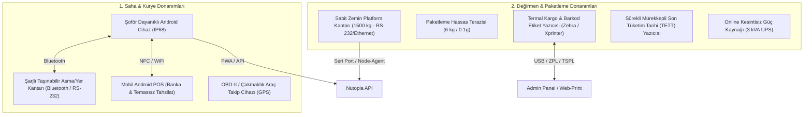

# 35 — Fiziksel Donanım, Cihaz Entegrasyonları ve Çevre Birimleri Şartnamesi (Hardware & Peripherals)

> Bu belge; Ormanlı değirmen tesisinde ve kurye aracında kullanılacak tüm **fiziki donanımların (kantar, barkod yazıcı, el terminali, araç takip, mobil POS)** marka/model tavsiyelerini, bağlantı protokollerini (COM, USB, Bluetooth, IP) ve yazılımla haberleşme mimarisini belirler.
> Amaç: Saha personeli ve paketleme ekibinin donanım uyumsuzluğu nedeniyle manuel iş yükü altında ezilmesini önlemek.

---

## 1. DONANIM MİMARİSİ VE BAĞLANTI PROTOKOLLERİ



---

## 2. DONANIM LİSTESİ, MODEL TAVSİYELERİ VE PROTOKOLLER

### 2.1 Saha Terazisi (Şoför Kantarı)
- **Kullanım Yeri:** Fındık bahçesinde çuvalların araç yanına indirilip tartılması.
- **Tavsiye Edilen Tip:** **Şarjlı Vinç / Asma Kantar (Crane Scale) veya Katlanabilir Alüminyum Zemin Baskülü.**
- **Teknik Özellikler:**
  - Kapasite: En az **300 kg - 500 kg**.
  - Hassasiyet: `50 g` veya `100 g`.
  - Gövde: Döküm alüminyum, darbelere ve çamura dayanıklı.
  - Pil: En az 40 saat kesintisiz çalışan dahili lityum akü.
  - Haberleşme (Opsiyonel): Bluetooth veya dahili LED kantar ekranı (Kantar fişi/ekranı şoför telefonuyla fotoğraflanır).
  - Yasal Uygunluk: Sanayi ve Teknoloji Bakanlığı mühürlü / CE belgeli.

### 2.2 Termal Kargo ve Barkod Etiket Yazıcısı (Depo & Paketleme)
- **Kullanım Yeri:** Kargo kolilerine barkod yapıştırma ve değirmendeki çuvallara Lot Etiketi basma.
- **Tavsiye Edilen Modeller:** **Xprinter XP-470B** veya **Zebra ZD220 / ZD230 (Direkt Termal - 108mm)**.
- **Protokol & Baskı Formatı:**
  - Kağıt Ölçüsü: `100 x 150 mm` (Kargo etiketi standardı) ve `80 x 50 mm` (Çuval Lot etiketi).
  - Bağlantı: USB + Ethernet (LAN üzerinden ağdaki tüm bilgisayarlar etiket basabilir).
  - Sürücü / Yazılım: Admin paneli üzerinden tek tıkla doğrudan PDF kargo fişi dökümü (Web-to-Print / Raw Print).

### 2.3 Mürekkepli Tarih ve Parti Kodlama Yazıcısı (TETT Inkjet)
- **Kullanım Yeri:** Vakumlu poşetlerin ve cam kavanoz kapaklarının üzerine Üretim Tarihi, Tavsiye Edilen Tüketim Tarihi (TETT) ve Parti No basımı.
- **Tavsiye Edilen Tip:** **El Tipi Taşınabilir Termal Inkjet Kodlama Cihazı (Handheld TIJ Printer - 12.7mm)**.
- **Baskı Formatı:**
  ```
  ÜRT : 15.10.2026
  TETT: 15.10.2027
  PARTİ: L26-000142
  TR-67-K-XXXXXX
  ```
- Mürekkep: Hızlı kuruyan solvent bazlı siyah kartuş (Cam, plastik ve vakum poşeti üzerinde dağılmaz).

### 2.4 Tesis Zemin Kantarı (Kabul & Doğrulama Terazisi)
- **Kullanım Yeri:** Değirmen girişinde gelen çuvalların palet veya toplu olarak indirilip ikinci tartımının yapılması.
- **Teknik Özellikler:**
  - Ölçü: `120 x 120 cm` veya `150 x 150 cm` Çelik Baklavalı Sac Platform.
  - Kapasite: **1.500 kg (1.5 Ton)**.
  - Hassasiyet: `200 g` veya `500 g`.
  - Gösterge (İndikatör): RS-232 seri port çıkışlı, paslanmaz çelik dijital gösterge.

---

## 3. ARAÇ TAKİP VE YAKIT VERİMLİLİĞİ (TELEMATICS)

- **Cihaz Türü:** OBD-II portuna takılan veya aküye bağlanan bağımsız **GPS / 4G Araç Takip Ünitesi** (Teltonika / Arvento benzeri).
- **İşlevler:**
  - Aracın o an hangi köyde veya yolda olduğunun anlık izlenmesi.
  - Bahçe durağına ulaştığında otomatik "Vardı" sinyali (Geofencing).
  - Günlük kilometre ve ortalama yakıt tüketim hesabı (Alım başına düşen gerçek kurye lojistik maliyeti analizi için).

