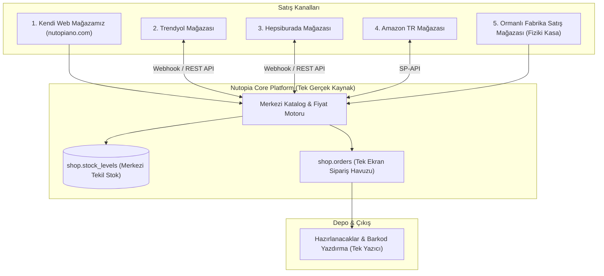

# 36 — Pazaryeri Entegrasyonları (Trendyol/Hepsiburada/Amazon) ve Çoklu Kanal Mimarisi (Marketplace Sync)

> Bu belge; Nutopiano ürünlerinin ilerleyen aşamalarda Trendyol, Hepsiburada ve Amazon Türkiye gibi pazaryerlerinde satışa açılması durumunda ana mimarinin nasıl davranacağını, **stokların tek merkezden anlık nasıl kilitleneceğini** ve siparişlerin tek ekranda nasıl toplanacağını belirler.
> Veri mimarisi: `14-sql-sema.md` içindeki `shop.orders.channel` ve `shop.carts.channel` alanları bu çoklu kanal omurgasını baştan destekleyecek şekilde tasarlanmıştır.

---

## 1. ÇOKLU KANAL (OMNICHANNEL) MİMARİSİ

---

## 2. MERKEZİ STOK KİLİTLEME VE ÇİFT SATIŞI (OVERSOLD) ÖNLEME KURALI

Pazaryeri satışlarında en büyük kriz, kendi web sitenizde son 1 adet kalan fındık ezmesinin aynı dakikada Trendyol'da da satılması ve müşteriye mahcup olunmasıdır (Stoksuz satış cezası).

### 2.1 Çift Satış Engelleme Mekanizması
1. **Tekil Stok Havuzu:** Stok miktarı pazaryerlerinde ayrı ayrı tutulmaz. Tek bir ana merkez vardır: `shop.stock_levels.available`.
2. **Olay Güdümlü Anlık Senkronizasyon (Event-Driven Stock Push):**
   - Kendi sitemizde 1 adet ürün satıldığı anda `core.outbox` tablosuna `StockChanged` olayı düşer.
   - Arka plan işi (`marketplace.sync-inventory`), Trendyol ve Hepsiburada API'lerini saniyeler içinde çağırarak yeni stoğu günceller (`POST /suppliers/.../products/price-and-inventory`).
3. **Pazaryeri Güvenlik Tamponu (Safety Buffer):**
   - Panelden `marketplace_safety_buffer = 2` ayarı açılabilir.
   - Bu ayar açıkken, gerçek stok 2 adedin altına düştüğünde sistem pazaryerlerine stoğu otomatik olarak `0` bildirir; son 2 adet yalnızca kendi web sitemizdeki müşterilerimize rezerve edilir. Böylece ceza riski sıfırlanır.

---

## 3. FİYAT AYRIŞTIRMASI VE KOMİSYON YÖNETİMİ

Pazaryerleri fındık ve gıda kategorisinde **%15 ile %22 arasında komisyon** keser. Bu nedenle kendi sitemizdeki fiyat ile Trendyol fiyatı aynı olamaz.

- **Kanal Bazlı Fiyat Listesi (`shop.price_lists`):**
  - Kendi Sitemiz: `%100 Fındık Ezmesi 320g = 195,00 ₺` (Kargo 750 TL üzerine ücretsiz).
  - Trendyol Fiyatı: `245,00 ₺` (Pazaryeri komisyonu ve kargo baremi fiyata giydirilmiş).
- **Otomatik Fiyat Güncelleme:**
  - Panelden tek tıkla: *"Kendi sitemdeki fiyata %20 ekleyerek tüm pazaryerlerine gönder"* formülü işletilebilir.

---

## 4. TEK MERKEZLİ PAKETLEME VE KARGO ETİKETİ DÖKÜMÜ

- Paketleme personelinin önüne sipariş hangi kanaldan gelirse gelsin (Web, Trendyol veya Hepsiburada) **aynı ekranda** düşer.
- Sipariş satırında kanal logosu görünür (`[Trendyol]`, `[Web]`).
- Personel barkod okutur; yazıcıdan Trendyol kargo barkodu veya sitemizin kargo barkodu otomatik basılır. Personel farklı panellere girmekle vakit kaybetmez.

