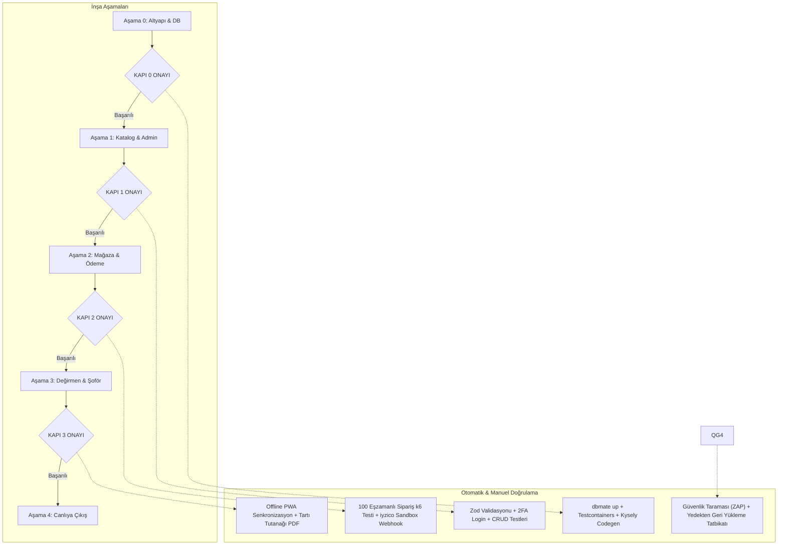

# 38 — Uygulama Yönetişimi, Aşama Doğrulama Kapıları ve Kabul Protokolü (Execution Governance & Verification)

> Bu belge; Nutopia Platformu'nun kodlama ve inşa sürecinin **nasıl icra edileceğini**, geliştiricinin/ekibin **hangi katı mühendislik kurallarına uyacağını** ve her bir aşamanın eksiksiz tamamlandığından **nasıl mutlak emin olunacağını (Kalite Kapıları)** belirleyen Başmimar Denetim Protokolüdür.
> **Temel İlke:** "Çalışıyor gibi görünmesi" yetmez; otomatik testlerle, yük testleriyle ve matematiksel mutabakatla kanıtlanmak zorundadır.

---

## 1. MÜHENDİSLİK İCRA STANDARTLARI (KODLAMA KURALLARI)

Geliştirici (insan veya yapay zeka ajanı) kod yazarken aşağıdaki 8 temel kuralı ihlal edemez (CI/CD boru hattında otomatik kontrol edilir):

1. **Katı Tip Güvenliği (`strict: true`):**
   - TypeScript'te `any` kullanımı kesinlikle yasaktır (`no-explicit-any: error`).
   - Tüm API istek ve yanıtları `packages/contracts` içindeki Zod şemalarından türetilmelidir.
2. **Sıfır ORM Büyüsü & Tamamen Belirgin SQL:**
   - Veritabanı sorgularında Kysely kullanılacaktır. Arka planda gizli `JOIN` veya kontrolsüz `lazy-loading` sorgusu atılamaz.
   - Her yazma işlemi (`INSERT/UPDATE`) mutlaka etkilenen satır sayısını (`ROW_COUNT`) kontrol etmek zorundadır.
3. **Kuruş ve Gram Bütünlüğü:**
   - Kod tabanında `float` veya `double` ile para hesabı yapılamaz. Tüm para değerleri `packages/money` kütüphanesindeki `bigint` fonksiyonlarıyla toplanır, çıkarılır ve bölünür.
   - Yuvarlama kalanları (`remainder`) satır kalemleri arasında kuruş kaybı yaratmayacak deterministik algoritmaya tabidir.
4. **Outbox Deseni Zorunluluğu:**
   - Dış servislere (SMS, iyzico, E-posta) doğrudan HTTP isteği bir transaction içinden atılamaz!
   - Önce veritabanına `core.outbox` kaydı yazılır; transaction başarıyla `COMMIT` edildikten sonra `pg-boss` arka plan işçisi isteği dışarıya fırlatır.
5. **Modül İzolasyonu (`Dependency Cruiser`):**
   - `apps/api/src/modules/mill` klasöründeki bir dosya, `apps/api/src/modules/shop` altındaki bir servisi veya şemayı doğrudan `import` edemez.
   - İhlal durumunda GitHub Actions derlemeyi anında kırar (`Build Failed`).
6. **Erişilebilirlik (Lint & Test):**
   - Vitrin bileşenlerinde `@axe-core/playwright` çalıştırılır; kontrastı 4.5:1'in altında olan veya `alt` etiketi eksik olan hiçbir PR birleştirilemez.
7. **Sıfır Sır (Zero-Secrets in Git):**
   - `gitleaks` aracı her commit öncesi çalışır; kazara `.env` veya API anahtarı depoya itilemez.
8. **Göç İki Aşamalıdır (Expand / Contract):**
   - Canlı veritabanındaki bir sütun aynı anda silinemez veya tipi değiştirilemez. Önce yeni sütun açılır, veri çift yazılır, sonraki sürümde eski sütun kaldırılır.

---

## 2. AŞAMA DOĞRULAMA VE KALİTE KAPILARI (QUALITY GATES)

Her aşamanın sonunda bir sonraki aşamaya geçebilmek için aşağıdaki **"Kalite Kapısı (Gate)"** testlerinden %100 başarıyla geçilmesi zorunludur:

### Kapı 0: Çekirdek Veritabanı ve Altyapı Onayı
- [ ] `dbmate up` komutu temiz bir PostgreSQL 17 üzerinde sıfır hata ile çalıştı mı?
- [ ] 6 şema (`core`, `shop`, `mill`, `payments`, `ops`, `reporting`) eksiksiz oluştu mu?
- [ ] `core.forbid_mutation()` tetikleyicisi test edildi mi? (`stock_ledger` üzerinde `DELETE` denenip veritabanının hata fırlattığı kanıtlandı mı?)
- [ ] `packages/money` kütüphanesinin özellik tabanlı testleri (`fast-check`) 10.000 rastgele kuruş kombinasyonunda 0 kayıp verdi mi?

### Kapı 1: Katalog ve Yönetim Paneli Onayı
- [ ] 7 ana ürün ve tüm varyantlar yönetim panelinden girilebiliyor mu?
- [ ] Görsel yüklendiğinde `sharp` arka planda otomatik WebP/AVIF boyutlarını üretti mi?
- [ ] Panel girişi TOTP 2FA olmadan engelleniyor mu?
- [ ] Personel yetki sınırları çalışıyor mu? (Paketleme personeli sipariş iadesi yapamıyor mu?)

### Kapı 2: E-Ticaret Sepet, Stok ve Ödeme Onayı
- [ ] **Eşzamanlılık (Concurrency) Testi:** Stokta 5 adet ürün varken `k6` aracıyla aynı saniyede 50 kullanıcı sipariş verdiğinde:
  - Yalnızca 5 sipariş başarılı oldu mu?
  - Kalan 45 kullanıcı net bir "Stok Tükendi" hatası aldı mı?
  - Veritabanındaki `available` stoğu kesinlikle `0` mı (negatife düşmedi mi)?
- [ ] iyzico Sandbox kartı ile 3D Secure ödeme tamamlandı mı?
- [ ] Sahte imzalı bir webhook gönderildiğinde sunucunun `400 Bad Request` ile reddettiği test edildi mi?
- [ ] Aynı ödeme bildirimi 2 kez üst üste gönderildiğinde sistemin tek bir sipariş oluşturduğu (idempotency) kanıtlandı mı?

### Kapı 3: Değirmen, Kurye ve Saha Uygulaması Onayı
- [ ] Çiftçi cep telefonundan 3 adımda randevu talebi açabiliyor mu?
- [ ] Şoför mobil cihazında uçak modunu açtığında (İnternetsiz ortam):
  - Tartı verisini girip dijital imza alabiliyor mu?
  - Uçak modu kapatılıp internet geldiğinde veri kayıpsız API'ye aktarıldı mı?
- [ ] Saha kantar tartısı ile tesis giriş tartısı arasında %1'den fazla fark girildiğinde sistemin partiyi bloke ettiği (`anomaly_flag = true`) doğrulandı mı?

### Kapı 4: Canlıya Çıkış (Go-Live) Mutlak Güvence Kapısı
- [ ] **Felaket Kurtarma Tatbikatı:** Sunucudaki veritabanı tamamen silinip `pgBackRest` yedeğinden sıfırdan ayağa kaldırıldı mı? (RTO < 30 dakika kanıtı).
- [ ] **301 Yönlendirme Denetimi:** Eski sitenin tüm sayfaları (`/urunler.html`, `/degirmen.html` vb.) `curl` ile test edilip `HTTP 301` döndürdüğü doğrulandı mı?
- [ ] Google PageSpeed Insights testinde mobil LCP skoru `< 2.5 saniye` mi?
- [ ] Canlı ortamda gerçek kredi kartı ile 10 TL'lik gerçek sipariş + anında iade testi başarıyla geçti mi?

---

## 3. BAŞMİMARIN NİHAİ KABUL PROTOKOLÜ (ACCEPTANCE SIGN-OFF)

Sistemin "Eksiksiz Tamamlandığı" yalnızca şu iki tarafın ortak dijital imzasıyla resmiyet kazanır:

1. **Yazılım Başmimarı:** Tüm otomatik testlerin (%90+ kritik kod kapsamı), güvenlik taramalarının ve yük testlerinin yeşil olduğunu teyit eder.
2. **İşletme Sahibi (Siz):** Şoförün eline telefonu alıp bir çuvalı tarttığını, yönetim panelinden fiyat değiştirebildiğini ve kendi kredi kartıyla bir kavanoz fındık ezmesi siparişi verip paranın hesabına düştüğünü bizzat görerek onaylar.

> Bu yönetişim modeli sayesinde; "yolda gördüğümüz eksiklikler", "sonradan çıkan uyumsuzluklar" veya "unutulmuş detaylar" geliştirme sürecine asla sızamaz. İnşaatın her tuğlası bu standartlara göre kontrol edilerek örülecektir.

